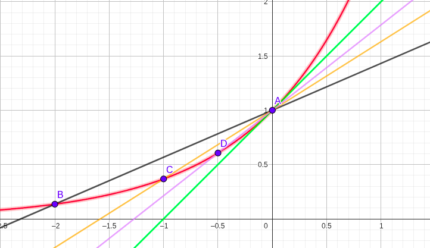
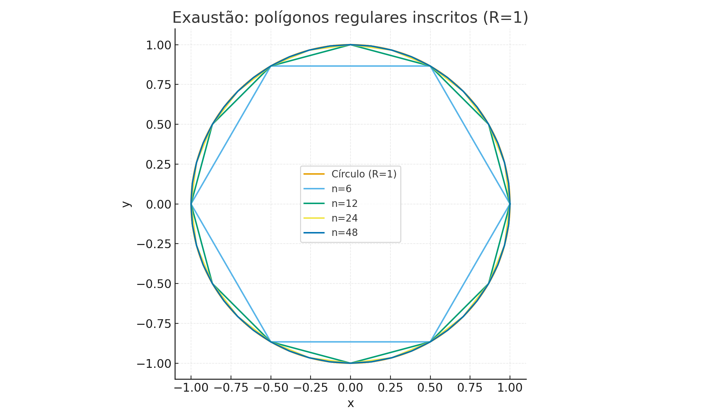

🏠 [← Sumário do Curso](../index.qmd) · [← Cursos de Matemática](../../index.qmd) · [← Seção de Matemática](/posts/matematica/index.qmd)

**Próxima aula:** [1.2 — Conjuntos Numéricos](1.2-conjuntos.qmd)

::: {.callout-tip title="Conhecimentos úteis para a leitura"}
Para acompanhar os exemplos iniciais, ajudam algumas noções de
**álgebra escolar**, como lidar com expressões e equações simples,
e saber localizar pontos num **gráfico cartesiano**.

O curso retoma esses assuntos e desenvolve as **funções elementares**,
como a função afim, a quadrática, a exponencial e a logarítmica. Você
pode acompanhar a introdução pelas figuras e tabelas antes de estudar
essas funções em detalhe.

> As fórmulas deste curso são preparadas em **LaTeX**, o padrão acadêmico para escrita matemática, o que garante **clareza** e **qualidade tipográfica** na apresentação.  
> 👉 Você verá apenas o resultado final, sem precisar conhecer LaTeX.
:::

***

::: {.callout-tip title="❓ Pergunta Disparadora"}
Como a Matemática descreve movimento, variação e acumulação?
:::

::: {.callout-note title="📌 Objetivos de Aprendizagem"}
- Entender a ideia inicial do Cálculo como estudo da variação e da acumulação;
- Relacionar retas secantes, reta tangente e taxa de variação;
- Apresentar a noção intuitiva de limite como preparação para derivadas e integrais.
:::

# 📘 O que é o Cálculo?

## 🌱 Intuição inicial

Imagine um carro na estrada: o velocímetro mostra **como a velocidade muda agora**; já a distância total depende de **somar pequenos trechos**.  
Esse é o espírito do cálculo: **estudar a mudança e o acúmulo** no mundo real.

## 📐 Formulação matemática (enxuta)

- **Mudança** → taxas de variação (derivadas).  
- **Acúmulo** → totais e áreas (integrais).  
- **Limite** → base formal que dá precisão ao “instantâneo” e ao “contínuo”.

***

# 🤔 Os dois problemas fundamentais do cálculo

## 🌱 Intuição: tangentes e áreas

1. **Problema da tangente:** qual é a inclinação de uma curva em um ponto?  
2. **Problema da área:** qual é a área de uma região limitada por curvas?

## 📐 Formulação matemática

- **Tangente** em \(A=(a,f(a))\): quando as inclinações das **secantes** tendem a um valor finito à medida que o segundo ponto se aproxima de $A$, esse valor é a inclinação da tangente. Uma tangente vertical não tem inclinação finita.  
- **Área** em \([a,b]\): quando $f$ é contínua e não negativa, dividimos $[a,b]$ em subintervalos de mesmo comprimento e construímos um retângulo em cada um, com altura dada por $f$ em um ponto do subintervalo. A soma das áreas desses retângulos converge para a área sob o gráfico à medida que aumentamos o número de subintervalos.

***

# 🔎 Motivação visual — o problema da tangente

Usaremos a função \(y=e^x\) no ponto \(A(0,1)\). Na figura, retas **secantes** $(A–B, A–C, A–D)$ vão “girando” até a **reta verde**, que representa a **tangente** em \(A\).

**Figura — Aproximação da tangente por secantes para \(y=e^x\)**

{fig-align="center" width="70%"}

## 🧮 Mini exemplo numérico (sem notação de limite)

Para \(y=e^x\) em \(x=0\), considere a secante entre \(x=0\) e \(x=h\), com \(h\neq 0\).  
A inclinação dessa secante é
\[
m(h)=\frac{e^{h}-e^{0}}{h}=\frac{e^{h}-1}{h}.
\]

Tabela (valores ilustrativos):

| \(h\)   | Expressão de \(m(h)\)                  | Valor aproximado |
|:------:|:---------------------------------------|:----------------:|
| 1      | \(\dfrac{e-1}{1}\)                     | 1.7183           |
| 0.5    | \(\dfrac{e^{0.5}-1}{0.5}\)             | 1.2974           |
| 0.1    | \(\dfrac{e^{0.1}-1}{0.1}\)             | 1.0517           |
| 0.01   | \(\dfrac{e^{0.01}-1}{0.01}\)           | 1.0050           |

📌 **Observação.** Os valores numéricos sugerem que $m(h)$ se aproxima de $1$ quando $h$ se aproxima de $0$ pela direita. A inclinação da tangente em $A$ é $1$. A tabela ilustra esse valor, cuja demonstração requer o estudo do limite pelos dois lados.

Esse é o **problema da tangente**, um dos dois problemas fundamentais do cálculo.

***

# 🔎 Motivação visual — o problema da área (método de exaustão)

Considere um **círculo de raio 1**. Inscrevemos **polígonos regulares** de \(n\) lados.  
Quando \(n\) cresce, a área do polígono se aproxima da **área do círculo** — este é o método de **exaustão** de Arquimedes.

**Figura — Polígonos inscritos aproximando a área do círculo (R=1)**

{fig-align="center" width="90%"}

## 🧮 Exemplo numérico (área de polígono inscrito)

Para um polígono de \(n\) lados inscrito no círculo unitário, a área é
\[
A_n=\frac{n}{2}\,\sin\!\left(\frac{2\pi}{n}\right).
\]

| \(n\) | \(A_n\)  | \(\pi - A_n\) |
|:----:|:--------:|:-------------:|
| 4    | 2.0000   | 1.1416        |
| 6    | 2.5981   | 0.5435        |
| 12   | 3.0000   | 0.1416        |
| 24   | 3.1058   | 0.0358        |
| 48   | 3.1326   | 0.0090        |
| 96   | 3.1394   | 0.0022        |

📌 **Lembrete:** a área do círculo é dada por \(\pi r^2\).  
No caso \(r=1\), a área é \(\pi \approx 3.1416\).  
Portanto, a última coluna da tabela mostra como a diferença \(\pi - A_n\) tende a zero à medida que \(n\) cresce.  

[Baixar tabela (CSV)](../data/area_exaustao_table.csv)

Esse raciocínio antecipa a **integral** como ferramenta para medir áreas e acúmulos — o **problema da área**, o outro problema fundamental do cálculo.

***

# 📜 Breve história do Cálculo

O Cálculo se formou ao longo de séculos. Os problemas de determinar áreas, traçar tangentes e descrever o movimento ajudam a entender como suas ideias se desenvolveram.

- **Arquimedes (séc. III a.C.)**: método da **exaustão** (áreas e volumes) — semente do cálculo integral.  
- **Fermat (séc. XVII)**: técnicas para **tangentes** — semente do cálculo diferencial.  
- **Newton (1643–1727)**: estudou o movimento e chamou de *fluxões* as taxas instantâneas de variação das grandezas.  
- **Leibniz (1646–1716)**: notação clara e geral (símbolos que usamos até hoje).

::: {.callout-tip title="Teorema Fundamental do Cálculo (ideia)"}
Mais adiante veremos que **mudança** (derivadas) e **acúmulo** (integrais) estão conectados por um resultado central — o **Teorema Fundamental do Cálculo** — que dá unidade à disciplina.
:::

## Fontes do panorama histórico

- **C. H. Edwards.** *The Historical Development of the Calculus*. Springer-Verlag, 1979. [Editora](https://link.springer.com/book/10.1007/978-1-4612-6230-5)
- **David M. Bressoud.** *Calculus Reordered: A History of the Big Ideas*. Princeton University Press, 2019. [Editora](https://press.princeton.edu/books/hardcover/9780691181318/calculus-reordered)

Para complementar o estudo, consulte as [referências recomendadas no sumário do curso](../index.qmd#referências-recomendadas).

***

# ✅ Encerrando a introdução

- O cálculo responde a duas perguntas universais:  
  1) **Quão rápido algo muda agora?** (tangentes/derivadas)  
  2) **Quanto se acumulou no intervalo?** (áreas/integral)
- Nesta abertura, evitamos símbolos formais de limite/derivada/integral — focamos na **intuição visual e histórica**.  
- A formalização virá passo a passo, sempre conectada a **figuras** e **exemplos numéricos**.

***

## 🧾 Quadro-resumo

| Ideia | Significado | Papel no Cálculo |
|---|---|---|
| Mudança | Estudo de como uma grandeza varia | Leva à ideia de derivada |
| Acúmulo | Soma de pequenas contribuições | Leva à ideia de integral |
| Limite | Processo de aproximação cada vez mais precisa | Dá rigor ao instantâneo e ao contínuo |
| Problema da tangente | Encontrar a inclinação de uma curva em um ponto | Motivação para o cálculo diferencial |
| Problema da área | Medir uma região por aproximações sucessivas | Motivação para o cálculo integral |
| Secantes aproximando a tangente | Retas entre dois pontos que se aproximam de uma reta-limite | Antecipam a noção de derivada |
| Polígonos aproximando o círculo | Figuras inscritas que se aproximam da área real | Antecipam a noção de integral |
| Teorema Fundamental do Cálculo | Conexão entre mudança e acúmulo | Dá unidade ao Cálculo |

***

# 🧩 Quiz — O que é Cálculo?

:::::{.question}
**Q1.** Nesta introdução, o cálculo aparece principalmente como o estudo de:

::::{.choices}
:::{.choice}
Somente geometria plana sem funções.
:::

:::{.choice}
Apenas operações aritméticas com números naturais.
:::

:::{.choice .correct-choice}
Mudança, acúmulo e limites.
:::

::::
:::::

:::::{.question}
**Q2.** O problema da tangente está ligado à ideia de:

::::{.choices}
:::{.choice .correct-choice}
Determinar a inclinação instantânea de uma curva em um ponto.
:::

:::{.choice}
Contar quantos pontos existem em uma reta.
:::

:::{.choice}
Calcular apenas áreas de polígonos regulares.
:::

::::
:::::

:::::{.question}
**Q3.** O método de exaustão de Arquimedes antecipa qual ideia do cálculo?

::::{.choices}
:::{.choice .correct-choice}
Aproximar uma grandeza por objetos mais simples e estudar o valor limite dessa aproximação.
:::

:::{.choice}
Evitar aproximações e trabalhar apenas com números inteiros.
:::

:::{.choice}
Substituir toda geometria por tabelas sem interpretação visual.
:::

::::
:::::

***

# Questões abertas

**Q4.** Durante o enchimento de um reservatório, um medidor indica quantos litros de água entram por minuto. Ao fim de uma hora, queremos saber quantos litros entraram ao todo. Qual dessas grandezas é uma taxa de variação e qual representa uma acumulação? Justifique pela unidade de medida de cada uma.

**Q5.** Na tabela dos polígonos inscritos no círculo, o que a coluna $\pi-A_n$ mede? O que os valores da tabela sugerem sobre o erro de aproximação? Por que esses valores, por si sós, não demonstram que o erro tende a zero?

::: {.callout-note collapse="true" title="Gabarito das questões abertas"}

**Q4.** A vazão de entrada é uma taxa de variação, pois indica o volume que entra por unidade de tempo e é medida em litros por minuto. O volume total que entrou ao longo da hora é a acumulação, medida em litros.

**Q5.** A diferença $\pi-A_n$ é a área do círculo unitário que fica fora do polígono inscrito. Nos casos da tabela, essa diferença diminui à medida que o número de lados aumenta. Os dados sugerem que ela tende a zero, mas mostram apenas alguns casos. Para demonstrar a convergência, é preciso justificar que, para qualquer erro positivo escolhido, a diferença fica abaixo desse valor sempre que o número de lados é suficientemente grande.

:::

***

# 🔗 Navegação

**Próxima aula:** [1.2 — Conjuntos Numéricos](1.2-conjuntos.qmd)

🏠 [← Sumário do Curso](../index.qmd) · [← Cursos de Matemática](../../index.qmd) · [← Seção de Matemática](/posts/matematica/index.qmd) · 🔝 [Voltar ao topo](#)

***

*Blog do Marcellini — Explorando a Matemática com Rigor e Beleza.*

:::{.callout-note}
Criado por Blog do Marcellini com ❤️ e código.
:::

