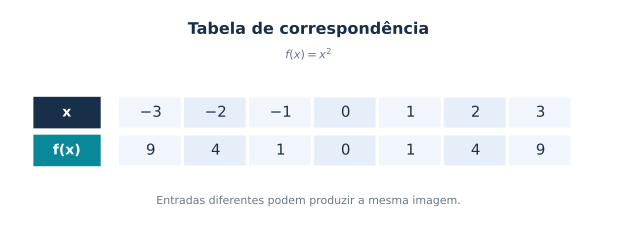
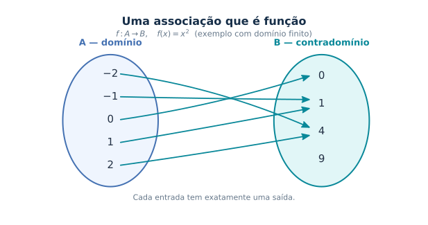
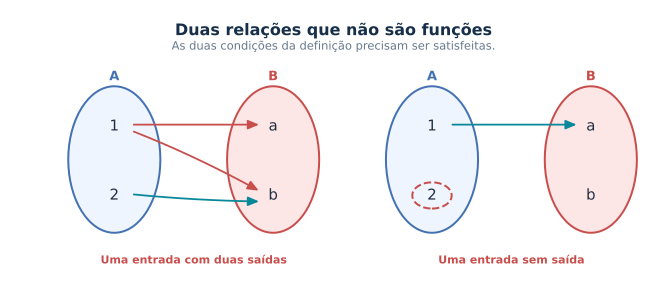
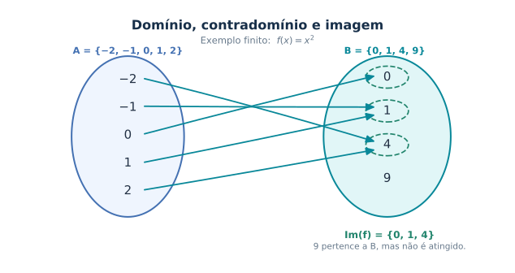
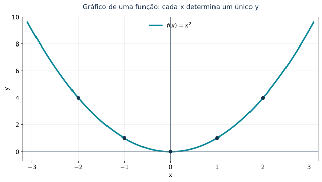
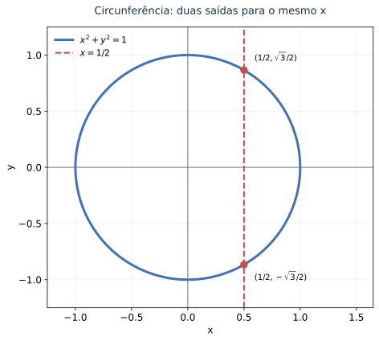
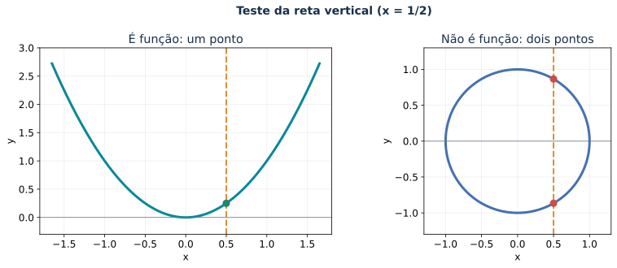
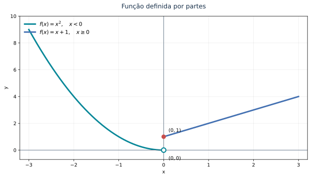

🏠 [← Sumário do Curso](../index.qmd) · [← Cursos de Matemática](../../index.qmd) · [← Seção de Matemática](/posts/matematica/index.qmd)

🎯 **Aula anterior:** [1.9 Trigonometria Essencial](1.9-trigonometria-essencial.qmd)

🎯 **Próxima aula:** [1.11 Revisão Gráfica e Algébrica](1.11-revisao-grafica-e-algebrica.qmd)

***

::: {.callout-tip title="❓ Pergunta disparadora"}

Toda regra que associa entradas a saídas define uma função?

O que precisamos especificar, além de uma fórmula, para definir uma função matematicamente?

:::

::: {.callout-note title="🎯 Objetivos de aprendizagem"}

Ao final desta aula, você deverá ser capaz de:

- Compreender a definição formal de função $f:A\to B$.
- Distinguir domínio, contradomínio e imagem.
- Identificar quando uma relação entre conjuntos representa uma função.
- Interpretar gráficos utilizando o teste da reta vertical.
- Compreender as condições de igualdade entre funções.
- Reconhecer que uma mesma expressão algébrica pode definir funções diferentes quando os domínios são distintos.
- Interpretar funções definidas por partes em situações elementares.

:::

# 📘 Conceito formal de função

Até aqui, já utilizamos funções em diferentes contextos.

Estudamos expressões como

$$
f(x)=x^2,
$$

$$
g(x)=\frac{1}{x-2},
$$

e

$$
h(x)=\sin x.
$$

Agora precisamos dar um passo conceitual importante: compreender o que é uma função **formalmente**.

Essa formalização será necessária porque, no Cálculo, não estudaremos apenas fórmulas. Investigaremos objetos matemáticos caracterizados por seu domínio, contradomínio, imagem e comportamento.

***

## 💡 A ideia intuitiva

Intuitivamente, uma função é uma regra que associa entradas a saídas.

Por exemplo, a regra

$$
f(x)=x^2
$$

associa a cada número real $x$ o número real $x^2$.

Assim,

$$
f(2)=4,\qquad f(-3)=9,\qquad f(0)=0.
$$

{#fig-1-10-tabela-valores fig-alt="Tabela para f(x) igual a x ao quadrado, com entradas de menos três até três e saídas nove, quatro, um, zero, um, quatro, nove." width="90%"}

Podemos imaginar uma função como uma máquina:

$$
x\longmapsto f(x).
$$

A entrada é $x$; a saída é $f(x)$.

Essa imagem é útil para começar, mas não é suficiente para a matemática formal. Precisamos especificar quais entradas são permitidas e em que conjunto estão as saídas.

***

## 📐 Definição formal de função

Uma função de um conjunto $A$ em um conjunto $B$ é uma correspondência que associa a **cada elemento de $A$ exatamente um elemento de $B$**.

Escrevemos:

$$
f:A\to B.
$$

Nessa notação:

- $A$ é o **domínio**;
- $B$ é o **contradomínio**;
- $f$ é a função;
- $f(x)$ é o valor associado ao elemento $x\in A$.

A condição fundamental pode ser expressa assim:

::: {.callout-important title="Definição essencial"}

Para cada $x\in A$, existe um único elemento $y\in B$ tal que $y=f(x)$.

:::

Essa definição exige duas condições:

1. Todo elemento do domínio precisa estar associado a algum elemento do contradomínio.
2. Nenhum elemento do domínio pode estar associado a dois valores diferentes.

{#fig-1-10-diagrama-funcao fig-alt="Conjunto A com cinco entradas, conjunto B com quatro possíveis saídas e uma seta para cada elemento de A." width="90%"}

{#fig-1-10-diagramas-nao-funcao fig-alt="Dois diagramas: no primeiro, uma entrada possui duas setas; no segundo, uma entrada não possui seta." width="90%"}

No primeiro diagrama de relação não funcional, uma entrada possui duas imagens. No segundo, existe uma entrada sem imagem.

Ambas as situações violam a definição de função.

***

## 🧭 Domínio

O domínio é o conjunto de todas as entradas permitidas.

Se escrevemos

$$
f:A\to B,
$$

o domínio é o conjunto $A$.

Por exemplo, considere

$$
f:\mathbb{R}\to\mathbb{R},
\qquad f(x)=x^2.
$$

Nesse caso, o domínio é

$$
D_f=\mathbb{R}.
$$

Qualquer número real pode ser utilizado como entrada.

Considere agora

$$
g(x)=\sqrt{x}.
$$

Se trabalhamos apenas com números reais, precisamos exigir

$$
x\geq 0.
$$

Portanto, o domínio real natural dessa expressão é

$$
D_g=[0,+\infty).
$$

O domínio faz parte da definição da função: não basta conhecer a expressão algébrica.

***

## 🎯 Contradomínio

O contradomínio é o conjunto no qual declaramos que os valores da função estão contidos.

Na notação

$$
f:A\to B,
$$

o conjunto $B$ é o contradomínio.

Por exemplo,

$$
f:\mathbb{R}\to\mathbb{R},
\qquad f(x)=x^2.
$$

O contradomínio é $\mathbb{R}$.

Entretanto, a função nunca assume valores negativos. Isso nos leva ao próximo conceito.

***

## 🖼️ Imagem

A imagem é o conjunto de todos os valores que a função efetivamente assume.

Para

$$
f:\mathbb{R}\to\mathbb{R},
\qquad f(x)=x^2,
$$

temos

$$
\operatorname{Im}(f)=[0,+\infty).
$$

De fato, $x^2$ nunca é negativo, e todo número real não negativo é quadrado de algum número real.

Em geral,

$$
\operatorname{Im}(f)\subseteq B.
$$

A imagem está contida no contradomínio, mas não precisa coincidir com ele.

***

## 🎯 Domínio, contradomínio e imagem: comparação

| Conceito | Significado |
|---|---|
| Domínio | Conjunto das entradas permitidas. |
| Contradomínio | Conjunto estabelecido para as saídas. |
| Imagem | Conjunto dos valores efetivamente assumidos pela função. |

Considere novamente

$$
f:\mathbb{R}\to\mathbb{R},
\qquad f(x)=x^2.
$$

Temos:

$$
D_f=\mathbb{R},
$$

$$
\text{Contradomínio}=\mathbb{R},
$$

e

$$
\operatorname{Im}(f)=[0,+\infty).
$$

Para visualizar a diferença entre esses conjuntos, considere o exemplo finito

$$
A=\{-2,-1,0,1,2\},
$$

$$
B=\{0,1,4,9\},
$$

com a regra $f(x)=x^2$.

{#fig-1-10-dominio-contradominio-imagem fig-alt="Domínio A com cinco números, contradomínio B com quatro números e imagem destacada igual a zero, um e quatro, excluindo nove." width="90%"}

Nesse exemplo,

$$
\operatorname{Im}(f)=\{0,1,4\}.
$$

Observe que $9\in B$, mas $9\notin\operatorname{Im}(f)$.

O contradomínio contém um elemento que não é atingido pela função. É justamente essa possibilidade que distingue contradomínio de imagem.

***

## 🧩 Funções como relações especiais

Uma relação de um conjunto $A$ em um conjunto $B$ é um subconjunto do produto cartesiano

$$
A\times B.
$$

Seus elementos são pares ordenados

$$
(x,y),
$$

em que $x\in A$ e $y\in B$.

Uma função é uma relação especial: cada elemento $x\in A$ aparece como primeira coordenada de exatamente um par ordenado.

Por exemplo, a função $f(x)=x^2$, com domínio real, pode ser representada pelo conjunto

$$
G_f=\{(x,x^2)\mid x\in\mathbb{R}\}.
$$

Essa representação será importante para compreender os gráficos de funções.

***

## 📊 Gráfico de uma função

O gráfico de uma função real de variável real é o conjunto dos pontos

$$
(x,f(x))
$$

no plano cartesiano.

Se

$$
f:A\to\mathbb{R},
\qquad A\subseteq\mathbb{R},
$$

então seu gráfico é

$$
G_f=\{(x,f(x))\mid x\in A\}.
$$

Por exemplo, o gráfico de

$$
f(x)=x^2
$$

é

$$
G_f=\{(x,x^2)\mid x\in\mathbb{R}\}.
$$

Esse conjunto de pontos forma uma parábola.

{#fig-1-10-grafico-parabola fig-alt="Parábola voltada para cima no plano cartesiano, com pontos marcados em x igual a menos dois, menos um, zero, um e dois." width="90%"}

::: {.callout-note collapse="true" title="🐍 Código Python da ilustração"}

O código utiliza **NumPy** e **Matplotlib** para reproduzir a parábola.

```python
import numpy as np
import matplotlib.pyplot as plt
from pathlib import Path

plt.rcParams.update({"font.family": "DejaVu Sans", "svg.fonttype": "path"})

x = np.linspace(-3.1, 3.1, 700)

fig, ax = plt.subplots(figsize=(9, 5.2))
ax.plot(x, x**2, lw=3, color="#098899", label=r"$f(x)=x^2$")

for xx in (-2, -1, 0, 1, 2):
    ax.scatter(xx, xx**2, s=40, color="#172F49", zorder=4)

ax.axhline(0, color="#66788A", lw=1)
ax.axvline(0, color="#66788A", lw=1)

ax.set(xlim=(-3.2, 3.2), ylim=(-0.7, 10), xlabel="x", ylabel="y")
ax.grid(alpha=0.22)
ax.legend(frameon=False, loc="upper center", fontsize=12)
ax.set_title("Gráfico de uma função: cada x determina um único y",
             pad=16, fontsize=13, color="#172F49")

fig.tight_layout()
Path("images").mkdir(exist_ok=True)
fig.savefig("images/1.10-grafico-parabola.svg", bbox_inches="tight")
plt.close(fig)
```

:::

***

## 🔎 O teste da reta vertical

Nem todo conjunto de pontos do plano cartesiano representa o gráfico de uma função de $x$.

Para que isso aconteça, cada valor de $x$ deve corresponder a exatamente um valor de $y$.

Geometricamente, essa condição conduz ao teste da reta vertical.

::: {.callout-tip title="Teste da reta vertical"}

Um gráfico representa uma função de $x$ se toda reta vertical o intercepta em, no máximo, um ponto.

:::

A parábola

$$
y=x^2
$$

passa no teste da reta vertical.

Já a circunferência

$$
x^2+y^2=1
$$

não passa, pois uma mesma reta vertical pode interceptá-la em dois pontos.

{#fig-1-10-relacao-circunferencia fig-alt="Circunferência unitária cortada por reta vertical x igual a um meio em dois pontos." width="90%"}

::: {.callout-note collapse="true" title="🐍 Código Python da ilustração"}

```python
import numpy as np
import matplotlib.pyplot as plt
from pathlib import Path

a = np.linspace(0, 2*np.pi, 800)
c = 0.5
b = np.sqrt(1-c**2)

fig, ax = plt.subplots(figsize=(8.2, 6.1))
ax.plot(np.cos(a), np.sin(a), lw=3, color="#4471B2",
        label=r"$x^2+y^2=1$")
ax.axvline(c, color="#C84E4C", lw=2, ls="--", label=r"$x=1/2$")
ax.scatter([c, c], [b, -b], color="#C84E4C", s=70, zorder=5)

ax.annotate(r"$(1/2,\sqrt{3}/2)$", (c, b),
            xytext=(13, 12), textcoords="offset points", fontsize=10)
ax.annotate(r"$(1/2,-\sqrt{3}/2)$", (c, -b),
            xytext=(13, -19), textcoords="offset points", fontsize=10)

ax.axhline(0, color="#66788A", lw=1)
ax.axvline(0, color="#66788A", lw=1)
ax.set_aspect("equal", adjustable="box")
ax.set(xlim=(-1.25, 1.65), ylim=(-1.25, 1.25), xlabel="x", ylabel="y")
ax.grid(alpha=0.2)
ax.legend(frameon=False, loc="upper left", fontsize=11)
ax.set_title("Circunferência: duas saídas para o mesmo x",
             pad=16, fontsize=13, color="#172F49")

fig.tight_layout()
Path("images").mkdir(exist_ok=True)
fig.savefig("images/1.10-relacao-circunferencia.svg", bbox_inches="tight")
plt.close(fig)
```

:::

{#fig-1-10-teste-reta-vertical fig-alt="Dois painéis: a reta vertical corta a parábola em um ponto e a circunferência em dois." width="90%"}

::: {.callout-note collapse="true" title="🐍 Código Python da ilustração"}

```python
import numpy as np
import matplotlib.pyplot as plt
from pathlib import Path

fig, axes = plt.subplots(1, 2, figsize=(11.6, 4.7))

x = np.linspace(-1.65, 1.65, 500)
axes[0].plot(x, x**2, color="#098899", lw=3)
axes[0].axvline(0.5, color="#E28C32", lw=2, ls="--")
axes[0].scatter([0.5], [0.25], color="#21846C", s=65, zorder=5)
axes[0].set(xlim=(-1.8, 1.8), ylim=(-0.3, 3.0),
            title="É função: um ponto", xlabel="x", ylabel="y")

t = np.linspace(0, 2*np.pi, 600)
axes[1].plot(np.cos(t), np.sin(t), color="#4471B2", lw=3)
axes[1].axvline(0.5, color="#E28C32", lw=2, ls="--")

q = np.sqrt(3)/2
axes[1].scatter([0.5, 0.5], [q, -q], color="#C84E4C", s=65, zorder=5)
axes[1].set(xlim=(-1.3, 1.3), ylim=(-1.3, 1.3),
            title="Não é função: dois pontos", xlabel="x", ylabel="y")
axes[1].set_aspect("equal", adjustable="box")

for ax in axes:
    ax.axhline(0, lw=0.8, color="#66788A")
    ax.grid(alpha=0.2)
    ax.title.set_color("#172F49")

fig.suptitle("Teste da reta vertical (x = 1/2)",
             fontsize=14, color="#172F49", weight="bold")
fig.tight_layout()

Path("images").mkdir(exist_ok=True)
fig.savefig("images/1.10-teste-reta-vertical.svg", bbox_inches="tight")
plt.close(fig)
```

:::

***

## ⚖️ Igualdade de funções

Neste curso, consideraremos que uma função é especificada por seu domínio, contradomínio e regra de associação.

Dessa forma, duas funções são iguais quando:

1. possuem o mesmo domínio;
2. possuem o mesmo contradomínio;
3. associam o mesmo valor a cada elemento do domínio.

Considere:

$$
f:\mathbb{R}\to\mathbb{R},
\qquad f(x)=x^2,
$$

e

$$
g:[0,+\infty)\to\mathbb{R},
\qquad g(x)=x^2.
$$

Embora as expressões algébricas sejam iguais, as funções não são iguais, pois seus domínios são diferentes.

Por exemplo, $f(-2)=4$, enquanto $g(-2)$ não está definido, pois $-2$ não pertence ao domínio de $g$.

Isso é importante no Cálculo: uma expressão algébrica, isoladamente, não determina todos os aspectos de uma função.

***

## 🧮 Uma mesma expressão pode assumir formas diferentes

Considere

$$
f(x)=\sqrt{x^2}.
$$

Para todo número real $x$,

$$
\sqrt{x^2}=|x|.
$$

Portanto,

$$
f(x)=
\begin{cases}
x, & x\geq 0,\\
-x, & x<0.
\end{cases}
$$

Se restringirmos o domínio a $[0,+\infty)$, teremos

$$
\sqrt{x^2}=x.
$$

Se restringirmos o domínio a $(-\infty,0]$, teremos

$$
\sqrt{x^2}=-x.
$$

A expressão e o domínio precisam ser considerados em conjunto.

***

## 🧩 Funções reais de variável real

No Cálculo de uma variável, estudamos principalmente funções reais de variável real.

São funções da forma

$$
f:A\to\mathbb{R},
\qquad A\subseteq\mathbb{R}.
$$

A entrada é um número real, e a saída também é um número real.

Exemplos:

$$
f(x)=x^2,
$$

$$
g(x)=\frac{1}{x-1},
$$

$$
h(x)=\ln x,
$$

$$
p(x)=\sin x.
$$

Essas funções possuem domínios diferentes, determinados pelas respectivas regras e condições de definição.

***

## 🧩 Uma primeira introdução às funções definidas por partes

Algumas funções são definidas por regras diferentes em regiões distintas do domínio.

Por exemplo,

$$
f(x)=
\begin{cases}
x^2, & x<0,\\
x+1, & x\geq 0.
\end{cases}
$$

Para calcular $f(-2)$, usamos a primeira regra, pois $-2<0$:

$$
f(-2)=(-2)^2=4.
$$

Para calcular $f(3)$, usamos a segunda regra, pois $3\geq 0$:

$$
f(3)=3+1=4.
$$

Observe que o valor $x=0$ pertence à segunda condição. Portanto,

$$
f(0)=0+1=1.
$$

{#fig-1-10-funcoes-por-partes fig-alt="Gráfico da função definida por partes. A parábola y igual a x ao quadrado aparece para x menor que zero, com círculo aberto na origem. A reta y igual a x mais um aparece para x maior ou igual a zero, com ponto fechado em zero, um." width="90%"}

::: {.callout-note collapse="true" title="🐍 Código Python da ilustração"}

```python
import numpy as np
import matplotlib.pyplot as plt
from pathlib import Path

plt.rcParams.update({
    "font.family": "DejaVu Sans",
    "svg.fonttype": "path"
})

x_left = np.linspace(-3, 0, 500, endpoint=False)
y_left = x_left**2

x_right = np.linspace(0, 3, 500)
y_right = x_right + 1

fig, ax = plt.subplots(figsize=(9, 5.2))

ax.plot(x_left, y_left, lw=3, color="#098899",
        label=r"$f(x)=x^2,\quad x<0$")
ax.plot(x_right, y_right, lw=3, color="#4471B2",
        label=r"$f(x)=x+1,\quad x\geq 0$")

ax.scatter([0], [0], s=85, facecolors="white",
           edgecolors="#098899", linewidths=2.2, zorder=5)
ax.scatter([0], [1], s=65, color="#C84E4C", zorder=5)

ax.annotate(r"$(0,0)$", (0, 0), xytext=(10, -20),
            textcoords="offset points", fontsize=10)
ax.annotate(r"$(0,1)$", (0, 1), xytext=(10, 10),
            textcoords="offset points", fontsize=10)

ax.axhline(0, color="#66788A", lw=1)
ax.axvline(0, color="#66788A", lw=1)
ax.set(xlim=(-3.2, 3.2), ylim=(-0.7, 10), xlabel="x", ylabel="y")
ax.grid(alpha=0.22)
ax.legend(frameon=False, loc="upper left", fontsize=11)
ax.set_title("Função definida por partes", pad=16,
             fontsize=13, color="#172F49")

fig.tight_layout()
Path("images").mkdir(exist_ok=True)
fig.savefig("images/1.10-funcoes-por-partes.svg", bbox_inches="tight")
plt.close(fig)
```

:::

O exemplo mostra que uma única função pode utilizar expressões diferentes em regiões distintas do domínio.

Por enquanto, nosso objetivo é saber identificar a regra correta e calcular os valores da função. O estudo detalhado dos pontos de troca, dos limites laterais e da continuidade será desenvolvido no [Módulo 1.22-AP — Funções por Partes](1.22-AP-funcoes-por-partes.qmd).

***

## 🛠️ Funções e modelagem

Em aplicações, uma função costuma representar uma dependência entre grandezas.

Por exemplo:

- a posição pode ser função do tempo;
- a temperatura pode ser função da altitude;
- o custo pode ser função da quantidade produzida;
- a área pode ser função do raio;
- a população pode ser função do tempo.

Nesses casos, o domínio também depende do contexto.

Se $t$ representa o tempo transcorrido após o início de um experimento, por exemplo, normalmente consideramos

$$
t\geq 0.
$$

Mesmo que uma fórmula esteja definida para valores negativos, o modelo pode não ter significado físico nesses valores.

***

::: {.callout-note title="📋 Quadro-resumo"}

| Conceito | Síntese matemática |
|---|---|
| Função $f:A\to B$ | A cada $x\in A$ corresponde exatamente um $f(x)\in B$. |
| Domínio | Conjunto $A$ das entradas admissíveis. |
| Contradomínio | Conjunto $B$ declarado para as saídas. |
| Imagem | $f(A)=\{f(x):x\in A\}\subseteq B$. |
| Gráfico | Conjunto dos pares $(x,f(x))$, com $x\in A$. |
| Teste da reta vertical | Uma reta vertical não pode interceptar o gráfico em mais de um ponto. |
| Igualdade de funções | Exige mesmo domínio, mesmo contradomínio e mesmos valores associados. |
| Função por partes | Diferentes expressões podem definir uma única função, desde que cada entrada tenha exatamente uma saída. |

:::

***

::: {.callout-tip title="🌉 Ponte para o Cálculo"}

A definição formal de função será essencial para o estudo dos limites, das derivadas e das integrais.

No Cálculo, não basta conhecer uma expressão algébrica. Precisamos compreender o domínio da função, os valores que ela assume e seu comportamento nas proximidades de cada ponto.

Nas próximas aulas, essa compreensão será ampliada progressivamente.

:::

# 🧪 Exercícios propostos

::: {.callout-note title="📝 Exercícios"}

## 🧪 Exercício 1

Determine o domínio real natural de cada expressão:

a) $f(x)=x^2+1$

b) $g(x)=\sqrt{x-4}$

c) $h(x)=\dfrac{1}{x+2}$

d) $p(x)=\ln(x-1)$

## 🧪 Exercício 2

Considere

$$
f:\mathbb{R}\to\mathbb{R},
\qquad f(x)=x^2.
$$

Determine:

a) o domínio;

b) o contradomínio;

c) a imagem.

## 🧪 Exercício 3

Explique por que a circunferência

$$
x^2+y^2=1
$$

não é o gráfico de uma função $y=f(x)$ em todo o intervalo $[-1,1]$.

## 🧪 Exercício 4

Considere

$$
f(x)=
\begin{cases}
2x, & x<1,\\
x^2, & x\geq 1.
\end{cases}
$$

Calcule:

a) $f(0)$;

b) $f(1)$;

c) $f(3)$.

## 🧪 Exercício 5

As funções abaixo são iguais? Justifique.

$$
f:\mathbb{R}\to\mathbb{R},
\qquad f(x)=x^2,
$$

$$
g:[0,+\infty)\to\mathbb{R},
\qquad g(x)=x^2.
$$

:::

***

::: {.callout-important collapse="true" title="✅ Gabarito comentado"}

## 🧪 Exercício 1

**a)** Para $f(x)=x^2+1$, não há restrição real. Logo,

$$
D_f=\mathbb{R}.
$$

**b)** Para $g(x)=\sqrt{x-4}$, precisamos de

$$
x-4\geq 0.
$$

Assim,

$$
D_g=[4,+\infty).
$$

**c)** Para $h(x)=\dfrac{1}{x+2}$, o denominador deve ser diferente de zero:

$$
x+2\neq 0.
$$

Portanto,

$$
D_h=\mathbb{R}\setminus\{-2\}.
$$

**d)** Para $p(x)=\ln(x-1)$, o argumento do logaritmo deve ser positivo:

$$
x-1>0.
$$

Logo,

$$
D_p=(1,+\infty).
$$

## 🧪 Exercício 2

Para

$$
f:\mathbb{R}\to\mathbb{R},
\qquad f(x)=x^2,
$$

temos:

a) Domínio:

$$
D_f=\mathbb{R}.
$$

b) Contradomínio:

$$
B=\mathbb{R}.
$$

c) Imagem:

$$
\operatorname{Im}(f)=[0,+\infty).
$$

Isso ocorre porque $x^2\geq 0$ para todo real $x$, e todo número não negativo é quadrado de algum número real.

## 🧪 Exercício 3

A circunferência

$$
x^2+y^2=1
$$

não representa o gráfico de uma função $y=f(x)$ em todo o intervalo $[-1,1]$ porque alguns valores de $x$ correspondem a dois valores de $y$.

Por exemplo, para $x=0$:

$$
y^2=1.
$$

Logo,

$$
y=1\quad\text{ou}\quad y=-1.
$$

A mesma entrada teria duas saídas diferentes, contrariando a definição de função.

## 🧪 Exercício 4

A função é

$$
f(x)=
\begin{cases}
2x, & x<1,\\
x^2, & x\geq 1.
\end{cases}
$$

**a)** Como $0<1$, usamos a primeira regra:

$$
f(0)=2\cdot0=0.
$$

**b)** Como $1\geq1$, usamos a segunda regra:

$$
f(1)=1^2=1.
$$

**c)** Como $3\geq1$, usamos a segunda regra:

$$
f(3)=3^2=9.
$$

## 🧪 Exercício 5

As funções não são iguais.

Embora possuam a mesma expressão algébrica e o mesmo contradomínio, seus domínios são diferentes:

$$
D_f=\mathbb{R},
$$

enquanto

$$
D_g=[0,+\infty).
$$

Para serem iguais, as funções precisam ter o mesmo domínio, o mesmo contradomínio e a mesma regra de associação.

:::

***

# 🧩 Quiz — Conceito Formal de Função

:::::{.question}
**Q1.** Uma função $f:A\to B$ associa:

::::{.choices}
:::{.choice .correct-choice}
A cada elemento de $A$ exatamente um elemento de $B$.
:::

:::{.choice}
A cada elemento de $A$ pelo menos dois elementos de $B$.
:::

:::{.choice}
Apenas alguns elementos de $A$ a elementos de $B$.
:::
::::
:::::

:::::{.question}
**Q2.** Na notação $f:A\to B$, o conjunto $A$ é chamado de:

::::{.choices}
:::{.choice}
Imagem.
:::

:::{.choice .correct-choice}
Domínio.
:::

:::{.choice}
Gráfico.
:::
::::
:::::

:::::{.question}
**Q3.** A imagem de uma função é:

::::{.choices}
:::{.choice}
Sempre igual ao domínio.
:::

:::{.choice}
Sempre igual ao contradomínio.
:::

:::{.choice .correct-choice}
O conjunto dos valores que a função realmente assume.
:::
::::
:::::

***

::: {.callout-tip title="🔬 Quer aprofundar?"}

O aprofundamento é opcional. Você pode explorá-lo agora ou seguir a sequência principal e retornar depois.

- [1.21-AP — Domínio de Funções: Guia Completo](1.21-AP-dominio-de-funcoes-guia-completo.qmd) — Restrições de domínio em raízes, frações, logaritmos e composições.
- [1.22-AP — Funções por Partes](1.22-AP-funcoes-por-partes.qmd) — Leitura detalhada de funções por partes, pontos de troca, limites laterais e continuidade.

:::

# 🔗 Navegação

🎯 **Aula anterior:** [1.9 Trigonometria Essencial](1.9-trigonometria-essencial.qmd)

🎯 **Próxima aula:** [1.11 Revisão Gráfica e Algébrica](1.11-revisao-grafica-e-algebrica.qmd)

🏠 [← Sumário do Curso](../index.qmd) · [← Cursos de Matemática](../../index.qmd) · [← Seção de Matemática](/posts/matematica/index.qmd) · 🔝 [Voltar ao topo](#)

***

*Blog do Marcellini — Explorando a Matemática com Rigor e Beleza.*

::: {.callout-note}
Criado por Blog do Marcellini com ❤️ e código.
:::