🏠 [← Sumário do Curso](../index.qmd) · [← Cursos de Matemática](../../index.qmd) · [← Seção de Matemática](/posts/matematica/index.qmd)

🎯 **Aula anterior:** 👉 [1.10 Conceito Formal de Função](1.10-conceito-formal-de-funcao.qmd)

🎯 **Próxima aula:** 👉 [1.12 Transformações Gráficas](1.12-transformacoes-graficas.qmd)

***

::: {.callout-tip title="❓ Pergunta Disparadora"}

O que podemos descobrir sobre uma função examinando sua expressão algébrica e seu gráfico? Como essas duas representações se complementam?

:::

::: {.callout-note title="📌 Objetivos de Aprendizagem"}

Ao final desta aula, você deverá ser capaz de:

- Relacionar a expressão algébrica de uma função à sua representação gráfica.
- Identificar e interpretar domínio e imagem.
- Determinar zeros e interseções com os eixos coordenados.
- Analisar os intervalos em que a função é positiva ou negativa.
- Reconhecer intervalos de crescimento e decrescimento, máximos e mínimos.
- Investigar simetrias e reconhecer assíntotas.
- Utilizar informações gráficas e algébricas para interpretar o comportamento de funções e preparar o estudo do Cálculo.

:::

# 📘 Revisão Gráfica e Algébrica

O estudo de funções pode ser feito por dois caminhos complementares:

- o caminho **algébrico**, usando fórmulas, equações, inequações e manipulações simbólicas;
- o caminho **gráfico**, observando pontos, curvas, interseções, crescimento, zeros e comportamento global.

No Cálculo, esses dois olhares precisam caminhar juntos.

Quando estudarmos limites, derivadas e integrais, será comum alternar entre expressões algébricas e gráficos. Uma fórmula pode revelar domínio, zeros e assíntotas. Um gráfico pode revelar crescimento, descontinuidade, máximos, mínimos e tendências.

Este post faz uma revisão integrada dessas duas linguagens.

***

## 📊 A fórmula e o gráfico

Considere a função

$$
f(x)=x^2-4.
$$

Algebricamente, podemos fatorar:

$$
f(x)=x^2-4=(x-2)(x+2).
$$

Isso mostra que os zeros da função são

$$
x=-2
$$

e

$$
x=2.
$$

Graficamente, esses zeros correspondem aos pontos onde o gráfico cruza o eixo $x$:

$$
(-2,0)
$$

e

$$
(2,0).
$$

A mesma informação aparece em duas linguagens: a fatoração mostra os zeros na álgebra; o gráfico mostra os interceptos horizontais.

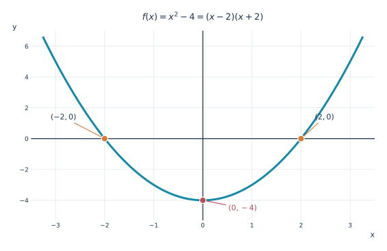{fig-alt="Parábola de f(x) igual a x ao quadrado menos quatro, com zeros em menos dois e dois e vértice em zero, menos quatro." width="94%"}

::: {.callout-note collapse="true" title="Clique para ver o código"}

```python
from pathlib import Path
import numpy as np
import matplotlib.pyplot as plt

# Padrão gráfico editorial do Blog do Marcellini.
AZUL = "#19324f"
CIANO = "#1689a6"
LARANJA = "#d87832"
VERMELHO = "#ba4a56"
GRADE = "#e2e9ef"
plt.rcParams.update({
    "font.family": "DejaVu Sans",
    "font.size": 11,
    "axes.titlesize": 13,
    "svg.fonttype": "path",  # conserva a aparência matemática em SVG
    "figure.facecolor": "white",
    "axes.facecolor": "white",
})


def preparar(ax, xlim, ylim, xticks=None, yticks=None):
    ax.set_xlim(*xlim)
    ax.set_ylim(*ylim)
    if xticks is not None:
        ax.set_xticks(xticks)
    if yticks is not None:
        ax.set_yticks(yticks)
    ax.set_axisbelow(True)
    ax.grid(True, color=GRADE, linewidth=0.8)
    for spine in ax.spines.values():
        spine.set_visible(False)
    ax.axhline(0, color=AZUL, linewidth=1.25, zorder=2)
    ax.axvline(0, color=AZUL, linewidth=1.25, zorder=2)
    ax.tick_params(axis="both", length=0, colors=AZUL, labelsize=9)
    ax.set_xlabel("x", loc="right", color=AZUL)
    ax.set_ylabel("y", loc="top", rotation=0, color=AZUL)


def salvar(fig, nome):
    destino = Path("images")
    destino.mkdir(parents=True, exist_ok=True)
    fig.savefig(destino / nome, format="svg", bbox_inches="tight",
                pad_inches=0.25, facecolor="white")
    plt.close(fig)


fig, ax = plt.subplots(figsize=(9.0, 5.0))
x = np.linspace(-3.25, 3.25, 700)
preparar(ax, (-3.5, 3.5), (-5.3, 7.0),
         xticks=np.arange(-3, 4), yticks=np.arange(-4, 7, 2))
ax.plot(x, x**2 - 4, color=CIANO, linewidth=3, zorder=3)
ax.scatter([-2, 2], [0, 0], s=85, color=LARANJA,
           edgecolors="white", linewidth=1.2, zorder=5)
ax.scatter([0], [-4], s=85, color=VERMELHO,
           edgecolors="white", linewidth=1.2, zorder=5)
ax.annotate(r"$(-2,0)$", xy=(-2, 0), xytext=(-3.1, 1.25),
            fontsize=11, color=AZUL,
            arrowprops=dict(arrowstyle="-", color=LARANJA, lw=1.1))
ax.annotate(r"$(2,0)$", xy=(2, 0), xytext=(2.28, 1.25),
            fontsize=11, color=AZUL,
            arrowprops=dict(arrowstyle="-", color=LARANJA, lw=1.1))
ax.annotate(r"$(0,-4)$", xy=(0, -4), xytext=(.52, -4.65),
            fontsize=11, color=VERMELHO,
            arrowprops=dict(arrowstyle="-", color=VERMELHO, lw=1.1))
ax.set_title(r"$f(x)=x^2-4=(x-2)(x+2)$", color=AZUL, pad=16)
salvar(fig, "1.11-formula-grafico.svg")
```

:::

***

## 🧭 Domínio

O domínio de uma função é o conjunto dos valores de entrada permitidos.

Algebricamente, encontramos restrições procurando operações que exigem cuidado, como:

- denominadores;
- raízes de índice par;
- logaritmos;
- expressões trigonométricas com denominadores, como a tangente.

Por exemplo, para

$$
f(x)=\frac{1}{x-3},
$$

precisamos de

$$
x-3\neq 0.
$$

Logo,

$$
x\neq 3.
$$

Assim,

$$
D_f=(-\infty,3)\cup(3,+\infty).
$$

Neste exemplo, a restrição $x\neq 3$ corresponde a uma assíntota vertical em $x=3$. Quando $x$ se aproxima de $3$, pela esquerda ou pela direita, o módulo de $f(x)$ cresce sem limite.

Os dois ramos do gráfico se aproximam da reta vertical tracejada, mas nenhum ponto da curva tem abscissa $x=3$.

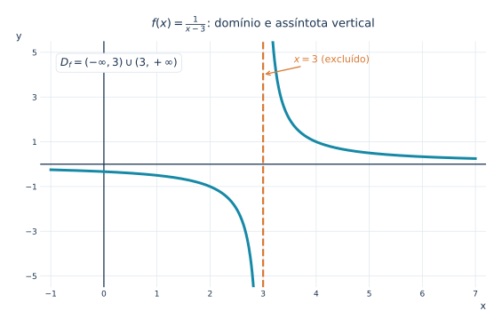{fig-alt="Gráfico de um sobre x menos três com dois ramos e assíntota vertical tracejada em x igual a três." width="94%"}

::: {.callout-note collapse="true" title="Clique para ver o código"}

```python
from pathlib import Path
import numpy as np
import matplotlib.pyplot as plt

# Padrão gráfico editorial do Blog do Marcellini.
AZUL = "#19324f"
CIANO = "#1689a6"
LARANJA = "#d87832"
VERMELHO = "#ba4a56"
GRADE = "#e2e9ef"
plt.rcParams.update({
    "font.family": "DejaVu Sans",
    "font.size": 11,
    "axes.titlesize": 13,
    "svg.fonttype": "path",  # conserva a aparência matemática em SVG
    "figure.facecolor": "white",
    "axes.facecolor": "white",
})


def preparar(ax, xlim, ylim, xticks=None, yticks=None):
    ax.set_xlim(*xlim)
    ax.set_ylim(*ylim)
    if xticks is not None:
        ax.set_xticks(xticks)
    if yticks is not None:
        ax.set_yticks(yticks)
    ax.set_axisbelow(True)
    ax.grid(True, color=GRADE, linewidth=0.8)
    for spine in ax.spines.values():
        spine.set_visible(False)
    ax.axhline(0, color=AZUL, linewidth=1.25, zorder=2)
    ax.axvline(0, color=AZUL, linewidth=1.25, zorder=2)
    ax.tick_params(axis="both", length=0, colors=AZUL, labelsize=9)
    ax.set_xlabel("x", loc="right", color=AZUL)
    ax.set_ylabel("y", loc="top", rotation=0, color=AZUL)


def salvar(fig, nome):
    destino = Path("images")
    destino.mkdir(parents=True, exist_ok=True)
    fig.savefig(destino / nome, format="svg", bbox_inches="tight",
                pad_inches=0.25, facecolor="white")
    plt.close(fig)


fig, ax = plt.subplots(figsize=(9.0, 5.0))
esquerda = np.linspace(-1.0, 2.88, 450)
direita = np.linspace(3.12, 7.0, 450)
preparar(ax, (-1.2, 7.2), (-5.5, 5.5),
         xticks=np.arange(-1, 8), yticks=np.arange(-5, 6, 2))
ax.plot(esquerda, 1/(esquerda-3), color=CIANO, lw=3)
ax.plot(direita, 1/(direita-3), color=CIANO, lw=3)
ax.axvline(3, color=LARANJA, ls="--", lw=2.2, zorder=4)
ax.annotate(r"$x=3$ (excluído)", xy=(3, 4.0), xytext=(3.58, 4.55),
            color=LARANJA, fontsize=11,
            arrowprops=dict(arrowstyle="->", color=LARANJA, lw=1.3))
ax.text(-.82, 4.4, r"$D_f=(-\infty,3)\cup(3,+\infty)$",
        fontsize=12, color=AZUL,
        bbox=dict(facecolor="white", edgecolor=GRADE, boxstyle="round,pad=0.4"))
ax.set_title(r"$f(x)=\frac{1}{x-3}$: domínio e assíntota vertical",
             color=AZUL, pad=16)
salvar(fig, "1.11-dominio-assintota.svg")
```

:::

***

## 🖼️ Imagem

A imagem é o conjunto dos valores que a função realmente assume.

Por exemplo, para

$$
f(x)=x^2,
$$

temos

$$
f(x)\geq 0
$$

para todo

$$
x\in\mathbb{R}.
$$

Além disso, todo número real não negativo pode ser obtido como quadrado de algum número real.

Logo,

$$
\operatorname{Im}(f)=[0,+\infty).
$$

Graficamente, isso significa que o gráfico da parábola fica sobre ou acima do eixo $x$.

O menor valor de saída é $0$ e não há valores negativos na imagem.

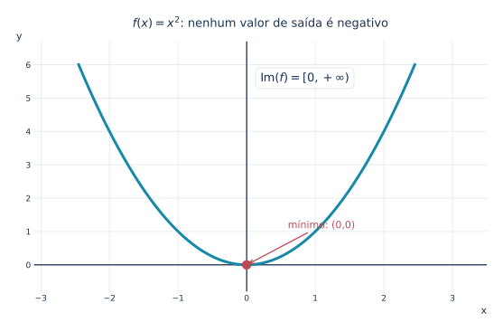{fig-alt="Parábola de x ao quadrado, com mínimo em zero, zero, mostrando imagem igual aos reais não negativos." width="94%"}

::: {.callout-note collapse="true" title="Clique para ver o código"}

```python
from pathlib import Path
import numpy as np
import matplotlib.pyplot as plt

# Padrão gráfico editorial do Blog do Marcellini.
AZUL = "#19324f"
CIANO = "#1689a6"
LARANJA = "#d87832"
VERMELHO = "#ba4a56"
GRADE = "#e2e9ef"
plt.rcParams.update({
    "font.family": "DejaVu Sans",
    "font.size": 11,
    "axes.titlesize": 13,
    "svg.fonttype": "path",  # conserva a aparência matemática em SVG
    "figure.facecolor": "white",
    "axes.facecolor": "white",
})


def preparar(ax, xlim, ylim, xticks=None, yticks=None):
    ax.set_xlim(*xlim)
    ax.set_ylim(*ylim)
    if xticks is not None:
        ax.set_xticks(xticks)
    if yticks is not None:
        ax.set_yticks(yticks)
    ax.set_axisbelow(True)
    ax.grid(True, color=GRADE, linewidth=0.8)
    for spine in ax.spines.values():
        spine.set_visible(False)
    ax.axhline(0, color=AZUL, linewidth=1.25, zorder=2)
    ax.axvline(0, color=AZUL, linewidth=1.25, zorder=2)
    ax.tick_params(axis="both", length=0, colors=AZUL, labelsize=9)
    ax.set_xlabel("x", loc="right", color=AZUL)
    ax.set_ylabel("y", loc="top", rotation=0, color=AZUL)


def salvar(fig, nome):
    destino = Path("images")
    destino.mkdir(parents=True, exist_ok=True)
    fig.savefig(destino / nome, format="svg", bbox_inches="tight",
                pad_inches=0.25, facecolor="white")
    plt.close(fig)


fig, ax = plt.subplots(figsize=(9.0, 5.0))
x = np.linspace(-2.45, 2.45, 600)
preparar(ax, (-3.1, 3.5), (-.8, 6.7),
         xticks=np.arange(-3, 4), yticks=np.arange(0, 7))
ax.plot(x, x*x, color=CIANO, lw=3, zorder=3)
ax.scatter([0], [0], s=90, color=VERMELHO, zorder=5)
ax.annotate("mínimo: (0,0)", xy=(0, 0), xytext=(.6, 1.1),
            fontsize=11, color=VERMELHO,
            arrowprops=dict(arrowstyle="->", color=VERMELHO, lw=1.3))
ax.text(0.2, 5.5, r"$\operatorname{Im}(f)=[0,+\infty)$",
        fontsize=13, color=AZUL,
        bbox=dict(facecolor="white", edgecolor=GRADE, boxstyle="round,pad=0.4"))
ax.set_title(r"$f(x)=x^2$: nenhum valor de saída é negativo",
             color=AZUL, pad=16)
salvar(fig, "1.11-imagem-parabola.svg")
```

:::

***

## 🎯 Zeros da função

Os zeros de uma função são os valores de $x$ tais que

$$
f(x)=0.
$$

No gráfico, eles são os pontos onde a curva encontra o eixo horizontal.

Por exemplo, se

$$
f(x)=x^2-5x+6,
$$

então

$$
f(x)=(x-2)(x-3).
$$

Logo,

$$
f(x)=0
$$

quando

$$
x=2
$$

ou

$$
x=3.
$$

Os zeros são fundamentais porque dividem a reta em intervalos nos quais o sinal da função pode ser analisado.

A figura aproxima a região das raízes para tornar visível que a curva cruza o eixo horizontal em dois pontos distintos. O recorte não altera o domínio da função, que continua sendo $\mathbb{R}$.

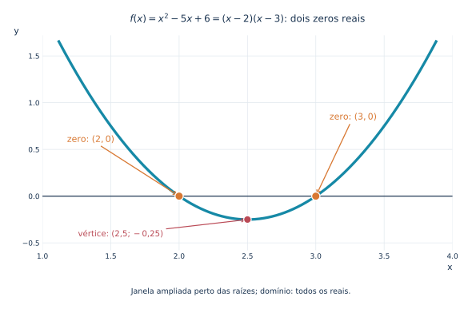{fig-alt="Recorte ampliado da parábola x ao quadrado menos cinco x mais seis, com zeros distintos em dois e três e vértice em dois e meio, menos um quarto." width="94%"}

::: {.callout-note collapse="true" title="Clique para ver o código"}

```python
from pathlib import Path
import numpy as np
import matplotlib.pyplot as plt
from matplotlib.patches import FancyBboxPatch

AZUL = "#19324f"
CIANO = "#1689a6"
LARANJA = "#d87832"
VERMELHO = "#ba4a56"
GRADE = "#e2e9ef"
ROXO = "#6c5b90"
plt.rcParams.update({
    "font.family": "DejaVu Sans",
    "font.size": 11,
    "axes.titlesize": 12,
    "svg.fonttype": "path",
    "figure.facecolor": "white",
    "axes.facecolor": "white",
})


def preparar(ax, xlim, ylim, xticks=None, yticks=None):
    ax.set_xlim(*xlim)
    ax.set_ylim(*ylim)
    if xticks is not None:
        ax.set_xticks(xticks)
    if yticks is not None:
        ax.set_yticks(yticks)
    ax.set_axisbelow(True)
    ax.grid(True, color=GRADE, linewidth=.75)
    for spine in ax.spines.values():
        spine.set_visible(False)
    if xlim[0] <= 0 <= xlim[1]:
        ax.axvline(0, color=AZUL, lw=1.2, zorder=2)
    if ylim[0] <= 0 <= ylim[1]:
        ax.axhline(0, color=AZUL, lw=1.2, zorder=2)
    ax.tick_params(axis="both", length=0, colors=AZUL, labelsize=9)
    ax.set_xlabel("x", loc="right", color=AZUL)
    ax.set_ylabel("y", loc="top", rotation=0, color=AZUL)


def salvar(fig, nome):
    destino = Path("images")
    destino.mkdir(parents=True, exist_ok=True)
    fig.savefig(destino / nome, format="svg", bbox_inches="tight",
                pad_inches=.24, facecolor="white")
    plt.close(fig)

# Recorte próximo às raízes: o mínimo é pouco abaixo do eixo x.
fig, ax = plt.subplots(figsize=(9.2, 5.2))
x = np.linspace(1.12, 3.88, 900)
y = x**2 - 5*x + 6
preparar(ax, (1.1, 3.9), (-.58, 1.72),
         xticks=np.arange(1.0, 4.1, .5),
         yticks=[-.5, 0, .5, 1, 1.5])
ax.plot(x, y, color=CIANO, lw=3.3, zorder=3)
ax.scatter([2, 3], [0, 0], color=LARANJA, s=105,
           edgecolor="white", linewidth=1.3, zorder=6)
ax.scatter([2.5], [-.25], color=VERMELHO, s=88,
           edgecolor="white", linewidth=1.2, zorder=6)
ax.annotate(r"zero: $(2,0)$", xy=(2, 0), xytext=(1.18, .58),
            fontsize=11, color=LARANJA,
            arrowprops=dict(arrowstyle="->", lw=1.3, color=LARANJA))
ax.annotate(r"zero: $(3,0)$", xy=(3, 0), xytext=(3.10, .82),
            fontsize=11, color=LARANJA,
            arrowprops=dict(arrowstyle="->", lw=1.3, color=LARANJA))
ax.annotate(r"vértice: $(2{,}5;-0{,}25)$", xy=(2.5, -.25),
            xytext=(1.26, -.43), fontsize=10.2, color=VERMELHO,
            arrowprops=dict(arrowstyle="->", lw=1.2, color=VERMELHO))
ax.set_title(r"$f(x)=x^2-5x+6=(x-2)(x-3)$: dois zeros reais",
             color=AZUL, pad=17)
fig.text(.50, .015, "Janela ampliada perto das raízes; domínio: todos os reais.",
         ha="center", fontsize=9.5, color=AZUL)
fig.subplots_adjust(bottom=.16)
salvar(fig, "1.11-zeros-quadratica.svg")
```

:::

***

## 📍 Interseção com o eixo vertical

A interseção com o eixo vertical ocorre quando

$$
x=0.
$$

Se $0$ pertence ao domínio da função, o ponto de interseção com o eixo $y$ é

$$
(0,f(0)).
$$

Por exemplo, para

$$
f(x)=2x+5,
$$

temos

$$
f(0)=5.
$$

Logo, o gráfico corta o eixo vertical no ponto

$$
(0,5).
$$

Para uma função como

$$
g(x)=\frac{1}{x},
$$

o valor $x=0$ não pertence ao domínio. Portanto, o gráfico não corta o eixo vertical.

Compare o ponto $(0,5)$, que pertence ao gráfico da reta, com a hipérbole $g(x)=1/x$, que não possui ponto de abscissa zero.

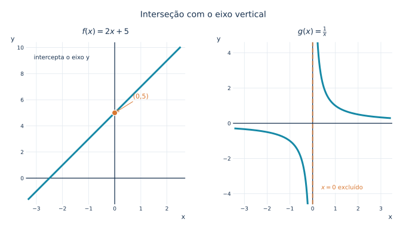{fig-alt="Dois gráficos: a reta dois x mais cinco cruza o eixo vertical em zero, cinco, enquanto a função um sobre x não cruza esse eixo." width="94%"}

::: {.callout-note collapse="true" title="Clique para ver o código"}

```python
from pathlib import Path
import numpy as np
import matplotlib.pyplot as plt

# Padrão gráfico editorial do Blog do Marcellini.
AZUL = "#19324f"
CIANO = "#1689a6"
LARANJA = "#d87832"
VERMELHO = "#ba4a56"
GRADE = "#e2e9ef"
plt.rcParams.update({
    "font.family": "DejaVu Sans",
    "font.size": 11,
    "axes.titlesize": 13,
    "svg.fonttype": "path",  # conserva a aparência matemática em SVG
    "figure.facecolor": "white",
    "axes.facecolor": "white",
})


def preparar(ax, xlim, ylim, xticks=None, yticks=None):
    ax.set_xlim(*xlim)
    ax.set_ylim(*ylim)
    if xticks is not None:
        ax.set_xticks(xticks)
    if yticks is not None:
        ax.set_yticks(yticks)
    ax.set_axisbelow(True)
    ax.grid(True, color=GRADE, linewidth=0.8)
    for spine in ax.spines.values():
        spine.set_visible(False)
    ax.axhline(0, color=AZUL, linewidth=1.25, zorder=2)
    ax.axvline(0, color=AZUL, linewidth=1.25, zorder=2)
    ax.tick_params(axis="both", length=0, colors=AZUL, labelsize=9)
    ax.set_xlabel("x", loc="right", color=AZUL)
    ax.set_ylabel("y", loc="top", rotation=0, color=AZUL)


def salvar(fig, nome):
    destino = Path("images")
    destino.mkdir(parents=True, exist_ok=True)
    fig.savefig(destino / nome, format="svg", bbox_inches="tight",
                pad_inches=0.25, facecolor="white")
    plt.close(fig)


fig, (a, b) = plt.subplots(1, 2, figsize=(11, 4.9))
fig.subplots_adjust(wspace=.3)
x = np.linspace(-3.3, 2.5, 500)
preparar(a, (-3.4, 2.7), (-2.0, 10.4),
         xticks=np.arange(-3, 3), yticks=np.arange(0, 11, 2))
a.plot(x, 2*x+5, color=CIANO, linewidth=3)
a.scatter([0], [5], s=85, color=LARANJA,
          edgecolors="white", linewidth=1.2, zorder=5)
a.annotate("(0,5)", xy=(0, 5), xytext=(.7, 6.1),
           fontsize=11, color=LARANJA,
           arrowprops=dict(arrowstyle="->", color=LARANJA))
a.set_title(r"$f(x)=2x+5$", color=AZUL, pad=14)
a.text(-3.1, 9.1, "intercepta o eixo y", color=AZUL, fontsize=10)
xl = np.linspace(-3.4, -.16, 450)
xr = np.linspace(.16, 3.4, 450)
preparar(b, (-3.5, 3.5), (-4.6, 4.6),
         xticks=np.arange(-3, 4), yticks=np.arange(-4, 5, 2))
b.plot(xl, 1/xl, color=CIANO, linewidth=3)
b.plot(xr, 1/xr, color=CIANO, linewidth=3)
b.axvline(0, color=LARANJA, ls="--", lw=2, alpha=.8)
b.set_title(r"$g(x)=\frac{1}{x}$", color=AZUL, pad=14)
b.text(.38, -3.75, r"$x=0$ excluído", color=LARANJA, fontsize=10,
       bbox=dict(facecolor="white", edgecolor="none", alpha=.9))
fig.suptitle("Interseção com o eixo vertical", fontsize=14, color=AZUL, y=1.03)
salvar(fig, "1.11-intersecao-eixo-y.svg")
```

:::

***

## ➕ Sinal da função

Estudar o sinal de uma função significa determinar onde ela é positiva, negativa ou nula.

Por exemplo, considere

$$
f(x)=x^2-4=(x-2)(x+2).
$$

Os zeros são

$$
x=-2
$$

e

$$
x=2.
$$

Eles dividem a reta em três intervalos:

$$
(-\infty,-2),\qquad (-2,2),\qquad (2,+\infty).
$$

Analisando sinais:

- em $(-\infty,-2)$, os dois fatores são negativos, então $f(x)>0$;
- em $(-2,2)$, os fatores têm sinais opostos, então $f(x)<0$;
- em $(2,+\infty)$, os dois fatores são positivos, então $f(x)>0$.

Graficamente, isso significa que a curva fica acima do eixo $x$ fora do intervalo $[-2,2]$ e abaixo do eixo $x$ entre $-2$ e $2$.

Na figura, as partes acima do eixo $x$ correspondem a $f(x)>0$ e a parte abaixo corresponde a $f(x)<0$. Nos zeros, $f(x)=0$.

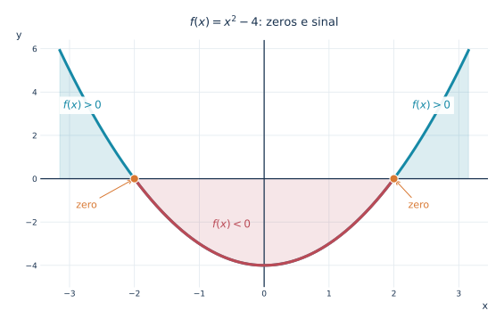{fig-alt="Parábola x ao quadrado menos quatro com os trechos positivos realçados em azul, trecho negativo em vermelho e raízes em menos dois e dois." width="94%"}

::: {.callout-note collapse="true" title="Clique para ver o código"}

```python
from pathlib import Path
import numpy as np
import matplotlib.pyplot as plt

# Padrão gráfico editorial do Blog do Marcellini.
AZUL = "#19324f"
CIANO = "#1689a6"
LARANJA = "#d87832"
VERMELHO = "#ba4a56"
GRADE = "#e2e9ef"
plt.rcParams.update({
    "font.family": "DejaVu Sans",
    "font.size": 11,
    "axes.titlesize": 13,
    "svg.fonttype": "path",  # conserva a aparência matemática em SVG
    "figure.facecolor": "white",
    "axes.facecolor": "white",
})


def preparar(ax, xlim, ylim, xticks=None, yticks=None):
    ax.set_xlim(*xlim)
    ax.set_ylim(*ylim)
    if xticks is not None:
        ax.set_xticks(xticks)
    if yticks is not None:
        ax.set_yticks(yticks)
    ax.set_axisbelow(True)
    ax.grid(True, color=GRADE, linewidth=0.8)
    for spine in ax.spines.values():
        spine.set_visible(False)
    ax.axhline(0, color=AZUL, linewidth=1.25, zorder=2)
    ax.axvline(0, color=AZUL, linewidth=1.25, zorder=2)
    ax.tick_params(axis="both", length=0, colors=AZUL, labelsize=9)
    ax.set_xlabel("x", loc="right", color=AZUL)
    ax.set_ylabel("y", loc="top", rotation=0, color=AZUL)


def salvar(fig, nome):
    destino = Path("images")
    destino.mkdir(parents=True, exist_ok=True)
    fig.savefig(destino / nome, format="svg", bbox_inches="tight",
                pad_inches=0.25, facecolor="white")
    plt.close(fig)


fig, ax = plt.subplots(figsize=(9.0, 5.0))
x = np.linspace(-3.15, 3.15, 900)
y = x*x - 4
preparar(ax, (-3.45, 3.45), (-5, 6.4),
         xticks=np.arange(-3, 4), yticks=np.arange(-4, 7, 2))
ax.fill_between(x, y, 0, where=(y > 0), color=CIANO, alpha=.15,
                interpolate=True)
ax.fill_between(x, y, 0, where=(y < 0), color=VERMELHO, alpha=.14,
                interpolate=True)
ax.plot(x, y, color=CIANO, lw=3, zorder=3)
ax.plot(x[(x>-2)&(x<2)], y[(x>-2)&(x<2)], color=VERMELHO,
        lw=3.2, zorder=4)
ax.scatter([-2, 2], [0, 0], s=85, color=LARANJA,
           edgecolors="white", linewidth=1, zorder=5)
ax.text(-3.1, 3.25, r"$f(x)>0$", color=CIANO, fontsize=12,
        bbox=dict(facecolor="white", edgecolor="none", alpha=.92))
ax.text(-.8, -2.25, r"$f(x)<0$", color=VERMELHO, fontsize=12)
ax.text(2.28, 3.25, r"$f(x)>0$", color=CIANO, fontsize=12,
        bbox=dict(facecolor="white", edgecolor="none", alpha=.92))
ax.annotate("zero", xy=(-2, 0), xytext=(-2.9, -1.35),
            color=LARANJA, arrowprops=dict(arrowstyle="->", color=LARANJA))
ax.annotate("zero", xy=(2, 0), xytext=(2.22, -1.35),
            color=LARANJA, arrowprops=dict(arrowstyle="->", color=LARANJA))
ax.set_title(r"$f(x)=x^2-4$: zeros e sinal", color=AZUL, pad=16)
salvar(fig, "1.11-zeros-sinal.svg")
```

:::

***

## 📉 Crescimento e decrescimento

Uma função é crescente em um intervalo quando, à medida que $x$ aumenta, os valores de $f(x)$ também aumentam.

Uma função é decrescente em um intervalo quando, à medida que $x$ aumenta, os valores de $f(x)$ diminuem.

Por exemplo, a função

$$
f(x)=x^2
$$

é decrescente em

$$
(-\infty,0]
$$

e crescente em

$$
[0,+\infty).
$$

Graficamente, a parábola desce até o vértice e depois sobe.

Mais adiante, a derivada será a ferramenta principal para estudar crescimento e decrescimento com precisão.

A mesma parábola reúne os três aspectos: decrescimento à esquerda, mínimo no vértice e crescimento à direita.

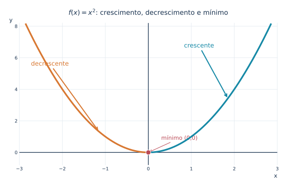{fig-alt="Gráfico de x ao quadrado com ramo esquerdo decrescente em laranja, direito crescente em azul e mínimo em zero, zero." width="94%"}

::: {.callout-note collapse="true" title="Clique para ver o código"}

```python
from pathlib import Path
import numpy as np
import matplotlib.pyplot as plt

# Padrão gráfico editorial do Blog do Marcellini.
AZUL = "#19324f"
CIANO = "#1689a6"
LARANJA = "#d87832"
VERMELHO = "#ba4a56"
GRADE = "#e2e9ef"
plt.rcParams.update({
    "font.family": "DejaVu Sans",
    "font.size": 11,
    "axes.titlesize": 13,
    "svg.fonttype": "path",  # conserva a aparência matemática em SVG
    "figure.facecolor": "white",
    "axes.facecolor": "white",
})


def preparar(ax, xlim, ylim, xticks=None, yticks=None):
    ax.set_xlim(*xlim)
    ax.set_ylim(*ylim)
    if xticks is not None:
        ax.set_xticks(xticks)
    if yticks is not None:
        ax.set_yticks(yticks)
    ax.set_axisbelow(True)
    ax.grid(True, color=GRADE, linewidth=0.8)
    for spine in ax.spines.values():
        spine.set_visible(False)
    ax.axhline(0, color=AZUL, linewidth=1.25, zorder=2)
    ax.axvline(0, color=AZUL, linewidth=1.25, zorder=2)
    ax.tick_params(axis="both", length=0, colors=AZUL, labelsize=9)
    ax.set_xlabel("x", loc="right", color=AZUL)
    ax.set_ylabel("y", loc="top", rotation=0, color=AZUL)


def salvar(fig, nome):
    destino = Path("images")
    destino.mkdir(parents=True, exist_ok=True)
    fig.savefig(destino / nome, format="svg", bbox_inches="tight",
                pad_inches=0.25, facecolor="white")
    plt.close(fig)


fig, ax = plt.subplots(figsize=(9.0, 5.0))
preparar(ax, (-3.0, 3.0), (-.8, 8.2),
         xticks=np.arange(-3, 4), yticks=np.arange(0, 9, 2))
xe = np.linspace(-2.85, 0, 400)
xd = np.linspace(0, 2.85, 400)
ax.plot(xe, xe*xe, color=LARANJA, lw=3.2, zorder=4)
ax.plot(xd, xd*xd, color=CIANO, lw=3.2, zorder=4)
ax.scatter([0], [0], s=90, color=VERMELHO,
           edgecolors="white", linewidth=1, zorder=5)
ax.annotate("decrescente", xy=(-1.15, 1.32), xytext=(-2.73, 5.5),
            color=LARANJA, fontsize=12,
            arrowprops=dict(arrowstyle="->", color=LARANJA, lw=2))
ax.annotate("crescente", xy=(1.85, 3.42), xytext=(.83, 6.65),
            color=CIANO, fontsize=12,
            arrowprops=dict(arrowstyle="->", color=CIANO, lw=2))
ax.annotate("mínimo (0,0)", xy=(0,0), xytext=(.3, .8),
            color=VERMELHO, fontsize=11,
            arrowprops=dict(arrowstyle="->", color=VERMELHO))
ax.set_title(r"$f(x)=x^2$: crescimento, decrescimento e mínimo",
             color=AZUL, pad=16)
salvar(fig, "1.11-crescimento-minimo.svg")
```

:::

***

## 🏔️ Máximos e mínimos

Um ponto de mínimo ocorre quando a função atinge um valor menor do que os valores próximos.

Por exemplo,

$$
f(x)=x^2
$$

tem mínimo em

$$
x=0,
$$

pois

$$
f(0)=0
$$

e

$$
x^2\geq 0
$$

para todo real $x$.

Um ponto de máximo ocorre quando a função atinge um valor maior do que os valores próximos.

A análise de máximos e mínimos será uma das grandes aplicações das derivadas.

Diferentemente de $x^2$, que tem mínimo absoluto, a função cúbica a seguir possui **um máximo local e um mínimo local**, mas não possui máximo nem mínimo absolutos em $\mathbb{R}$.

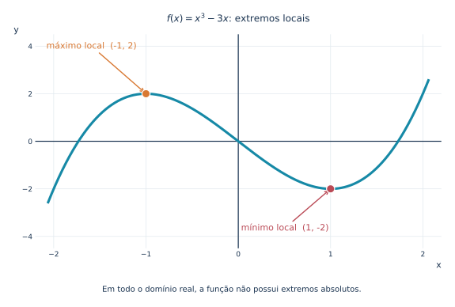{fig-alt="Curva cúbica x ao cubo menos três x com máximo local em menos um, dois e mínimo local em um, menos dois, sem extremos absolutos." width="94%"}

::: {.callout-note collapse="true" title="Clique para ver o código"}

```python
from pathlib import Path
import numpy as np
import matplotlib.pyplot as plt
from matplotlib.patches import FancyBboxPatch

AZUL = "#19324f"
CIANO = "#1689a6"
LARANJA = "#d87832"
VERMELHO = "#ba4a56"
GRADE = "#e2e9ef"
ROXO = "#6c5b90"
plt.rcParams.update({
    "font.family": "DejaVu Sans",
    "font.size": 11,
    "axes.titlesize": 12,
    "svg.fonttype": "path",
    "figure.facecolor": "white",
    "axes.facecolor": "white",
})


def preparar(ax, xlim, ylim, xticks=None, yticks=None):
    ax.set_xlim(*xlim)
    ax.set_ylim(*ylim)
    if xticks is not None:
        ax.set_xticks(xticks)
    if yticks is not None:
        ax.set_yticks(yticks)
    ax.set_axisbelow(True)
    ax.grid(True, color=GRADE, linewidth=.75)
    for spine in ax.spines.values():
        spine.set_visible(False)
    if xlim[0] <= 0 <= xlim[1]:
        ax.axvline(0, color=AZUL, lw=1.2, zorder=2)
    if ylim[0] <= 0 <= ylim[1]:
        ax.axhline(0, color=AZUL, lw=1.2, zorder=2)
    ax.tick_params(axis="both", length=0, colors=AZUL, labelsize=9)
    ax.set_xlabel("x", loc="right", color=AZUL)
    ax.set_ylabel("y", loc="top", rotation=0, color=AZUL)


def salvar(fig, nome):
    destino = Path("images")
    destino.mkdir(parents=True, exist_ok=True)
    fig.savefig(destino / nome, format="svg", bbox_inches="tight",
                pad_inches=.24, facecolor="white")
    plt.close(fig)


fig, ax = plt.subplots(figsize=(9.2, 5.3))
x = np.linspace(-2.06, 2.06, 850)
y = x**3 - 3*x
preparar(ax, (-2.2, 2.2), (-4.5, 4.5),
         xticks=np.arange(-2, 3), yticks=np.arange(-4, 5, 2))
ax.plot(x, y, color=CIANO, lw=3.1, zorder=3)
ax.scatter([-1], [2], color=LARANJA, s=105,
           edgecolor="white", lw=1.2, zorder=5)
ax.scatter([1], [-2], color=VERMELHO, s=105,
           edgecolor="white", lw=1.2, zorder=5)
ax.annotate("máximo local  (-1, 2)", xy=(-1, 2), xytext=(-2.08, 3.9),
            fontsize=11, color=LARANJA,
            arrowprops=dict(arrowstyle="->", lw=1.4, color=LARANJA))
ax.annotate("mínimo local  (1, -2)", xy=(1, -2), xytext=(.03, -3.75),
            fontsize=11, color=VERMELHO,
            arrowprops=dict(arrowstyle="->", lw=1.4, color=VERMELHO))
ax.set_title(r"$f(x)=x^3-3x$: extremos locais", color=AZUL, pad=16)
fig.text(.5, .026, "Em todo o domínio real, a função não possui extremos absolutos.",
         ha="center", fontsize=10, color=AZUL)
fig.subplots_adjust(bottom=.17)
salvar(fig, "1.11-maximos-minimos.svg")
```

:::

***

## 🪞 Simetria

Algumas funções apresentam simetrias importantes.

Para classificar uma função como par ou ímpar, seu domínio deve ser simétrico em relação à origem: sempre que $x$ pertence ao domínio, $-x$ também deve pertencer.

Uma função é par quando, para todo $x\in D_f$,

$$
f(-x)=f(x).
$$

O gráfico de uma função par é simétrico em relação ao eixo vertical.

Exemplo:

$$
f(x)=x^2.
$$

De fato,

$$
f(-x)=(-x)^2=x^2=f(x).
$$

Uma função é ímpar quando, para todo $x\in D_f$,

$$
f(-x)=-f(x).
$$

O gráfico de uma função ímpar é simétrico em relação à origem.

Exemplo:

$$
g(x)=x^3.
$$

De fato,

$$
g(-x)=(-x)^3=-x^3=-g(x).
$$

As duas simetrias são distintas: reflexão no eixo vertical para a função par e rotação de meia-volta ao redor da origem para a ímpar.

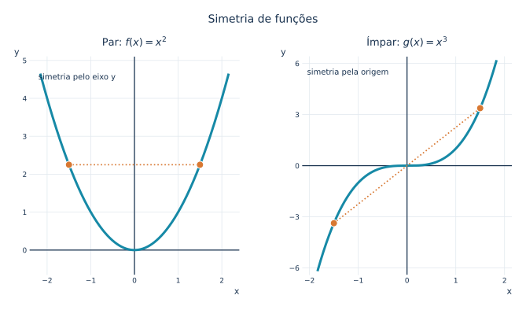{fig-alt="Comparação entre parábola x ao quadrado com simetria em relação ao eixo vertical e curva cúbica x ao cubo com simetria em relação à origem." width="94%"}

::: {.callout-note collapse="true" title="Clique para ver o código"}

```python
from pathlib import Path
import numpy as np
import matplotlib.pyplot as plt

# Padrão gráfico editorial do Blog do Marcellini.
AZUL = "#19324f"
CIANO = "#1689a6"
LARANJA = "#d87832"
VERMELHO = "#ba4a56"
GRADE = "#e2e9ef"
plt.rcParams.update({
    "font.family": "DejaVu Sans",
    "font.size": 11,
    "axes.titlesize": 13,
    "svg.fonttype": "path",  # conserva a aparência matemática em SVG
    "figure.facecolor": "white",
    "axes.facecolor": "white",
})


def preparar(ax, xlim, ylim, xticks=None, yticks=None):
    ax.set_xlim(*xlim)
    ax.set_ylim(*ylim)
    if xticks is not None:
        ax.set_xticks(xticks)
    if yticks is not None:
        ax.set_yticks(yticks)
    ax.set_axisbelow(True)
    ax.grid(True, color=GRADE, linewidth=0.8)
    for spine in ax.spines.values():
        spine.set_visible(False)
    ax.axhline(0, color=AZUL, linewidth=1.25, zorder=2)
    ax.axvline(0, color=AZUL, linewidth=1.25, zorder=2)
    ax.tick_params(axis="both", length=0, colors=AZUL, labelsize=9)
    ax.set_xlabel("x", loc="right", color=AZUL)
    ax.set_ylabel("y", loc="top", rotation=0, color=AZUL)


def salvar(fig, nome):
    destino = Path("images")
    destino.mkdir(parents=True, exist_ok=True)
    fig.savefig(destino / nome, format="svg", bbox_inches="tight",
                pad_inches=0.25, facecolor="white")
    plt.close(fig)


fig, (a, b) = plt.subplots(1, 2, figsize=(11, 5.0))
fig.subplots_adjust(wspace=.3)
x = np.linspace(-2.15, 2.15, 700)
preparar(a, (-2.4, 2.4), (-.65, 5.1),
         xticks=np.arange(-2, 3), yticks=np.arange(0, 6))
a.plot(x, x*x, color=CIANO, linewidth=3)
a.scatter([-1.5, 1.5], [2.25, 2.25], s=80,
          color=LARANJA, edgecolor="white", zorder=5)
a.plot([-1.5, 1.5], [2.25, 2.25], ls=":", color=LARANJA, lw=1.7)
a.set_title(r"Par: $f(x)=x^2$", color=AZUL, pad=14)
a.text(-2.2, 4.5, "simetria pelo eixo y", fontsize=10, color=AZUL)
preparar(b, (-2.15, 2.15), (-6.4, 6.4),
         xticks=np.arange(-2, 3), yticks=np.arange(-6, 7, 3))
x2 = np.linspace(-1.83, 1.83, 700)
b.plot(x2, x2**3, color=CIANO, linewidth=3)
b.scatter([-1.5, 1.5], [-3.375, 3.375], s=80,
          color=LARANJA, edgecolor="white", zorder=5)
b.plot([-1.5, 1.5], [-3.375, 3.375], ls=":", color=LARANJA, lw=1.7)
b.set_title(r"Ímpar: $g(x)=x^3$", color=AZUL, pad=14)
b.text(-2.05, 5.35, "simetria pela origem", fontsize=10, color=AZUL)
fig.suptitle("Simetria de funções", color=AZUL, fontsize=14, y=1.03)
salvar(fig, "1.11-simetria-par-impar.svg")
```

:::

***

## 📏 Assíntotas

De maneira intuitiva, uma assíntota é uma reta à qual o gráfico de uma função se aproxima cada vez mais em determinado regime. A formalização dessa ideia será feita por meio de limites.

Uma reta vertical $x=a$ é uma assíntota vertical quando, ao menos por um dos lados, os valores de $f(x)$ tendem a $+\infty$ ou a $-\infty$ quando $x$ se aproxima de $a$.

Uma reta horizontal $y=L$ é uma assíntota horizontal quando a função se aproxima do valor constante $L$ à medida que $x$ tende a $+\infty$ ou a $-\infty$, em pelo menos uma dessas direções.

É importante observar que a exclusão de um valor do domínio, por si só, não garante uma assíntota vertical. Em alguns casos, pode ocorrer apenas um buraco removível no gráfico, como veremos na seção sobre leitura algébrica.

Por exemplo,

$$
f(x)=\frac{1}{x-2}
$$

tem assíntota vertical em

$$
x=2.
$$

Uma assíntota horizontal pode ser observada quando a função se aproxima de um valor constante para valores de $x$ cada vez maiores em módulo.

Por exemplo,

$$
g(x)=\frac{2x+1}{x-3}
$$

se aproxima de

$$
y=2
$$

quando $x$ tende a $+\infty$ ou a $-\infty$.

No módulo de limites, essas ideias serão formalizadas.

Neste exemplo, as duas assíntotas aparecem simultaneamente: como o numerador vale $7$ em $x=3$, enquanto o denominador tende a zero, a reta vertical $x=3$ é uma assíntota vertical. Já a reta horizontal $y=2$ descreve o comportamento dos ramos para valores de $|x|$ cada vez maiores.

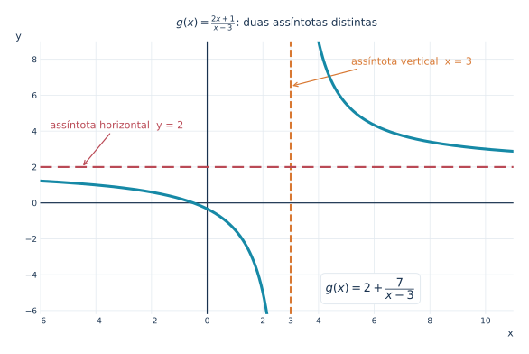{fig-alt="Função racional dois x mais um sobre x menos três com assíntota vertical x igual a três e horizontal y igual a dois, ambas tracejadas." width="94%"}

::: {.callout-note collapse="true" title="Clique para ver o código"}

```python
from pathlib import Path
import numpy as np
import matplotlib.pyplot as plt
from matplotlib.patches import FancyBboxPatch

AZUL = "#19324f"
CIANO = "#1689a6"
LARANJA = "#d87832"
VERMELHO = "#ba4a56"
GRADE = "#e2e9ef"
ROXO = "#6c5b90"
plt.rcParams.update({
    "font.family": "DejaVu Sans",
    "font.size": 11,
    "axes.titlesize": 12,
    "svg.fonttype": "path",
    "figure.facecolor": "white",
    "axes.facecolor": "white",
})


def preparar(ax, xlim, ylim, xticks=None, yticks=None):
    ax.set_xlim(*xlim)
    ax.set_ylim(*ylim)
    if xticks is not None:
        ax.set_xticks(xticks)
    if yticks is not None:
        ax.set_yticks(yticks)
    ax.set_axisbelow(True)
    ax.grid(True, color=GRADE, linewidth=.75)
    for spine in ax.spines.values():
        spine.set_visible(False)
    if xlim[0] <= 0 <= xlim[1]:
        ax.axvline(0, color=AZUL, lw=1.2, zorder=2)
    if ylim[0] <= 0 <= ylim[1]:
        ax.axhline(0, color=AZUL, lw=1.2, zorder=2)
    ax.tick_params(axis="both", length=0, colors=AZUL, labelsize=9)
    ax.set_xlabel("x", loc="right", color=AZUL)
    ax.set_ylabel("y", loc="top", rotation=0, color=AZUL)


def salvar(fig, nome):
    destino = Path("images")
    destino.mkdir(parents=True, exist_ok=True)
    fig.savefig(destino / nome, format="svg", bbox_inches="tight",
                pad_inches=.24, facecolor="white")
    plt.close(fig)


fig, ax = plt.subplots(figsize=(9.4, 5.45))
xe = np.linspace(-6, 2.79, 900)
xd = np.linspace(3.25, 11, 900)
preparar(ax, (-6, 11), (-6.2, 9.0),
         xticks=[-6, -4, -2, 0, 2, 3, 4, 6, 8, 10],
         yticks=[-6, -4, -2, 0, 2, 4, 6, 8])
ax.plot(xe, (2*xe+1)/(xe-3), color=CIANO, lw=3.1, zorder=4)
ax.plot(xd, (2*xd+1)/(xd-3), color=CIANO, lw=3.1, zorder=4)
ax.axvline(3, color=LARANJA, ls="--", lw=2.15, zorder=5)
ax.axhline(2, color=VERMELHO, ls=(0, (6, 3)), lw=2.15, zorder=5)
ax.annotate("assíntota vertical  x = 3", xy=(3, 6.5),
            xytext=(5.3, 7.7), fontsize=11.2, color=LARANJA,
            arrowprops=dict(arrowstyle="->", lw=1.2, color=LARANJA))
ax.annotate("assíntota horizontal  y = 2", xy=(-4.5, 2),
            xytext=(-5.65, 4.15), fontsize=11.2, color=VERMELHO,
            arrowprops=dict(arrowstyle="->", lw=1.2, color=VERMELHO))
ax.text(4.25, -4.95, r"$g(x)=2+\dfrac{7}{x-3}$", fontsize=13,
        color=AZUL, bbox=dict(facecolor="white", edgecolor=GRADE,
                              boxstyle="round,pad=0.4"))
ax.set_title(r"$g(x)=\frac{2x+1}{x-3}$: duas assíntotas distintas",
             color=AZUL, pad=17)
salvar(fig, "1.11-assintotas-racional.svg")
```

:::

***

## 📊 Leitura de gráficos

Ao observar um gráfico, podemos fazer várias perguntas:

- Que parte do domínio está representada na janela do gráfico?
- Qual parece ser a imagem?
- Onde a curva cruza o eixo $x$?
- Onde cruza o eixo $y$?
- Em quais intervalos a função cresce?
- Em quais intervalos decresce?
- Há buracos?
- Há saltos?
- Há assíntotas?
- Há máximos ou mínimos?
- Há simetria?

Essas perguntas formam uma leitura qualitativa da função.

O Cálculo transformará muitas dessas observações em definições e teoremas.

A função $h(x)=x^3-3x+1$ permite reunir várias perguntas em uma única leitura. Observe os pontos destacados e compare a **janela visível do desenho** com o domínio matemático completo da função.

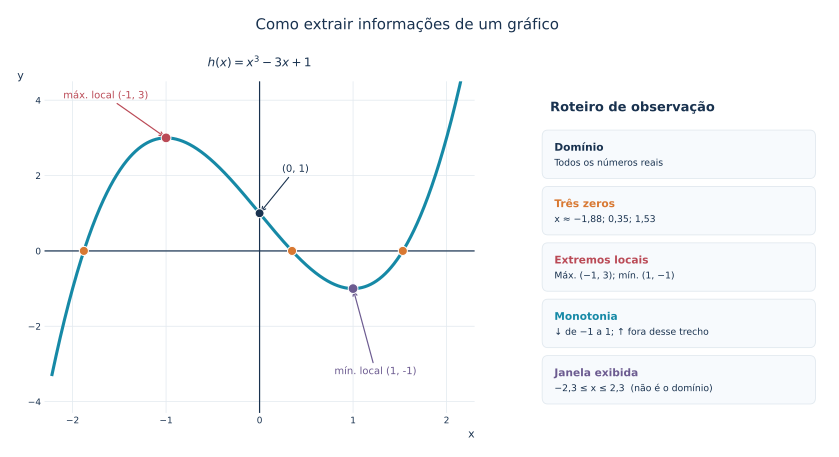{fig-alt="Painel de leitura do gráfico da função cúbica x ao cubo menos três x mais um com três zeros aproximados, intercepto vertical, máximo e mínimo locais e resumo de domínio e monotonia." width="94%"}

::: {.callout-note collapse="true" title="Clique para ver o código"}

```python
from pathlib import Path
import numpy as np
import matplotlib.pyplot as plt
from matplotlib.patches import FancyBboxPatch

AZUL = "#19324f"
CIANO = "#1689a6"
LARANJA = "#d87832"
VERMELHO = "#ba4a56"
GRADE = "#e2e9ef"
ROXO = "#6c5b90"
plt.rcParams.update({
    "font.family": "DejaVu Sans",
    "font.size": 11,
    "axes.titlesize": 12,
    "svg.fonttype": "path",
    "figure.facecolor": "white",
    "axes.facecolor": "white",
})


def preparar(ax, xlim, ylim, xticks=None, yticks=None):
    ax.set_xlim(*xlim)
    ax.set_ylim(*ylim)
    if xticks is not None:
        ax.set_xticks(xticks)
    if yticks is not None:
        ax.set_yticks(yticks)
    ax.set_axisbelow(True)
    ax.grid(True, color=GRADE, linewidth=.75)
    for spine in ax.spines.values():
        spine.set_visible(False)
    if xlim[0] <= 0 <= xlim[1]:
        ax.axvline(0, color=AZUL, lw=1.2, zorder=2)
    if ylim[0] <= 0 <= ylim[1]:
        ax.axhline(0, color=AZUL, lw=1.2, zorder=2)
    ax.tick_params(axis="both", length=0, colors=AZUL, labelsize=9)
    ax.set_xlabel("x", loc="right", color=AZUL)
    ax.set_ylabel("y", loc="top", rotation=0, color=AZUL)


def salvar(fig, nome):
    destino = Path("images")
    destino.mkdir(parents=True, exist_ok=True)
    fig.savefig(destino / nome, format="svg", bbox_inches="tight",
                pad_inches=.24, facecolor="white")
    plt.close(fig)


fig = plt.figure(figsize=(12.0, 6.15))
gs = fig.add_gridspec(1, 2, width_ratios=[1.52, 1], wspace=.18)
ax = fig.add_subplot(gs[0, 0])
painel = fig.add_subplot(gs[0, 1])
x = np.linspace(-2.22, 2.22, 1000)
h = x**3 - 3*x + 1
preparar(ax, (-2.3, 2.3), (-4.3, 4.5),
         xticks=np.arange(-2, 3), yticks=np.arange(-4, 5, 2))
ax.plot(x, h, color=CIANO, lw=3.1, zorder=3)
zeros = np.sort(np.roots([1, 0, -3, 1]).real)
ax.scatter(zeros, [0]*3, s=83, color=LARANJA,
           edgecolors="white", lw=1, zorder=6)
ax.scatter([-1], [3], s=95, color=VERMELHO,
           edgecolors="white", lw=1, zorder=6)
ax.scatter([1], [-1], s=95, color=ROXO,
           edgecolors="white", lw=1, zorder=6)
ax.scatter([0], [1], s=80, color=AZUL,
           edgecolors="white", lw=1, zorder=6)
ax.annotate("máx. local (-1, 3)", xy=(-1, 3), xytext=(-2.1, 4.05),
            fontsize=10.0, color=VERMELHO,
            arrowprops=dict(arrowstyle="->", color=VERMELHO, lw=1.2))
ax.annotate("mín. local (1, -1)", xy=(1, -1), xytext=(.80, -3.27),
            fontsize=10.0, color=ROXO,
            arrowprops=dict(arrowstyle="->", color=ROXO, lw=1.2))
ax.annotate("(0, 1)", xy=(0, 1), xytext=(.24, 2.1),
            fontsize=10.0, color=AZUL,
            arrowprops=dict(arrowstyle="->", color=AZUL, lw=1.1))
ax.set_title(r"$h(x)=x^3-3x+1$", color=AZUL, pad=15)

painel.axis("off")
painel.set_xlim(0, 1)
painel.set_ylim(0, 1)
painel.text(.04, .94, "Roteiro de observação", color=AZUL,
            weight="bold", fontsize=13, va="top")


def linha(y, titulo, detalhe, cor):
    box = FancyBboxPatch((.025, y-.10), .94, .12,
                         boxstyle="round,pad=0.013,rounding_size=.02",
                         facecolor="#f7fafd", edgecolor=GRADE, lw=.9)
    painel.add_patch(box)
    painel.text(.055, y-.005, titulo, color=cor,
                fontsize=10.6, weight="bold", va="top")
    painel.text(.055, y-.053, detalhe, color=AZUL,
                fontsize=9.3, va="top")


linha(.82, "Domínio", "Todos os números reais", AZUL)
linha(.65, "Três zeros", "x ≈ −1,88; 0,35; 1,53", LARANJA)
linha(.48, "Extremos locais", "Máx. (−1, 3); mín. (1, −1)", VERMELHO)
linha(.31, "Monotonia", "↓ de −1 a 1; ↑ fora desse trecho", CIANO)
linha(.14, "Janela exibida", "−2,3 ≤ x ≤ 2,3  (não é o domínio)", ROXO)
fig.suptitle("Como extrair informações de um gráfico",
             fontsize=15, color=AZUL, y=.995)
fig.subplots_adjust(top=.85, bottom=.10, left=.08, right=.98)
salvar(fig, "1.11-leitura-grafico-guia.svg")
```

:::

***

## 🔎 Leitura algébrica de funções

Dada uma fórmula, podemos investigar:

- domínio;
- zeros;
- intercepto vertical;
- sinal;
- simplificações;
- simetrias;
- comportamento para valores grandes de $x$.

Por exemplo, para

$$
f(x)=\frac{x^2-1}{x-1},
$$

vemos que

$$
x\neq 1.
$$

Além disso,

$$
x^2-1=(x-1)(x+1).
$$

Então, para $x\neq 1$,

$$
f(x)=x+1.
$$

O gráfico é a reta $y=x+1$, mas com um buraco em $x=1$.

Esse exemplo mostra como a álgebra revela detalhes que o gráfico precisa respeitar.

O círculo aberto em $(1,2)$ indica que o ponto não pertence ao gráfico, mesmo que a expressão simplificada $x+1$ pudesse assumir esse valor.

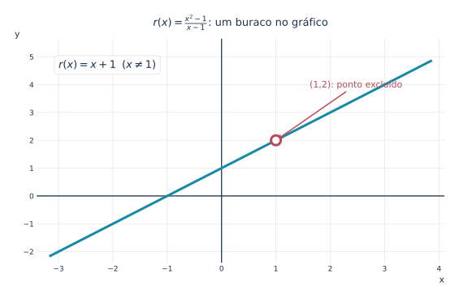{fig-alt="Reta y igual a x mais um com círculo aberto no ponto um, dois, indicando descontinuidade removível da função racional." width="94%"}

::: {.callout-note collapse="true" title="Clique para ver o código"}

```python
from pathlib import Path
import numpy as np
import matplotlib.pyplot as plt

# Padrão gráfico editorial do Blog do Marcellini.
AZUL = "#19324f"
CIANO = "#1689a6"
LARANJA = "#d87832"
VERMELHO = "#ba4a56"
GRADE = "#e2e9ef"
plt.rcParams.update({
    "font.family": "DejaVu Sans",
    "font.size": 11,
    "axes.titlesize": 13,
    "svg.fonttype": "path",  # conserva a aparência matemática em SVG
    "figure.facecolor": "white",
    "axes.facecolor": "white",
})


def preparar(ax, xlim, ylim, xticks=None, yticks=None):
    ax.set_xlim(*xlim)
    ax.set_ylim(*ylim)
    if xticks is not None:
        ax.set_xticks(xticks)
    if yticks is not None:
        ax.set_yticks(yticks)
    ax.set_axisbelow(True)
    ax.grid(True, color=GRADE, linewidth=0.8)
    for spine in ax.spines.values():
        spine.set_visible(False)
    ax.axhline(0, color=AZUL, linewidth=1.25, zorder=2)
    ax.axvline(0, color=AZUL, linewidth=1.25, zorder=2)
    ax.tick_params(axis="both", length=0, colors=AZUL, labelsize=9)
    ax.set_xlabel("x", loc="right", color=AZUL)
    ax.set_ylabel("y", loc="top", rotation=0, color=AZUL)


def salvar(fig, nome):
    destino = Path("images")
    destino.mkdir(parents=True, exist_ok=True)
    fig.savefig(destino / nome, format="svg", bbox_inches="tight",
                pad_inches=0.25, facecolor="white")
    plt.close(fig)


fig, ax = plt.subplots(figsize=(9.0, 5.0))
x = np.linspace(-3.15, 3.85, 750)
preparar(ax, (-3.4, 4.1), (-2.4, 5.65),
         xticks=np.arange(-3, 5), yticks=np.arange(-2, 6))
ax.plot(x, x+1, color=CIANO, lw=3, zorder=3)
ax.scatter([1], [2], s=145, facecolor="white",
           edgecolor=VERMELHO, linewidth=3.0, zorder=6)
ax.annotate("(1,2): ponto excluído", xy=(1, 2), xytext=(1.62, 3.9),
            fontsize=11, color=VERMELHO,
            arrowprops=dict(arrowstyle="->", color=VERMELHO, lw=1.5))
ax.text(-3.0, 4.6, r"$r(x)=x+1\;\;(x\neq 1)$", fontsize=13,
        color=AZUL,
        bbox=dict(facecolor="white", edgecolor=GRADE, boxstyle="round,pad=0.4"))
ax.set_title(r"$r(x)=\frac{x^2-1}{x-1}$: um buraco no gráfico",
             color=AZUL, pad=16)
salvar(fig, "1.11-buraco-removivel.svg")
```

:::

***

## 📊 Gráficos e Cálculo

O Cálculo pode ser visto como uma forma refinada de leitura gráfica.

- Limites estudam o que acontece perto de um ponto.
- Continuidade estuda se há quebras, saltos ou buracos.
- Derivadas estudam inclinação, crescimento e taxa de variação.
- Integrais estudam área, acumulação e soma contínua.

Por isso, revisar a leitura gráfica e algébrica de funções é essencial antes de entrar em limites.

A mesma função $f(x)=x^2$ pode ser observada sob quatro perspectivas. Esta ilustração é uma **antecipação intuitiva**: os conceitos serão definidos e desenvolvidos rigorosamente nos módulos seguintes.

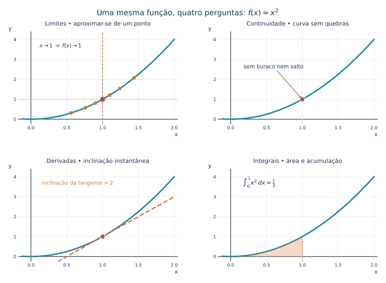{fig-alt="Quatro painéis com a parábola x ao quadrado ilustrando limite ao aproximar de x igual a um, continuidade no ponto, reta tangente de inclinação dois e área sob a curva de zero a um." width="94%"}

::: {.callout-note collapse="true" title="Clique para ver o código"}

```python
from pathlib import Path
import numpy as np
import matplotlib.pyplot as plt
from matplotlib.patches import FancyBboxPatch

AZUL = "#19324f"
CIANO = "#1689a6"
LARANJA = "#d87832"
VERMELHO = "#ba4a56"
GRADE = "#e2e9ef"
ROXO = "#6c5b90"
plt.rcParams.update({
    "font.family": "DejaVu Sans",
    "font.size": 11,
    "axes.titlesize": 12,
    "svg.fonttype": "path",
    "figure.facecolor": "white",
    "axes.facecolor": "white",
})


def preparar(ax, xlim, ylim, xticks=None, yticks=None):
    ax.set_xlim(*xlim)
    ax.set_ylim(*ylim)
    if xticks is not None:
        ax.set_xticks(xticks)
    if yticks is not None:
        ax.set_yticks(yticks)
    ax.set_axisbelow(True)
    ax.grid(True, color=GRADE, linewidth=.75)
    for spine in ax.spines.values():
        spine.set_visible(False)
    if xlim[0] <= 0 <= xlim[1]:
        ax.axvline(0, color=AZUL, lw=1.2, zorder=2)
    if ylim[0] <= 0 <= ylim[1]:
        ax.axhline(0, color=AZUL, lw=1.2, zorder=2)
    ax.tick_params(axis="both", length=0, colors=AZUL, labelsize=9)
    ax.set_xlabel("x", loc="right", color=AZUL)
    ax.set_ylabel("y", loc="top", rotation=0, color=AZUL)


def salvar(fig, nome):
    destino = Path("images")
    destino.mkdir(parents=True, exist_ok=True)
    fig.savefig(destino / nome, format="svg", bbox_inches="tight",
                pad_inches=.24, facecolor="white")
    plt.close(fig)


fig, axs = plt.subplots(2, 2, figsize=(11.5, 8.0))
xx = np.linspace(-.12, 2.0, 650)
for ax in axs.flat:
    preparar(ax, (-.18, 2.05), (-.25, 4.4),
             xticks=[0, .5, 1, 1.5, 2], yticks=[0, 1, 2, 3, 4])
    ax.plot(xx, xx**2, color=CIANO, lw=2.9, zorder=3)

# Limite: aproximação bilateral de x=1.
a = axs[0, 0]
a.axvline(1, color=LARANJA, lw=1.5, ls="--")
a.axhline(1, color=LARANJA, lw=1.2, ls=":")
xs = np.array([.56, .76, .9, 1.1, 1.24, 1.44])
a.scatter(xs, xs**2, s=42, color=LARANJA, zorder=5)
a.scatter([1], [1], s=85, color=VERMELHO, zorder=6)
a.text(.12, 3.6, r"$x\to1\;\Rightarrow\;f(x)\to1$", color=AZUL,
       fontsize=11, bbox=dict(facecolor="white", edgecolor="none", alpha=.93))
a.set_title("Limites • aproximar-se de um ponto", color=AZUL, pad=12)

# Continuidade: ponto preenchido e sem interrupção na curva.
a = axs[0, 1]
a.axvline(1, color=GRADE, lw=1.4, ls="--")
a.scatter([1], [1], s=92, color=VERMELHO,
          edgecolors="white", lw=1, zorder=6)
a.annotate("sem buraco nem salto", xy=(1,1), xytext=(.18, 2.55),
           color=AZUL, fontsize=11,
           arrowprops=dict(arrowstyle="->", color=VERMELHO, lw=1.2))
a.set_title("Continuidade • curva sem quebras", color=AZUL, pad=12)

# Derivada: reta tangente em x=1.
a = axs[1, 0]
a.plot(xx, 2*xx-1, color=LARANJA, lw=2.6, ls="--", zorder=4)
a.scatter([1], [1], s=92, color=VERMELHO,
          edgecolors="white", lw=1, zorder=6)
a.text(.15, 3.6, "inclinação da tangente = 2",
       fontsize=10.8, color=LARANJA,
       bbox=dict(facecolor="white", edgecolor="none", alpha=.95))
a.set_title("Derivadas • inclinação instantânea", color=AZUL, pad=12)

# Integral: área sob a curva entre 0 e 1.
a = axs[1, 1]
area = np.linspace(0, 1, 350)
a.fill_between(area, 0, area**2, color=LARANJA, alpha=.27, zorder=4)
a.axvline(1, ymin=0, ymax=(1.25/4.65), color=LARANJA,
          lw=1.2, ls="--", zorder=5)
a.text(.17, 3.6, r"$\int_0^1x^2\,dx=\frac{1}{3}$",
       color=AZUL, fontsize=12,
       bbox=dict(facecolor="white", edgecolor="none", alpha=.95))
a.set_title("Integrais • área e acumulação", color=AZUL, pad=12)

fig.suptitle(r"Uma mesma função, quatro perguntas: $f(x)=x^2$",
             color=AZUL, fontsize=15.5, y=.992)
fig.subplots_adjust(left=.08, right=.97, bottom=.09, top=.91,
                    hspace=.48, wspace=.25)
salvar(fig, "1.11-graficos-e-calculo.svg")
```

:::

***

::: {.callout-note title="📋 Quadro-resumo"}

| Propriedade | Interpretação gráfica | Interpretação algébrica |
|---|---|---|
| Domínio | Valores de entrada para os quais há pontos no gráfico; a janela mostra apenas parte dele | Valores de $x$ para os quais a função está definida |
| Imagem | Alturas efetivamente atingidas pelo gráfico | Valores que $f(x)$ assume |
| Zeros | Interseções com o eixo horizontal | Soluções de $f(x)=0$ |
| Interseção vertical | Ponto do gráfico sobre o eixo $y$, quando existente | Valor $f(0)$, se $0$ pertence ao domínio |
| Sinal | Regiões acima ou abaixo do eixo horizontal | Estudo de $f(x)>0$ e $f(x)<0$ |
| Crescimento | O gráfico sobe quando percorremos um intervalo da esquerda para a direita | Comparação dos valores de $f$ quando as entradas aumentam |
| Decrescimento | O gráfico desce quando percorremos um intervalo da esquerda para a direita | Comparação dos valores de $f$ quando as entradas aumentam |
| Extremos | Pontos de máximo ou mínimo, locais ou absolutos | Comparação de valores da função em uma região adequada |
| Simetria | Simetria em relação ao eixo $y$ ou à origem | $f(-x)=f(x)$ ou $f(-x)=-f(x)$, respectivamente, para todo $x$ do domínio, que deve ser simétrico em relação à origem |
| Assíntotas | Retas das quais o gráfico se aproxima em condições apropriadas | Estudo do comportamento da função perto de pontos ou no infinito |

**Ideia central:** a expressão algébrica e o gráfico oferecem informações complementares sobre a mesma função.

:::

***

::: {.callout-note title="🌉 Ponte para o Cálculo"}

A leitura gráfica e algébrica desenvolvida nesta aula fornece a base para as próximas etapas. A partir de agora, vamos transformar as observações intuitivas em definições, propriedades e resultados demonstrados, avançando da interpretação dos gráficos para o estudo rigoroso do comportamento das funções.

:::

# 🧪 Exercícios propostos

::: {.callout-note title="📝 Exercícios"}

## 🧪 Exercício 1

Para a função

$$
f(x)=x^2-9,
$$

determine:

a) o domínio;  
b) os zeros;  
c) a interseção com o eixo vertical;  
d) os intervalos em que $f(x)>0$;  
e) os intervalos em que $f(x)<0$.

## 🧪 Exercício 2

Para a função

$$
g(x)=\frac{1}{x+4},
$$

determine:

a) o domínio;  
b) a interseção com o eixo vertical;  
c) a assíntota vertical.

## 🧪 Exercício 3

Verifique se as funções abaixo são pares, ímpares ou nenhuma das duas:

a) $f(x)=x^4$  
b) $g(x)=x^3$  
c) $h(x)=x^2+x$  
d) $p(x)=\cos x$  
e) $q(x)=\sin x$

## 🧪 Exercício 4

Considere

$$
r(x)=\frac{x^2-4}{x-2}.
$$

a) Determine o domínio.  
b) Simplifique a expressão quando possível.  
c) Explique o que acontece no gráfico em $x=2$.

## 🧪 Exercício 5

Explique, com suas palavras, por que a leitura gráfica e a leitura algébrica de uma função devem ser usadas juntas.

:::

***

# ✅ Gabarito comentado

::: {.callout-important collapse=true title="✅ Gabarito"}

## 🧪 Exercício 1

A função é

$$
f(x)=x^2-9.
$$

a) Como é uma função polinomial, o domínio é

$$
D_f=\mathbb{R}.
$$

b) Os zeros são obtidos resolvendo

$$
x^2-9=0.
$$

Como

$$
x^2-9=(x-3)(x+3),
$$

temos

$$
x=-3
$$

ou

$$
x=3.
$$

c) A interseção com o eixo vertical ocorre em $x=0$:

$$
f(0)=0^2-9=-9.
$$

Logo, o ponto é

$$
(0,-9).
$$

d) Como

$$
f(x)=(x-3)(x+3),
$$

a função é positiva fora das raízes:

$$
f(x)>0
$$

em

$$
(-\infty,-3)\cup(3,+\infty).
$$

e) A função é negativa entre as raízes:

$$
f(x)<0
$$

em

$$
(-3,3).
$$

## 🧪 Exercício 2

A função é

$$
g(x)=\frac{1}{x+4}.
$$

a) Precisamos de

$$
x+4\neq 0.
$$

Logo,

$$
x\neq -4.
$$

Portanto,

$$
D_g=(-\infty,-4)\cup(-4,+\infty).
$$

b) A interseção com o eixo vertical ocorre em $x=0$:

$$
g(0)=\frac{1}{4}.
$$

Logo, o ponto é

$$
\left(0,\frac{1}{4}\right).
$$

c) A assíntota vertical ocorre em

$$
x=-4.
$$

## 🧪 Exercício 3

a) Para $f(x)=x^4$,

$$
f(-x)=(-x)^4=x^4=f(x).
$$

Logo, $f$ é par.

b) Para $g(x)=x^3$,

$$
g(-x)=(-x)^3=-x^3=-g(x).
$$

Logo, $g$ é ímpar.

c) Para $h(x)=x^2+x$,

$$
h(-x)=x^2-x.
$$

Isso não é igual a $h(x)$ nem a $-h(x)$. Logo, $h$ não é par nem ímpar.

d) A função $p(x)=\cos x$ é par, pois

$$
\cos(-x)=\cos x.
$$

e) A função $q(x)=\sin x$ é ímpar, pois

$$
\sin(-x)=-\sin x.
$$

## 🧪 Exercício 4

A função é

$$
r(x)=\frac{x^2-4}{x-2}.
$$

a) O denominador não pode ser zero:

$$
x-2\neq 0.
$$

Logo,

$$
x\neq 2.
$$

Assim,

$$
D_r=(-\infty,2)\cup(2,+\infty).
$$

b) Como

$$
x^2-4=(x-2)(x+2),
$$

temos

$$
r(x)=\frac{(x-2)(x+2)}{x-2}.
$$

Para $x\neq 2$, podemos cancelar o fator $x-2$:

$$
r(x)=x+2.
$$

c) O gráfico coincide com a reta

$$
y=x+2
$$

para $x\neq 2$, mas possui um buraco no ponto correspondente a $x=2$.

Como

$$
x+2=4
$$

quando $x=2$, o buraco ocorre no ponto

$$
(2,4).
$$

## 🧪 Exercício 5

A leitura algébrica permite encontrar domínio, zeros, sinais, restrições e simplificações com precisão. A leitura gráfica ajuda a visualizar comportamento, crescimento, interseções, buracos e tendências. Usadas juntas, elas dão uma compreensão mais completa da função.

:::

***

# 🧩 Quiz — Revisão Gráfica e Algébrica

:::::{.question}

**Q1.** Os zeros de uma função são os valores de $x$ tais que:

::::{.choices}
:::{.choice .correct-choice}
$f(x)=0$.
:::

:::{.choice}
$f(x)=1$.
:::

:::{.choice}
$x=0$ necessariamente.
:::
::::
:::::

:::::{.question}

**Q2.** A interseção com o eixo vertical ocorre, quando existe, em:

::::{.choices}
:::{.choice}
$x=1$.
:::

:::{.choice .correct-choice}
$x=0$.
:::

:::{.choice}
$f(x)=0$.
:::
::::
:::::

:::::{.question}

**Q3.** Considere uma função $f$ cujo domínio $D_f$ é simétrico em relação à origem. Uma função par satisfaz, para todo $x\in D_f$:

::::{.choices}
:::{.choice .correct-choice}
$f(-x)=f(x)$.
:::

:::{.choice}
$f(-x)=-f(x)$.
:::

:::{.choice}
$f(x)=0$ para todo $x$.
:::
::::
:::::

***

# 🔗 Navegação

🎯 **Aula anterior:** 👉 [1.10 Conceito Formal de Função](1.10-conceito-formal-de-funcao.qmd)

🎯 **Próxima aula:** 👉 [1.12 Transformações Gráficas](1.12-transformacoes-graficas.qmd)

🏠 [← Sumário do Curso](../index.qmd) · [← Cursos de Matemática](../../index.qmd) · [← Seção de Matemática](/posts/matematica/index.qmd) · 🔝 [Voltar ao topo](#)

***

*Blog do Marcellini — Explorando a Matemática com Rigor e Beleza.*

:::{.callout-note}
Criado por Blog do Marcellini com ❤️ e código.
:::