🏠 [← Sumário do Curso](../index.qmd) · [← Cursos de Matemática](../../index.qmd) · [← Seção de Matemática](/posts/matematica/index.qmd)

🎯 **Post Anterior:** 👉 [1.11 Revisão Gráfica e Algébrica](1.11-revisao-grafica-e-algebrica.qmd)

***

# 📘 Transformações Gráficas

Uma das maneiras mais eficientes de entender funções é observar como seus gráficos mudam quando alteramos a fórmula.

Se conhecemos o gráfico de uma função simples, como

$$
f(x)=x^2,
$$

podemos construir muitos outros gráficos a partir dele:

$$
f(x)+3,\qquad f(x-2),\qquad -f(x),\qquad 2f(x).
$$

Essas modificações são chamadas de **transformações gráficas**.

Elas são importantes porque permitem reconhecer rapidamente deslocamentos, reflexões, alongamentos, compressões e mudanças de domínio. No Cálculo, essa habilidade será útil para estudar limites, continuidade, derivadas e integrais.

***

## 💡 A ideia básica

Suponha que conhecemos o gráfico de

$$
y=f(x).
$$

A partir dele, podemos estudar funções como:

$$
y=f(x)+k,
$$

$$
y=f(x-h),
$$

$$
y=-f(x),
$$

$$
y=f(-x),
$$

$$
y=af(x),
$$

e

$$
y=f(bx).
$$

Cada uma dessas expressões altera o gráfico original de uma forma específica.

A distinção mais importante é esta:

::: {.callout-note title="Ideia central"}
Transformações fora da função alteram os valores de saída. Transformações dentro da função alteram os valores de entrada.
:::

Por exemplo, em

$$
f(x)+3,
$$

a soma acontece depois de calcular $f(x)$. A mudança é vertical.

Em

$$
f(x-3),
$$

a alteração acontece antes de aplicar a função. A mudança é horizontal.

A mesma parábola permite distinguir uma mudança na saída, que eleva o gráfico, de uma mudança na entrada, que o desloca para a direita.

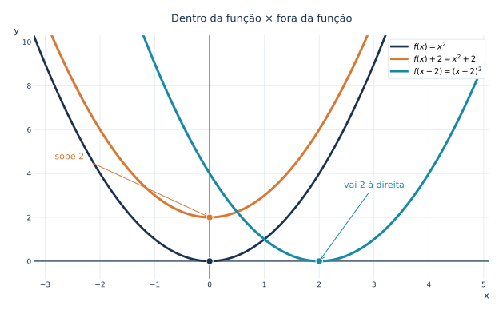{fig-alt="Comparação entre a função original x ao quadrado, a translação vertical x ao quadrado mais dois e a translação horizontal (x menos dois) ao quadrado." width="94%"}

::: {.callout-note collapse="true" title="Clique para ver o código"}

```python
from pathlib import Path
import numpy as np
import matplotlib.pyplot as plt

# Padrão editorial — Blog do Marcellini.
AZUL = "#19324f"
CIANO = "#1689a6"
LARANJA = "#d87832"
VERMELHO = "#ba4a56"
ROXO = "#7858a6"
VERDE = "#478774"
GRADE = "#e2e9ef"
plt.rcParams.update({
    "font.family": "DejaVu Sans",
    "font.size": 11,
    "axes.titlesize": 13,
    "svg.fonttype": "path",
    "figure.facecolor": "white",
    "axes.facecolor": "white",
})


def preparar(ax, xlim, ylim, xticks=None, yticks=None):
    ax.set_xlim(*xlim)
    ax.set_ylim(*ylim)
    if xticks is not None:
        ax.set_xticks(xticks)
    if yticks is not None:
        ax.set_yticks(yticks)
    ax.set_axisbelow(True)
    ax.grid(True, color=GRADE, lw=.8)
    for spine in ax.spines.values():
        spine.set_visible(False)
    ax.axhline(0, color=AZUL, lw=1.15, zorder=2)
    ax.axvline(0, color=AZUL, lw=1.15, zorder=2)
    ax.tick_params(axis="both", length=0, colors=AZUL, labelsize=9)
    ax.set_xlabel("x", loc="right", color=AZUL)
    ax.set_ylabel("y", loc="top", rotation=0, color=AZUL)


def legenda(ax, **kwargs):
    opts = dict(loc="upper right", fontsize=10, framealpha=.97,
                facecolor="white", edgecolor=GRADE)
    opts.update(kwargs)
    ax.legend(**opts)


def salvar(fig, nome):
    destino = Path("images")
    destino.mkdir(parents=True, exist_ok=True)
    arquivo = destino / nome
    fig.savefig(arquivo, format="svg",
                bbox_inches="tight", pad_inches=.24,
                facecolor="white")
    # Evita espaços em branco no fim das linhas dos SVGs gerados.
    linhas = arquivo.read_text(encoding="utf-8").splitlines()
    arquivo.write_text("\n".join(linha.rstrip() for linha in linhas) + "\n",
                       encoding="utf-8")
    plt.close(fig)

fig, ax = plt.subplots(figsize=(10.2, 5.5))
x = np.linspace(-3.2, 5.0, 1000)
preparar(ax, (-3.2, 5.1), (-.8, 10.3),
         xticks=np.arange(-3, 6), yticks=np.arange(0, 11, 2))
ax.plot(x, x*x, color=AZUL, lw=2.7, label=r"$f(x)=x^2$")
ax.plot(x, x*x+2, color=LARANJA, lw=3,
        label=r"$f(x)+2=x^2+2$")
ax.plot(x, (x-2)**2, color=CIANO, lw=3,
        label=r"$f(x-2)=(x-2)^2$")
ax.scatter([0, 0, 2], [0, 2, 0], s=70,
           color=[AZUL, LARANJA, CIANO],
           edgecolors="white", zorder=6)
ax.annotate("sobe 2", xy=(0, 2), xytext=(-2.80, 4.65),
            color=LARANJA, fontsize=11,
            arrowprops=dict(arrowstyle="->", color=LARANJA))
ax.annotate("vai 2 à direita", xy=(2, 0), xytext=(2.45, 3.35),
            color=CIANO, fontsize=11,
            arrowprops=dict(arrowstyle="->", color=CIANO))
legenda(ax)
ax.set_title("Dentro da função × fora da função", color=AZUL, pad=17)
salvar(fig, "1.12-ideia-basica.svg")
```

:::

***

## ↔️ Translação vertical

A transformação

$$
g(x)=f(x)+k
$$

desloca o gráfico de $f$ verticalmente.

- Se $k>0$, o gráfico sobe $k$ unidades.
- Se $k<0$, o gráfico desce $|k|$ unidades.

Por exemplo, se

$$
f(x)=x^2,
$$

então

$$
g(x)=x^2+2
$$

é o gráfico de $f$ deslocado $2$ unidades para cima.

Já

$$
h(x)=x^2-5
$$

é o gráfico de $f$ deslocado $5$ unidades para baixo.

Em termos de pontos, se

$$
(x,y)
$$

está no gráfico de $f$, então

$$
(x,y+k)
$$

está no gráfico de $g(x)=f(x)+k$.

Os vértices $(0,0)$, $(0,2)$ e $(0,-5)$ evidenciam que a coordenada horizontal permanece inalterada na translação vertical.

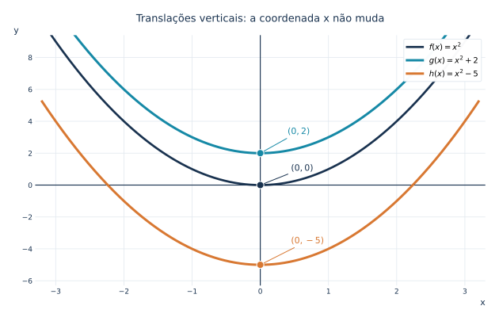{fig-alt="Três parábolas de mesma forma: x ao quadrado, x ao quadrado mais dois e x ao quadrado menos cinco, com vértices alinhados verticalmente." width="94%"}

::: {.callout-note collapse="true" title="Clique para ver o código"}

```python
from pathlib import Path
import numpy as np
import matplotlib.pyplot as plt

# Padrão editorial — Blog do Marcellini.
AZUL = "#19324f"
CIANO = "#1689a6"
LARANJA = "#d87832"
VERMELHO = "#ba4a56"
ROXO = "#7858a6"
VERDE = "#478774"
GRADE = "#e2e9ef"
plt.rcParams.update({
    "font.family": "DejaVu Sans",
    "font.size": 11,
    "axes.titlesize": 13,
    "svg.fonttype": "path",
    "figure.facecolor": "white",
    "axes.facecolor": "white",
})


def preparar(ax, xlim, ylim, xticks=None, yticks=None):
    ax.set_xlim(*xlim)
    ax.set_ylim(*ylim)
    if xticks is not None:
        ax.set_xticks(xticks)
    if yticks is not None:
        ax.set_yticks(yticks)
    ax.set_axisbelow(True)
    ax.grid(True, color=GRADE, lw=.8)
    for spine in ax.spines.values():
        spine.set_visible(False)
    ax.axhline(0, color=AZUL, lw=1.15, zorder=2)
    ax.axvline(0, color=AZUL, lw=1.15, zorder=2)
    ax.tick_params(axis="both", length=0, colors=AZUL, labelsize=9)
    ax.set_xlabel("x", loc="right", color=AZUL)
    ax.set_ylabel("y", loc="top", rotation=0, color=AZUL)


def legenda(ax, **kwargs):
    opts = dict(loc="upper right", fontsize=10, framealpha=.97,
                facecolor="white", edgecolor=GRADE)
    opts.update(kwargs)
    ax.legend(**opts)


def salvar(fig, nome):
    destino = Path("images")
    destino.mkdir(parents=True, exist_ok=True)
    arquivo = destino / nome
    fig.savefig(arquivo, format="svg",
                bbox_inches="tight", pad_inches=.24,
                facecolor="white")
    # Evita espaços em branco no fim das linhas dos SVGs gerados.
    linhas = arquivo.read_text(encoding="utf-8").splitlines()
    arquivo.write_text("\n".join(linha.rstrip() for linha in linhas) + "\n",
                       encoding="utf-8")
    plt.close(fig)

fig, ax = plt.subplots(figsize=(10.2, 5.7))
x = np.linspace(-3.2, 3.2, 900)
preparar(ax, (-3.3, 3.3), (-6.3, 9.4),
         xticks=np.arange(-3, 4), yticks=np.arange(-6, 10, 2))
ax.plot(x, x*x, color=AZUL, lw=2.7, label=r"$f(x)=x^2$")
ax.plot(x, x*x+2, color=CIANO, lw=3, label=r"$g(x)=x^2+2$")
ax.plot(x, x*x-5, color=LARANJA, lw=3, label=r"$h(x)=x^2-5$")
ax.scatter([0, 0, 0], [0, 2, -5], s=82,
           color=[AZUL, CIANO, LARANJA], edgecolors="white", zorder=6)
ax.annotate(r"$(0,2)$", (0,2), (0.40,3.2), color=CIANO,
            arrowprops=dict(arrowstyle="-", color=CIANO))
ax.annotate(r"$(0,0)$", (0,0), (0.45,.9), color=AZUL,
            arrowprops=dict(arrowstyle="-", color=AZUL))
ax.annotate(r"$(0,-5)$", (0,-5), (.45,-3.65), color=LARANJA,
            arrowprops=dict(arrowstyle="-", color=LARANJA))
legenda(ax)
ax.set_title("Translações verticais: a coordenada x não muda", color=AZUL, pad=17)
salvar(fig, "1.12-translacao-vertical.svg")
```

:::

***

## ↔️ Translação horizontal

A transformação

$$
g(x)=f(x-h)
$$

desloca o gráfico horizontalmente.

- Se $h>0$, o gráfico vai para a direita $h$ unidades.
- Se $h<0$, o gráfico vai para a esquerda $|h|$ unidades.

Esse é um ponto que costuma causar confusão: o sinal parece agir ao contrário.

Por exemplo, se

$$
f(x)=x^2,
$$

então

$$
g(x)=(x-3)^2
$$

é o gráfico de $f$ deslocado $3$ unidades para a direita.

Já

$$
h(x)=(x+2)^2
$$

é o gráfico de $f$ deslocado $2$ unidades para a esquerda.

Em termos de pontos, se

$$
(x,y)
$$

está no gráfico de $f$, então

$$
(x+h,y)
$$

está no gráfico de $g(x)=f(x-h)$.

A posição dos vértices mostra o sentido correto do deslocamento: $f(x-3)$ move-se para a direita; $f(x+2)$, para a esquerda.

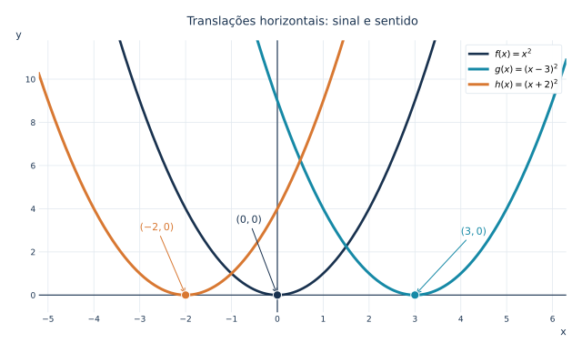{fig-alt="Três parábolas com vértices em menos dois zero, zero zero e três zero, comparando translações horizontais para esquerda e direita." width="94%"}

::: {.callout-note collapse="true" title="Clique para ver o código"}

```python
from pathlib import Path
import numpy as np
import matplotlib.pyplot as plt

# Padrão editorial — Blog do Marcellini.
AZUL = "#19324f"
CIANO = "#1689a6"
LARANJA = "#d87832"
VERMELHO = "#ba4a56"
ROXO = "#7858a6"
VERDE = "#478774"
GRADE = "#e2e9ef"
plt.rcParams.update({
    "font.family": "DejaVu Sans",
    "font.size": 11,
    "axes.titlesize": 13,
    "svg.fonttype": "path",
    "figure.facecolor": "white",
    "axes.facecolor": "white",
})


def preparar(ax, xlim, ylim, xticks=None, yticks=None):
    ax.set_xlim(*xlim)
    ax.set_ylim(*ylim)
    if xticks is not None:
        ax.set_xticks(xticks)
    if yticks is not None:
        ax.set_yticks(yticks)
    ax.set_axisbelow(True)
    ax.grid(True, color=GRADE, lw=.8)
    for spine in ax.spines.values():
        spine.set_visible(False)
    ax.axhline(0, color=AZUL, lw=1.15, zorder=2)
    ax.axvline(0, color=AZUL, lw=1.15, zorder=2)
    ax.tick_params(axis="both", length=0, colors=AZUL, labelsize=9)
    ax.set_xlabel("x", loc="right", color=AZUL)
    ax.set_ylabel("y", loc="top", rotation=0, color=AZUL)


def legenda(ax, **kwargs):
    opts = dict(loc="upper right", fontsize=10, framealpha=.97,
                facecolor="white", edgecolor=GRADE)
    opts.update(kwargs)
    ax.legend(**opts)


def salvar(fig, nome):
    destino = Path("images")
    destino.mkdir(parents=True, exist_ok=True)
    arquivo = destino / nome
    fig.savefig(arquivo, format="svg",
                bbox_inches="tight", pad_inches=.24,
                facecolor="white")
    # Evita espaços em branco no fim das linhas dos SVGs gerados.
    linhas = arquivo.read_text(encoding="utf-8").splitlines()
    arquivo.write_text("\n".join(linha.rstrip() for linha in linhas) + "\n",
                       encoding="utf-8")
    plt.close(fig)

fig, ax = plt.subplots(figsize=(10.4, 5.4))
x = np.linspace(-5.3, 6.3, 1200)
preparar(ax, (-5.2, 6.3), (-.8, 11.8),
         xticks=np.arange(-5, 7), yticks=np.arange(0, 12, 2))
ax.plot(x, x*x, color=AZUL, lw=2.7, label=r"$f(x)=x^2$")
ax.plot(x, (x-3)**2, color=CIANO, lw=3,
        label=r"$g(x)=(x-3)^2$")
ax.plot(x, (x+2)**2, color=LARANJA, lw=3,
        label=r"$h(x)=(x+2)^2$")
ax.scatter([-2, 0, 3], [0,0,0], s=84,
           color=[LARANJA, AZUL, CIANO], edgecolors="white", zorder=7)
ax.annotate(r"$(-2,0)$", (-2,0), (-3.0,3.0), color=LARANJA,
            arrowprops=dict(arrowstyle="->", color=LARANJA))
ax.annotate(r"$(0,0)$", (0,0), (-.9,3.35), color=AZUL,
            arrowprops=dict(arrowstyle="->", color=AZUL))
ax.annotate(r"$(3,0)$", (3,0), (4.0,2.80), color=CIANO,
            arrowprops=dict(arrowstyle="->", color=CIANO))
legenda(ax)
ax.set_title("Translações horizontais: sinal e sentido", color=AZUL, pad=17)
salvar(fig, "1.12-translacao-horizontal.svg")
```

:::

***

## 🪞 Reflexão em relação ao eixo horizontal

A transformação

$$
g(x)=-f(x)
$$

reflete o gráfico em relação ao eixo horizontal.

Isso acontece porque todos os valores de saída mudam de sinal.

Se um ponto do gráfico de $f$ é

$$
(x,y),
$$

então o ponto correspondente no gráfico de $g$ é

$$
(x,-y).
$$

Por exemplo, se

$$
f(x)=x^2,
$$

então

$$
g(x)=-x^2
$$

é a parábola refletida em relação ao eixo $x$.

A parábola que antes tinha concavidade para cima passa a ter concavidade para baixo.

Para a mesma entrada, os valores de saída mudam de sinal: $(1,1)$ e $(1,-1)$ formam um par refletido.

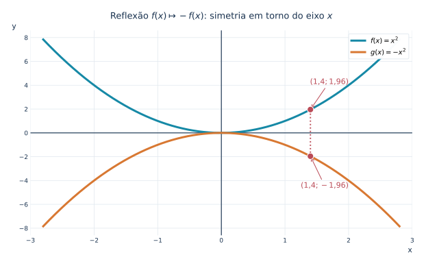{fig-alt="Gráficos da parábola x ao quadrado e de sua reflexão menos x ao quadrado, simétricos em relação ao eixo horizontal." width="94%"}

::: {.callout-note collapse="true" title="Clique para ver o código"}

```python
from pathlib import Path
import numpy as np
import matplotlib.pyplot as plt

# Padrão editorial — Blog do Marcellini.
AZUL = "#19324f"
CIANO = "#1689a6"
LARANJA = "#d87832"
VERMELHO = "#ba4a56"
ROXO = "#7858a6"
VERDE = "#478774"
GRADE = "#e2e9ef"
plt.rcParams.update({
    "font.family": "DejaVu Sans",
    "font.size": 11,
    "axes.titlesize": 13,
    "svg.fonttype": "path",
    "figure.facecolor": "white",
    "axes.facecolor": "white",
})


def preparar(ax, xlim, ylim, xticks=None, yticks=None):
    ax.set_xlim(*xlim)
    ax.set_ylim(*ylim)
    if xticks is not None:
        ax.set_xticks(xticks)
    if yticks is not None:
        ax.set_yticks(yticks)
    ax.set_axisbelow(True)
    ax.grid(True, color=GRADE, lw=.8)
    for spine in ax.spines.values():
        spine.set_visible(False)
    ax.axhline(0, color=AZUL, lw=1.15, zorder=2)
    ax.axvline(0, color=AZUL, lw=1.15, zorder=2)
    ax.tick_params(axis="both", length=0, colors=AZUL, labelsize=9)
    ax.set_xlabel("x", loc="right", color=AZUL)
    ax.set_ylabel("y", loc="top", rotation=0, color=AZUL)


def legenda(ax, **kwargs):
    opts = dict(loc="upper right", fontsize=10, framealpha=.97,
                facecolor="white", edgecolor=GRADE)
    opts.update(kwargs)
    ax.legend(**opts)


def salvar(fig, nome):
    destino = Path("images")
    destino.mkdir(parents=True, exist_ok=True)
    arquivo = destino / nome
    fig.savefig(arquivo, format="svg",
                bbox_inches="tight", pad_inches=.24,
                facecolor="white")
    # Evita espaços em branco no fim das linhas dos SVGs gerados.
    linhas = arquivo.read_text(encoding="utf-8").splitlines()
    arquivo.write_text("\n".join(linha.rstrip() for linha in linhas) + "\n",
                       encoding="utf-8")
    plt.close(fig)

fig, ax = plt.subplots(figsize=(10, 5.4))
x = np.linspace(-2.8, 2.8, 950)
preparar(ax, (-3, 3), (-8.6, 8.6),
         xticks=np.arange(-3, 4), yticks=np.arange(-8, 9, 2))
ax.plot(x, x*x, color=CIANO, lw=3, label=r"$f(x)=x^2$")
ax.plot(x, -x*x, color=LARANJA, lw=3, label=r"$g(x)=-x^2$")
ax.plot([1.4,1.4], [-1.96, 1.96], color=VERMELHO, ls=":", lw=1.9)
ax.scatter([1.4,1.4], [1.96,-1.96], s=84, color=VERMELHO,
           edgecolors="white", zorder=6)
ax.annotate(r"$(1{,}4;1{,}96)$", (1.4,1.96), (2.0,4.1), ha="right",
            color=VERMELHO, arrowprops=dict(arrowstyle="->", color=VERMELHO))
ax.annotate(r"$(1{,}4;-1{,}96)$", (1.4,-1.96), (2.0,-4.6), ha="right",
            color=VERMELHO, arrowprops=dict(arrowstyle="->", color=VERMELHO))
legenda(ax)
ax.set_title(r"Reflexão $f(x)\mapsto-f(x)$: simetria em torno do eixo $x$",
             color=AZUL, pad=17)
salvar(fig, "1.12-reflexao-horizontal.svg")
```

:::

***

## 🪞 Reflexão em relação ao eixo vertical

A transformação

$$
g(x)=f(-x)
$$

reflete o gráfico em relação ao eixo vertical.

Isso acontece porque trocamos cada entrada $x$ por $-x$.

Se um ponto do gráfico de $f$ é

$$
(x,y),
$$

então o ponto correspondente no gráfico de $g$ é

$$
(-x,y).
$$

Por exemplo, a função

$$
f(x)=\sqrt{x}
$$

tem domínio

$$
[0,+\infty).
$$

Já

$$
g(x)=\sqrt{-x}
$$

é a reflexão do gráfico em relação ao eixo vertical e tem domínio

$$
(-\infty,0].
$$

Os pontos $(4,2)$ e $(-4,2)$ exemplificam a reflexão $(x,y)\mapsto(-x,y)$ e a mudança do domínio.

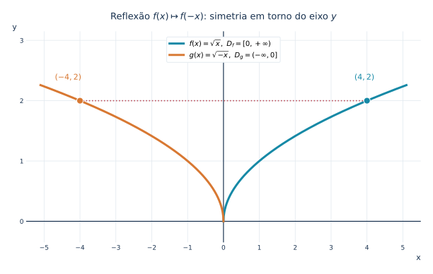{fig-alt="Raiz quadrada de x e raiz quadrada de menos x refletidas em relação ao eixo y, com pontos correspondentes em quatro dois e menos quatro dois." width="94%"}

::: {.callout-note collapse="true" title="Clique para ver o código"}

```python
from pathlib import Path
import numpy as np
import matplotlib.pyplot as plt

# Padrão editorial — Blog do Marcellini.
AZUL = "#19324f"
CIANO = "#1689a6"
LARANJA = "#d87832"
VERMELHO = "#ba4a56"
ROXO = "#7858a6"
VERDE = "#478774"
GRADE = "#e2e9ef"
plt.rcParams.update({
    "font.family": "DejaVu Sans",
    "font.size": 11,
    "axes.titlesize": 13,
    "svg.fonttype": "path",
    "figure.facecolor": "white",
    "axes.facecolor": "white",
})


def preparar(ax, xlim, ylim, xticks=None, yticks=None):
    ax.set_xlim(*xlim)
    ax.set_ylim(*ylim)
    if xticks is not None:
        ax.set_xticks(xticks)
    if yticks is not None:
        ax.set_yticks(yticks)
    ax.set_axisbelow(True)
    ax.grid(True, color=GRADE, lw=.8)
    for spine in ax.spines.values():
        spine.set_visible(False)
    ax.axhline(0, color=AZUL, lw=1.15, zorder=2)
    ax.axvline(0, color=AZUL, lw=1.15, zorder=2)
    ax.tick_params(axis="both", length=0, colors=AZUL, labelsize=9)
    ax.set_xlabel("x", loc="right", color=AZUL)
    ax.set_ylabel("y", loc="top", rotation=0, color=AZUL)


def legenda(ax, **kwargs):
    opts = dict(loc="upper right", fontsize=10, framealpha=.97,
                facecolor="white", edgecolor=GRADE)
    opts.update(kwargs)
    ax.legend(**opts)


def salvar(fig, nome):
    destino = Path("images")
    destino.mkdir(parents=True, exist_ok=True)
    arquivo = destino / nome
    fig.savefig(arquivo, format="svg",
                bbox_inches="tight", pad_inches=.24,
                facecolor="white")
    # Evita espaços em branco no fim das linhas dos SVGs gerados.
    linhas = arquivo.read_text(encoding="utf-8").splitlines()
    arquivo.write_text("\n".join(linha.rstrip() for linha in linhas) + "\n",
                       encoding="utf-8")
    plt.close(fig)

fig, ax = plt.subplots(figsize=(10, 5.4))
x = np.linspace(0, 5.1, 650)
preparar(ax, (-5.5, 5.5), (-.35, 3.15),
         xticks=np.arange(-5, 6), yticks=np.arange(0, 4))
ax.plot(x, np.sqrt(x), color=CIANO, lw=3,
        label=r"$f(x)=\sqrt{x},\ D_f=[0,+\infty)$")
ax.plot(-x, np.sqrt(x), color=LARANJA, lw=3,
        label=r"$g(x)=\sqrt{-x},\ D_g=(-\infty,0]$")
ax.scatter([-4,4], [2,2], s=84, color=[LARANJA,CIANO],
           edgecolors="white", zorder=6)
ax.plot([-4,4],[2,2],ls=":",lw=1.6,color=VERMELHO)
ax.annotate(r"$(-4,2)$", (-4,2), (-4.7,2.35), color=LARANJA)
ax.annotate(r"$(4,2)$", (4,2), (3.65,2.35), color=CIANO)
legenda(ax, loc="upper center", bbox_to_anchor=(.5, .99))
ax.set_title(r"Reflexão $f(x)\mapsto f(-x)$: simetria em torno do eixo $y$",
             color=AZUL, pad=17)
salvar(fig, "1.12-reflexao-vertical.svg")
```

:::

***

## 📏 Alongamento e compressão vertical

A transformação

$$
g(x)=af(x)
$$

altera verticalmente o gráfico.

- Se $|a|>1$, há alongamento vertical.
- Se $0<|a|<1$, há compressão vertical.
- Se $a<0$, além disso, há reflexão em relação ao eixo horizontal.

Por exemplo, se

$$
f(x)=x^2,
$$

então

$$
g(x)=3x^2
$$

é um alongamento vertical por fator $3$.

Já

$$
h(x)=\frac{1}{2}x^2
$$

é uma compressão vertical.

E

$$
p(x)=-2x^2
$$

combina reflexão em relação ao eixo horizontal com alongamento vertical por fator $2$.

Compare as alturas das curvas para a mesma entrada $x=1$: $1$, $3$, $1/2$ e $-2$, respectivamente.

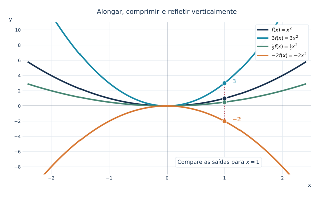{fig-alt="Quatro parábolas mostrando alongamento vertical, compressão vertical e reflexão: x ao quadrado, três x ao quadrado, metade de x ao quadrado e menos dois x ao quadrado." width="94%"}

::: {.callout-note collapse="true" title="Clique para ver o código"}

```python
from pathlib import Path
import numpy as np
import matplotlib.pyplot as plt

# Padrão editorial — Blog do Marcellini.
AZUL = "#19324f"
CIANO = "#1689a6"
LARANJA = "#d87832"
VERMELHO = "#ba4a56"
ROXO = "#7858a6"
VERDE = "#478774"
GRADE = "#e2e9ef"
plt.rcParams.update({
    "font.family": "DejaVu Sans",
    "font.size": 11,
    "axes.titlesize": 13,
    "svg.fonttype": "path",
    "figure.facecolor": "white",
    "axes.facecolor": "white",
})


def preparar(ax, xlim, ylim, xticks=None, yticks=None):
    ax.set_xlim(*xlim)
    ax.set_ylim(*ylim)
    if xticks is not None:
        ax.set_xticks(xticks)
    if yticks is not None:
        ax.set_yticks(yticks)
    ax.set_axisbelow(True)
    ax.grid(True, color=GRADE, lw=.8)
    for spine in ax.spines.values():
        spine.set_visible(False)
    ax.axhline(0, color=AZUL, lw=1.15, zorder=2)
    ax.axvline(0, color=AZUL, lw=1.15, zorder=2)
    ax.tick_params(axis="both", length=0, colors=AZUL, labelsize=9)
    ax.set_xlabel("x", loc="right", color=AZUL)
    ax.set_ylabel("y", loc="top", rotation=0, color=AZUL)


def legenda(ax, **kwargs):
    opts = dict(loc="upper right", fontsize=10, framealpha=.97,
                facecolor="white", edgecolor=GRADE)
    opts.update(kwargs)
    ax.legend(**opts)


def salvar(fig, nome):
    destino = Path("images")
    destino.mkdir(parents=True, exist_ok=True)
    arquivo = destino / nome
    fig.savefig(arquivo, format="svg",
                bbox_inches="tight", pad_inches=.24,
                facecolor="white")
    # Evita espaços em branco no fim das linhas dos SVGs gerados.
    linhas = arquivo.read_text(encoding="utf-8").splitlines()
    arquivo.write_text("\n".join(linha.rstrip() for linha in linhas) + "\n",
                       encoding="utf-8")
    plt.close(fig)

fig, ax = plt.subplots(figsize=(10.3, 5.5))
x = np.linspace(-2.4, 2.4, 900)
preparar(ax, (-2.5, 2.5), (-9.0, 11),
         xticks=np.arange(-2, 3), yticks=np.arange(-8, 11, 2))
curvas = [(x*x, AZUL, r"$f(x)=x^2$"),
          (3*x*x, CIANO, r"$3f(x)=3x^2$"),
          (.5*x*x, VERDE, r"$\frac{1}{2}f(x)=\frac{1}{2}x^2$"),
          (-2*x*x, LARANJA, r"$-2f(x)=-2x^2$")]
for y, cor, rotulo in curvas:
    ax.plot(x, y, color=cor, lw=3, label=rotulo)
ax.plot([1,1],[-2,3],ls=":",lw=1.8,color=VERMELHO)
ax.scatter([1]*4, [1,3,.5,-2], s=76,
           color=[AZUL,CIANO,VERDE,LARANJA], edgecolors="white", zorder=6)
ax.text(1.14, 3.0, r"$3$", color=CIANO)
ax.text(1.14, -2.0, r"$-2$", color=LARANJA)
ax.text(.18, -7.6, r"Compare as saídas para $x=1$", fontsize=11, color=AZUL,
        bbox=dict(facecolor="white", edgecolor=GRADE, boxstyle="round,pad=.4"))
legenda(ax)
ax.set_title("Alongar, comprimir e refletir verticalmente", color=AZUL, pad=17)
salvar(fig, "1.12-escala-vertical.svg")
```

:::

***

## 📏 Alongamento e compressão horizontal

A transformação

$$
g(x)=f(bx)
$$

altera horizontalmente o gráfico.

- Se $|b|>1$, o gráfico é comprimido horizontalmente.
- Se $0<|b|<1$, o gráfico é alongado horizontalmente.
- Se $b<0$, também ocorre reflexão em relação ao eixo vertical.

Esse comportamento parece inverso porque a transformação acontece na entrada.

Mais precisamente, para $b\neq 0$, a escala horizontal é $1/|b|$:
se $(u,v)$ pertence ao gráfico de $f$, então $(u/b,v)$ pertence ao
gráfico de $g(x)=f(bx)$. Quando $b<0$, também ocorre reflexão no eixo vertical.

Por exemplo, se

$$
f(x)=\sin x,
$$

então

$$
g(x)=\sin(2x)
$$

tem período menor que o de $\sin x$.

Como o período de $\sin x$ é $2\pi$, o período de $\sin(2x)$ é

$$
\frac{2\pi}{2}=\pi.
$$

Já

$$
h(x)=\sin\left(\frac{x}{2}\right)
$$

tem período

$$
4\pi.
$$

O fator interno altera a escala horizontal pelo inverso de seu módulo: os períodos de $\sin x$, $\sin(2x)$ e $\sin(x/2)$ são $2\pi$, $\pi$ e $4\pi$.

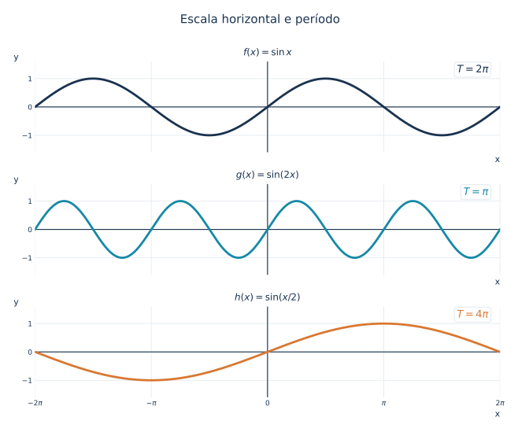{fig-alt="Três painéis de seno, seno de dois x e seno de x sobre dois, indicando períodos dois pi, pi e quatro pi." width="94%"}

::: {.callout-note collapse="true" title="Clique para ver o código"}

```python
from pathlib import Path
import numpy as np
import matplotlib.pyplot as plt

# Padrão editorial — Blog do Marcellini.
AZUL = "#19324f"
CIANO = "#1689a6"
LARANJA = "#d87832"
VERMELHO = "#ba4a56"
ROXO = "#7858a6"
VERDE = "#478774"
GRADE = "#e2e9ef"
plt.rcParams.update({
    "font.family": "DejaVu Sans",
    "font.size": 11,
    "axes.titlesize": 13,
    "svg.fonttype": "path",
    "figure.facecolor": "white",
    "axes.facecolor": "white",
})


def preparar(ax, xlim, ylim, xticks=None, yticks=None):
    ax.set_xlim(*xlim)
    ax.set_ylim(*ylim)
    if xticks is not None:
        ax.set_xticks(xticks)
    if yticks is not None:
        ax.set_yticks(yticks)
    ax.set_axisbelow(True)
    ax.grid(True, color=GRADE, lw=.8)
    for spine in ax.spines.values():
        spine.set_visible(False)
    ax.axhline(0, color=AZUL, lw=1.15, zorder=2)
    ax.axvline(0, color=AZUL, lw=1.15, zorder=2)
    ax.tick_params(axis="both", length=0, colors=AZUL, labelsize=9)
    ax.set_xlabel("x", loc="right", color=AZUL)
    ax.set_ylabel("y", loc="top", rotation=0, color=AZUL)


def legenda(ax, **kwargs):
    opts = dict(loc="upper right", fontsize=10, framealpha=.97,
                facecolor="white", edgecolor=GRADE)
    opts.update(kwargs)
    ax.legend(**opts)


def salvar(fig, nome):
    destino = Path("images")
    destino.mkdir(parents=True, exist_ok=True)
    arquivo = destino / nome
    fig.savefig(arquivo, format="svg",
                bbox_inches="tight", pad_inches=.24,
                facecolor="white")
    # Evita espaços em branco no fim das linhas dos SVGs gerados.
    linhas = arquivo.read_text(encoding="utf-8").splitlines()
    arquivo.write_text("\n".join(linha.rstrip() for linha in linhas) + "\n",
                       encoding="utf-8")
    plt.close(fig)

fig, axs = plt.subplots(3, 1, figsize=(10.6, 7.7), sharex=True)
x = np.linspace(-2*np.pi, 2*np.pi, 1400)
series = [(np.sin(x), AZUL, r"$f(x)=\sin x$", r"$T=2\pi$"),
          (np.sin(2*x), CIANO, r"$g(x)=\sin(2x)$", r"$T=\pi$"),
          (np.sin(x/2), LARANJA, r"$h(x)=\sin(x/2)$", r"$T=4\pi$")]
for i, (ax, (y, cor, titulo, periodo)) in enumerate(zip(axs,series)):
    preparar(ax, (-2*np.pi, 2*np.pi), (-1.6,1.6),
             yticks=[-1,0,1])
    ax.plot(x, y, color=cor, lw=2.8)
    ax.set_title(titulo, color=AZUL, fontsize=12, pad=8)
    ax.text(.975,.88,periodo,transform=ax.transAxes, ha="right",
            fontsize=13, color=cor,
            bbox=dict(facecolor="white", edgecolor=GRADE, boxstyle="round,pad=.25"))
axs[-1].set_xticks([-2*np.pi,-np.pi,0,np.pi,2*np.pi],
                   [r"$-2\pi$",r"$-\pi$","0",r"$\pi$",r"$2\pi$"])
axs[0].tick_params(labelbottom=False)
axs[1].tick_params(labelbottom=False)
fig.suptitle("Escala horizontal e período", color=AZUL, fontsize=15, y=.99)
fig.subplots_adjust(hspace=.35)
salvar(fig, "1.12-escala-horizontal.svg")
```

:::

***

## 🧩 Combinações de transformações

Muitas funções combinam várias transformações.

Considere

$$
g(x)=2(x-3)^2+1.
$$

Partimos da função base

$$
f(x)=x^2.
$$

A expressão

$$
(x-3)^2
$$

desloca o gráfico $3$ unidades para a direita.

O fator $2$ produz alongamento vertical.

O termo $+1$ desloca o gráfico $1$ unidade para cima.

Assim, o vértice da parábola, que era

$$
(0,0),
$$

passa a ser

$$
(3,1).
$$

A construção em quatro passos deixa visível como o vértice sai de $(0,0)$ e chega a $(3,1)$, enquanto a parábola fica mais estreita.

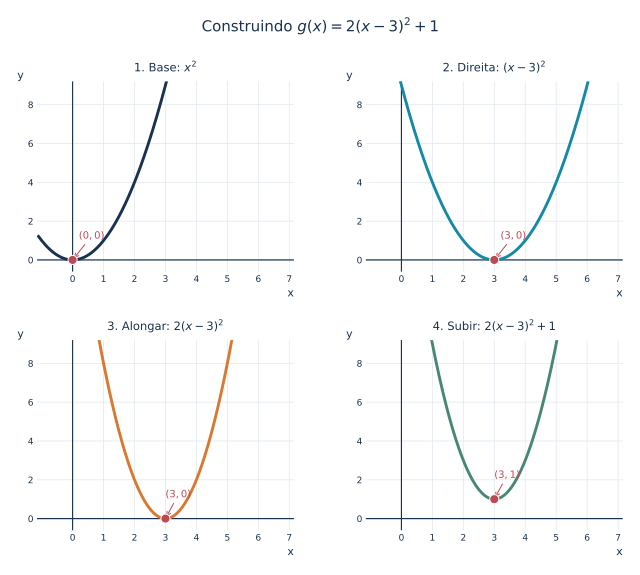{fig-alt="Quatro gráficos em sequência: x ao quadrado, x menos três ao quadrado, duas vezes x menos três ao quadrado e duas vezes x menos três ao quadrado mais um." width="94%"}

::: {.callout-note collapse="true" title="Clique para ver o código"}

```python
from pathlib import Path
import numpy as np
import matplotlib.pyplot as plt

# Padrão editorial — Blog do Marcellini.
AZUL = "#19324f"
CIANO = "#1689a6"
LARANJA = "#d87832"
VERMELHO = "#ba4a56"
ROXO = "#7858a6"
VERDE = "#478774"
GRADE = "#e2e9ef"
plt.rcParams.update({
    "font.family": "DejaVu Sans",
    "font.size": 11,
    "axes.titlesize": 13,
    "svg.fonttype": "path",
    "figure.facecolor": "white",
    "axes.facecolor": "white",
})


def preparar(ax, xlim, ylim, xticks=None, yticks=None):
    ax.set_xlim(*xlim)
    ax.set_ylim(*ylim)
    if xticks is not None:
        ax.set_xticks(xticks)
    if yticks is not None:
        ax.set_yticks(yticks)
    ax.set_axisbelow(True)
    ax.grid(True, color=GRADE, lw=.8)
    for spine in ax.spines.values():
        spine.set_visible(False)
    ax.axhline(0, color=AZUL, lw=1.15, zorder=2)
    ax.axvline(0, color=AZUL, lw=1.15, zorder=2)
    ax.tick_params(axis="both", length=0, colors=AZUL, labelsize=9)
    ax.set_xlabel("x", loc="right", color=AZUL)
    ax.set_ylabel("y", loc="top", rotation=0, color=AZUL)


def legenda(ax, **kwargs):
    opts = dict(loc="upper right", fontsize=10, framealpha=.97,
                facecolor="white", edgecolor=GRADE)
    opts.update(kwargs)
    ax.legend(**opts)


def salvar(fig, nome):
    destino = Path("images")
    destino.mkdir(parents=True, exist_ok=True)
    arquivo = destino / nome
    fig.savefig(arquivo, format="svg",
                bbox_inches="tight", pad_inches=.24,
                facecolor="white")
    # Evita espaços em branco no fim das linhas dos SVGs gerados.
    linhas = arquivo.read_text(encoding="utf-8").splitlines()
    arquivo.write_text("\n".join(linha.rstrip() for linha in linhas) + "\n",
                       encoding="utf-8")
    plt.close(fig)

fig, axs = plt.subplots(2, 2, figsize=(10.5, 8.1))
x = np.linspace(-1.1, 7.1, 900)
configs = [(x*x, AZUL, r"1. Base: $x^2$",0,0),
           ((x-3)**2, CIANO, r"2. Direita: $(x-3)^2$",3,0),
           (2*(x-3)**2, LARANJA, r"3. Alongar: $2(x-3)^2$",3,0),
           (2*(x-3)**2+1, VERDE, r"4. Subir: $2(x-3)^2+1$",3,1)]
posicoes_rotulos = [
    (0.2, 1.1),
    (3.2, 1.1),
    (3.0, 1.1),
    (3.0, 2.1)
]
for ax, (y, cor, titulo, xv, yv), xytexto in zip(
    axs.flat, configs, posicoes_rotulos
):
    preparar(ax, (-1.15,7.15), (-.6,9.2),
             xticks=[0,1,2,3,4,5,6,7],yticks=[0,2,4,6,8])
    ax.plot(x,y,color=cor,lw=2.9)
    ax.scatter([xv],[yv],s=83,color=VERMELHO,
               edgecolors="white",zorder=5)
    ax.annotate(fr"$({xv},{yv})$",(xv,yv), xytexto,
                fontsize=10, color=VERMELHO,
                arrowprops=dict(arrowstyle="->",color=VERMELHO,lw=1))
    ax.set_title(titulo,fontsize=11.5,color=AZUL,pad=10)
fig.suptitle(r"Construindo $g(x)=2(x-3)^2+1$",color=AZUL,fontsize=15,y=.99)
fig.subplots_adjust(hspace=.36,wspace=.28)
salvar(fig,"1.12-transformacoes-combinadas.svg")
```

:::

***

## 🌊 Transformações em funções trigonométricas

Funções trigonométricas aparecem frequentemente com transformações.

Considere

$$
g(x)=A\sin(Bx+C)+D.
$$

Nesse caso:

- $A$ controla a amplitude;
- $B$ controla o período;
- $C$ está relacionado ao deslocamento horizontal;
- $D$ desloca o gráfico verticalmente.

Quando $B\neq 0$, podemos reescrever o argumento como
$Bx+C=B(x+C/B)$. Portanto, o deslocamento horizontal é $-C/B$:
se $-C/B>0$, ocorre para a direita; se $-C/B<0$, para a esquerda.
Se $B=0$, a expressão é constante e a regra de período não se aplica.

Quando a função é

$$
g(x)=A\sin(Bx)+D,
$$

a amplitude é

$$
|A|,
$$

e o período é

$$
\frac{2\pi}{|B|}.
$$

Por exemplo,

$$
g(x)=3\sin(2x)-1
$$

tem amplitude $3$, período $\pi$ e deslocamento vertical de $1$ unidade para baixo.

A curva transformada tem amplitude $3$, período $\pi$ e linha média em $y=-1$. Observe o máximo $2$ e o mínimo $-4$.

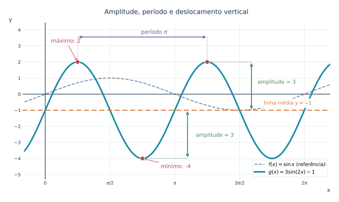{fig-alt="Comparação de seno de x e três seno de dois x menos um, com linha média y igual a menos um, amplitude três e período pi." width="94%"}

::: {.callout-note collapse="true" title="Clique para ver o código"}

```python
from pathlib import Path
import numpy as np
import matplotlib.pyplot as plt

# Padrão editorial — Blog do Marcellini.
AZUL = "#19324f"
CIANO = "#1689a6"
LARANJA = "#d87832"
VERMELHO = "#ba4a56"
ROXO = "#7858a6"
VERDE = "#478774"
GRADE = "#e2e9ef"
plt.rcParams.update({
    "font.family": "DejaVu Sans",
    "font.size": 11,
    "axes.titlesize": 13,
    "svg.fonttype": "path",
    "figure.facecolor": "white",
    "axes.facecolor": "white",
})


def preparar(ax, xlim, ylim, xticks=None, yticks=None):
    ax.set_xlim(*xlim)
    ax.set_ylim(*ylim)
    if xticks is not None:
        ax.set_xticks(xticks)
    if yticks is not None:
        ax.set_yticks(yticks)
    ax.set_axisbelow(True)
    ax.grid(True, color=GRADE, lw=.8)
    for spine in ax.spines.values():
        spine.set_visible(False)
    ax.axhline(0, color=AZUL, lw=1.15, zorder=2)
    ax.axvline(0, color=AZUL, lw=1.15, zorder=2)
    ax.tick_params(axis="both", length=0, colors=AZUL, labelsize=9)
    ax.set_xlabel("x", loc="right", color=AZUL)
    ax.set_ylabel("y", loc="top", rotation=0, color=AZUL)


def legenda(ax, **kwargs):
    opts = dict(loc="upper right", fontsize=10, framealpha=.97,
                facecolor="white", edgecolor=GRADE)
    opts.update(kwargs)
    ax.legend(**opts)


def salvar(fig, nome):
    destino = Path("images")
    destino.mkdir(parents=True, exist_ok=True)
    arquivo = destino / nome
    fig.savefig(arquivo, format="svg",
                bbox_inches="tight", pad_inches=.24,
                facecolor="white")
    # Evita espaços em branco no fim das linhas dos SVGs gerados.
    linhas = arquivo.read_text(encoding="utf-8").splitlines()
    arquivo.write_text("\n".join(linha.rstrip() for linha in linhas) + "\n",
                       encoding="utf-8")
    plt.close(fig)

fig, ax = plt.subplots(figsize=(10.9, 5.6))
x = np.linspace(-.5, 2.2*np.pi, 1200)
preparar(ax, (-.55,2.2*np.pi),(-5.3,4.45),
         yticks=np.arange(-5,5))
ax.plot(x,np.sin(x),color=AZUL,lw=1.7,ls="--",alpha=.6,
        label=r"$f(x)=\sin x$ (referência)")
ax.plot(x,3*np.sin(2*x)-1,color=CIANO,lw=3,
        label=r"$g(x)=3\sin(2x)-1$")
ax.axhline(-1, color=LARANJA, lw=1.9, ls=(0,(5,3)))
ax.text(5.3,-.65,r"linha média $y=-1$",color=LARANJA, fontsize=10,
        bbox=dict(facecolor="white",edgecolor="none",alpha=.92))
ax.scatter([np.pi/4,3*np.pi/4],[2,-4],s=75,color=VERMELHO,
           edgecolors="white",zorder=5)
ax.annotate("máximo: 2",(np.pi/4,2),(.14,3.2),color=VERMELHO,
            arrowprops=dict(arrowstyle="->",color=VERMELHO))
ax.annotate("mínimo: -4",(3*np.pi/4,-4),(2.8,-4.6),color=VERMELHO,
            arrowprops=dict(arrowstyle="->",color=VERMELHO))
# Dois máximos consecutivos distam um período = pi.
ax.annotate("",xy=(5*np.pi/4,3.55),xytext=(np.pi/4,3.55),
            arrowprops=dict(arrowstyle="<->",lw=1.5,color=ROXO))
ax.text(2.32,3.75,r"período $\pi$",color=ROXO,fontsize=11)

# Amplitude superior: da linha média ao máximo.
ax.plot([5*np.pi/4, 5.0], [2, 2],
        color=VERDE, ls=":", lw=1.3)

ax.annotate(
    "", xy=(5.0, 2), xytext=(5.0, -1),
    arrowprops=dict(arrowstyle="<->", color=VERDE, lw=1.8)
)

ax.text(5.15, 0.65, "amplitude = 3",
        color=VERDE, fontsize=10.5)

# Amplitude inferior: do mínimo à linha média.
ax.plot([3*np.pi/4, 3.45], [-4, -4],
        color=VERDE, ls=":", lw=1.3)

ax.annotate(
    "", xy=(3.45, -1), xytext=(3.45, -4),
    arrowprops=dict(arrowstyle="<->", color=VERDE, lw=1.8)
)

ax.text(3.65, -2.65, "amplitude = 3",
        color=VERDE, fontsize=10.5)

# Segundo máximo consecutivo.
ax.scatter(
    [5*np.pi/4], [2],
    s=75, color=VERMELHO,
    edgecolors="white", zorder=6
)

# Guias verticais entre os máximos e a seta do período.
for x_max in [np.pi/4, 5*np.pi/4]:
    ax.plot(
        [x_max, x_max],
        [2, 3.55],
        color=ROXO,
        ls=(0, (2, 3)),
        lw=1.05,
        alpha=0.75,
        zorder=3
    )

ax.set_xticks([0,np.pi/2,np.pi,3*np.pi/2,2*np.pi],
              ["0",r"$\pi/2$",r"$\pi$",r"$3\pi/2$",r"$2\pi$"])
legenda(ax,loc="lower right")
ax.set_title("Amplitude, período e deslocamento vertical",color=AZUL,pad=17)
salvar(fig,"1.12-transformacoes-trigonometricas.svg")
```

:::

***

## 🧭 Transformações e domínio

Transformações podem alterar o domínio.

A função

$$
f(x)=\sqrt{x}
$$

tem domínio

$$
[0,+\infty).
$$

A função

$$
g(x)=\sqrt{x-2}
$$

exige

$$
x-2\geq 0.
$$

Logo,

$$
x\geq 2,
$$

e

$$
D_g=[2,+\infty).
$$

Já

$$
h(x)=\sqrt{-x}
$$

exige

$$
-x\geq 0,
$$

isto é,

$$
x\leq 0.
$$

Logo,

$$
D_h=(-\infty,0].
$$

Por isso, ao transformar uma função, não devemos olhar apenas para o desenho do gráfico. Também devemos verificar o domínio.

Cada painel começa no extremo permitido do domínio, marcado por um ponto preenchido; a translação e a reflexão mudam as entradas admissíveis.

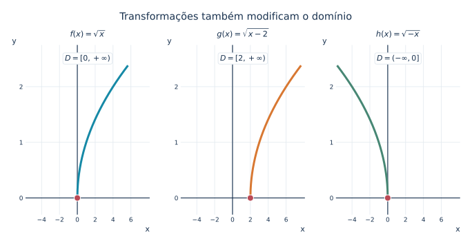{fig-alt="Três painéis com raiz de x domínio não negativo, raiz de x menos dois domínio a partir de dois e raiz de menos x domínio não positivo." width="94%"}

::: {.callout-note collapse="true" title="Clique para ver o código"}

```python
from pathlib import Path
import numpy as np
import matplotlib.pyplot as plt

# Padrão editorial — Blog do Marcellini.
AZUL = "#19324f"
CIANO = "#1689a6"
LARANJA = "#d87832"
VERMELHO = "#ba4a56"
ROXO = "#7858a6"
VERDE = "#478774"
GRADE = "#e2e9ef"
plt.rcParams.update({
    "font.family": "DejaVu Sans",
    "font.size": 11,
    "axes.titlesize": 13,
    "svg.fonttype": "path",
    "figure.facecolor": "white",
    "axes.facecolor": "white",
})


def preparar(ax, xlim, ylim, xticks=None, yticks=None):
    ax.set_xlim(*xlim)
    ax.set_ylim(*ylim)
    if xticks is not None:
        ax.set_xticks(xticks)
    if yticks is not None:
        ax.set_yticks(yticks)
    ax.set_axisbelow(True)
    ax.grid(True, color=GRADE, lw=.8)
    for spine in ax.spines.values():
        spine.set_visible(False)
    ax.axhline(0, color=AZUL, lw=1.15, zorder=2)
    ax.axvline(0, color=AZUL, lw=1.15, zorder=2)
    ax.tick_params(axis="both", length=0, colors=AZUL, labelsize=9)
    ax.set_xlabel("x", loc="right", color=AZUL)
    ax.set_ylabel("y", loc="top", rotation=0, color=AZUL)


def legenda(ax, **kwargs):
    opts = dict(loc="upper right", fontsize=10, framealpha=.97,
                facecolor="white", edgecolor=GRADE)
    opts.update(kwargs)
    ax.legend(**opts)


def salvar(fig, nome):
    destino = Path("images")
    destino.mkdir(parents=True, exist_ok=True)
    arquivo = destino / nome
    fig.savefig(arquivo, format="svg",
                bbox_inches="tight", pad_inches=.24,
                facecolor="white")
    # Evita espaços em branco no fim das linhas dos SVGs gerados.
    linhas = arquivo.read_text(encoding="utf-8").splitlines()
    arquivo.write_text("\n".join(linha.rstrip() for linha in linhas) + "\n",
                       encoding="utf-8")
    plt.close(fig)

fig,axs=plt.subplots(1,3,figsize=(11.3,4.45))
cfg=[(r"$f(x)=\sqrt{x}$",0,1,CIANO,r"$[0,+\infty)$"),
     (r"$g(x)=\sqrt{x-2}$",2,1,LARANJA,r"$[2,+\infty)$"),
     (r"$h(x)=\sqrt{-x}$",0,-1,VERDE,r"$(-\infty,0]$")]
t=np.linspace(0,5.6,450)
for ax,(titulo,origem,sinal,cor,dominio) in zip(axs,cfg):
    preparar(ax,(-5.8,8.1),(-.3,2.75),yticks=[0,1,2])
    ax.plot(origem+sinal*t,np.sqrt(t),color=cor,lw=3)
    ax.scatter([origem],[0],s=83,color=VERMELHO,
               edgecolors="white",zorder=6)
    ax.set_title(titulo,color=AZUL,fontsize=11.5,pad=12)
    ax.text(.5,.92,r"$D=$"+dominio,ha="center",va="center",
            transform=ax.transAxes,color=AZUL,fontsize=11,
            bbox=dict(facecolor="white",edgecolor=GRADE,boxstyle="round,pad=.26"))
    ax.set_xticks([-4,-2,0,2,4,6])
fig.suptitle("Transformações também modificam o domínio",color=AZUL,fontsize=14.5,y=1.03)
fig.subplots_adjust(wspace=.25)
salvar(fig,"1.12-transformacoes-dominio.svg")
```

:::

***

## 🔢 Ordem das transformações

Quando várias transformações aparecem juntas, convém interpretá-las com cuidado.

Considere

$$
g(x)=-2f(x-3)+4.
$$

Uma leitura possível é:

1. $x-3$: deslocamento horizontal para a direita;
2. multiplicação por $2$: alongamento vertical;
3. sinal negativo: reflexão em relação ao eixo horizontal;
4. $+4$: deslocamento vertical para cima.

Essa leitura ajuda a construir o gráfico passo a passo.

Uma forma compacta de registrar as mudanças é acompanhar um ponto do
gráfico original. Para $b\neq 0$, na transformação geral
$g(x)=a\,f\bigl(b(x-h)\bigr)+k$, cada ponto $(u,v)$ do gráfico de $f$
corresponde ao ponto $(h+u/b,\,av+k)$ do gráfico de $g$.

| Transformação | Correspondência de pontos |
|---|---|
| $f(x)+k$ | $(u,v)\mapsto(u,v+k)$ |
| $f(x-h)$ | $(u,v)\mapsto(u+h,v)$ |
| $af(x)$ | $(u,v)\mapsto(u,av)$ |
| $f(bx)$, $b\neq 0$ | $(u,v)\mapsto(u/b,v)$ |

No exemplo $g(x)=-2f(x-3)+4$, o vértice de $f(x)=x^2$, situado
em $(0,0)$, passa para $(3,4)$. A nova parábola abre para baixo.

O passo final produz $g(x)=-2(x-3)^2+4$, com vértice em $(3,4)$ e concavidade para baixo.

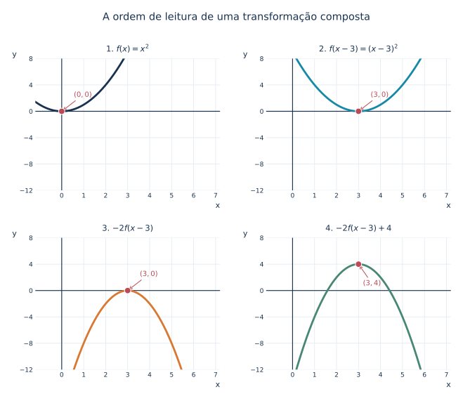{fig-alt="Quatro estágios de transformação de x ao quadrado: translação para direita, reflexão com alongamento vertical e deslocamento para cima até o vértice três quatro." width="94%"}

::: {.callout-note collapse="true" title="Clique para ver o código"}

```python
from pathlib import Path
import numpy as np
import matplotlib.pyplot as plt

# Padrão editorial — Blog do Marcellini.
AZUL = "#19324f"
CIANO = "#1689a6"
LARANJA = "#d87832"
VERMELHO = "#ba4a56"
ROXO = "#7858a6"
VERDE = "#478774"
GRADE = "#e2e9ef"
plt.rcParams.update({
    "font.family": "DejaVu Sans",
    "font.size": 11,
    "axes.titlesize": 13,
    "svg.fonttype": "path",
    "figure.facecolor": "white",
    "axes.facecolor": "white",
})


def preparar(ax, xlim, ylim, xticks=None, yticks=None):
    ax.set_xlim(*xlim)
    ax.set_ylim(*ylim)
    if xticks is not None:
        ax.set_xticks(xticks)
    if yticks is not None:
        ax.set_yticks(yticks)
    ax.set_axisbelow(True)
    ax.grid(True, color=GRADE, lw=.8)
    for spine in ax.spines.values():
        spine.set_visible(False)
    ax.axhline(0, color=AZUL, lw=1.15, zorder=2)
    ax.axvline(0, color=AZUL, lw=1.15, zorder=2)
    ax.tick_params(axis="both", length=0, colors=AZUL, labelsize=9)
    ax.set_xlabel("x", loc="right", color=AZUL)
    ax.set_ylabel("y", loc="top", rotation=0, color=AZUL)


def legenda(ax, **kwargs):
    opts = dict(loc="upper right", fontsize=10, framealpha=.97,
                facecolor="white", edgecolor=GRADE)
    opts.update(kwargs)
    ax.legend(**opts)


def salvar(fig, nome):
    destino = Path("images")
    destino.mkdir(parents=True, exist_ok=True)
    arquivo = destino / nome
    fig.savefig(arquivo, format="svg",
                bbox_inches="tight", pad_inches=.24,
                facecolor="white")
    # Evita espaços em branco no fim das linhas dos SVGs gerados.
    linhas = arquivo.read_text(encoding="utf-8").splitlines()
    arquivo.write_text("\n".join(linha.rstrip() for linha in linhas) + "\n",
                       encoding="utf-8")
    plt.close(fig)

fig,axs=plt.subplots(2,2,figsize=(10.6,8.0))
x=np.linspace(-1.2,7.2,900)
cfg=[(x*x,AZUL,r"1. $f(x)=x^2$",0,0),
     ((x-3)**2,CIANO,r"2. $f(x-3)=(x-3)^2$",3,0),
     (-2*(x-3)**2,LARANJA,r"3. $-2f(x-3)$",3,0),
     (-2*(x-3)**2+4,VERDE,r"4. $-2f(x-3)+4$",3,4)]
for ax,(y,cor,titulo,xv,yv) in zip(axs.flat,cfg):
    preparar(ax,(-1.2,7.2),(-12,8),xticks=np.arange(0,8),yticks=[-12,-8,-4,0,4,8])
    ax.plot(x,y,color=cor,lw=2.8)
    ax.scatter([xv],[yv],s=78,color=VERMELHO,
               edgecolors="white",zorder=6)
    ax.annotate(fr"$({xv},{yv})$",(xv,yv),
                (3.2 if yv == 4 else xv+.55, yv+2.2 if yv<4 else yv-3.2),
                color=VERMELHO,fontsize=10,
                arrowprops=dict(arrowstyle="->",color=VERMELHO,lw=1))
    ax.set_title(titulo,color=AZUL,fontsize=11.5,pad=10)
fig.suptitle("A ordem de leitura de uma transformação composta",color=AZUL,fontsize=14.5,y=.995)
fig.subplots_adjust(hspace=.36,wspace=.25)
salvar(fig,"1.12-ordem-transformacoes.svg")
```

:::

***

## 🌉 Por que isso importa para o Cálculo?

Transformações gráficas ajudam a reconhecer funções rapidamente.

No estudo de limites, elas ajudam a visualizar deslocamentos, aproximações e assíntotas.

No estudo de continuidade, ajudam a perceber quebras, buracos e mudanças de domínio.

No estudo de derivadas, ajudam a prever inclinações e crescimento.

No estudo de integrais, ajudam a interpretar áreas e simetrias.

Em resumo, transformações gráficas são uma ponte entre a álgebra da fórmula e a geometria do gráfico.

A função transladada $g(x)=(x-1)^2+1$ permite visualizar, em quatro painéis, aproximação, continuidade, tangência e área acumulada.

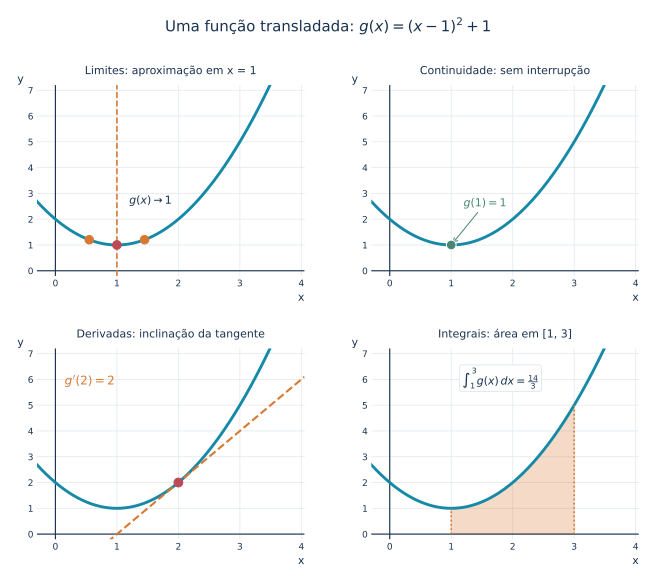{fig-alt="Quatro painéis com uma parábola transladada (x menos um ao quadrado mais um): aproximação para limites, continuidade, reta tangente e área definida." width="94%"}

::: {.callout-note collapse="true" title="Clique para ver o código"}

```python
from pathlib import Path
import numpy as np
import matplotlib.pyplot as plt

# Padrão editorial — Blog do Marcellini.
AZUL = "#19324f"
CIANO = "#1689a6"
LARANJA = "#d87832"
VERMELHO = "#ba4a56"
ROXO = "#7858a6"
VERDE = "#478774"
GRADE = "#e2e9ef"
plt.rcParams.update({
    "font.family": "DejaVu Sans",
    "font.size": 11,
    "axes.titlesize": 13,
    "svg.fonttype": "path",
    "figure.facecolor": "white",
    "axes.facecolor": "white",
})


def preparar(ax, xlim, ylim, xticks=None, yticks=None):
    ax.set_xlim(*xlim)
    ax.set_ylim(*ylim)
    if xticks is not None:
        ax.set_xticks(xticks)
    if yticks is not None:
        ax.set_yticks(yticks)
    ax.set_axisbelow(True)
    ax.grid(True, color=GRADE, lw=.8)
    for spine in ax.spines.values():
        spine.set_visible(False)
    ax.axhline(0, color=AZUL, lw=1.15, zorder=2)
    ax.axvline(0, color=AZUL, lw=1.15, zorder=2)
    ax.tick_params(axis="both", length=0, colors=AZUL, labelsize=9)
    ax.set_xlabel("x", loc="right", color=AZUL)
    ax.set_ylabel("y", loc="top", rotation=0, color=AZUL)


def legenda(ax, **kwargs):
    opts = dict(loc="upper right", fontsize=10, framealpha=.97,
                facecolor="white", edgecolor=GRADE)
    opts.update(kwargs)
    ax.legend(**opts)


def salvar(fig, nome):
    destino = Path("images")
    destino.mkdir(parents=True, exist_ok=True)
    arquivo = destino / nome
    fig.savefig(arquivo, format="svg",
                bbox_inches="tight", pad_inches=.24,
                facecolor="white")
    # Evita espaços em branco no fim das linhas dos SVGs gerados.
    linhas = arquivo.read_text(encoding="utf-8").splitlines()
    arquivo.write_text("\n".join(linha.rstrip() for linha in linhas) + "\n",
                       encoding="utf-8")
    plt.close(fig)

fig,axs=plt.subplots(2,2,figsize=(10.8,8.2))
x=np.linspace(-.3,4.05,900)
y=(x-1)**2+1
nomes=["Limites: aproximação em x = 1",
       "Continuidade: sem interrupção",
       "Derivadas: inclinação da tangente",
       "Integrais: área em [1, 3]"]
for ax,nome in zip(axs.flat,nomes):
    preparar(ax,(-.3,4.05),(-.2,7.2),xticks=[0,1,2,3,4],
             yticks=[0,1,2,3,4,5,6,7])
    ax.plot(x,y,color=CIANO,lw=2.9)
    ax.set_title(nome,color=AZUL,fontsize=11,pad=11)
# Painel 1: proximidade em torno de x=1.
a=axs[0,0]
a.axvline(1,color=LARANJA,ls="--",lw=1.6)
a.scatter([.55,1.45],[1.2025,1.2025],s=72,color=LARANJA,zorder=6)
a.scatter([1],[1],s=75,color=VERMELHO,zorder=6)
a.text(1.2,2.6,r"$g(x)\to 1$",fontsize=11,color=AZUL)
# Painel 2: o ponto preenchido pertence à curva contínua.
a=axs[0,1]
a.scatter([1],[1],s=94,color=VERDE,edgecolors="white",zorder=6)
a.annotate(r"$g(1)=1$",(1,1),(1.2,2.5),color=VERDE,
           arrowprops=dict(arrowstyle="->",color=VERDE))
# Painel 3: g'(2)=2, tangente = 3 + 2(x-2).
a=axs[1,0]
a.plot(x,2+2*(x-2),color=LARANJA,lw=2.1,ls="--")
a.scatter([2],[2],s=78,color=VERMELHO,zorder=6)
a.text(.15,5.8,r"$g'(2)=2$",color=LARANJA,fontsize=12)
# Painel 4: integral em [1,3] = 14/3, área positiva.
a=axs[1,1]
xx=np.linspace(1,3,500)
a.fill_between(xx,0,(xx-1)**2+1,color=LARANJA,alpha=.27)
a.plot([1,1],[0,1],color=LARANJA,ls=":",lw=1.6)
a.plot([3,3],[0,5],color=LARANJA,ls=":",lw=1.6)
a.text(1.18,5.8,r"$\int_1^3 g(x)\,dx=\frac{14}{3}$",
       color=AZUL,fontsize=11,
       bbox=dict(facecolor="white",edgecolor=GRADE,boxstyle="round,pad=.25"))
fig.suptitle(r"Uma função transladada: $g(x)=(x-1)^2+1$",
             color=AZUL,fontsize=15,y=.995)
fig.subplots_adjust(hspace=.38,wspace=.25)
salvar(fig,"1.12-transformacoes-calculo.svg")
```

:::

***

# 🧪 Exercícios propostos

::: {.callout-note title="📝 Exercícios"}

## 🧪 Exercício 1

Considere a função base

$$
f(x)=x^2.
$$

Descreva a transformação em cada caso:

a) $g(x)=x^2+4$  
b) $h(x)=x^2-3$  
c) $p(x)=(x-2)^2$  
d) $q(x)=(x+5)^2$

## 🧪 Exercício 2

Ainda considerando

$$
f(x)=x^2,
$$

descreva a transformação:

a) $g(x)=-x^2$  
b) $h(x)=3x^2$  
c) $p(x)=\dfrac{1}{2}x^2$  
d) $q(x)=-2x^2$

## 🧪 Exercício 3

Determine o vértice da parábola:

a) $g(x)=(x-4)^2+1$  
b) $h(x)=(x+2)^2-3$  
c) $p(x)=2(x-1)^2+5$

## 🧪 Exercício 4

Determine o domínio real das funções:

a) $f(x)=\sqrt{x-3}$  
b) $g(x)=\sqrt{x+2}$  
c) $h(x)=\sqrt{-x}$  
d) $p(x)=\sqrt{5-x}$

## 🧪 Exercício 5

Para a função

$$
g(x)=3\sin(2x)-1,
$$

determine:

a) a amplitude;  
b) o período;  
c) o deslocamento vertical.

:::

***

::: {.callout-important collapse=true title="✅ Gabarito"}

# ✅ Gabarito comentado

## 🧪 Exercício 1

a) $g(x)=x^2+4$ é o gráfico de $f(x)=x^2$ deslocado $4$ unidades para cima.  

b) $h(x)=x^2-3$ é o gráfico deslocado $3$ unidades para baixo.  

c) $p(x)=(x-2)^2$ é o gráfico deslocado $2$ unidades para a direita.  

d) $q(x)=(x+5)^2$ é o gráfico deslocado $5$ unidades para a esquerda.

## 🧪 Exercício 2

a) $g(x)=-x^2$ é uma reflexão em relação ao eixo horizontal.  

b) $h(x)=3x^2$ é um alongamento vertical por fator $3$.  

c) $p(x)=\dfrac{1}{2}x^2$ é uma compressão vertical por fator $\dfrac{1}{2}$.  

d) $q(x)=-2x^2$ combina reflexão em relação ao eixo horizontal com alongamento vertical por fator $2$.

## 🧪 Exercício 3

a) A função

$$
g(x)=(x-4)^2+1
$$

vem de $x^2$ deslocada $4$ unidades para a direita e $1$ para cima. Logo, o vértice é

$$
(4,1).
$$

b) A função

$$
h(x)=(x+2)^2-3
$$

vem de $x^2$ deslocada $2$ unidades para a esquerda e $3$ para baixo. Logo, o vértice é

$$
(-2,-3).
$$

c) A função

$$
p(x)=2(x-1)^2+5
$$

vem de $x^2$ deslocada $1$ unidade para a direita, alongada verticalmente por fator $2$ e deslocada $5$ unidades para cima. Logo, o vértice é

$$
(1,5).
$$

## 🧪 Exercício 4

a) Para $f(x)=\sqrt{x-3}$, precisamos de

$$
x-3\geq 0.
$$

Logo,

$$
x\geq 3,
$$

e

$$
D_f=[3,+\infty).
$$

b) Para $g(x)=\sqrt{x+2}$, precisamos de

$$
x+2\geq 0.
$$

Logo,

$$
x\geq -2,
$$

e

$$
D_g=[-2,+\infty).
$$

c) Para $h(x)=\sqrt{-x}$, precisamos de

$$
-x\geq 0.
$$

Logo,

$$
x\leq 0,
$$

e

$$
D_h=(-\infty,0].
$$

d) Para $p(x)=\sqrt{5-x}$, precisamos de

$$
5-x\geq 0.
$$

Logo,

$$
x\leq 5,
$$

e

$$
D_p=(-\infty,5].
$$

## 🧪 Exercício 5

A função é

$$
g(x)=3\sin(2x)-1.
$$

a) A amplitude é

$$
|3|=3.
$$

b) O período é

$$
\frac{2\pi}{|2|}=\pi.
$$

c) O deslocamento vertical é $1$ unidade para baixo, pois aparece o termo $-1$.

:::

***

## 🧩 Quiz — Transformações Gráficas

:::::{.question}
**Q1.** A função $g(x)=f(x)+3$ representa:

::::{.choices}
:::{.choice .correct-choice}
Uma translação vertical de $3$ unidades para cima.
:::

:::{.choice}
Uma translação horizontal de $3$ unidades para a direita.
:::

:::{.choice}
Uma reflexão em relação ao eixo vertical.
:::
::::
:::::

:::::{.question}
**Q2.** A função $g(x)=f(x-2)$ representa:

::::{.choices}
:::{.choice}
Uma translação de $2$ unidades para a esquerda.
:::

:::{.choice .correct-choice}
Uma translação de $2$ unidades para a direita.
:::

:::{.choice}
Uma translação de $2$ unidades para baixo.
:::
::::
:::::

:::::{.question}
**Q3.** A transformação $g(x)=-f(x)$ produz:

::::{.choices}
:::{.choice}
Reflexão em relação ao eixo vertical.
:::

:::{.choice .correct-choice}
Reflexão em relação ao eixo horizontal.
:::

:::{.choice}
Compressão horizontal.
:::
::::
:::::

***

# 🔗 Navegação

🎯 **Post Anterior:** 👉 [1.11 Revisão Gráfica e Algébrica](1.11-revisao-grafica-e-algebrica.qmd)

🎯 **Próximo Post:** 👉 [1.13 Composição de Funções](1.13-composicao-de-funcoes.qmd)

🏠 [Sumário do Curso](../index.qmd) · [← Cursos de Matemática](../../index.qmd) · 🔝 [Topo](1.12-transformacoes-graficas.qmd)

***

*Blog do Marcellini — Explorando a Matemática com Rigor e Beleza.*

:::{.callout-note}
Criado por Blog do Marcellini com ❤️ e código.
:::

