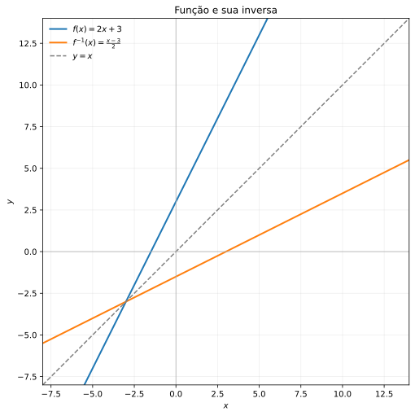
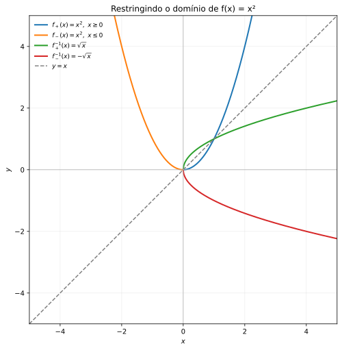
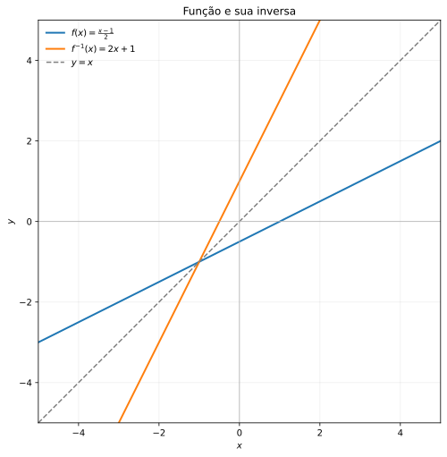
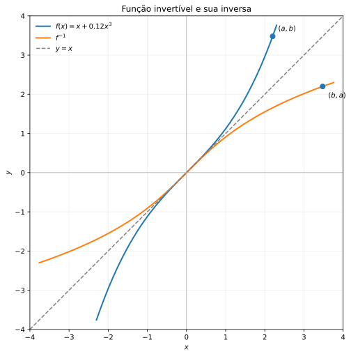
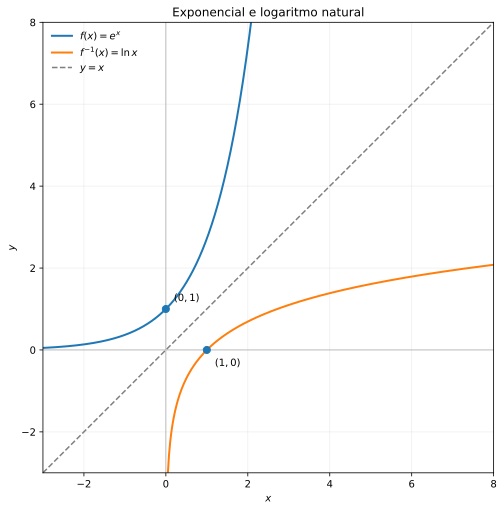
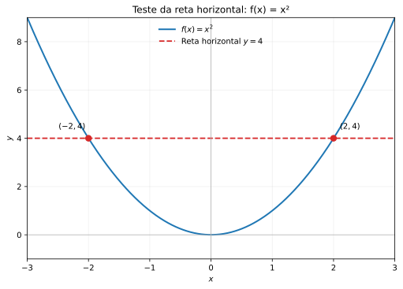
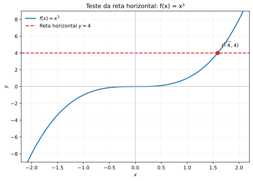
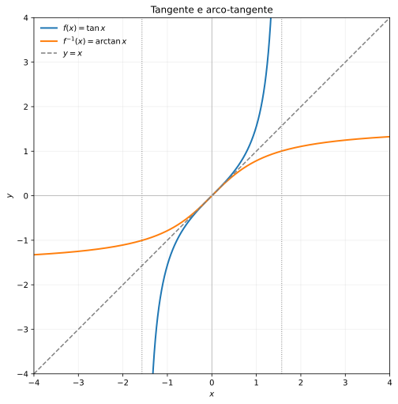

🏠 [← Sumário do Curso](../index.qmd) · [← Cursos de Matemática](../../index.qmd) · [← Seção de Matemática](/posts/matematica/index.qmd)

🎯 **Aula anterior:** 👉 [1.13 Composição de Funções](1.13-composicao-de-funcoes.qmd)

🎯 **Próxima aula:** 👉 [1.15 Modelos com Funções Elementares](1.15-modelos-com-funcoes-elementares.qmd)

***

::: {.callout-tip title="❓ Pergunta Disparadora"}

Em que condições podemos desfazer uma função e recuperar uma única entrada a partir de sua saída?

Toda função possui inversa?

:::

::: {.callout-note title="📌 Objetivos de Aprendizagem"}

Ao final desta aula, você deverá ser capaz de:

- Compreender o significado de função inversa e sua relação com a composição de funções.
- Distinguir funções injetivas, sobrejetivas e bijetivas.
- Identificar as condições necessárias e suficientes para a existência de uma inversa.
- Determinar funções inversas algebricamente e verificar as identidades de composição.
- Interpretar restrições adequadas de domínio e contradomínio para obter funções invertíveis.
- Identificar a reflexão dos gráficos de \(f\) e \(f^{-1}\) na reta \(y=x\).
- Reconhecer pares importantes de funções inversas, como exponencial e logaritmo.

:::

# 📘 Função Inversa

Na aula anterior, estudamos a composição de funções. Agora vamos utilizar essa ideia para compreender um conceito fundamental: a **função inversa**.

Intuitivamente, uma função inversa desfaz o que a função original fez.

Por exemplo, considere:

$$
f(x)=x+3.
$$

Essa função soma \(3\) à entrada.

A função que desfaz essa operação é:

$$
f^{-1}(x)=x-3.
$$

De fato, se começamos com \(x\), aplicamos \(f\) e depois aplicamos \(f^{-1}\), voltamos ao valor inicial:

$$
\begin{aligned}
f^{-1}(f(x))
&=f^{-1}(x+3)\\
&=(x+3)-3\\
&=x.
\end{aligned}
$$

A função inversa é, portanto, uma função de retorno.

Entretanto, existe uma condição importante: para que a inversa seja uma função, cada saída da função original deve corresponder a uma única entrada.

É por isso que nem toda função possui inversa.

***

## 💡 A ideia de desfazer uma operação

Considere a função:

$$
f(x)=2x.
$$

Ela dobra o valor de entrada.

Para desfazer essa operação, dividimos por \(2\):

$$
f^{-1}(x)=\frac{x}{2}.
$$

Assim:

$$
\begin{aligned}
f^{-1}(f(x))
&=f^{-1}(2x)\\
&=\frac{2x}{2}\\
&=x.
\end{aligned}
$$

Também temos:

$$
\begin{aligned}
f(f^{-1}(x))
&=f\left(\frac{x}{2}\right)\\
&=2\cdot\frac{x}{2}\\
&=x.
\end{aligned}
$$

As duas composições recuperam o valor inicial.

**Ilustração — Ida e volta entre uma função e sua inversa**

Primeiro, aplicamos \(f\) e, em seguida, sua inversa \(f^{-1}\).

```{mermaid}
%%| fig-width: 7
%%| fig-height: 2.5
flowchart LR
    X["Entrada: x"] --> F["Aplicar f"]
    F --> Y["Saída: f(x)"]
    Y --> FI["Aplicar f⁻¹"]
    FI --> X2["Retorno: x"]
```

Agora, fazemos o percurso contrário: aplicamos \(f^{-1}\) e depois \(f\).

```{mermaid}
%%| fig-width: 7
%%| fig-height: 2.5
flowchart LR
    Y2["Entrada: y"] --> FI2["Aplicar f⁻¹"]
    FI2 --> X3["Saída: f⁻¹(y)"]
    X3 --> F2["Aplicar f"]
    F2 --> Y3["Retorno: y"]
```

Quando as duas composições devolvem a entrada original, uma função é inversa da outra.

***

## 📐 Definição de função inversa

Seja:

$$
f:A\to B
$$

uma função.

Uma função:

$$
f^{-1}:B\to A
$$

é chamada de **função inversa de \(f\)** quando satisfaz as duas condições:

$$
f^{-1}(f(x))=x,
\qquad x\in A,
$$

e

$$
f(f^{-1}(y))=y,
\qquad y\in B.
$$

Em termos de composição:

$$
f^{-1}\circ f=\operatorname{id}_A
$$

e

$$
f\circ f^{-1}=\operatorname{id}_B,
$$

onde \(\operatorname{id}\) representa a função identidade.

Essas duas relações expressam a ideia de que uma função desfaz a ação da outra, tanto no sentido de ida quanto no sentido de volta.

::: {.callout-note title="Ideia central"}

A inversa de uma função é a função que desfaz a ação da função original.

Para uma função \(f:A\to B\), sua inversa, quando existe, associa elementos de \(B\) a elementos de \(A\).

:::

***

## 🆔 A função identidade

A função identidade em um conjunto \(A\) é definida por:

$$
\operatorname{id}_A(x)=x.
$$

Ela não altera a entrada.

Por exemplo, em \(\mathbb{R}\):

$$
\operatorname{id}_{\mathbb{R}}(x)=x.
$$

Dizer que:

$$
f^{-1}\circ f=\operatorname{id}_A
$$

significa que aplicar \(f\) e depois aplicar \(f^{-1}\) devolve o ponto inicial.

Dizer que:

$$
f\circ f^{-1}=\operatorname{id}_B
$$

significa que aplicar \(f^{-1}\) e depois aplicar \(f\) também devolve o ponto inicial.

A função identidade é, portanto, o elemento neutro da composição de funções compatíveis.

***

## ⚠️ Nem toda função tem inversa

Nem toda função possui inversa.

Para uma função \(f:A\to B\) ter uma inversa definida em todo o contradomínio \(B\), ela precisa satisfazer duas condições:

1. Entradas diferentes devem produzir saídas diferentes.
2. Todos os elementos do contradomínio devem ser atingidos.

Em outras palavras, a função precisa ser **bijetiva**.

Uma função bijetiva é, ao mesmo tempo:

- injetiva;
- sobrejetiva.

Esses conceitos são fundamentais para entender quando a inversa existe.

***

## 🧩 Função injetiva

Uma função é **injetiva** quando entradas diferentes produzem saídas diferentes.

Formalmente, uma função \(f:A\to B\) é injetiva quando:

$$
x_1\neq x_2
\quad\Rightarrow\quad
f(x_1)\neq f(x_2).
$$

Equivalentemente:

$$
f(x_1)=f(x_2)
\quad\Rightarrow\quad
x_1=x_2.
$$

Isso significa que nenhum elemento da imagem pode ser obtido a partir de duas entradas diferentes.

**Exemplo:**

Considere:

$$
f(x)=2x+1.
$$

Se:

$$
f(x_1)=f(x_2),
$$

então:

$$
2x_1+1=2x_2+1.
$$

Subtraindo \(1\) dos dois lados:

$$
2x_1=2x_2.
$$

Dividindo por \(2\):

$$
x_1=x_2.
$$

Portanto, \(f(x)=2x+1\) é injetiva em \(\mathbb{R}\).

**Exemplo de função que não é injetiva:**

Considere:

$$
f(x)=x^2.
$$

Temos:

$$
f(2)=4
$$

e

$$
f(-2)=4.
$$

Duas entradas diferentes produzem a mesma saída.

**Ilustração — Duas entradas chegam à mesma saída**

```{mermaid}
%%| fig-width: 6
%%| fig-height: 3
flowchart LR
    subgraph A["Entradas"]
        direction TB
        X1["−2"]
        X2["2"]
    end

    subgraph B["Saída"]
        direction TB
        Y["4"]
    end

    X1 --> Y
    X2 --> Y
```

Assim, \(f(x)=x^2\) não é injetiva em todo \(\mathbb{R}\).

***

## 🧩 Função sobrejetiva

Uma função

$$
f:A\to B
$$

é **sobrejetiva** quando todo elemento do contradomínio \(B\) é imagem de pelo menos um elemento do domínio \(A\).

Formalmente, para todo \(y\in B\), existe pelo menos um \(x\in A\) tal que:

$$
f(x)=y.
$$

Em símbolos:

$$
\boxed{
\forall y\in B,\ \exists x\in A:\ f(x)=y
}
$$

Isso significa que nenhum elemento do contradomínio fica sem ser atingido. Equivalentemente, a imagem da função coincide com o contradomínio:

$$
\boxed{\operatorname{Im}(f)=B}
$$

### Ilustração — Todos os elementos do contradomínio são atingidos

```{mermaid}
%%| fig-width: 7
%%| fig-height: 4.5
flowchart LR
    subgraph A["Domínio A"]
        direction TB
        a["a"]
        b["b"]
        c["c"]
        d["d"]
    end

    subgraph B["Contradomínio B"]
        direction TB
        y1["1"]
        y2["2"]
        y3["3"]
    end

    a -->|f| y1
    b -->|f| y2
    c -->|f| y3
    d -->|f| y2
```

Observe que todos os elementos do contradomínio \(B=\{1,2,3\}\) recebem pelo menos uma seta. Portanto, a função é sobrejetiva.

Note também que os elementos \(b\) e \(d\) possuem a mesma imagem:

$$
f(b)=f(d)=2.
$$

Isso mostra que uma função pode ser sobrejetiva sem ser injetiva: diferentes elementos do domínio podem ser enviados ao mesmo elemento do contradomínio.

### Exemplo — Uma função sobrejetiva de \(\mathbb{R}\) em \(\mathbb{R}\)

Considere a função:

$$
f:\mathbb{R}\to\mathbb{R}
$$

definida por:

$$
f(x)=2x+1.
$$

Para verificar se \(f\) é sobrejetiva, devemos mostrar que todo número real \(y\) pode ser escrito como \(f(x)\) para algum \(x\in\mathbb{R}\).

Seja, então, \(y\in\mathbb{R}\) arbitrário. Procuramos um \(x\in\mathbb{R}\) que satisfaça:

$$
f(x)=y.
$$

Substituindo a expressão da função:

$$
2x+1=y.
$$

Isolando \(x\), obtemos:

$$
2x=y-1,
$$

e, portanto:

$$
\boxed{x=\frac{y-1}{2}}.
$$

Como \(y\in\mathbb{R}\), temos:

$$
\frac{y-1}{2}\in\mathbb{R}.
$$

Assim, para qualquer número real \(y\), encontramos um número real \(x\) tal que:

$$
\begin{aligned}
f\left(\frac{y-1}{2}\right)
&=2\left(\frac{y-1}{2}\right)+1\\
&=y-1+1\\
&=y.
\end{aligned}
$$

Logo, todo elemento do contradomínio é atingido.

Concluímos que:

$$
\boxed{f\text{ é sobrejetiva}.}
$$

**Ideia fundamental:** para demonstrar que uma função é sobrejetiva, partimos de um elemento arbitrário do contradomínio e mostramos que existe um elemento do domínio cuja imagem é exatamente esse elemento.

***

## 🧩 Função bijetiva

Uma função é **bijetiva** quando é simultaneamente injetiva e sobrejetiva.

Isso significa que:

- entradas diferentes produzem saídas diferentes;
- todos os elementos do contradomínio são atingidos.

Cada elemento do contradomínio corresponde, portanto, a exatamente uma entrada do domínio.

**Ilustração — Correspondência bijetiva**

```{mermaid}
%%| fig-width: 6
%%| fig-height: 3.4
flowchart LR
    subgraph A["Domínio A"]
        direction TB
        A1["a₁"]
        A2["a₂"]
        A3["a₃"]
    end

    subgraph B["Contradomínio B"]
        direction TB
        B1["b₁"]
        B2["b₂"]
        B3["b₃"]
    end

    A1 --> B2
    A2 --> B3
    A3 --> B1
```

Nesse exemplo, cada elemento do domínio está associado a um único elemento do contradomínio, e cada elemento do contradomínio é atingido exatamente uma vez.

::: {.callout-tip title="Critério prático"}

Uma função \(f:A\to B\) possui inversa \(f^{-1}:B\to A\) quando cada valor de saída corresponde a uma única entrada e todos os valores do contradomínio são atingidos.

:::

***

## ✅ Exemplo de função com inversa

Considere:

$$
f:\mathbb{R}\to\mathbb{R}
$$

dada por:

$$
f(x)=2x+3.
$$

Para encontrar a inversa, escrevemos:

$$
y=2x+3.
$$

Agora resolvemos essa equação para \(x\):

$$
y-3=2x,
$$

logo:

$$
x=\frac{y-3}{2}.
$$

Trocando \(y\) por \(x\), obtemos:

$$
\boxed{f^{-1}(x)=\frac{x-3}{2}}.
$$

Vamos verificar a primeira composição:

$$
\begin{aligned}
f^{-1}(f(x))
&=f^{-1}(2x+3)\\
&=\frac{(2x+3)-3}{2}\\
&=\frac{2x}{2}\\
&=x.
\end{aligned}
$$

Agora verificamos a segunda:

$$
\begin{aligned}
f(f^{-1}(x))
&=f\left(\frac{x-3}{2}\right)\\
&=2\cdot\frac{x-3}{2}+3\\
&=x-3+3\\
&=x.
\end{aligned}
$$

As duas composições resultam na identidade. Portanto, as funções são inversas.

{#fig-1-14-inversa fig-alt="Plano cartesiano com os gráficos de f(x)=2x+3 e de sua inversa f⁻¹(x)=(x−3)/2. As duas retas são simétricas em relação à reta y=x." width="90%"}

::: {.callout-note collapse="true" title="Clique para ver o código"}

```{python}
import numpy as np
import matplotlib.pyplot as plt
from pathlib import Path

x = np.linspace(-8, 14, 600)

fig, ax = plt.subplots(figsize=(7.2, 7.2))

ax.plot(x, 2*x + 3,
        lw=2, label=r'$f(x)=2x+3$')

ax.plot(x, (x - 3)/2,
        lw=2, label=r'$f^{-1}(x)=\frac{x-3}{2}$')

ax.plot(x, x,
        linestyle='--', color='gray',
        lw=1.5, label=r'$y=x$')

ax.axhline(0, color='0.7', lw=0.8)
ax.axvline(0, color='0.7', lw=0.8)

ax.set(
    xlim=(-8, 14),
    ylim=(-8, 14),
    xlabel='$x$',
    ylabel='$y$',
    title='Função e sua inversa'
)

ax.set_aspect('equal', adjustable='box')
ax.legend(loc='upper left', frameon=False)
ax.grid(alpha=0.2)

fig.tight_layout()

Path('images').mkdir(exist_ok=True)
fig.savefig('images/1.14-funcao-inversa.svg',
            bbox_inches='tight')

plt.close(fig)
```
:::

***

## ❌ Exemplo de função sem inversa em todo \(\mathbb{R}\)

Considere:

$$
f:\mathbb{R}\to\mathbb{R}
$$

dada por:

$$
f(x)=x^2.
$$

Essa função não é injetiva em \(\mathbb{R}\), pois:

$$
f(2)=4
$$

e

$$
f(-2)=4.
$$

Duas entradas diferentes produzem a mesma saída.

Além disso, a função não é sobrejetiva em \(\mathbb{R}\), pois não assume valores negativos.

Portanto, \(f(x)=x^2\) não possui inversa como função de \(\mathbb{R}\) em \(\mathbb{R}\).

***

## 🧭 Restringindo o domínio

Embora:

$$
f(x)=x^2
$$

não tenha inversa em todo \(\mathbb{R}\), podemos restringir seu domínio.

Considere:

$$
f:[0,+\infty)\to[0,+\infty)
$$

dada por:

$$
f(x)=x^2.
$$

Agora a função é injetiva e sobrejetiva.

A inversa é:

$$
f^{-1}(x)=\sqrt{x}.
$$

De fato:

$$
\sqrt{x^2}=x
$$

para:

$$
x\geq 0.
$$

**Ilustração — Restrição do domínio e recuperação da entrada**

```{mermaid}
%%| fig-width: 6
%%| fig-height: 4
flowchart TB
    A["Domínio: x ≥ 0"] --> F["Aplicar f(x) = x²"]
    F --> B["Imagem: y ≥ 0"]
    B --> G["Aplicar f⁻¹(y) = √y"]
    G --> C["Recuperar x ≥ 0"]
```

Esse exemplo mostra que a existência da inversa depende fortemente do domínio e do contradomínio escolhidos.

Também poderíamos restringir o domínio a:

$$
(-\infty,0].
$$

Nesse caso, a função também seria bijetiva sobre \([0,+\infty)\), e sua inversa seria:

$$
f^{-1}(x)=-\sqrt{x}.
$$

::: {.callout-note title="Atenção ao domínio"}

A função \(x^2\) possui duas restrições naturais que permitem construir inversas diferentes:

- Se o domínio for \([0,+\infty)\), a inversa será \(\sqrt{x}\).
- Se o domínio for \((-\infty,0]\), a inversa será \(-\sqrt{x}\).

A escolha do domínio determina qual ramo da função será invertido.

:::

{#fig-1-14-restricoes fig-alt="Plano cartesiano com os dois ramos da parábola y=x²: o ramo para x maior ou igual a zero e o ramo para x menor ou igual a zero. Também aparecem as inversas y=√x e y=−√x, simétricas aos respectivos ramos em relação à reta y=x." width="90%"}

::: {.callout-note collapse="true" title="Clique para ver o código"}

```{python}
import numpy as np
import matplotlib.pyplot as plt
from pathlib import Path

# Domínio da restrição x >= 0
x_pos = np.linspace(0, np.sqrt(5), 400)
y_pos = x_pos**2

# Domínio da restrição x <= 0
x_neg = np.linspace(-np.sqrt(5), 0, 400)
y_neg = x_neg**2

# Domínio das funções inversas: x >= 0
u = np.linspace(0, 5, 400)
y_inv_pos = np.sqrt(u)
y_inv_neg = -np.sqrt(u)

fig, ax = plt.subplots(figsize=(7.2, 7.2))

# Funções com domínio restrito
ax.plot(x_pos, y_pos, lw=2,
        label=r'$f_+(x)=x^2,\ x\geq 0$')

ax.plot(x_neg, y_neg, lw=2,
        label=r'$f_-(x)=x^2,\ x\leq 0$')

# Funções inversas
ax.plot(u, y_inv_pos, lw=2,
        label=r'$f_+^{-1}(x)=\sqrt{x}$')

ax.plot(u, y_inv_neg, lw=2,
        label=r'$f_-^{-1}(x)=-\sqrt{x}$')

# Reta de simetria
ax.plot([-5, 5], [-5, 5],
        linestyle='--', color='gray', lw=1.5,
        label=r'$y=x$')

# Eixos cartesianos
ax.axhline(0, color='0.7', lw=0.8)
ax.axvline(0, color='0.7', lw=0.8)

ax.set(
    xlim=(-5, 5),
    ylim=(-5, 5),
    xlabel='$x$',
    ylabel='$y$',
    title='Restringindo o domínio de f(x) = x²'
)

ax.set_aspect('equal', adjustable='box')
ax.legend(loc='upper left', frameon=False, fontsize=9)
ax.grid(alpha=0.2)

fig.tight_layout()

Path('images').mkdir(exist_ok=True)
fig.savefig('images/1.14-restricoes-dominio.svg',
            bbox_inches='tight')

plt.close(fig)
```

:::

***

## 🪞 Como encontrar a inversa

Para encontrar a inversa de uma função dada por uma fórmula, podemos seguir estes passos:

1. Escreva \(y=f(x)\).
2. Resolva a equação para \(x\) em função de \(y\).
3. Troque o nome da variável \(y\) por \(x\), obtendo a expressão da inversa.
4. Identifique o domínio e a imagem da inversa.
5. Verifique as duas composições, quando necessário.

**Exemplo:**

Considere:

$$
f(x)=\frac{x-1}{2}.
$$

Escrevemos:

$$
y=\frac{x-1}{2}.
$$

Multiplicando por \(2\):

$$
2y=x-1.
$$

Logo:

$$
x=2y+1.
$$

Portanto:

$$
\boxed{f^{-1}(x)=2x+1}.
$$

Observe que o procedimento algébrico precisa ser acompanhado da verificação dos domínios. A expressão obtida deve representar uma função com o domínio e o contradomínio adequados.

{#fig-1-14-como-encontrar-inversa fig-alt="Plano cartesiano com os gráficos das retas f(x)=(x−1)/2 e f inversa de x igual a 2x+1. As duas retas são simétricas em relação à reta y=x." width="90%"}

::: {.callout-note collapse="true" title="Clique para ver o código"}

```{python}
import numpy as np
import matplotlib.pyplot as plt
from pathlib import Path

x = np.linspace(-5, 5, 600)

# Função original
y_f = (x - 1) / 2

# Função inversa
y_inv = 2*x + 1

# Reta de simetria
y_identidade = x

fig, ax = plt.subplots(figsize=(7.2, 7.2))

ax.plot(x, y_f, lw=2,
        label=r'$f(x)=\frac{x-1}{2}$')

ax.plot(x, y_inv, lw=2,
        label=r'$f^{-1}(x)=2x+1$')

ax.plot(x, y_identidade,
        linestyle='--', color='gray', lw=1.5,
        label=r'$y=x$')

# Eixos cartesianos
ax.axhline(0, color='0.7', lw=0.8)
ax.axvline(0, color='0.7', lw=0.8)

ax.set(
    xlim=(-5, 5),
    ylim=(-5, 5),
    xlabel='$x$',
    ylabel='$y$',
    title='Função e sua inversa'
)

ax.set_aspect('equal', adjustable='box')
ax.legend(loc='upper left', frameon=False)
ax.grid(alpha=0.2)

fig.tight_layout()

Path('images').mkdir(exist_ok=True)
fig.savefig('images/1.14-como-encontrar-inversa.svg',
            bbox_inches='tight')

plt.close(fig)
```
:::

***

## 📊 Gráfico da função inversa

O gráfico de uma função inversa possui uma relação geométrica especial com o gráfico da função original.

Se o ponto:

$$
(a,b)
$$

pertence ao gráfico de \(f\), então:

$$
f(a)=b.
$$

Como a inversa desfaz a ação de \(f\), temos:

$$
f^{-1}(b)=a.
$$

Portanto, o ponto:

$$
(b,a)
$$

pertence ao gráfico de \(f^{-1}\).

Isso significa que os gráficos de \(f\) e \(f^{-1}\) são simétricos em relação à reta:

$$
y=x.
$$

**Ilustração — Troca das coordenadas**

```{mermaid}
%%| fig-width: 6
%%| fig-height: 3.5
flowchart TB
    A["Ponto (a, b) no gráfico de f"] --> B["Trocar as coordenadas"]
    B --> C["Ponto (b, a) no gráfico de f⁻¹"]
    C --> D["Simetria em relação à reta y = x"]
```

A simetria ocorre porque a inversa troca os papéis da entrada e da saída.

Por exemplo, as funções:

$$
f(x)=e^x
$$

e

$$
f^{-1}(x)=\ln x
$$

têm gráficos simétricos em relação à reta \(y=x\).

{#fig-1-14-inversa-generica fig-alt="Plano cartesiano com uma curva estritamente crescente representando uma função invertível e sua curva inversa. A reta y=x é a bissetriz dos quadrantes ímpares. Os pontos (a,b) e (b,a) são simétricos em relação a essa reta." width="90%"}

{#fig-1-14-exponencial-logaritmo fig-alt="Plano cartesiano com os gráficos de y=e elevado a x e y=logaritmo natural de x, além da reta y=x. Os gráficos da exponencial e do logaritmo natural são simétricos em relação à reta y=x." width="90%"}

::: {.callout-note collapse="true" title="Clique para ver o código"}

```{python}
import numpy as np
import matplotlib.pyplot as plt
from pathlib import Path

Path('images').mkdir(exist_ok=True)

# =========================================================
# 1. Gráfico esquemático de uma função invertível
# =========================================================

# Função estritamente crescente usada como exemplo visual
x = np.linspace(-2.3, 2.3, 600)
y = x + 0.12*x**3

# Ponto (a,b) e seu correspondente (b,a)
a = 2.2
b = a + 0.12*a**3

fig, ax = plt.subplots(figsize=(7.2, 7.2))

# Função original
ax.plot(x, y, lw=2,
        label=r'$f(x)=x+0.12x^3$')

# Inversa: troca das coordenadas dos pontos do gráfico
ax.plot(y, x, lw=2,
        label=r'$f^{-1}$')

# Bissetriz dos quadrantes ímpares
ax.plot([-4, 4], [-4, 4],
        linestyle='--', color='gray', lw=1.5,
        label=r'$y=x$')

# Pontos simétricos
ax.scatter([a, b], [b, a], s=50, zorder=4)

ax.annotate(r'$(a,b)$', (a, b),
            xytext=(8, 8), textcoords='offset points')

ax.annotate(r'$(b,a)$', (b, a),
            xytext=(8, -16), textcoords='offset points')

ax.axhline(0, color='0.7', lw=0.8)
ax.axvline(0, color='0.7', lw=0.8)

ax.set(
    xlim=(-4, 4),
    ylim=(-4, 4),
    xlabel='$x$',
    ylabel='$y$',
    title='Função invertível e sua inversa'
)

ax.set_aspect('equal', adjustable='box')
ax.legend(loc='upper left', frameon=False)
ax.grid(alpha=0.2)

fig.tight_layout()
fig.savefig('images/1.14-grafico-generico-inversa.svg',
            bbox_inches='tight')

plt.close(fig)


# =========================================================
# 2. Função exponencial e logaritmo natural
# =========================================================

# f(x) = e^x
x_exp = np.linspace(-3, np.log(8), 600)
y_exp = np.exp(x_exp)

# f^(-1)(x) = ln(x), com domínio x > 0
x_log = np.linspace(np.exp(-3), 8, 600)
y_log = np.log(x_log)

fig, ax = plt.subplots(figsize=(7.2, 7.2))

ax.plot(x_exp, y_exp, lw=2,
        label=r'$f(x)=e^x$')

ax.plot(x_log, y_log, lw=2,
        label=r'$f^{-1}(x)=\ln x$')

# Bissetriz dos quadrantes ímpares
ax.plot([-3, 8], [-3, 8],
        linestyle='--', color='gray', lw=1.5,
        label=r'$y=x$')

# Pontos correspondentes: (0,1) e (1,0)
ax.scatter([0, 1], [1, 0], s=50, zorder=4)

ax.annotate(r'$(0,1)$', (0, 1),
            xytext=(8, 8), textcoords='offset points')

ax.annotate(r'$(1,0)$', (1, 0),
            xytext=(8, -16), textcoords='offset points')

ax.axhline(0, color='0.7', lw=0.8)
ax.axvline(0, color='0.7', lw=0.8)

ax.set(
    xlim=(-3, 8),
    ylim=(-3, 8),
    xlabel='$x$',
    ylabel='$y$',
    title='Exponencial e logaritmo natural'
)

ax.set_aspect('equal', adjustable='box')
ax.legend(loc='upper left', frameon=False)
ax.grid(alpha=0.2)

fig.tight_layout()
fig.savefig('images/1.14-exponencial-logaritmo.svg',
            bbox_inches='tight')

plt.close(fig)
```
:::

***

## 🔎 Teste da reta horizontal

Para saber se uma função é injetiva, podemos utilizar o **teste da reta horizontal**.

::: {.callout-tip title="Teste da reta horizontal"}

Uma função é injetiva se toda reta horizontal intercepta seu gráfico em, no máximo, um ponto.

:::

Se alguma reta horizontal corta o gráfico em dois ou mais pontos, existem dois valores diferentes de \(x\) produzindo a mesma saída. Nesse caso, a função não é injetiva e não possui inversa como função no domínio considerado.

**Ilustração — Como interpretar o teste**

```{mermaid}
%%| fig-width: 6
%%| fig-height: 3.5
flowchart TB
    A["Escolha uma reta horizontal"] --> B["Observe as interseções com o gráfico"]
    B --> C{"Quantos pontos de interseção?"}
    C -->|"No máximo um"| D["A condição de injetividade é satisfeita"]
    C -->|"Dois ou mais"| E["A função não é injetiva"]
```

Por exemplo, o gráfico de:

$$
f(x)=x^2
$$

em \(\mathbb{R}\) falha no teste da reta horizontal.

Já o gráfico de:

$$
f(x)=x^3
$$

passa no teste e possui inversa em \(\mathbb{R}\), dada por:

$$
f^{-1}(x)=\sqrt[3]{x}.
$$

{#fig-1-14-teste-horizontal-x2 fig-alt="Gráfico da parábola y=x² e da reta horizontal y=4. A reta intercepta a parábola em dois pontos distintos, correspondentes a x igual a menos dois e x igual a dois." width="90%"}

{#fig-1-14-teste-horizontal-x3 fig-alt="Gráfico da função y=x³ e da reta horizontal y=4. A reta intercepta o gráfico em um único ponto, com coordenadas (raiz cúbica de quatro, 4)." width="90%"}

::: {.callout-note collapse="true" title="Clique para ver o código"}

```{python}
import numpy as np
import matplotlib.pyplot as plt
from pathlib import Path

Path('images').mkdir(exist_ok=True)

# =========================================================
# 1. Função f(x) = x²: não é injetiva em R
# =========================================================

x = np.linspace(-3, 3, 600)
y = x**2

# Reta horizontal y = 4
y_horizontal = 4

# Pontos de interseção: (-2, 4) e (2, 4)
x_intersecoes = [-2, 2]
y_intersecoes = [4, 4]

fig, ax = plt.subplots(figsize=(7.2, 5.2))

ax.plot(x, y, lw=2,
        label=r'$f(x)=x^2$')

ax.axhline(y_horizontal, color='tab:red',
           linestyle='--', lw=1.8,
           label=r'Reta horizontal $y=4$')

ax.scatter(x_intersecoes, y_intersecoes,
           color='tab:red', s=55, zorder=4)

ax.annotate(r'$(-2,4)$', (-2, 4),
            xytext=(-38, 12),
            textcoords='offset points')

ax.annotate(r'$(2,4)$', (2, 4),
            xytext=(8, 12),
            textcoords='offset points')

ax.axhline(0, color='0.7', lw=0.8)
ax.axvline(0, color='0.7', lw=0.8)

ax.set(
    xlim=(-3, 3),
    ylim=(-1, 9),
    xlabel='$x$',
    ylabel='$y$',
    title='Teste da reta horizontal: f(x) = x²'
)

ax.legend(loc='upper center', frameon=False)
ax.grid(alpha=0.2)

fig.tight_layout()
fig.savefig('images/1.14-teste-reta-horizontal-x2.svg',
            bbox_inches='tight')

plt.close(fig)


# =========================================================
# 2. Função f(x) = x³: é injetiva em R
# =========================================================

x = np.linspace(-2.2, 2.2, 600)
y = x**3

# Reta horizontal y = 4
y_horizontal = 4

# Única interseção: x = raiz cúbica de 4
x_intersecao = np.cbrt(4)

fig, ax = plt.subplots(figsize=(7.2, 5.2))

ax.plot(x, y, lw=2,
        label=r'$f(x)=x^3$')

ax.axhline(y_horizontal, color='tab:red',
           linestyle='--', lw=1.8,
           label=r'Reta horizontal $y=4$')

ax.scatter([x_intersecao], [4],
           color='tab:red', s=55, zorder=4)

ax.annotate(r'$(\sqrt[3]{4},4)$',
            (x_intersecao, 4),
            xytext=(8, 12),
            textcoords='offset points')

ax.axhline(0, color='0.7', lw=0.8)
ax.axvline(0, color='0.7', lw=0.8)

ax.set(
    xlim=(-2.2, 2.2),
    ylim=(-9, 9),
    xlabel='$x$',
    ylabel='$y$',
    title='Teste da reta horizontal: f(x) = x³'
)

ax.legend(loc='upper left', frameon=False)
ax.grid(alpha=0.2)

fig.tight_layout()
fig.savefig('images/1.14-teste-reta-horizontal-x3.svg',
            bbox_inches='tight')

plt.close(fig)
```
:::

**Uma observação importante:** o teste da reta horizontal verifica a injetividade, mas não garante, sozinho, a sobrejetividade em relação a um contradomínio previamente escolhido.

***

## 🚀 Exponencial e logaritmo

Um dos pares mais importantes de funções inversas é:

$$
f(x)=e^x
$$

e

$$
f^{-1}(x)=\ln x.
$$

Temos:

$$
\ln(e^x)=x
$$

para todo:

$$
x\in\mathbb{R},
$$

e:

$$
e^{\ln x}=x
$$

para todo:

$$
x>0.
$$

Observe a troca entre domínio e imagem:

- \(e^x\) tem domínio \(\mathbb{R}\) e imagem \((0,+\infty)\).
- \(\ln x\) tem domínio \((0,+\infty)\) e imagem \(\mathbb{R}\).

**Ilustração — Exponencial e logaritmo como operações inversas**

Primeiro, aplicamos a exponencial:

```{mermaid}
%%| fig-width: 6
%%| fig-height: 2.5
flowchart LR
    A["x ∈ ℝ"] --> B["Aplicar eˣ"]
    B --> C["y > 0"]
```

Em seguida, aplicamos o logaritmo para recuperar a entrada:

```{mermaid}
%%| fig-width: 6
%%| fig-height: 2.5
flowchart LR
    A["y > 0"] --> B["Aplicar ln"]
    B --> C["Recuperar x ∈ ℝ"]
```

{#fig-1-14-exponencial-logaritmo fig-alt="Plano cartesiano com os gráficos de y=e elevado a x e y=logaritmo natural de x, além da reta y=x. Os gráficos da exponencial e do logaritmo natural são simétricos em relação à reta y=x." width="90%"}

A relação entre exponencial e logaritmo será especialmente importante no estudo de limites, derivadas e integrais.

***

## 🪞 Seno, cosseno e funções inversas

As funções trigonométricas também podem ter inversas, mas precisam de restrições adequadas de domínio.

Por exemplo, a função:

$$
f(x)=\sin x
$$

não é injetiva em todo \(\mathbb{R}\), pois é periódica.

Entretanto, se restringirmos seu domínio a:

$$
\left[-\frac{\pi}{2},\frac{\pi}{2}\right],
$$

o seno se torna injetivo e admite uma inversa chamada arco-seno:

$$
f^{-1}(x)=\arcsin x.
$$

Nesse caso, a função inversa é:

$$
\arcsin:[-1,1]\to
\left[-\frac{\pi}{2},\frac{\pi}{2}\right].
$$

O mesmo raciocínio vale para outras funções trigonométricas.

| Função original | Domínio escolhido | Função inversa |
|---|---|---|
| \(\sin x\) | \(\left[-\frac{\pi}{2},\frac{\pi}{2}\right]\) | \(\arcsin x\) |
| \(\cos x\) | \([0,\pi]\) | \(\arccos x\) |
| \(\tan x\) | \(\left(-\frac{\pi}{2},\frac{\pi}{2}\right)\) | \(\arctan x\) |

![Gráficos do seno restrito a [−π/2,π/2] e de sua inversa arco-seno, simétricos em relação à reta y=x.](images/1.14-seno-arcoseno.svg){#fig-1-14-seno-arcoseno fig-alt="Gráficos de y=sen x para x entre menos pi sobre dois e pi sobre dois, e y=arcsen x para x entre menos um e um. A reta y=x mostra a simetria entre as curvas." width="90%"}

![Gráficos do cosseno restrito a [0,π] e de sua inversa arco-cosseno, simétricos em relação à reta y=x.](images/1.14-cosseno-arcocosseno.svg){#fig-1-14-cosseno-arcocosseno fig-alt="Gráficos de y=cos x para x entre zero e pi, e y=arccos x para x entre menos um e um. A reta y=x mostra a simetria entre as curvas." width="90%"}

{#fig-1-14-tangente-arcotangente fig-alt="Gráficos de y=tan x para x entre menos pi sobre dois e pi sobre dois, sem incluir os extremos, e y=arctan x. A reta y=x mostra a simetria entre as curvas." width="90%"}

::: {.callout-note collapse="true" title="Clique para ver o código"}

```{python}
import numpy as np
import matplotlib.pyplot as plt
from pathlib import Path

Path('images').mkdir(exist_ok=True)

# =========================================================
# 1. Seno e arco-seno
# =========================================================

# Seno: domínio restrito [-pi/2, pi/2]
x_sin = np.linspace(-np.pi/2, np.pi/2, 600)
y_sin = np.sin(x_sin)

# Arco-seno: domínio [-1, 1]
x_asin = np.linspace(-1, 1, 600)
y_asin = np.arcsin(x_asin)

fig, ax = plt.subplots(figsize=(7.2, 7.2))

ax.plot(x_sin, y_sin, lw=2,
        label=r'$f(x)=\sin x$')

ax.plot(x_asin, y_asin, lw=2,
        label=r'$f^{-1}(x)=\arcsin x$')

ax.plot([-np.pi/2, np.pi/2],
        [-np.pi/2, np.pi/2],
        linestyle='--', color='gray', lw=1.5,
        label=r'$y=x$')

ax.axhline(0, color='0.7', lw=0.8)
ax.axvline(0, color='0.7', lw=0.8)

ax.set(
    xlim=(-np.pi/2 - 0.15, np.pi/2 + 0.15),
    ylim=(-np.pi/2 - 0.15, np.pi/2 + 0.15),
    xlabel='$x$',
    ylabel='$y$',
    title='Seno e arco-seno'
)

ax.set_aspect('equal', adjustable='box')
ax.legend(loc='upper left', frameon=False)
ax.grid(alpha=0.2)

fig.tight_layout()
fig.savefig('images/1.14-seno-arcoseno.svg',
            bbox_inches='tight')

plt.close(fig)


# =========================================================
# 2. Cosseno e arco-cosseno
# =========================================================

# Cosseno: domínio restrito [0, pi]
x_cos = np.linspace(0, np.pi, 600)
y_cos = np.cos(x_cos)

# Arco-cosseno: domínio [-1, 1]
x_acos = np.linspace(-1, 1, 600)
y_acos = np.arccos(x_acos)

fig, ax = plt.subplots(figsize=(7.2, 7.2))

ax.plot(x_cos, y_cos, lw=2,
        label=r'$f(x)=\cos x$')

ax.plot(x_acos, y_acos, lw=2,
        label=r'$f^{-1}(x)=\arccos x$')

ax.plot([-1, np.pi], [-1, np.pi],
        linestyle='--', color='gray', lw=1.5,
        label=r'$y=x$')

ax.axhline(0, color='0.7', lw=0.8)
ax.axvline(0, color='0.7', lw=0.8)

ax.set(
    xlim=(-1.2, np.pi + 0.2),
    ylim=(-1.2, np.pi + 0.2),
    xlabel='$x$',
    ylabel='$y$',
    title='Cosseno e arco-cosseno'
)

ax.set_aspect('equal', adjustable='box')
ax.legend(loc='upper left', frameon=False)
ax.grid(alpha=0.2)

fig.tight_layout()
fig.savefig('images/1.14-cosseno-arcocosseno.svg',
            bbox_inches='tight')

plt.close(fig)


# =========================================================
# 3. Tangente e arco-tangente
# =========================================================

# Tangente: domínio aberto (-pi/2, pi/2)
epsilon = 0.025
x_tan = np.linspace(
    -np.pi/2 + epsilon,
    np.pi/2 - epsilon,
    1200
)
y_tan = np.tan(x_tan)

# Arco-tangente: domínio R
x_atan = np.linspace(-4, 4, 800)
y_atan = np.arctan(x_atan)

fig, ax = plt.subplots(figsize=(7.2, 7.2))

ax.plot(x_tan, y_tan, lw=2,
        label=r'$f(x)=\tan x$')

ax.plot(x_atan, y_atan, lw=2,
        label=r'$f^{-1}(x)=\arctan x$')

ax.plot([-4, 4], [-4, 4],
        linestyle='--', color='gray', lw=1.5,
        label=r'$y=x$')

# Assíntotas verticais da tangente
ax.axvline(-np.pi/2, color='0.5',
           linestyle=':', lw=1)

ax.axvline(np.pi/2, color='0.5',
           linestyle=':', lw=1)

ax.axhline(0, color='0.7', lw=0.8)
ax.axvline(0, color='0.7', lw=0.8)

ax.set(
    xlim=(-4, 4),
    ylim=(-4, 4),
    xlabel='$x$',
    ylabel='$y$',
    title='Tangente e arco-tangente'
)

ax.set_aspect('equal', adjustable='box')
ax.legend(loc='upper left', frameon=False)
ax.grid(alpha=0.2)

fig.tight_layout()
fig.savefig('images/1.14-tangente-arcotangente.svg',
            bbox_inches='tight')

plt.close(fig)
```

:::

As restrições escolhidas tornam cada função original injetiva e permitem definir suas inversas nos respectivos intervalos de imagem.

Esse fenômeno mostra novamente que a existência da inversa depende do domínio escolhido.

***

::: {.callout-note title="📋 Quadro-resumo"}

| Conceito | Caracterização | Consequência |
|---|---|---|
| Injetividade | Entradas distintas têm imagens distintas | Cada valor da imagem tem uma única pré-imagem |
| Sobrejetividade | \(\operatorname{Im}(f)=B\) | Todo elemento de \(B\) é atingido |
| Bijetividade | Injetividade e sobrejetividade | Existe inversa de \(B\) em \(A\) |
| Função inversa | \(f^{-1}:B\to A\) | Desfaz a correspondência estabelecida por \(f\) |
| Composição | Duas identidades fundamentais | A função e sua inversa desfazem mutuamente suas ações |
| Gráfico da inversa | \((a,b)\mapsto(b,a)\) | Reflexão em relação à reta \(y=x\) |
| Teste da reta horizontal | Cada reta horizontal corta o gráfico em, no máximo, um ponto | Caracteriza a injetividade |

**Critério algébrico de injetividade:**

Para \(f:A\to B\), a injetividade equivale a:

$$
f(x_1)=f(x_2)
\Longrightarrow
x_1=x_2,
\qquad x_1,x_2\in A.
$$

**Identidades fundamentais da função inversa:**

Para uma bijeção \(f:A\to B\), temos:

$$
f^{-1}\circ f=I_A
\qquad\text{e}\qquad
f\circ f^{-1}=I_B.
$$

Aqui, \(I_A\) e \(I_B\) representam as funções identidade nos conjuntos \(A\) e \(B\), respectivamente.

**Condição fundamental:** uma função \(f:A\to B\) possui inversa \(f^{-1}:B\to A\) se, e somente se, for bijetiva.

Se \(f:A\to B\) for apenas injetiva, podemos considerá-la como uma função:

$$
f:A\longrightarrow f(A),
$$

que será bijetiva e terá inversa:

$$
f^{-1}:f(A)\longrightarrow A.
$$

**Exemplo:** a função:

$$
f:[0,+\infty)\longrightarrow[0,+\infty),
\qquad f(x)=x^2
$$

é bijetiva, e sua inversa é:

$$
f^{-1}(x)=\sqrt{x}.
$$

**Atenção:** \(f^{-1}(x)\) representa a função inversa, não o recíproco \(1/f(x)\).

:::

***

::: {.callout-note title="🌉 Ponte para o Cálculo"}

Funções inversas aparecem em muitos pontos do Cálculo.

A função logarítmica aparece como inversa da exponencial. As funções trigonométricas inversas aparecem em integrais, substituições e equações.

A derivada da função inversa será estudada mais adiante. Sua compreensão depende da relação entre a função original e sua inversa.

Além disso, compreender inversas ajuda a entender melhor domínio, imagem, composição e transformação de funções.

:::

# 🧪 Exercícios propostos

::: {.callout-note title="📝 Exercícios"}

## 🧪 Exercício 1

Determine a inversa das funções, considerando domínio e contradomínio iguais a \(\mathbb{R}\):

a) \(f(x)=x+5\)

b) \(g(x)=3x-2\)

c) \(h(x)=\dfrac{x}{4}\)

d) \(p(x)=\dfrac{x-1}{2}\)

## 🧪 Exercício 2

Verifique por composição se as funções são inversas:

$$
f(x)=2x+1
$$

e

$$
g(x)=\frac{x-1}{2}.
$$

## 🧪 Exercício 3

Explique por que:

$$
f:\mathbb{R}\to\mathbb{R},
\qquad f(x)=x^2
$$

não possui inversa.

## 🧪 Exercício 4

Restrinja o domínio da função:

$$
f(x)=x^2
$$

para que ela tenha inversa e determine essa inversa.

## 🧪 Exercício 5

Determine domínio e imagem das funções:

a) \(f(x)=e^x\)

b) \(g(x)=\ln x\)

:::

***

# ✅ Gabarito comentado

::: {.callout-important collapse="true" title="✅ Gabarito"}

## 🧪 Exercício 1

**a)** Para:

$$
f(x)=x+5,
$$

escrevemos:

$$
y=x+5.
$$

Logo:

$$
x=y-5.
$$

Portanto:

$$
\boxed{f^{-1}(x)=x-5}.
$$

**b)** Para:

$$
g(x)=3x-2,
$$

temos:

$$
y=3x-2.
$$

Então:

$$
y+2=3x,
$$

logo:

$$
x=\frac{y+2}{3}.
$$

Portanto:

$$
\boxed{g^{-1}(x)=\frac{x+2}{3}}.
$$

**c)** Para:

$$
h(x)=\frac{x}{4},
$$

temos:

$$
y=\frac{x}{4}.
$$

Logo:

$$
x=4y.
$$

Portanto:

$$
\boxed{h^{-1}(x)=4x}.
$$

**d)** Para:

$$
p(x)=\frac{x-1}{2},
$$

temos:

$$
y=\frac{x-1}{2}.
$$

Então:

$$
2y=x-1.
$$

Logo:

$$
x=2y+1.
$$

Portanto:

$$
\boxed{p^{-1}(x)=2x+1}.
$$

## 🧪 Exercício 2

Temos:

$$
f(x)=2x+1
$$

e

$$
g(x)=\frac{x-1}{2}.
$$

Calculando \(g(f(x))\):

$$
\begin{aligned}
g(f(x))
&=g(2x+1)\\
&=\frac{(2x+1)-1}{2}\\
&=\frac{2x}{2}\\
&=x.
\end{aligned}
$$

Calculando \(f(g(x))\):

$$
\begin{aligned}
f(g(x))
&=f\left(\frac{x-1}{2}\right)\\
&=2\cdot\frac{x-1}{2}+1\\
&=x-1+1\\
&=x.
\end{aligned}
$$

Como as duas composições resultam na identidade, \(f\) e \(g\) são inversas.

## 🧪 Exercício 3

A função:

$$
f(x)=x^2
$$

em todo \(\mathbb{R}\) não é injetiva, pois existem entradas diferentes com a mesma saída.

Por exemplo:

$$
f(2)=4
$$

e

$$
f(-2)=4.
$$

Como uma mesma saída corresponde a duas entradas diferentes, não é possível definir uma inversa que seja função de \(\mathbb{R}\) em \(\mathbb{R}\).

Além disso, a função não é sobrejetiva em \(\mathbb{R}\), pois não assume valores negativos.

## 🧪 Exercício 4

Podemos restringir o domínio a:

$$
[0,+\infty).
$$

Assim:

$$
f:[0,+\infty)\to[0,+\infty)
$$

dada por:

$$
f(x)=x^2
$$

é bijetiva.

Sua inversa é:

$$
\boxed{f^{-1}(x)=\sqrt{x}}.
$$

Também poderíamos restringir o domínio a:

$$
(-\infty,0].
$$

Nesse caso, a inversa seria:

$$
\boxed{f^{-1}(x)=-\sqrt{x}}.
$$

## 🧪 Exercício 5

**a)** Para:

$$
f(x)=e^x,
$$

o domínio é:

$$
\boxed{\operatorname{Dom}(f)=\mathbb{R}}
$$

e a imagem é:

$$
\boxed{\operatorname{Im}(f)=(0,+\infty)}.
$$

**b)** Para:

$$
g(x)=\ln x,
$$

o domínio é:

$$
\boxed{\operatorname{Dom}(g)=(0,+\infty)}
$$

e a imagem é:

$$
\boxed{\operatorname{Im}(g)=\mathbb{R}}.
$$

Essas funções são inversas uma da outra.

:::

***

# 🧩 Quiz — Função Inversa

:::::{.question}

**Q1.** A função inversa de \(f\) é aquela que:

::::{.choices}

:::{.choice .correct-choice}
Desfaz a ação de \(f\).
:::

:::{.choice}
Repete a mesma ação de \(f\).
:::

:::{.choice}
Calcula o recíproco de \(f(x)\).
:::

::::

:::::

:::::{.question}

**Q2.** Considerando domínio e contradomínio fixos, uma função \(f:A\to B\) possui inversa \(f^{-1}:B\to A\) se, e somente se, for:

::::{.choices}

:::{.choice}
Apenas injetiva.
:::

:::{.choice}
Apenas sobrejetiva.
:::

:::{.choice .correct-choice}
Bijetiva.
:::

::::

:::::

:::::{.question}

**Q3.** Os gráficos de uma função e de sua inversa são simétricos em relação à reta:

::::{.choices}

:::{.choice}
\(y=0\).
:::

:::{.choice}
\(x=0\).
:::

:::{.choice .correct-choice}
\(y=x\).
:::

::::

:::::

***

# 🔗 Navegação

🎯 **Aula anterior:** 👉 [1.13 Composição de Funções](1.13-composicao-de-funcoes.qmd)

🎯 **Próxima aula:** 👉 [1.15 Modelos com Funções Elementares](1.15-modelos-com-funcoes-elementares.qmd)

🏠 [← Sumário do Curso](../index.qmd) · [← Cursos de Matemática](../../index.qmd) · [← Seção de Matemática](/posts/matematica/index.qmd) · 🔝 [Voltar ao topo](#)

***

*Blog do Marcellini — Explorando a Matemática com Rigor e Beleza.*

:::{.callout-note}
Criado por Blog do Marcellini com ❤️ e código.
:::