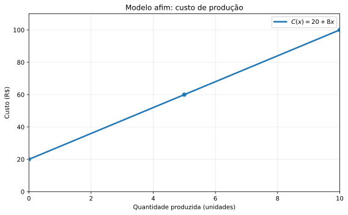
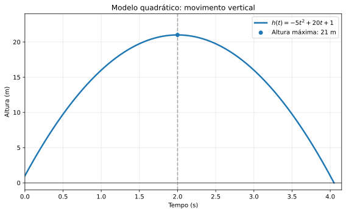
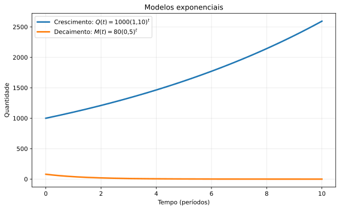
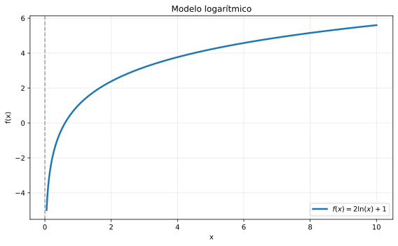
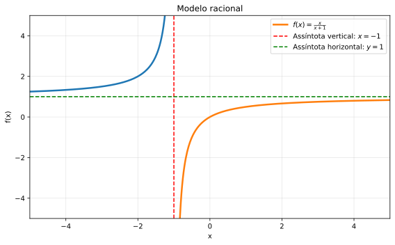
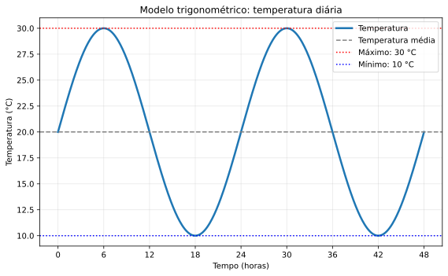

🏠 [← Sumário do Curso](../index.qmd) · [← Cursos de Matemática](../../index.qmd) · [← Seção de Matemática](/posts/matematica/index.qmd)

🎯 **Aula anterior:** 👉 [1.14 Função Inversa](1.14-funcao-inversa.qmd)

🎯 **Próxima aula:** 👉 [1.16 Crescimento e Comportamento Assintótico](1.16-crescimento-e-comportamento-assintotico.qmd)

***

::: {.callout-tip title="❓ Pergunta Disparadora"}

Como escolher uma função matemática para representar um fenômeno real? O que os parâmetros do modelo nos dizem sobre esse fenômeno?

:::

::: {.callout-note title="📌 Objetivos de Aprendizagem"}

Ao final desta aula, você deverá ser capaz de:

- Compreender o processo de modelagem matemática e sua relação com situações reais.
- Identificar variáveis, parâmetros e unidades de medida em um modelo.
- Construir e interpretar modelos lineares e quadráticos.
- Reconhecer situações que podem ser representadas por modelos exponenciais, logarítmicos, racionais e trigonométricos.
- Escolher tipos de funções adequados à descrição de diferentes fenômenos.
- Analisar restrições de domínio, hipóteses e limitações dos modelos matemáticos.

:::

# 📘 Modelos com Funções Elementares

Uma das grandes razões para estudar funções é que elas nos permitem construir **modelos matemáticos**.

Um modelo matemático é uma representação simplificada de uma situação real por meio de linguagem matemática.

Por exemplo:

- o custo pode ser função da quantidade produzida;
- a distância pode ser função do tempo;
- a população pode ser função do tempo;
- a temperatura pode ser função da altitude;
- a altura de um objeto lançado pode ser função do tempo;
- a intensidade de uma onda pode ser função da posição.

Nesta aula, vamos ver como funções elementares podem ser usadas para representar situações simples.

O objetivo não é transformar a realidade em fórmulas perfeitas. O objetivo é aprender a escolher uma função que capture o comportamento principal de um fenômeno.

***

## 🛠️ O que é modelar?

Modelar é construir uma ponte entre uma situação e uma estrutura matemática.

Em uma situação real, temos grandezas que variam. Em um modelo, escolhemos variáveis para representar essas grandezas.

Por exemplo, se o preço de uma corrida depende da distância percorrida, podemos usar:

- $x$ para representar a distância;
- $C(x)$ para representar o custo.

Então uma fórmula como

$$
C(x)=5+3x
$$

pode representar uma tarifa fixa de R$ 5,00 mais R$ 3,00 por quilômetro.

Esse é um modelo afim.

::: {.callout-note title="Ideia central"}

Um modelo matemático não é a realidade completa. Ele é uma representação simplificada que ajuda a entender, prever ou calcular.

:::

***

## 🔣 Variáveis e parâmetros

Em um modelo, é importante distinguir variáveis e parâmetros.

A **variável independente** é a grandeza de entrada.

A **variável dependente** é a grandeza que depende da entrada.

Os **parâmetros** são constantes que ajustam o modelo.

No exemplo

$$
C(x)=5+3x,
$$

a variável independente é $x$, a distância.

A variável dependente é $C(x)$, o custo.

Os parâmetros são $5$ e $3$.

O número $5$ representa o custo fixo. O número $3$ representa o custo por unidade de distância.

As unidades também são importantes. Se o custo é medido em reais e a distância em quilômetros, o coeficiente $3$ representa reais por quilômetro.

***

## 🛠️ Modelos lineares e afins

Um modelo afim tem a forma

$$
f(x)=ax+b,
$$

em que $a$ e $b$ são constantes reais.

Quando $b=0$, temos uma função linear no sentido matemático estrito. Quando $b\neq 0$, temos uma função afim.

Em aplicações, é comum utilizar a expressão modelo linear para ambos os casos.

Esse modelo representa situações em que a taxa de variação é constante.

Exemplo:

Uma empresa cobra uma taxa fixa de R$ 20,00 mais R$ 8,00 por unidade vendida. Se $x$ é o número de unidades, o custo é

$$
C(x)=20+8x.
$$

Aqui, cada unidade a mais aumenta o custo em R$ 8,00.

Essa taxa constante é a característica principal de um modelo afim.

### 🔎 Interpretação dos coeficientes

No modelo

$$
f(x)=ax+b,
$$

o coeficiente $a$ representa a taxa de variação.

O termo $b$ representa o valor inicial, isto é, o valor da função quando

$$
x=0.
$$

Por exemplo, em

$$
C(x)=20+8x,
$$

temos:

$$
C(0)=20.
$$

Isso significa que, mesmo com zero unidades produzidas, há um custo fixo de R$ 20,00.

O coeficiente $8$ indica que cada unidade adicional aumenta o custo em R$ 8,00.

Se o custo é medido em reais e a quantidade em unidades, a unidade do coeficiente $8$ é reais por unidade produzida.

### 📈 Visualização: modelo afim de custo

O gráfico representa o custo total em função da quantidade produzida.

{#fig-modelo-afim fig-alt="Gráfico do custo C(x)=20+8x, destacando o custo fixo e a taxa de crescimento constante." width="85%"}

::: {.callout-note collapse="true" title="Clique para ver o código Python"}

```{python}
import numpy as np
import matplotlib.pyplot as plt

x = np.linspace(0, 10, 300)
C = 20 + 8*x

fig, ax = plt.subplots(figsize=(8, 5))

ax.plot(x, C, linewidth=2.5, label=r"$C(x)=20+8x$")
ax.scatter([0, 5, 10], [20, 60, 100], zorder=3)

ax.set_title("Modelo afim: custo de produção")
ax.set_xlabel("Quantidade produzida (unidades)")
ax.set_ylabel("Custo (R$)")
ax.grid(alpha=0.3)
ax.legend()
ax.set_xlim(0, 10)
ax.set_ylim(0, 110)

fig.tight_layout()
fig.savefig("images/1.15-modelo-afim.svg", bbox_inches="tight")
plt.close(fig)
```

:::

***

## 🛠️ Modelos quadráticos

Um modelo quadrático tem a forma

$$
f(x)=ax^2+bx+c,
$$

com

$$
a\neq 0.
$$

Ele aparece em situações com aceleração constante, áreas, trajetórias parabólicas e problemas de otimização.

Por exemplo, a altura de um objeto lançado verticalmente pode ser modelada por uma função quadrática:

$$
h(t)=-5t^2+20t+1.
$$

Aqui:

- $t$ representa o tempo, em segundos;
- $h(t)$ representa a altura, em metros.

O termo $-5t^2$ está associado ao efeito da gravidade, considerando uma aceleração gravitacional de módulo aproximado de $10\,\text{m/s}^2$ e desprezando a resistência do ar.

O gráfico dessa função é uma parábola com concavidade voltada para baixo.

### 🛠️ Máximo em um modelo quadrático

Em um modelo quadrático com concavidade para baixo, o vértice representa um valor máximo.

Considere

$$
h(t)=-5t^2+20t+1.
$$

O vértice de uma parábola

$$
at^2+bt+c
$$

ocorre em

$$
t_v=-\frac{b}{2a}.
$$

Nesse caso,

$$
a=-5
$$

e

$$
b=20.
$$

Logo,

$$
t_v=-\frac{20}{2(-5)}=2.
$$

A altura máxima ocorre em

$$
t=2.
$$

Calculando:

$$
h(2)=-5(2)^2+20(2)+1=-20+40+1=21.
$$

A altura máxima é $21$ metros.

### 📈 Visualização: trajetória vertical

O gráfico apresenta o trecho da parábola correspondente ao movimento físico, desde o lançamento até o instante em que o objeto atinge o solo.

{#fig-modelo-quadratico fig-alt="Gráfico da altura h(t)=-5t²+20t+1, com altura máxima de 21 metros no instante de 2 segundos." width="85%"}

::: {.callout-note collapse="true" title="Clique para ver o código Python"}

```{python}
import numpy as np
import matplotlib.pyplot as plt

raiz = (20 + np.sqrt(420)) / 10

t = np.linspace(0, raiz, 300)
h = -5*t**2 + 20*t + 1

fig, ax = plt.subplots(figsize=(8, 5))

ax.plot(t, h, linewidth=2.5,
        label=r"$h(t)=-5t^2+20t+1$")

ax.scatter([2], [21], zorder=3,
           label="Altura máxima: 21 m")

ax.axhline(0, color="black", linewidth=0.8)
ax.axvline(2, color="gray", linestyle="--", alpha=0.7)

ax.set_title("Modelo quadrático: movimento vertical")
ax.set_xlabel("Tempo (s)")
ax.set_ylabel("Altura (m)")
ax.grid(alpha=0.3)
ax.legend()
ax.set_xlim(0, raiz + 0.1)
ax.set_ylim(-1, 24)

fig.tight_layout()
fig.savefig("images/1.15-modelo-quadratico.svg", bbox_inches="tight")
plt.close(fig)
```

:::

::: {.callout-note title="📌 Interpretação física do modelo"}

Embora a função quadrática esteja definida para todo número real, o movimento físico começa em $t=0$ e termina quando o objeto atinge o solo.

Para determinar esse instante, resolvemos

$$
-5t^2+20t+1=0.
$$

A raiz positiva é

$$
t=\frac{20+\sqrt{420}}{10}\approx 4{,}05\text{ s}.
$$

Portanto, o intervalo de interesse físico é aproximadamente

$$
0\leq t\leq 4{,}05.
$$

O gráfico completo da parábola é matematicamente válido, mas somente esse trecho representa o movimento descrito pelo modelo.

:::

***

## 🛠️ Modelos exponenciais

Um modelo exponencial aparece quando uma quantidade muda por um fator multiplicativo constante.

A forma básica é

$$
Q(t)=Q_0a^t,
$$

em que:

- $Q_0$ é o valor inicial;
- $a$ é o fator de crescimento ou decaimento;
- $t$ é o tempo.

Se

$$
a>1,
$$

temos crescimento exponencial.

Se

$$
0<a<1,
$$

temos decaimento exponencial.

Por exemplo, se uma população começa com $1000$ indivíduos e cresce $10\%$ por período, então

$$
Q(t)=1000(1{,}10)^t.
$$

O fator $1{,}10$ significa que, a cada período, a população passa a corresponder a $110\%$ do valor anterior.

### 📉 Decaimento exponencial

O decaimento exponencial aparece quando uma quantidade diminui por uma razão constante.

Por exemplo, se uma substância perde metade de sua massa a cada unidade de tempo, podemos modelar por

$$
M(t)=M_0\left(\frac{1}{2}\right)^t.
$$

Se

$$
M_0=80,
$$

então

$$
M(t)=80\left(\frac{1}{2}\right)^t.
$$

Assim:

$$
M(0)=80,
$$

$$
M(1)=40,
$$

$$
M(2)=20.
$$

A cada unidade de tempo, a quantidade é multiplicada por $\frac{1}{2}$.

### 📈 Visualização: crescimento e decaimento exponencial

O gráfico compara dois comportamentos:

- crescimento de uma população por fator multiplicativo;
- redução da massa de uma substância por um fator constante.

{#fig-modelos-exponenciais fig-alt="Gráfico comparando Q(t)=1000 vezes 1,10 elevado a t e M(t)=80 vezes 0,5 elevado a t." width="85%"}

::: {.callout-note collapse="true" title="Clique para ver o código Python"}

```{python}
import numpy as np
import matplotlib.pyplot as plt

t = np.linspace(0, 10, 300)

Q = 1000 * (1.10)**t
M = 80 * (0.5)**t

fig, ax = plt.subplots(figsize=(8, 5))

ax.plot(t, Q, linewidth=2.5,
        label=r"Crescimento: $Q(t)=1000(1{,}10)^t$")

ax.plot(t, M, linewidth=2.5,
        label=r"Decaimento: $M(t)=80(0{,}5)^t$")

ax.set_title("Modelos exponenciais")
ax.set_xlabel("Tempo (períodos)")
ax.set_ylabel("Quantidade")
ax.grid(alpha=0.3)
ax.legend()

fig.tight_layout()
fig.savefig("images/1.15-modelos-exponenciais.svg", bbox_inches="tight")
plt.close(fig)
```

:::

### 🔎 Tempo discreto e tempo contínuo

O modelo

$$
Q(t)=Q_0a^t
$$

é especialmente adequado quando $t$ representa períodos sucessivos e a quantidade é multiplicada pelo mesmo fator a cada período.

Se o tempo for considerado contínuo, uma forma bastante utilizada é

$$
Q(t)=Q_0e^{kt},
$$

em que $k$ é uma constante real.

Se $k>0$, temos crescimento exponencial. Se $k<0$, temos decaimento exponencial.

Essa distinção será importante posteriormente, quando estudarmos derivadas e equações diferenciais.

***

## 🛠️ Modelos logarítmicos

Modelos logarítmicos aparecem em situações nas quais a variável dependente apresenta crescimento cada vez mais lento em relação à variável independente.

Uma forma simples é

$$
f(x)=a\ln x+b,
$$

com

$$
a>0
$$

e

$$
x>0.
$$

Esse tipo de modelo aparece em escalas de medida, percepção, complexidade algorítmica e situações em que aumentos multiplicativos na entrada produzem aumentos aditivos na saída.

Por exemplo, a expressão

$$
f(x)=2\ln x+1
$$

cresce, mas cada vez mais lentamente.

O domínio natural é

$$
(0,+\infty).
$$

É importante observar que nem todo fenômeno cujo crescimento desacelera é necessariamente logarítmico. A adequação desse modelo deve ser avaliada a partir do comportamento observado e dos dados disponíveis.

### 📈 Visualização: modelo logarítmico

{#fig-modelo-logaritmico fig-alt="Gráfico de f(x)=2 ln x+1, mostrando crescimento cada vez mais lento para x positivo." width="85%"}

::: {.callout-note collapse="true" title="Clique para ver o código Python"}

```{python}
import numpy as np
import matplotlib.pyplot as plt

x = np.linspace(0.05, 10, 400)
y = 2*np.log(x) + 1

fig, ax = plt.subplots(figsize=(8, 5))

ax.plot(x, y, linewidth=2.5,
        label=r"$f(x)=2\ln(x)+1$")

ax.axvline(0, color="gray", linestyle="--", alpha=0.7)

ax.set_title("Modelo logarítmico")
ax.set_xlabel("x")
ax.set_ylabel("f(x)")
ax.grid(alpha=0.3)
ax.legend()

fig.tight_layout()
fig.savefig("images/1.15-modelo-logaritmico.svg", bbox_inches="tight")
plt.close(fig)
```

:::

***

## 🛠️ Modelos racionais

Modelos racionais têm a forma

$$
f(x)=\frac{p(x)}{q(x)},
$$

onde $p$ e $q$ são polinômios e $q(x)\neq 0$.

Eles aparecem em situações com taxas, razões, eficiência, concentração e comportamentos com assíntotas.

Por exemplo:

$$
f(x)=\frac{x}{x+1}.
$$

O domínio natural é

$$
\mathbb{R}\setminus\{-1\}.
$$

Para valores positivos de $x$, temos

$$
0\leq \frac{x}{x+1}<1.
$$

Quando $x$ cresce muito,

$$
\frac{x}{x+1}\approx 1.
$$

Além disso,

$$
\lim_{x\to+\infty}\frac{x}{x+1}=1.
$$

Portanto, a reta

$$
y=1
$$

é uma assíntota horizontal.

O gráfico se aproxima dessa reta à medida que $x$ cresce, sem atingi-la para nenhum valor finito de $x$.

Esse tipo de comportamento será estudado com mais precisão no módulo de limites.

### 📈 Visualização: modelo racional

{#fig-modelo-racional fig-alt="Gráfico de f(x)=x/(x+1), com assíntota vertical x=-1 e horizontal y=1." width="85%"}

::: {.callout-note collapse="true" title="Clique para ver o código Python"}

```{python}
import numpy as np
import matplotlib.pyplot as plt

x1 = np.linspace(-5, -1.05, 300)
x2 = np.linspace(-0.95, 5, 300)

fig, ax = plt.subplots(figsize=(8, 5))

ax.plot(x1, x1/(x1+1), linewidth=2.5)
ax.plot(x2, x2/(x2+1), linewidth=2.5,
        label=r"$f(x)=\frac{x}{x+1}$")

ax.axvline(-1, color="red", linestyle="--",
           label=r"Assíntota vertical: $x=-1$")

ax.axhline(1, color="green", linestyle="--",
           label=r"Assíntota horizontal: $y=1$")

ax.set_title("Modelo racional")
ax.set_xlabel("x")
ax.set_ylabel("f(x)")
ax.set_xlim(-5, 5)
ax.set_ylim(-5, 5)
ax.grid(alpha=0.3)
ax.legend()

fig.tight_layout()
fig.savefig("images/1.15-modelo-racional.svg", bbox_inches="tight")
plt.close(fig)
```

:::

***

## 🛠️ Modelos trigonométricos

Modelos trigonométricos são usados para representar fenômenos periódicos.

Uma forma básica é

$$
f(t)=A\sin(Bt+C)+D.
$$

Nessa expressão:

- $A$ controla a amplitude;
- $B$ controla o período;
- $C$ desloca o gráfico horizontalmente;
- $D$ desloca o gráfico verticalmente.

A amplitude é $|A|$ e, quando $B\neq 0$, o período é

$$
P=\frac{2\pi}{|B|}.
$$

Por exemplo,

$$
T(t)=10\sin\left(\frac{2\pi}{24}t\right)+20
$$

pode representar, de maneira idealizada, uma temperatura diária oscilando em torno de $20^\circ$C.

Nesse modelo:

- a amplitude é $10^\circ$C;
- a temperatura média é $20^\circ$C;
- o período é $24$ horas;
- a temperatura varia entre $10^\circ$C e $30^\circ$C.

Como a função seno atinge seu máximo quando o argumento é $\frac{\pi}{2}$, o modelo atinge a temperatura máxima quando

$$
\frac{2\pi}{24}t=\frac{\pi}{2}.
$$

Logo,

$$
t=6.
$$

Assim, o modelo prevê temperatura máxima de $30^\circ$C às 6 horas, considerando que $t=0$ corresponde à meia-noite.

A escolha da fase inicial deve ser ajustada quando desejamos representar dados reais de temperatura.

### 📈 Visualização: modelo trigonométrico

{#fig-modelo-trigonometrico fig-alt="Gráfico de T(t)=10 sen(2 pi t/24)+20, com amplitude de 10 graus e período de 24 horas." width="85%"}

::: {.callout-note collapse="true" title="Clique para ver o código Python"}

```{python}
import numpy as np
import matplotlib.pyplot as plt

t = np.linspace(0, 48, 500)
T = 10*np.sin((2*np.pi/24)*t) + 20

fig, ax = plt.subplots(figsize=(8, 5))

ax.plot(t, T, linewidth=2.5,
        label="Temperatura")

ax.axhline(20, color="gray", linestyle="--",
           label="Temperatura média")

ax.axhline(30, color="red", linestyle=":",
           label="Máximo: 30 °C")

ax.axhline(10, color="blue", linestyle=":",
           label="Mínimo: 10 °C")

ax.set_title("Modelo trigonométrico: temperatura diária")
ax.set_xlabel("Tempo (horas)")
ax.set_ylabel("Temperatura (°C)")
ax.set_xticks(np.arange(0, 49, 6))
ax.grid(alpha=0.3)
ax.legend()

fig.tight_layout()
fig.savefig("images/1.15-modelo-trigonometrico.svg", bbox_inches="tight")
plt.close(fig)
```

:::

***

## 🧩 Escolhendo o tipo de função

Uma parte importante da modelagem é escolher a família de funções adequada.

| Comportamento observado | Modelo possível | Característica matemática |
|---|---|---|
| Variação por soma constante | Linear ou afim | Taxa de variação constante |
| Trajetória parabólica ou otimização simples | Quadrático | Variação da taxa de crescimento |
| Crescimento por fator constante | Exponencial | Taxa relativa constante |
| Crescimento cada vez mais lento | Logarítmico | Crescimento desacelerado |
| Relações entre razões e grandezas | Racional | Quociente de polinômios |
| Oscilações e ciclos | Trigonométrico | Periodicidade |

Essa escolha depende do contexto, dos dados e da pergunta que queremos responder.

::: {.callout-tip title="Uma observação importante"}

A tabela apresenta possibilidades, não regras absolutas.

Um mesmo fenômeno pode ser descrito por diferentes modelos, dependendo do intervalo analisado, da precisão desejada e das hipóteses adotadas.

Na modelagem matemática, a escolha de uma função deve ser justificada pelo comportamento do fenômeno e, sempre que possível, pela comparação com dados reais.

:::

***

## 🧭 Domínio no contexto

Em modelagem, o domínio não depende apenas da fórmula. Ele também depende do significado das variáveis.

Por exemplo, se

$$
C(x)=20+8x
$$

representa o custo para produzir $x$ unidades, então faz sentido considerar

$$
x\geq 0.
$$

Além disso, se $x$ representa número de unidades inteiras, talvez o domínio natural seja

$$
\{0,1,2,3,\ldots\}.
$$

Mesmo que a fórmula faça sentido para $x=-2$, esse valor não tem interpretação no problema.

::: {.callout-warning title="Cuidado"}

Em modelos, sempre pergunte se o valor da variável faz sentido no contexto.

:::

***

## ⚠️ Limitações dos modelos

Todo modelo é uma simplificação.

Um modelo linear pode funcionar bem em certo intervalo, mas falhar fora dele.

Um modelo exponencial pode descrever crescimento inicial, mas não considerar limitações de recursos.

Um modelo trigonométrico pode capturar periodicidade, mas ignorar ruídos e variações irregulares.

Por isso, ao usar modelos, devemos perguntar:

- quais hipóteses estão sendo feitas?
- em que intervalo o modelo é razoável?
- quais fatores foram ignorados?
- os resultados fazem sentido?
- os dados disponíveis sustentam a escolha da função?

Modelar não é apenas calcular. É interpretar.

***

::: {.callout-note title="📋 Quadro-resumo"}

| Tipo de modelo | Característica principal | Aplicação ilustrativa |
|---|---|---|
| Linear ou afim | Taxa de variação constante | Custo com parcela fixa e variável |
| Quadrático | Comportamento parabólico | Trajetórias idealizadas |
| Exponencial | Variação multiplicativa | Crescimento e decaimento |
| Logarítmico | Crescimento desacelerado | Fenômenos em escala logarítmica |
| Racional | Quociente de polinômios | Relações entre grandezas e taxas |
| Trigonométrico | Comportamento periódico | Oscilações idealizadas |

**Exemplo — interpretação de parâmetros**

Considere o modelo de custo

$$
C(q)=C_0+cq,
\qquad q\geq 0.
$$

Nesse modelo, $C_0$ representa o custo fixo, $c$ representa o custo por unidade produzida e $q$ representa a quantidade produzida.

A interpretação depende das unidades e do contexto.

Por exemplo, se $q$ representa unidades inteiras, o domínio contextual deve respeitar essa condição.

**Atenção:** um modelo matemático é uma representação simplificada de um fenômeno. Sua adequação depende das hipóteses adotadas, dos dados disponíveis e do intervalo em que se pretende utilizá-lo.

:::

***

::: {.callout-note title="🌉 Ponte para o Cálculo"}

O Cálculo nasceu de problemas de variação, movimento, área e acumulação.

Modelos com funções elementares serão o ponto de partida para perguntas como:

- qual é a taxa instantânea de variação?
- quando uma quantidade atinge valor máximo?
- qual é a área sob a curva?
- qual é o valor acumulado em certo intervalo?
- como comparar crescimentos?

Essas perguntas levarão naturalmente a limites, derivadas e integrais.

:::

# 🧪 Exercícios propostos

::: {.callout-note title="📝 Exercícios"}

## 🧪 Exercício 1

Uma corrida de aplicativo cobra uma taxa fixa de R$ 6,00 mais R$ 2,50 por quilômetro.

a) Escreva uma função $C(x)$ para o custo em função da distância $x$.

b) Calcule $C(10)$.

c) Interprete o coeficiente de $x$.

## 🧪 Exercício 2

A altura de um objeto é dada por

$$
h(t)=-5t^2+30t+2.
$$

Considere que o tempo é medido em segundos e a altura em metros.

a) Qual é o tipo de função?

b) Em que instante ocorre a altura máxima?

c) Qual é a altura máxima?

d) Determine aproximadamente o intervalo de tempo durante o qual o modelo representa o movimento até o objeto atingir o solo.

## 🧪 Exercício 3

Uma população inicial de $500$ indivíduos cresce $20\%$ por período.

a) Escreva um modelo exponencial para a população.

b) Calcule a população após $3$ períodos.

## 🧪 Exercício 4

Determine o domínio contextual indicado:

a) $C(x)=15+4x$, onde $x$ é quantidade produzida.

b) $A(r)=\pi r^2$, onde $r$ é o raio de um círculo.

c) $P(t)=1000(1{,}05)^t$, onde $t$ é tempo após o início da observação.

## 🧪 Exercício 5

Associe cada situação a um tipo provável de modelo: linear, quadrático, exponencial, logarítmico, racional ou trigonométrico.

a) Temperatura diária variando de forma periódica.

b) Crescimento de uma aplicação com juros compostos.

c) Custo com taxa fixa mais valor por unidade.

d) Altura de um projétil em função do tempo.

e) Quantidade que se aproxima de um limite horizontal.

f) Uma substância radioativa perde uma porcentagem fixa de sua massa a cada período.

:::

***

# ✅ Gabarito comentado

::: {.callout-important collapse="true" title="✅ Clique para consultar o gabarito"}

## 🧪 Exercício 1

a) A taxa fixa é R$ 6,00 e o valor por quilômetro é R$ 2,50. Logo,

$$
C(x)=6+2{,}5x.
$$

b) Para $x=10$,

$$
C(10)=6+2{,}5\cdot 10=6+25=31.
$$

O custo é R$ 31,00.

c) O coeficiente $2{,}5$ representa o custo por quilômetro percorrido.

## 🧪 Exercício 2

A função é

$$
h(t)=-5t^2+30t+2.
$$

a) É uma função quadrática.

b) O instante do vértice é

$$
t_v=-\frac{b}{2a}.
$$

Aqui,

$$
a=-5
$$

e

$$
b=30.
$$

Logo,

$$
t_v=-\frac{30}{2(-5)}=3.
$$

A altura máxima ocorre em $t=3$ segundos.

c)

$$
h(3)=-5(3)^2+30(3)+2.
$$

Portanto,

$$
h(3)=-45+90+2=47.
$$

A altura máxima é $47$ metros.

d) O objeto atinge o solo quando

$$
-5t^2+30t+2=0.
$$

Pela fórmula de Bhaskara,

$$
t=\frac{-30\pm\sqrt{30^2-4(-5)(2)}}{2(-5)}.
$$

Assim,

$$
t=\frac{-30\pm\sqrt{940}}{-10}.
$$

A raiz positiva é

$$
t=\frac{30+\sqrt{940}}{10}\approx 6{,}07.
$$

Logo, o intervalo de tempo de interesse físico é aproximadamente

$$
0\leq t\leq 6{,}07.
$$

## 🧪 Exercício 3

a) Crescimento de $20\%$ por período significa fator

$$
1{,}20.
$$

Logo,

$$
P(t)=500(1{,}20)^t.
$$

b)

$$
P(3)=500(1{,}20)^3.
$$

Como

$$
(1{,}20)^3=1{,}728,
$$

temos

$$
P(3)=500\cdot 1{,}728=864.
$$

A população após $3$ períodos é de $864$ indivíduos, segundo o modelo.

## 🧪 Exercício 4

a) Se $x$ representa quantidade produzida, faz sentido considerar

$$
x\geq 0.
$$

Se a quantidade precisa ser inteira, então

$$
x\in\{0,1,2,3,\ldots\}.
$$

b) Se $r$ é raio, então

$$
r\geq 0.
$$

c) Se $t$ é tempo após o início da observação, então

$$
t\geq 0.
$$

## 🧪 Exercício 5

a) Temperatura diária variando de forma periódica: modelo trigonométrico.

b) Crescimento com juros compostos: modelo exponencial.

c) Custo com taxa fixa mais valor por unidade: modelo afim.

d) Altura de um projétil em função do tempo: modelo quadrático.

e) Quantidade que se aproxima de um limite horizontal: modelo racional ou outro modelo com assíntota horizontal.

f) Perda de uma porcentagem fixa da massa a cada período: modelo exponencial de decaimento.

:::

***

# 🧩 Quiz — Modelos com Funções Elementares

:::::{.question}

**Q1.** Um modelo linear ou afim é adequado quando a situação apresenta:

::::{.choices}

:::{.choice .correct-choice}
Variação por soma constante.
:::

:::{.choice}
Oscilação periódica obrigatória.
:::

:::{.choice}
Domínio sempre negativo.
:::

::::

:::::

:::::{.question}

**Q2.** Um modelo exponencial é típico quando há:

::::{.choices}

:::{.choice}
Crescimento por soma constante.
:::

:::{.choice .correct-choice}
Crescimento ou decaimento por fator multiplicativo constante.
:::

:::{.choice}
Apenas valores periódicos entre $-1$ e $1$.
:::

::::

:::::

:::::{.question}

**Q3.** Em modelagem, o domínio deve considerar:

::::{.choices}

:::{.choice}
Apenas a fórmula algébrica, nunca o contexto.
:::

:::{.choice .correct-choice}
A fórmula e também o significado das variáveis no contexto.
:::

:::{.choice}
Somente números negativos.
:::

::::

:::::

***

# 🔗 Navegação

🎯 **Aula anterior:** 👉 [1.14 Função Inversa](1.14-funcao-inversa.qmd)

🎯 **Próxima aula:** 👉 [1.16 Crescimento e Comportamento Assintótico](1.16-crescimento-e-comportamento-assintotico.qmd)

🏠 [← Sumário do Curso](../index.qmd) · [← Cursos de Matemática](../../index.qmd) · [← Seção de Matemática](/posts/matematica/index.qmd) · 🔝 [Voltar ao topo](#)

***

*Blog do Marcellini — Explorando a Matemática com Rigor e Beleza.*

::: {.callout-note}

Criado por Blog do Marcellini com ❤️ e código.

:::