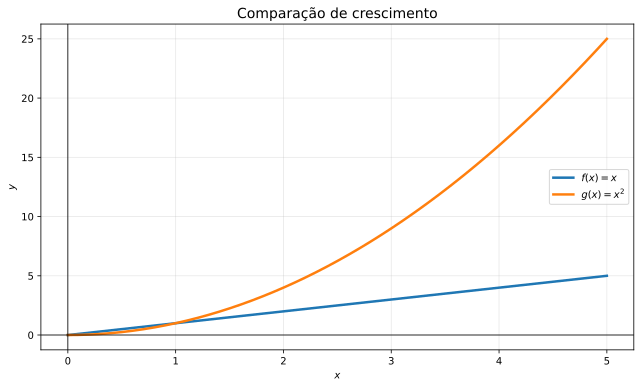
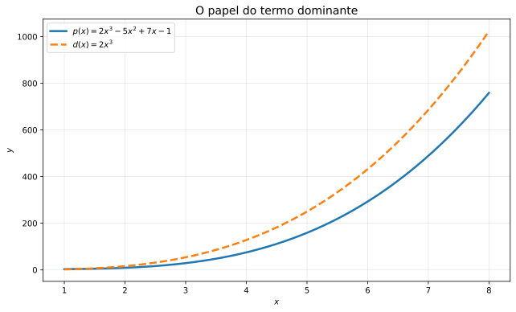
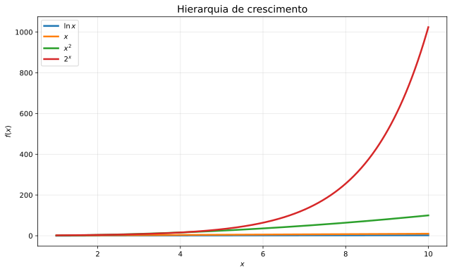
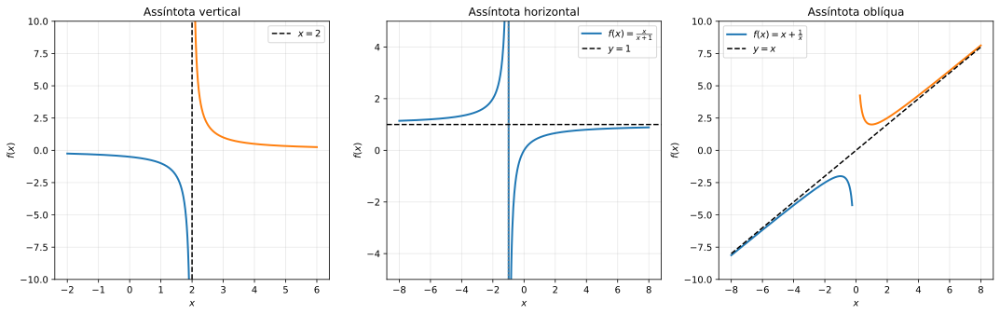

🏠 [← Sumário do Curso](../index.qmd) · [← Cursos de Matemática](../../index.qmd) · [← Seção de Matemática](/posts/matematica/index.qmd)

🎯 **Aula anterior:** 👉 [1.15 Modelos com Funções Elementares](1.15-modelos-com-funcoes-elementares.qmd)

🎯 **Próxima aula:** 👉 [1.17 Revisão Geral do Módulo 1](1.17-revisao-geral-do-modulo-1.qmd)

***

::: {.callout-tip title="❓ Pergunta Disparadora"}

Como comparar o crescimento de duas funções quando seus argumentos se tornam muito grandes?

O que significa dizer que o gráfico de uma função se aproxima de uma reta?

Uma função pode crescer indefinidamente sem que seu crescimento continue acelerando?

:::

::: {.callout-note title="📌 Objetivos de Aprendizagem"}

Ao final desta aula, você deverá ser capaz de:

- Identificar intervalos de crescimento e decrescimento de funções.
- Interpretar a taxa de variação média em intervalos.
- Comparar os comportamentos de funções lineares, polinomiais, exponenciais e logarítmicas.
- Reconhecer o papel do termo dominante no comportamento de polinômios.
- Compreender a ideia de comportamento assintótico.
- Reconhecer e interpretar assíntotas verticais, horizontais e oblíquas.
- Relacionar o comportamento assintótico ao estudo posterior de limites e derivadas.

:::

# 📘 Crescimento e Comportamento Assintótico

Quando estudamos funções, não queremos apenas calcular valores isolados. Queremos entender seu comportamento geral.

Algumas perguntas naturais são:

- A função cresce ou decresce?
- Cresce rapidamente ou lentamente?
- Sua taxa de crescimento permanece constante?
- Sua taxa de crescimento aumenta ou diminui?
- Aproxima-se de algum valor?
- Cresce indefinidamente?
- Como se comporta quando $x$ fica muito grande?

Essas perguntas nos levam ao estudo do **crescimento** e do **comportamento assintótico**.

A palavra *assintótico* está relacionada ao comportamento de uma função em regiões extremas: nas proximidades de determinados pontos ou quando a variável independente tende ao infinito.

Esse estudo prepara diretamente o terreno para o cálculo de limites, pois muitas das perguntas que fazemos sobre o comportamento de uma função podem ser formuladas e respondidas por meio deles.

***

## 📈 Crescimento de funções

Dizer que uma função cresce significa dizer que seus valores aumentam quando a variável independente aumenta.

Seja $f$ uma função definida em um intervalo $I$. Dizemos que $f$ é **não decrescente** em $I$ quando, para quaisquer $x_1,x_2\in I$, temos:

$$
x_1<x_2 \implies f(x_1)\leq f(x_2).
$$

Se a desigualdade entre os valores da função for sempre estrita, isto é,

$$
x_1<x_2 \implies f(x_1)<f(x_2),
$$

dizemos que a função é **estritamente crescente**.

Por exemplo,

$$
f(x)=x
$$

é estritamente crescente em todo $\mathbb{R}$.

Já a função

$$
g(x)=x^2
$$

não é crescente em todo $\mathbb{R}$. Ela é estritamente decrescente em

$$
(-\infty,0]
$$

e estritamente crescente em

$$
[0,+\infty).
$$

Observe que o comportamento de uma função pode mudar conforme o intervalo considerado.

### Visualizando o crescimento

A comparação entre $f(x)=x$ e $g(x)=x^2$ permite visualizar dois comportamentos diferentes. A primeira função cresce com inclinação constante; a segunda apresenta uma inclinação cada vez maior quando $x$ aumenta.

{#fig-crescimento-linear-quadratico fig-alt="Comparação dos gráficos das funções f(x)=x e g(x)=x²." width="90%"}

::: {.callout-note collapse="true" title="Clique para ver o código Python"}

```{python}
import numpy as np
import matplotlib.pyplot as plt

x = np.linspace(0, 5, 400)

fig, ax = plt.subplots(figsize=(9, 5.5))

ax.plot(x, x, label=r"$f(x)=x$", linewidth=2.5)
ax.plot(x, x**2, label=r"$g(x)=x^2$", linewidth=2.5)

ax.set_title("Comparação de crescimento", fontsize=14)
ax.set_xlabel("$x$")
ax.set_ylabel("$y$")
ax.grid(True, alpha=0.3)
ax.axhline(0, color="black", linewidth=0.8)
ax.axvline(0, color="black", linewidth=0.8)
ax.legend()

fig.tight_layout()
fig.savefig("images/1.16-crescimento-linear-quadratico.svg",
            format="svg", bbox_inches="tight")
plt.close(fig)
```

:::

***

## 📉 Decrescimento de funções

Uma função é **não crescente** em um intervalo quando seus valores não aumentam à medida que $x$ aumenta.

Formalmente,

$$
x_1<x_2 \implies f(x_1)\geq f(x_2).
$$

Se a desigualdade for sempre estrita,

$$
x_1<x_2 \implies f(x_1)>f(x_2),
$$

a função é chamada de **estritamente decrescente**.

Por exemplo,

$$
f(x)=-x
$$

é estritamente decrescente em todo $\mathbb{R}$.

Já a função

$$
g(x)=\frac{1}{x}
$$

é estritamente decrescente em cada um dos intervalos

$$
(-\infty,0)
$$

e

$$
(0,+\infty).
$$

Entretanto, não é decrescente em todo o seu domínio, que é a união desses intervalos.

Isso ocorre porque, por exemplo,

$$
-1<1,
$$

mas

$$
g(-1)=-1<1=g(1).
$$

Portanto, a condição de monotonicidade precisa ser verificada considerando todos os pares de pontos do intervalo em questão.

***

## ⏱️ Taxa de variação média

Duas funções podem crescer, mas em ritmos muito diferentes.

Para comparar o quanto uma função varia em determinado intervalo, utilizamos a **taxa de variação média**.

Se uma função $f$ está definida em um intervalo que contém $x_1$ e $x_2$, com $x_1\neq x_2$, sua taxa de variação média entre esses pontos é:

$$
\boxed{
\frac{f(x_2)-f(x_1)}{x_2-x_1}
}
$$

O numerador representa a variação dos valores da função, enquanto o denominador representa a variação da variável independente.

Geometricamente, essa razão corresponde à inclinação da reta secante que passa pelos pontos

$$
P_1=(x_1,f(x_1))
$$

e

$$
P_2=(x_2,f(x_2)).
$$

### Exemplo: função quadrática

Considere

$$
f(x)=x^2.
$$

Entre $x=1$ e $x=3$, temos:

$$
f(1)=1
$$

e

$$
f(3)=9.
$$

A taxa de variação média é:

$$
\frac{f(3)-f(1)}{3-1}
=
\frac{9-1}{2}
=
4.
$$

Portanto, nesse intervalo, a taxa de variação média é igual a $4$.

**Interpretação:** para cada unidade de variação de $x$, a função apresenta, em média, uma variação de quatro unidades nesse intervalo.

A taxa de variação média não deve ser confundida com a taxa de variação instantânea. Esta última será estudada posteriormente, no cálculo diferencial.

***

## 📈 Crescimento linear e afim

Uma função afim tem a forma:

$$
f(x)=ax+b.
$$

Quando $a>0$, ela é estritamente crescente em todo $\mathbb{R}$.

Quando $a<0$, é estritamente decrescente.

Quando $a=0$, é constante.

Por exemplo,

$$
f(x)=3x+2
$$

é crescente e apresenta taxa de variação constante igual a $3$.

Isso significa que, sempre que $x$ aumenta uma unidade, o valor de $f(x)$ aumenta três unidades.

**Observação terminológica:** no sentido matemático estrito, uma função linear tem a forma $f(x)=ax$, enquanto uma função afim tem a forma $f(x)=ax+b$. Em aplicações, é comum utilizar a expressão "modelo linear" também para modelos afins.

***

## 📈 Crescimento polinomial

Uma função polinomial tem a forma:

$$
p(x)=a_nx^n+a_{n-1}x^{n-1}+\cdots+a_1x+a_0,
$$

em que $a_n\neq 0$.

Para valores muito grandes de $|x|$, o termo de maior grau passa a dominar o comportamento do polinômio.

Por exemplo, considere:

$$
p(x)=2x^3-5x^2+7x-1.
$$

Seu termo de maior grau é:

$$
2x^3.
$$

Quando $x$ cresce em direção a $+\infty$, os termos de grau menor tornam-se relativamente menos importantes.

Assim, o comportamento de $p(x)$ para valores muito grandes de $x$ é governado principalmente por $2x^3$.

Mais precisamente, a razão entre o polinômio e seu termo dominante tende a $1$:

$$
\frac{2x^3-5x^2+7x-1}{2x^3}
\longrightarrow 1
\quad \text{quando }x\to+\infty.
$$

Isso explica por que o termo dominante é tão importante no estudo do comportamento assintótico.

### Visualizando o termo dominante

Considere o polinômio:

$$
p(x)=2x^3-5x^2+7x-1.
$$

Vamos compará-lo com seu termo dominante:

$$
d(x)=2x^3.
$$

{#fig-termo-dominante fig-alt="Comparação entre o polinômio 2x³ - 5x² + 7x - 1 e seu termo dominante 2x³." width="90%"}

::: {.callout-note collapse="true" title="Clique para ver o código Python"}

```{python}
import numpy as np
import matplotlib.pyplot as plt

x = np.linspace(1, 8, 500)

p = 2*x**3 - 5*x**2 + 7*x - 1
d = 2*x**3

fig, ax = plt.subplots(figsize=(9, 5.5))

ax.plot(x, p, label=r"$p(x)=2x^3-5x^2+7x-1$", linewidth=2.5)
ax.plot(x, d, "--", label=r"$d(x)=2x^3$", linewidth=2.5)

ax.set_title("O papel do termo dominante", fontsize=14)
ax.set_xlabel("$x$")
ax.set_ylabel("$y$")
ax.grid(True, alpha=0.3)
ax.legend()

fig.tight_layout()
fig.savefig("images/1.16-termo-dominante.svg",
            format="svg", bbox_inches="tight")
plt.close(fig)
```

:::

O gráfico mostra que, à medida que $x$ aumenta, o polinômio e seu termo dominante apresentam comportamentos cada vez mais próximos em termos relativos.

Para compreender melhor essa aproximação, consideremos a razão entre o polinômio e seu termo dominante:

$$
\begin{aligned}
\frac{p(x)}{d(x)}
&=\frac{2x^3-5x^2+7x-1}{2x^3}\\[4pt]
&=1-\frac{5}{2x}+\frac{7}{2x^2}
-\frac{1}{2x^3}.
\end{aligned}
$$

Calculando o limite quando $x$ tende ao infinito, obtemos:

$$
\boxed{
\lim_{x\to+\infty}\frac{p(x)}{d(x)}=1
}
$$

Isso significa que, para valores suficientemente grandes de $x$, o polinômio e seu termo dominante tornam-se praticamente equivalentes em termos relativos.

É importante observar que a diferença absoluta entre eles não tende a zero:

$$
p(x)-d(x)=-5x^2+7x-1,
$$

cujo módulo cresce sem limite à medida que $x\to+\infty$. O que tende a zero é a diferença relativa:

$$
\lim_{x\to+\infty}
\frac{p(x)-d(x)}{d(x)}=0.
$$

Portanto, embora os valores de $p(x)$ e $d(x)$ não se aproximem em distância absoluta, a diferença entre eles se torna desprezível quando comparada à magnitude do termo dominante.

::: {.callout-note title="Uma notação para a equivalência assintótica"}

Em Matemática, quando duas funções satisfazem

$$
\lim_{x\to+\infty}\frac{f(x)}{g(x)}=1,
$$

dizemos que elas são *assintoticamente equivalentes* e escrevemos

$$
\boxed{f(x)\sim g(x)}
$$

No exemplo estudado, portanto,

$$
\boxed{p(x)\sim 2x^3,\qquad x\to+\infty.}
$$

Essa notação indica que, para valores suficientemente grandes de $x$, as duas funções apresentam o mesmo comportamento em termos relativos. Não significa que seus valores sejam iguais ou que a diferença absoluta entre eles tenda a zero.

:::

**Atenção:** quando $x\to-\infty$, o termo dominante também determina o comportamento assintótico do polinômio. Entretanto, o sinal dos valores depende do sinal do coeficiente líder e da paridade do grau. Por isso, devemos distinguir o comportamento do polinômio em $+\infty$ daquele observado em $-\infty$.

***

## 📈 Crescimento exponencial

Funções exponenciais têm a forma:

$$
f(x)=a^x,
$$

com

$$
a>0,\qquad a\neq 1.
$$

Quando $a>1$, a função é estritamente crescente.

Quando $0<a<1$, é estritamente decrescente.

Considere, por exemplo,

$$
f(x)=2^x.
$$

Alguns de seus valores são:

| $x$ | $2^x$ |
|---:|---:|
| $0$ | $1$ |
| $1$ | $2$ |
| $2$ | $4$ |
| $3$ | $8$ |
| $10$ | $1024$ |
| $20$ | $1048576$ |

O crescimento exponencial é caracterizado pela multiplicação por um fator constante quando a variável aumenta uma unidade.

Por exemplo:

$$
2^{x+1}=2\cdot 2^x.
$$

Assim, cada aumento unitário de $x$ dobra o valor da função.

O crescimento exponencial supera o crescimento de qualquer polinômio de grau fixo quando $x\to+\infty$.

Por exemplo, embora $x^5$ possa assumir valores muito grandes, a função $2^x$ acaba crescendo mais rapidamente.

***

## 📈 Crescimento logarítmico

Funções logarítmicas apresentam crescimento muito lento.

Considere:

$$
f(x)=\ln x,
$$

definida para

$$
x>0.
$$

Essa função é estritamente crescente, mas seu crescimento desacelera à medida que $x$ aumenta.

Observe alguns valores:

| $x$ | $\ln x$ |
|---:|---:|
| $1$ | $0$ |
| $e$ | $1$ |
| $e^2$ | $2$ |
| $e^5$ | $5$ |
| $e^{10}$ | $10$ |

Para que $\ln x$ aumente de $1$ para $10$, a entrada precisa aumentar de $e$ para $e^{10}$.

Isso evidencia o crescimento lento da função logarítmica.

Em muitas comparações assintóticas, logaritmos crescem mais lentamente que qualquer potência positiva de $x$.

***

## 🪜 Uma hierarquia intuitiva de crescimento

Para $x\to+\infty$, uma hierarquia comum de crescimento é:

$$
\ln x
$$

cresce mais lentamente que

$$
x^\alpha
$$

para $\alpha>0$, que cresce mais lentamente que

$$
a^x
$$

para $a>1$.

De modo intuitivo:

$$
\boxed{
\ln x \ll x^\alpha \ll a^x
}
$$

O símbolo $\ll$, nesta aula, indica que a função à esquerda cresce mais lentamente que a função à direita, no sentido assintótico.

Essa comparação vale para valores suficientemente grandes de $x$. Não significa que as desigualdades entre os valores das funções sejam necessariamente verdadeiras para todo $x$ positivo.

### Comparação visual de diferentes crescimentos

O gráfico abaixo apresenta quatro funções:

$$
\ln x,\qquad x,\qquad x^2,\qquad 2^x.
$$

{#fig-hierarquia-crescimento fig-alt="Comparação dos gráficos de ln x, x, x² e 2 elevado a x." width="90%"}

::: {.callout-note collapse="true" title="Clique para ver o código Python"}

```{python}
import numpy as np
import matplotlib.pyplot as plt

x = np.linspace(1, 10, 500)

fig, ax = plt.subplots(figsize=(9, 5.5))

ax.plot(x, np.log(x), label=r"$\ln x$", linewidth=2.5)
ax.plot(x, x, label=r"$x$", linewidth=2.5)
ax.plot(x, x**2, label=r"$x^2$", linewidth=2.5)
ax.plot(x, 2**x, label=r"$2^x$", linewidth=2.5)

ax.set_title("Hierarquia de crescimento", fontsize=14)
ax.set_xlabel("$x$")
ax.set_ylabel("$f(x)$")
ax.grid(True, alpha=0.3)
ax.legend()

fig.tight_layout()
fig.savefig("images/1.16-hierarquia-crescimento.svg",
            format="svg", bbox_inches="tight")
plt.close(fig)
```

:::

Observe que o gráfico utiliza uma escala vertical comum. Por isso, a exponencial acaba dominando visualmente as demais curvas na região final.

***

## ♾️ Comportamento assintótico

O comportamento assintótico descreve como uma função se comporta quando a variável independente se aproxima de uma região extrema.

Isso pode acontecer de duas formas principais:

1. Quando $x$ se aproxima de um ponto que pode apresentar comportamento especial.
2. Quando $x$ tende a $+\infty$ ou a $-\infty$.

Por exemplo, considere:

$$
f(x)=\frac{1}{x}.
$$

Essa função apresenta um comportamento especial nas proximidades de $x=0$.

Quando $x$ se aproxima de zero pela direita, seus valores crescem sem limite:

$$
\frac{1}{0{,}1}=10,
$$

$$
\frac{1}{0{,}01}=100,
$$

$$
\frac{1}{0{,}001}=1000.
$$

Pela esquerda, entretanto, os valores decrescem sem limite:

$$
\frac{1}{-0{,}1}=-10,
$$

$$
\frac{1}{-0{,}01}=-100.
$$

Esse comportamento indica uma assíntota vertical em $x=0$.

Uma assíntota é uma reta que descreve uma aproximação do gráfico em determinada região. No caso vertical, essa aproximação ocorre nas proximidades de uma abscissa; nos casos horizontal e oblíquo, ocorre quando $x$ tende ao infinito.

***

## 📏 Três tipos de assíntota

Nesta introdução, vamos reconhecer os três tipos fundamentais de assíntota e compreender a ideia matemática por trás de cada um.

O estudo detalhado dos procedimentos algébricos para determiná-las, especialmente em funções racionais, será desenvolvido no aprofundamento opcional 1.23-AP.

### Assíntota vertical

Uma reta vertical $x=c$ é uma **assíntota vertical** de uma função quando pelo menos um dos limites laterais da função, ao se aproximar de $c$, é infinito positivo ou negativo.

Considere:

$$
f(x)=\frac{1}{x-2}.
$$

Quando $x$ se aproxima de $2$ pela direita, a função cresce sem limite:

$$
\lim_{x\to 2^+}\frac{1}{x-2}=+\infty.
$$

Quando $x$ se aproxima de $2$ pela esquerda, a função decresce sem limite:

$$
\lim_{x\to 2^-}\frac{1}{x-2}=-\infty.
$$

Portanto, a reta

$$
\boxed{x=2}
$$

é uma assíntota vertical.

Observe que a função não está definida em $x=2$. A assíntota descreve o comportamento do gráfico nas proximidades desse valor.

### Assíntota horizontal

Uma reta horizontal $y=L$ é uma **assíntota horizontal** quando a função se aproxima do valor $L$ em pelo menos uma das direções do infinito.

Considere:

$$
f(x)=\frac{x}{x+1}.
$$

Podemos reescrever a expressão dividindo o numerador e o denominador por $x$:

$$
f(x)=\frac{1}{1+\frac{1}{x}}.
$$

Quando $x$ tende a $+\infty$ ou a $-\infty$, o termo $1/x$ se aproxima de zero.

Consequentemente, a função se aproxima de:

$$
\frac{1}{1+0}=1.
$$

Assim, a reta

$$
\boxed{y=1}
$$

é uma assíntota horizontal nas duas direções do infinito.

### Assíntota oblíqua

Algumas funções não se aproximam de uma reta horizontal, mas de uma reta inclinada.

Considere:

$$
f(x)=\frac{x^2+1}{x}.
$$

Podemos reescrever:

$$
f(x)=x+\frac{1}{x}.
$$

Quando $x\to+\infty$ ou $x\to-\infty$, o termo $1/x$ se aproxima de zero.

Portanto, a diferença entre a função e a reta $y=x$ se aproxima de zero:

$$
f(x)-x=\frac{1}{x}.
$$

Assim, a reta

$$
\boxed{y=x}
$$

é uma assíntota oblíqua nas duas direções do infinito.

### Visualizando os três tipos de assíntota

A figura apresenta três exemplos:

- Assíntota vertical: $f(x)=1/(x-2)$.
- Assíntota horizontal: $f(x)=x/(x+1)$.
- Assíntota oblíqua: $f(x)=x+1/x$.

{#fig-tipos-assintotas fig-alt="Três gráficos ilustrando assíntotas vertical, horizontal e oblíqua." width="100%"}

::: {.callout-note collapse="true" title="Clique para ver o código Python"}

```{python}
import numpy as np
import matplotlib.pyplot as plt

fig, axes = plt.subplots(1, 3, figsize=(15, 4.8))

# 1. Assíntota vertical
x1 = np.linspace(-2, 1.9, 400)
x2 = np.linspace(2.1, 6, 400)

axes[0].plot(x1, 1/(x1-2), linewidth=2)
axes[0].plot(x2, 1/(x2-2), linewidth=2)
axes[0].axvline(2, linestyle="--", color="black",
                label=r"$x=2$")

axes[0].set_title("Assíntota vertical")
axes[0].set_xlabel("$x$")
axes[0].set_ylabel("$f(x)$")
axes[0].set_ylim(-10, 10)
axes[0].grid(True, alpha=0.3)
axes[0].legend()

# 2. Assíntota horizontal
x = np.linspace(-8, 8, 500)
axes[1].plot(x, x/(x+1), linewidth=2,
             label=r"$f(x)=\frac{x}{x+1}$")
axes[1].axhline(1, linestyle="--", color="black",
                label=r"$y=1$")
axes[1].axvline(-1, linestyle=":", color="gray")

axes[1].set_title("Assíntota horizontal")
axes[1].set_xlabel("$x$")
axes[1].set_ylabel("$f(x)$")
axes[1].set_ylim(-5, 5)
axes[1].grid(True, alpha=0.3)
axes[1].legend()

# 3. Assíntota oblíqua
x1 = np.linspace(-8, -0.25, 400)
x2 = np.linspace(0.25, 8, 400)

axes[2].plot(x1, x1 + 1/x1, linewidth=2,
             label=r"$f(x)=x+\frac{1}{x}$")
axes[2].plot(x2, x2 + 1/x2, linewidth=2)
axes[2].plot(x, x, "--", color="black",
             label=r"$y=x$")

axes[2].set_title("Assíntota oblíqua")
axes[2].set_xlabel("$x$")
axes[2].set_ylabel("$f(x)$")
axes[2].set_ylim(-10, 10)
axes[2].grid(True, alpha=0.3)
axes[2].legend()

fig.tight_layout()
fig.savefig("images/1.16-tipos-assintotas.svg",
            format="svg", bbox_inches="tight")
plt.close(fig)
```

:::

Observe que cada tipo de assíntota descreve uma situação diferente:

- A vertical está relacionada ao comportamento da função nas proximidades de um valor de $x$.
- A horizontal descreve a aproximação da função a um valor constante quando $x$ tende ao infinito.
- A oblíqua descreve a aproximação da função a uma reta inclinada quando $x$ tende ao infinito.

É importante lembrar que os comportamentos em $+\infty$ e $-\infty$ podem ser diferentes. Uma função pode apresentar uma assíntota em uma direção e outra assíntota, ou nenhuma, na direção oposta.

***

## ⚖️ Comparando funções no infinito

A comparação de funções no infinito será uma ferramenta importante no estudo de limites.

Considere:

$$
\frac{x}{x^2}=\frac{1}{x}.
$$

Quando $x\to+\infty$,

$$
\frac{1}{x}\to 0.
$$

Isso indica que $x^2$ cresce mais rapidamente que $x$.

Outro exemplo:

$$
\frac{\ln x}{x}\to 0
\qquad (x\to+\infty).
$$

Isso indica que $x$ cresce mais rapidamente que $\ln x$.

Considere ainda:

$$
\frac{x^3}{2^x}\to 0
\qquad (x\to+\infty).
$$

Isso indica que $2^x$ cresce mais rapidamente que $x^3$.

Esses resultados serão demonstrados com ferramentas de limites mais adiante.

**Uma interpretação importante:** quando o quociente entre duas funções positivas tende a zero, a função do numerador é desprezível em comparação com a função do denominador, no sentido assintótico.

***

::: {.callout-note title="📋 Quadro-resumo"}

| Conceito | Ideia principal |
|---|---|
| Crescimento | A função aumenta quando a entrada aumenta em um intervalo |
| Decrescimento | A função diminui quando a entrada aumenta em um intervalo |
| Taxa de variação média | Variação da saída dividida pela variação da entrada |
| Termo dominante | Determina o comportamento principal de um polinômio no infinito |
| Crescimento logarítmico | Crescimento lento em comparação com potências positivas de $x$ |
| Crescimento exponencial | Crescimento mais rápido que qualquer polinômio de grau fixo |
| Assíntota vertical | Reta associada a um comportamento ilimitado nas proximidades de uma abscissa |
| Assíntota horizontal | Reta horizontal à qual a função se aproxima no infinito |
| Assíntota oblíqua | Reta inclinada à qual a função se aproxima no infinito |

**Comparação de crescimento**

Para $p>0$ e $a>1$, temos:

$$
\lim_{x\to+\infty}
\frac{\ln x}{x^p}=0
$$

e

$$
\lim_{x\to+\infty}
\frac{x^p}{a^x}=0.
$$

Portanto, o logaritmo cresce mais lentamente que qualquer potência positiva de $x$, e esta cresce mais lentamente que uma exponencial de base maior que $1$.

**Assíntotas e limites**

Uma reta vertical $x=c$ é assíntota vertical quando pelo menos um limite lateral de $f(x)$, ao aproximar-se de $c$, é infinito positivo ou negativo.

Uma reta horizontal $y=L$ é assíntota horizontal quando $f(x)$ tende a $L$ em pelo menos uma das direções do infinito.

Uma reta oblíqua $y=mx+b$, com $m\neq 0$, é assíntota oblíqua em uma direção do infinito quando, nessa direção,

$$
\lim_{x\to\pm\infty}
\left[f(x)-(mx+b)\right]=0.
$$

O símbolo $\pm\infty$ indica que cada direção deve ser considerada separadamente.

**Ideia central:** o comportamento de uma função pode ser estudado localmente, em intervalos, e globalmente, quando o argumento tende ao infinito.

:::

***

::: {.callout-note title="🌉 Ponte para o Cálculo"}

O comportamento assintótico é uma das portas de entrada para o estudo dos limites.

Quando perguntamos o que acontece com uma função quando $x$ se aproxima de um ponto ou cresce indefinidamente, estamos fazendo perguntas de limite.

- Assíntotas verticais estão ligadas a limites laterais infinitos.
- Assíntotas horizontais estão ligadas a limites no infinito.
- Assíntotas oblíquas estão ligadas à aproximação de uma função por uma reta.
- Comparações de crescimento estão ligadas a limites de quocientes.

A taxa de variação média também prepara o caminho para o estudo da derivada, que permitirá investigar a taxa de variação instantânea.

Por isso, esta aula funciona como uma ponte entre o estudo de funções e o módulo de limites.

:::

# 🧪 Exercícios propostos

::: {.callout-note title="📝 Exercícios"}

## 🧪 Exercício 1

Classifique o tipo de função e seu comportamento de crescimento para $x\to+\infty$:

a) $f(x)=5x+2$

b) $g(x)=x^4-3x+1$

c) $h(x)=2^x$

d) $p(x)=\ln x$

## 🧪 Exercício 2

Calcule a taxa de variação média de

$$
f(x)=x^2+1
$$

nos intervalos:

a) $[1,3]$

b) $[2,4]$

Interprete os resultados.

## 🧪 Exercício 3

Para cada função racional, determine as assíntotas verticais:

a) $f(x)=\dfrac{1}{x-4}$

b) $g(x)=\dfrac{2}{x+3}$

c) $h(x)=\dfrac{x+1}{x^2-9}$

## 🧪 Exercício 4

Determine as assíntotas horizontais:

a) $f(x)=\dfrac{x}{x+1}$

b) $g(x)=\dfrac{3x^2+1}{x^2-5}$

c) $h(x)=\dfrac{2x+7}{5x-1}$

## 🧪 Exercício 5

Identifique o termo dominante dos polinômios:

a) $p(x)=x^3-4x+9$

b) $q(x)=7x^5-2x^2+1$

c) $r(x)=-3x^4+x^3+10$

## 🧪 Exercício 6

Coloque as funções abaixo em ordem crescente de crescimento para $x\to+\infty$:

$$
\ln x,\qquad x^2,\qquad 2^x,\qquad x.
$$

## 🧪 Exercício 7

Considere a função:

$$
f(x)=\frac{x^2+4}{x}.
$$

a) Reescreva a função como soma de dois termos.

b) Identifique uma possível assíntota oblíqua.

c) Justifique sua resposta utilizando o comportamento de $1/x$ no infinito.

:::

***

# ✅ Gabarito comentado

::: {.callout-important collapse="true" title="✅ Clique para consultar o gabarito"}

## 🧪 Exercício 1

a) $f(x)=5x+2$ é uma função afim, com crescimento linear no sentido usual das aplicações. Seu coeficiente angular é positivo, portanto é estritamente crescente.

b) $g(x)=x^4-3x+1$ é uma função polinomial de grau quatro. Para $x\to+\infty$, seu termo dominante é $x^4$, e a função cresce indefinidamente.

c) $h(x)=2^x$ é uma função exponencial crescente.

d) $p(x)=\ln x$ é uma função logarítmica crescente em seu domínio $x>0$.

## 🧪 Exercício 2

A taxa de variação média é:

$$
\frac{f(x_2)-f(x_1)}{x_2-x_1}.
$$

Como

$$
f(x)=x^2+1,
$$

temos:

**a) Intervalo $[1,3]$**

$$
f(1)=2,\qquad f(3)=10.
$$

Logo,

$$
\frac{10-2}{3-1}
=
\frac{8}{2}=4.
$$

**b) Intervalo $[2,4]$**

$$
f(2)=5,\qquad f(4)=17.
$$

Logo,

$$
\frac{17-5}{4-2}
=
\frac{12}{2}=6.
$$

**Interpretação:** a taxa de variação média é maior no segundo intervalo. Isso evidencia que a função quadrática apresenta taxas médias crescentes nesses intervalos.

## 🧪 Exercício 3

**a)** Para

$$
f(x)=\frac{1}{x-4},
$$

o denominador zera em $x=4$. Portanto, a assíntota vertical é:

$$
\boxed{x=4}.
$$

**b)** Para

$$
g(x)=\frac{2}{x+3},
$$

o denominador zera em $x=-3$. Portanto:

$$
\boxed{x=-3}.
$$

**c)** Para

$$
h(x)=\frac{x+1}{x^2-9},
$$

fatoramos o denominador:

$$
x^2-9=(x-3)(x+3).
$$

O denominador zera em:

$$
x=-3
$$

e

$$
x=3.
$$

Como o numerador não zera em nenhum desses pontos, ambas são assíntotas verticais:

$$
\boxed{x=-3\quad\text{e}\quad x=3}.
$$

## 🧪 Exercício 4

**a)** Para

$$
f(x)=\frac{x}{x+1},
$$

os graus do numerador e do denominador são iguais. A razão dos coeficientes líderes é:

$$
\frac{1}{1}=1.
$$

Logo:

$$
\boxed{y=1}.
$$

**b)** Para

$$
g(x)=\frac{3x^2+1}{x^2-5},
$$

a razão dos coeficientes líderes é:

$$
\frac{3}{1}=3.
$$

Logo:

$$
\boxed{y=3}.
$$

**c)** Para

$$
h(x)=\frac{2x+7}{5x-1},
$$

a razão dos coeficientes líderes é:

$$
\frac{2}{5}.
$$

Logo:

$$
\boxed{y=\frac{2}{5}}.
$$

## 🧪 Exercício 5

**a)** Em

$$
p(x)=x^3-4x+9,
$$

o termo dominante é:

$$
\boxed{x^3}.
$$

**b)** Em

$$
q(x)=7x^5-2x^2+1,
$$

o termo dominante é:

$$
\boxed{7x^5}.
$$

**c)** Em

$$
r(x)=-3x^4+x^3+10,
$$

o termo dominante é:

$$
\boxed{-3x^4}.
$$

Observe que o sinal do coeficiente líder é importante para determinar o comportamento do polinômio no infinito.

## 🧪 Exercício 6

Para $x\to+\infty$, a ordem crescente de crescimento é:

$$
\boxed{
\ln x,\qquad x,\qquad x^2,\qquad 2^x
}
$$

Os logaritmos crescem mais lentamente que potências positivas de $x$, enquanto exponenciais de base maior que $1$ crescem mais rapidamente que qualquer polinômio de grau fixo.

## 🧪 Exercício 7

Temos:

$$
f(x)=\frac{x^2+4}{x}.
$$

**a)** Dividindo cada termo do numerador por $x$:

$$
f(x)=x+\frac{4}{x}.
$$

**b)** A reta candidata a assíntota oblíqua é:

$$
\boxed{y=x}.
$$

**c)** Para verificar, observamos a diferença:

$$
f(x)-x=\frac{4}{x}.
$$

Como

$$
\lim_{x\to+\infty}\frac{4}{x}=0
$$

e

$$
\lim_{x\to-\infty}\frac{4}{x}=0,
$$

a reta $y=x$ é uma assíntota oblíqua nas duas direções do infinito.

:::

***

# 🧩 Quiz — Crescimento e Comportamento Assintótico

:::::{.question}

**Q1.** Entre as funções abaixo, qual cresce mais rapidamente para $x\to+\infty$?

::::{.choices}

:::{.choice}
$\ln x$.
:::

:::{.choice}
$x^2$.
:::

:::{.choice .correct-choice}
$2^x$.
:::

::::

:::::

:::::{.question}

**Q2.** A função $f(x)=\dfrac{1}{x-3}$ tem assíntota vertical em:

::::{.choices}

:::{.choice}
$y=3$.
:::

:::{.choice .correct-choice}
$x=3$.
:::

:::{.choice}
$x=0$.
:::

::::

:::::

:::::{.question}

**Q3.** Em um polinômio, o comportamento para valores muito grandes de $|x|$ é geralmente dominado:

::::{.choices}

:::{.choice .correct-choice}
Pelo termo de maior grau.
:::

:::{.choice}
Pelo termo constante.
:::

:::{.choice}
Pelo menor coeficiente.
:::

::::

:::::

:::::{.question}

**Q4.** Qual é a taxa de variação média de $f(x)=x^2$ no intervalo $[1,3]$?

::::{.choices}

:::{.choice}
$2$.
:::

:::{.choice .correct-choice}
$4$.
:::

:::{.choice}
$8$.
:::

::::

:::::

***

::: {.callout-tip title="🔬 Quer aprofundar?"}

Este aprofundamento é opcional. Você pode explorá-lo agora ou seguir as aulas principais e voltar quando quiser.

- [1.23-AP — Assíntotas e Comportamento no Infinito](1.23-AP-assintotas-e-comportamento-no-infinito.qmd) — Estudo mais detalhado das assíntotas verticais, horizontais e oblíquas, com aplicações, limites laterais, funções racionais e comportamento no infinito.

:::

# 🔗 Navegação

🎯 **Aula anterior:** 👉 [1.15 Modelos com Funções Elementares](1.15-modelos-com-funcoes-elementares.qmd)

🎯 **Próxima aula:** 👉 [1.17 Revisão Geral do Módulo 1](1.17-revisao-geral-do-modulo-1.qmd)

🏠 [← Sumário do Curso](../index.qmd) · [← Cursos de Matemática](../../index.qmd) · [← Seção de Matemática](/posts/matematica/index.qmd) · 🔝 [Voltar ao topo](#)

***

*Blog do Marcellini — Explorando a Matemática com Rigor e Beleza.*

:::{.callout-note}
Criado por Blog do Marcellini com ❤️ e código.
:::