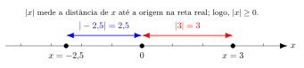

---
aliases:
  - /posts/cursos/matematica/calculo/modulo-1/1.3-valor-absoluto-AP.html
title: "📘 Módulo 1.19-AP: Valor Absoluto e Inequações Modulares"
description: "Definições de módulo, propriedades, desigualdade triangular e resolução de inequações com valor absoluto."
author: "Blog do Marcellini"
date: "2026-06-04"
lang: pt-BR
categories: [cálculo, matemática, curso, inequações, módulo, valor absoluto]
tags: [cálculo, matemática, curso, inequações, módulo, valor absoluto]
format:
  html:
    toc: true
    toc-title: "Neste Módulo"
    toc-depth: 4
    number-sections: true
    theme: cosmo
    fig-align: center
    code-overflow: scroll
    highlight-style: github
page-layout: full
---

🏠 [← Sumário do Curso](../index.qmd) · [← Cursos de Matemática](../../index.qmd) · [← Seção de Matemática](/posts/matematica/index.qmd)

::: {.callout-note title="🧭 Aprofundamento opcional"}

Este AP complementa a aula [1.3 Intervalos e Inequações](1.3-intervalos-inequacoes.qmd). Ele amplia o estudo sem interromper a sequência principal.

↩️ [Voltar à aula de origem](1.3-intervalos-inequacoes.qmd) · ▶️ [Continuar com 1.4 Números Reais e Intervalos](1.4-numeros-reais-e-intervalos.qmd)

:::

🔬 **AP anterior:** [1.18-AP — Conjuntos Numéricos](1.18-AP-conjuntos.qmd)

---

::: {.callout-note title="🎯 Objetivos de Aprendizagem"}

Ao concluir este aprofundamento, você deverá ser capaz de:

- Definir o valor absoluto (módulo) e interpretá-lo geometricamente;
- Apresentar e aplicar propriedades fundamentais do módulo;
- Compreender e utilizar a desigualdade triangular;
- Aplicar a desigualdade triangular reversa;
- Resolver equações e inequações com valor absoluto;
- Relacionar inequações modulares à representação de intervalos na reta real.

:::

---

# 📌 Definição de Módulo

::: {.callout-note title="📖 Definição"}

O **valor absoluto**, também chamado de **módulo**, de um número real $x$ é definido por

$$
|x|=
\begin{cases}
x, & \text{se } x\geq 0,\\
-x, & \text{se } x<0.
\end{cases}
$$

Em outras palavras, o módulo de um número é o próprio número quando ele é não negativo e seu oposto quando ele é negativo.

:::

---

# 📍 Interpretação Geométrica

Na reta real, o módulo de um número representa a **distância desse número até a origem**.

Por exemplo:

$$
|5|=5
\qquad\text{e}\qquad
|-5|=5.
$$

Embora $5$ e $-5$ estejam em lados opostos da origem, ambos estão a uma distância igual a $5$ unidades dela.

Consequentemente,

$$
|x|\geq 0
\qquad\text{para todo }x\in\mathbb{R}.
$$

{fig-align="center" width="100%" fig-cap="Interpretação geométrica do valor absoluto como distância até a origem."}

---

# 🧱 Propriedades do Módulo

::: {.callout-important title="📐 Propriedades principais"}

Para quaisquer números reais $x$ e $y$, valem as seguintes propriedades:

1. **Não negatividade:**

   $$
   |x|\geq 0
   \qquad\text{e}\qquad
   |x|=0\iff x=0.
   $$

2. **Módulo de um produto:**

   $$
   |xy|=|x|\cdot|y|.
   $$

3. **Módulo de um quociente:**

   $$
   \left|\frac{x}{y}\right|
   =
   \frac{|x|}{|y|},
   \qquad y\neq 0.
   $$

4. **Desigualdade triangular:**

   $$
   |x+y|\leq |x|+|y|.
   $$

5. **Desigualdade triangular reversa:**

   $$
   \big||x|-|y|\big|\leq |x-y|.
   $$

6. **Caracterizações do módulo:**

   $$
   |x|=\max\{x,-x\}=\sqrt{x^2}.
   $$

:::

::: {.callout-note collapse="true" title="🧾 Demonstração das Propriedades"}

**(1) Não negatividade**

Pela definição por casos, se $x\geq 0$, então $|x|=x\geq 0$. Se $x<0$, então $|x|=-x>0$.

Além disso, o módulo só é nulo quando $x=0$.

**(2) Módulo de um produto**

Como $|xy|$ e $|x||y|$ são não negativos, basta observar que seus quadrados são iguais:

$$
\begin{aligned}
|xy|^2
&=(xy)^2\\
&=x^2y^2\\
&=|x|^2|y|^2\\
&=(|x||y|)^2.
\end{aligned}
$$

Portanto,

$$
|xy|=|x||y|.
$$

**(3) Módulo de um quociente**

Para $y\neq 0$, aplicando a propriedade do produto ao número $x/y$, temos

$$
\left|\frac{x}{y}\right|
=
\frac{|x|}{|y|}.
$$

Isso também pode ser verificado elevando os dois lados ao quadrado e observando que ambos são não negativos.

**(4) Desigualdade triangular**

Sabemos que

$$
xy\leq |x||y|.
$$

Assim,

$$
\begin{aligned}
|x+y|^2
&=(x+y)^2\\
&=x^2+2xy+y^2\\
&\leq x^2+2|x||y|+y^2\\
&=(|x|+|y|)^2.
\end{aligned}
$$

Como os dois lados da desigualdade $|x+y|\leq |x|+|y|$ são não negativos, a desigualdade entre seus quadrados implica a desigualdade original:

$$
|x+y|\leq |x|+|y|.
$$

Geometricamente, essa propriedade expressa a ideia de que a distância direta entre dois pontos não supera o comprimento de um caminho que passa por um ponto intermediário.

**(5) Desigualdade triangular reversa**

Pela desigualdade triangular,

$$
\begin{aligned}
|x|
&=|(x-y)+y|\\
&\leq |x-y|+|y|.
\end{aligned}
$$

Logo,

$$
|x|-|y|\leq |x-y|.
$$

Trocando os papéis de $x$ e $y$, obtemos

$$
|y|-|x|\leq |x-y|.
$$

As duas desigualdades podem ser reunidas na forma

$$
-\lvert x-y\rvert
\leq |x|-|y|
\leq |x-y|.
$$

Portanto,

$$
\big||x|-|y|\big|\leq |x-y|.
$$

**(6) Caracterizações do módulo**

Pela definição por casos, temos

$$
|x|=
\begin{cases}
x, & x\geq 0,\\
-x, & x<0.
\end{cases}
$$

Assim, $|x|$ é o maior entre $x$ e $-x$:

$$
|x|=\max\{x,-x\}.
$$

Além disso, como $|x|\geq 0$ e $|x|^2=x^2$, segue que

$$
|x|=\sqrt{x^2}.
$$

:::

---

## 📌 Equivalências úteis para inequações modulares

Se $a\geq 0$, valem as seguintes equivalências:

- **Módulo menor que:**

  $$
  |x|<a
  \iff
  -a<x<a.
  $$

- **Módulo menor ou igual:**

  $$
  |x|\leq a
  \iff
  -a\leq x\leq a.
  $$

- **Módulo maior que:**

  $$
  |x|>a
  \iff
  x<-a\quad\text{ou}\quad x>a.
  $$

- **Módulo maior ou igual:**

  $$
  |x|\geq a
  \iff
  x\leq -a\quad\text{ou}\quad x\geq a.
  $$

De maneira mais geral, para $r\geq 0$:

$$
|x-c|<r
\iff
c-r<x<c+r.
$$

Essa última equivalência descreve um intervalo aberto centrado em $c$, com raio $r$.

---

# ✅ Exemplos Resolvidos

::: {.callout-note title="🧮 Exemplo 1"}

Resolva a equação

$$
|x|=3.
$$

::: {.callout-note collapse="true" title="Resolução"}

Pela definição do módulo, temos dois casos:

- Se $x\geq 0$, então $|x|=x=3$, de onde $x=3$.
- Se $x<0$, então $|x|=-x=3$, de onde $x=-3$.

Portanto, o conjunto solução é

$$
\boxed{S=\{-3,3\}}.
$$

:::
:::

---

::: {.callout-note title="🧮 Exemplo 2"}

Resolva a inequação

$$
|x-2|<5.
$$

::: {.callout-note collapse="true" title="Resolução"}

Aplicando a equivalência para módulo menor que:

$$
\begin{aligned}
|x-2|<5
&\iff -5<x-2<5\\
&\iff -3<x<7.
\end{aligned}
$$

Portanto, o conjunto solução é

$$
\boxed{S=(-3,7)}.
$$

:::
:::

---

# ⚖️ Inequações Modulares

::: {.callout-note title="📖 Definição"}

Uma **inequação modular** é uma desigualdade que contém uma expressão com valor absoluto, como

$$
|f(x)|<a,\qquad
|f(x)|\leq a,\qquad
|f(x)|>a
\quad\text{ou}\quad
|f(x)|\geq a.
$$

As equivalências fundamentais apresentadas a seguir pressupõem $a\geq 0$.

:::

---

## 🔎 Os quatro casos básicos

Para $a\geq 0$, temos:

**Caso 1 — menor que**

$$
|f(x)|<a
\iff
-a<f(x)<a.
$$

**Caso 2 — menor ou igual**

$$
|f(x)|\leq a
\iff
-a\leq f(x)\leq a.
$$

**Caso 3 — maior que**

$$
|f(x)|>a
\iff
f(x)<-a
\quad\text{ou}\quad
f(x)>a.
$$

**Caso 4 — maior ou igual**

$$
|f(x)|\geq a
\iff
f(x)\leq -a
\quad\text{ou}\quad
f(x)\geq a.
$$

::: {.callout-tip title="🚧 Casos-limite com $a=0$"}

Quando $a=0$, as equivalências assumem formas particulares:

- $|f(x)|<0$: **não possui solução**, pois o módulo nunca é negativo.
- $|f(x)|\leq 0$: equivale a $f(x)=0$.
- $|f(x)|>0$: equivale a $f(x)\neq 0$.
- $|f(x)|\geq 0$: é **sempre verdadeira**, para todo $x$ do domínio de $f$.

:::

---

## 🎯 Formas centradas

Para $|x-c|$ e $r\geq 0$, temos:

- **Intervalo aberto:**

  $$
  |x-c|<r
  \iff
  c-r<x<c+r.
  $$

- **Intervalo fechado:**

  $$
  |x-c|\leq r
  \iff
  c-r\leq x\leq c+r.
  $$

- **Região exterior ao intervalo:**

  $$
  |x-c|>r
  \iff
  x<c-r\quad\text{ou}\quad x>c+r.
  $$

- **Região exterior, incluindo as extremidades:**

  $$
  |x-c|\geq r
  \iff
  x\leq c-r\quad\text{ou}\quad x\geq c+r.
  $$

---

## ⚙️ Microexemplos

**Exemplo 1**

$$
\begin{aligned}
|x-2|<5
&\iff -5<x-2<5\\
&\iff -3<x<7.
\end{aligned}
$$

**Exemplo 2**

$$
\begin{aligned}
|2x+1|\geq 3
&\iff 2x+1\leq -3
   \quad\text{ou}\quad
   2x+1\geq 3\\
&\iff 2x\leq -4
   \quad\text{ou}\quad
   2x\geq 2\\
&\iff x\leq -2
   \quad\text{ou}\quad
   x\geq 1.
\end{aligned}
$$

Logo,

$$
\boxed{S=(-\infty,-2]\cup[1,+\infty)}.
$$

---

# 🧪 Exercícios Propostos

::: {.callout-note title="📝 Exercícios"}

**1.** Resolva:

$$
|x+1|\leq 4.
$$

**2.** Resolva:

$$
|2x-3|>5.
$$

**3.** Resolva:

$$
|x^2-1|<3.
$$

**4.** Verifique se a desigualdade triangular é satisfeita para $x=2$ e $y=-5$:

$$
|x+y|\leq |x|+|y|.
$$

:::

::: {.callout-important collapse="true" title="✅ Gabarito"}

**1.**

$$
\begin{aligned}
|x+1|\leq 4
&\iff -4\leq x+1\leq 4\\
&\iff -5\leq x\leq 3.
\end{aligned}
$$

Portanto,

$$
\boxed{S=[-5,3]}.
$$

**2.**

$$
\begin{aligned}
|2x-3|>5
&\iff 2x-3<-5
   \quad\text{ou}\quad
   2x-3>5\\
&\iff 2x<-2
   \quad\text{ou}\quad
   2x>8\\
&\iff x<-1
   \quad\text{ou}\quad
   x>4.
\end{aligned}
$$

Portanto,

$$
\boxed{S=(-\infty,-1)\cup(4,+\infty)}.
$$

**3.**

$$
\begin{aligned}
|x^2-1|<3
&\iff -3<x^2-1<3\\
&\iff -2<x^2<4.
\end{aligned}
$$

Como $x^2\geq 0$ para todo real $x$, a desigualdade da esquerda é automaticamente satisfeita. Resta

$$
x^2<4,
$$

ou seja,

$$
-2<x<2.
$$

Portanto,

$$
\boxed{S=(-2,2)}.
$$

**4.**

Substituindo $x=2$ e $y=-5$:

$$
|x+y|=|2-5|=|-3|=3.
$$

Por outro lado,

$$
|x|+|y|=|2|+|-5|=2+5=7.
$$

Assim,

$$
3\leq 7.
$$

A desigualdade triangular é satisfeita.

:::

---

## 🧩 Quiz — Valor Absoluto e Inequações Modulares

:::::{.question}

**Q1.** Geometricamente, $|x-a|$ representa:

::::{.choices}
:::{.choice .correct-choice}
A distância entre $x$ e $a$ na reta real.
:::

:::{.choice}
A soma algébrica entre $x$ e $a$.
:::

:::{.choice}
O produto entre $x$ e $a$.
:::
::::

:::::

:::::{.question}

**Q2.** Para $r\geq 0$, a inequação $|x-a|<r$ é equivalente a:

::::{.choices}
:::{.choice}
$x<a-r$ ou $x>a+r$.
:::

:::{.choice}
$x=a+r$ apenas.
:::

:::{.choice .correct-choice}
$a-r<x<a+r$.
:::
::::

:::::

:::::{.question}

**Q3.** A desigualdade triangular afirma que:

::::{.choices}
:::{.choice .correct-choice}
$|x+y|\leq |x|+|y|$.
:::

:::{.choice}
$|x+y|=|x|-|y|$ para todos os reais.
:::

:::{.choice}
$|xy|=|x|+|y|$ para todos os reais.
:::
::::

:::::

---

# 🔗 Navegação

↩️ **Voltar à aula de origem:** [1.3 Intervalos e Inequações](1.3-intervalos-inequacoes.qmd)

▶️ **Continuar a sequência principal:** [1.4 Números Reais e Intervalos](1.4-numeros-reais-e-intervalos.qmd)

🔬 **AP anterior:** [1.18-AP — Conjuntos Numéricos](1.18-AP-conjuntos.qmd)

🔬 **Próximo AP:** [1.20-AP — Valor Absoluto, Distância e Vizinhanças](1.20-AP-valor-absoluto-distancia-vizinhancas.qmd)

🏠 [Sumário do Curso](../index.qmd) · [← Cursos de Matemática](../../index.qmd) · [← Seção de Matemática](/posts/matematica/index.qmd) · 🔝 [Topo](#)

---

*Blog do Marcellini — Explorando a Matemática com Rigor e Beleza.*

::: {.callout-note}
Criado por Blog do Marcellini com ❤️ e código.
:::