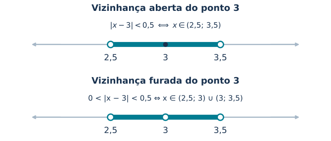

🏠 [← Sumário do Curso](../index.qmd) · [← Cursos de Matemática](../../index.qmd) · [← Seção de Matemática](/posts/matematica/index.qmd)

::: {.callout-note title="🧭 Aprofundamento opcional"}

Este aprofundamento complementa a aula [1.4 — Números Reais e Intervalos](1.4-numeros-reais-e-intervalos.qmd).

Na aula principal, estudamos os números reais, os intervalos e uma primeira interpretação do valor absoluto como distância. Aqui, desenvolveremos essa ideia com mais profundidade, introduzindo vizinhanças abertas, vizinhanças furadas e a linguagem matemática que será utilizada na definição formal de limite.

O conteúdo amplia a sequência principal sem interromper seu desenvolvimento.

↩️ [Voltar à aula de origem](1.4-numeros-reais-e-intervalos.qmd) · ▶️ [Continuar com 1.5 — Equações e Inequações](1.5-equacoes-e-inequacoes.qmd)

:::

🔬 **AP anterior:** [1.19-AP — Valor Absoluto e Inequações Modulares](1.19-AP-valor-absoluto.qmd)

***

# 🔬 Valor Absoluto, Distância e Vizinhanças

Este aprofundamento desenvolve uma das ideias mais importantes para o estudo de limites: **proximidade**.

Quando escrevemos

$$
|x-a|<\varepsilon,
$$

estamos afirmando que \(x\) está suficientemente próximo de \(a\), no sentido de que a distância entre esses dois números é menor que \(\varepsilon\).

Essa interpretação geométrica será essencial para compreender a definição formal de limite.

## 📦 Valor absoluto como distância até zero

O valor absoluto de um número real $x$ é definido por:

$$
|x|=
\begin{cases}
x, & x\geq 0,\\
-x, & x<0.
\end{cases}
$$

Geometricamente, $|x|$ representa a distância entre o número $x$ e a origem da reta real.

Por exemplo:

$$
|5|=5
$$

e

$$
|-5|=5.
$$

Os números $5$ e $-5$ estão à mesma distância do zero, embora estejam em lados opostos da reta.

::: {.callout-note title="💡 Interpretação geométrica"}

O valor absoluto não mede se um número é positivo ou negativo. Ele mede sua distância até zero.

Por isso, seu resultado nunca é negativo:

$$
|x|\geq 0.
$$

:::

## 📏 Distância entre dois pontos reais

A distância entre dois números reais $x$ e $a$ é dada por:

$$
d(x,a)=|x-a|.
$$

Essa expressão funciona independentemente da posição relativa dos dois números.

Por exemplo, a distância entre $7$ e $3$ é:

$$
|7-3|=4.
$$

A distância entre $-1$ e $3$ também é:

$$
|-1-3|=|-4|=4.
$$

Portanto, a expressão

$$
|x-a|
$$

mede quanto $x$ está afastado de $a$ na reta real.

É importante observar que a distância é simétrica:

$$
|x-a|=|a-x|.
$$

Assim, a distância de $x$ até $a$ é igual à distância de $a$ até $x$.

## 🎯 Vizinhança aberta

Uma **vizinhança aberta** de centro $a$ e raio $\varepsilon>0$ é o intervalo:

$$
(a-\varepsilon,\;a+\varepsilon).
$$

Equivalentemente, podemos representar essa vizinhança pelo conjunto:

$$
V_\varepsilon(a)
=
\{x\in\mathbb{R}:|x-a|<\varepsilon\}.
$$

Portanto:

$$
|x-a|<\varepsilon
$$

e

$$
a-\varepsilon<x<a+\varepsilon
$$

expressam exatamente a mesma condição.

::: {.callout-note title="📌 Ideia central"}

Uma vizinhança aberta reúne todos os pontos da reta real que estão a uma distância menor que $\varepsilon$ do centro $a$.

O centro pertence à vizinhança, mas suas extremidades não.

:::

### Exemplo: vizinhança de centro 3

Considere:

$$
a=3
$$

e

$$
\varepsilon=0{,}5.
$$

A vizinhança aberta será:

$$
(3-0{,}5,\;3+0{,}5).
$$

Logo:

$$
V_{0{,}5}(3)=(2{,}5,\;3{,}5).
$$

Também podemos escrever:

$$
|x-3|<0{,}5.
$$

Isso significa que $x$ está a uma distância menor que $0{,}5$ de $3$.

## 🧭 Vizinhança furada

No estudo de limites, frequentemente queremos analisar o comportamento de uma função perto de um ponto, mas sem considerar necessariamente o próprio ponto.

Para isso, utilizamos uma **vizinhança furada (ou perfurada)**.

Sua representação é:

$$
0<|x-a|<\varepsilon.
$$

Essa desigualdade reúne duas condições:

1. $x$ está a uma distância menor que $\varepsilon$ de $a$;
2. $x$ é diferente de $a$.

A primeira condição garante a proximidade. A segunda exclui o centro.

Podemos representar a vizinhança furada por:

$$
(a-\varepsilon,a)\cup(a,a+\varepsilon).
$$

Ou, em notação de conjuntos:

$$
V_\varepsilon^*(a)
=
\{x\in\mathbb{R}:0<|x-a|<\varepsilon\}.
$$

::: {.callout-important title="💡 Por que excluir o centro?"}

O limite de uma função em $a$ depende do comportamento de seus valores quando $x$ se aproxima de $a$, e não necessariamente do valor que a função assume exatamente em $a$.

Por isso, a definição de limite utiliza uma vizinhança furada.

:::

Compare as duas representações para $a=3$ e $\varepsilon=0{,}5$. Os extremos $2{,}5$ e $3{,}5$ ficam excluídos nos dois casos. O ponto $3$ pertence só à primeira vizinhança.

{#fig-ap03-vizinhancas width="95%" fig-align="center"}

## 🔁 Desigualdades equivalentes

O quadro retoma as formas centradas estudadas em [1.19-AP — Valor Absoluto e Inequações Modulares](1.19-AP-valor-absoluto.qmd).

Para $r\geq 0$, temos:

| Condição de distância | Região na reta real |
|:---|:---|
| $\lvert x-a\rvert<r$ | $(a-r,a+r)$ |
| $\lvert x-a\rvert\leq r$ | $[a-r,a+r]$ |
| $\lvert x-a\rvert>r$ | $(-\infty,a-r)\cup(a+r,+\infty)$ |
| $\lvert x-a\rvert\geq r$ | $(-\infty,a-r]\cup[a+r,+\infty)$ |

Vamos desenvolver a equivalência que conecta valor absoluto e intervalos.

Considere:

$$
|x-a|<\varepsilon,
\qquad \varepsilon>0.
$$

Pela definição de valor absoluto, essa condição equivale a:

$$
-\varepsilon<x-a<\varepsilon.
$$

Somando $a$ aos três membros:

$$
a-\varepsilon<x<a+\varepsilon.
$$

Assim:

$$
\boxed{
|x-a|<\varepsilon
\iff
a-\varepsilon<x<a+\varepsilon.
}
$$

Em termos de intervalos:

$$
\boxed{
x\in(a-\varepsilon,a+\varepsilon).
}
$$

Essa equivalência é uma ferramenta importante para traduzir uma condição algébrica em uma região geométrica da reta real.

## ⚖️ Desigualdades com valor absoluto: menor ou igual

Também podemos trabalhar com desigualdades não estritas:

$$
|x-a|\leq r,
\qquad r\geq 0.
$$

Essa condição significa que a distância entre $x$ e $a$ é menor ou igual a $r$.

Ela equivale a:

$$
-r\leq x-a\leq r.
$$

Somando $a$ aos três membros:

$$
a-r\leq x\leq a+r.
$$

Portanto:

$$
\boxed{
|x-a|\leq r
\iff
x\in[a-r,a+r].
}
$$

### Exemplo

Considere:

$$
|x-2|\leq 5.
$$

Temos:

$$
-5\leq x-2\leq 5.
$$

Somando $2$:

$$
-3\leq x\leq 7.
$$

Logo, a solução é:

$$
\boxed{x\in[-3,7].}
$$

Observe a diferença entre as duas situações:

- $|x-a|<r$: intervalo aberto;
- $|x-a|\leq r$: intervalo fechado.

## 🚪 Desigualdades com valor absoluto: maior que

A desigualdade

$$
|x-a|>r,
\qquad r\geq 0,
$$

significa que $x$ está a uma distância maior que $r$ de $a$.

Nesse caso, $x$ pertence ao complemento do intervalo fechado $[a-r,a+r]$.

Isso corresponde a duas possibilidades:

$$
x<a-r
$$

ou

$$
x>a+r.
$$

Portanto:

$$
\boxed{
|x-a|>r
\iff
x\in(-\infty,a-r)\cup(a+r,+\infty).
}
$$

### Exemplo

Considere:

$$
|x-3|>2.
$$

Temos duas possibilidades:

$$
x<3-2
$$

ou

$$
x>3+2.
$$

Logo:

$$
x<1
\qquad\text{ou}\qquad
x>5.
$$

A solução é:

$$
\boxed{
(-\infty,1)\cup(5,+\infty).
}
$$

### E quando a desigualdade é maior ou igual?

Para $r\geq 0$, se

$$
|x-a|\geq r,
$$

então:

$$
x\leq a-r
\qquad\text{ou}\qquad
x\geq a+r.
$$

Assim:

$$
\boxed{
|x-a|\geq r
\iff
x\in(-\infty,a-r]\cup[a+r,+\infty).
}
$$

## 🌉 Ponte para o Cálculo

A definição formal de limite utiliza exatamente a linguagem de distância e vizinhança que desenvolvemos até aqui.

Considere a afirmação:

$$
\lim_{x\to a}f(x)=L.
$$

Informalmente, ela significa que podemos tornar $f(x)$ tão próximo de $L$ quanto desejarmos, tomando $x$ no domínio de $f$, suficientemente perto de $a$ e diferente de $a$.

A linguagem matemática utiliza duas desigualdades:

$$
0<|x-a|<\delta
$$

e

$$
|f(x)-L|<\varepsilon.
$$

Cada uma desempenha um papel específico.

**Na entrada da função:**

$$
0<|x-a|<\delta.
$$

Essa condição indica que $x$ está em uma vizinhança furada de centro $a$ e raio $\delta$.

**Na saída da função:**

$$
|f(x)-L|<\varepsilon.
$$

Essa condição indica que $f(x)$ está a uma distância menor que $\varepsilon$ de $L$.

Portanto:

- $\delta$ controla a proximidade de $x$ em relação a $a$;
- $\varepsilon$ controla a proximidade de $f(x)$ em relação a $L$.

### A definição formal de limite

Seja $f:A\to\mathbb R$ e seja $a$ um **ponto de acumulação** de $A$. Isso significa que toda vizinhança furada de $a$ contém algum ponto do domínio. Mais precisamente, para todo $r>0$, existe $x\in A$ tal que $0<|x-a|<r$. Assim, podemos aproximar $x$ de $a$ com valores do domínio, mesmo quando $a\notin A$.

Dizemos que:

$$
\lim_{x\to a}f(x)=L
$$

quando:

$$
\forall\varepsilon>0,\ \exists\delta>0
$$

tal que, para todo $x\in A$,

$$
0<|x-a|<\delta
\quad\Longrightarrow\quad
|f(x)-L|<\varepsilon.
$$

Essa definição afirma que, para qualquer tolerância positiva $\varepsilon$ escolhida para os valores da função, existe uma tolerância positiva $\delta$ que garante o resultado desejado para as entradas suficientemente próximas de $a$.

::: {.callout-tip title="💡 Uma interpretação importante"}

O número $\varepsilon$ é escolhido primeiro. Depois, precisamos encontrar um $\delta$ que garanta a aproximação desejada.

Não precisamos que $\delta$ seja igual a $\varepsilon$. A escolha de $\delta$ pode depender da função, do ponto $a$ e da tolerância $\varepsilon$ escolhida.

:::

Não é necessário dominar todos os detalhes dessa definição neste momento. O objetivo deste aprofundamento é compreender de onde vêm as expressões de valor absoluto que aparecem nela.

## 🧪 Exercícios propostos

::: {.callout-note title="📝 Exercícios"}

### 🧪 Exercício 1 — Escrevendo intervalos

Escreva cada desigualdade na forma de intervalo:

a) $|x-4|<2$

b) $|x+1|<3$

c) $|x-5|\leq 1$

### 🧪 Exercício 2 — Escrevendo com valor absoluto

Escreva cada intervalo usando uma desigualdade com valor absoluto:

a) $x\in(2,8)$

b) $x\in(-3,3)$

c) $x\in[1,5]$

### 🧪 Exercício 3 — Desigualdades modulares

Resolva:

a) $|x-2|>4$

b) $|x+3|\geq 2$

### 🧪 Exercício 4 — Interpretação geométrica

Explique o significado geométrico da expressão:

$$
0<|x-a|<\varepsilon.
$$

### 🧪 Exercício 5 — Vizinhança aberta

Determine a vizinhança aberta de centro $a=4$ e raio $\varepsilon=0{,}2$, escrevendo sua resposta:

a) na forma de intervalo;

b) por meio de uma desigualdade com valor absoluto.

:::

## ✅ Gabarito comentado

::: {.callout-important collapse=true title="🔎 Clique para consultar as resoluções"}

### 🧪 Exercício 1 — Escrevendo intervalos

**a)**

$$
|x-4|<2
$$

Equivale a:

$$
4-2<x<4+2.
$$

Logo:

$$
\boxed{x\in(2,6).}
$$

**b)**

Podemos escrever:

$$
|x+1|=|x-(-1)|.
$$

Assim:

$$
|x-(-1)|<3.
$$

Logo:

$$
\boxed{x\in(-4,2).}
$$

**c)**

$$
|x-5|\leq 1
$$

Equivale a:

$$
5-1\leq x\leq 5+1.
$$

Portanto:

$$
\boxed{x\in[4,6].}
$$

### 🧪 Exercício 2 — Escrevendo com valor absoluto

**a)**

O intervalo $(2,8)$ tem centro:

$$
a=\frac{2+8}{2}=5
$$

e raio:

$$
r=\frac{8-2}{2}=3.
$$

Logo:

$$
\boxed{|x-5|<3.}
$$

**b)**

O intervalo $(-3,3)$ tem centro $0$ e raio $3$.

Logo:

$$
\boxed{|x|<3.}
$$

**c)**

O intervalo $[1,5]$ tem centro:

$$
a=\frac{1+5}{2}=3
$$

e raio:

$$
r=\frac{5-1}{2}=2.
$$

Como o intervalo é fechado, utilizamos a desigualdade não estrita:

$$
\boxed{|x-3|\leq 2.}
$$

### 🧪 Exercício 3 — Desigualdades modulares

**a)**

$$
|x-2|>4
$$

Isso significa:

$$
x<2-4
$$

ou:

$$
x>2+4.
$$

Logo:

$$
\boxed{x\in(-\infty,-2)\cup(6,+\infty).}
$$

**b)**

$$
|x+3|\geq 2
$$

Podemos escrever:

$$
|x-(-3)|\geq 2.
$$

Logo:

$$
x\leq -3-2
$$

ou:

$$
x\geq -3+2.
$$

Portanto:

$$
\boxed{x\in(-\infty,-5]\cup[-1,+\infty).}
$$

### 🧪 Exercício 4 — Interpretação geométrica

A expressão:

$$
0<|x-a|<\varepsilon
$$

indica que $x$ pertence à vizinhança aberta de centro $a$ e raio $\varepsilon$, mas não pode ser igual ao próprio centro.

É uma vizinhança furada, representada por:

$$
(a-\varepsilon,a)\cup(a,a+\varepsilon).
$$

### 🧪 Exercício 5 — Vizinhança aberta

Temos:

$$
a=4
\qquad\text{e}\qquad
\varepsilon=0{,}2.
$$

**a) Na forma de intervalo:**

$$
(4-0{,}2\,;\,4+0{,}2).
$$

Logo:

$$
\boxed{(3{,}8\,;\,4{,}2).}
$$

**b) Com valor absoluto:**

$$
\boxed{|x-4|<0{,}2.}
$$

:::

## 🧩 Quiz — Valor Absoluto, Distância e Vizinhanças

:::::{.question}

**Q1.** A expressão $|x-a|$ representa:

::::{.choices}
:::{.choice .correct-choice}
A distância entre $x$ e $a$ na reta real.
:::

:::{.choice}
A soma entre $x$ e $a$.
:::

:::{.choice}
A multiplicação entre $x$ e $a$.
:::
::::

:::::

:::::{.question}

**Q2.** A desigualdade $|x-3|<0{,}5$ representa:

::::{.choices}
:::{.choice}
$x$ está longe de $3$.
:::

:::{.choice .correct-choice}
$x$ está a uma distância menor que $0{,}5$ de $3$.
:::

:::{.choice}
$x$ é necessariamente igual a $3$.
:::
::::

:::::

:::::{.question}

**Q3.** Qual ponto da vizinhança aberta de centro $a$ e raio $\varepsilon>0$ é excluído pela condição $0<|x-a|<\varepsilon$?

::::{.choices}
:::{.choice}
Todos os pontos próximos de $a$.
:::

:::{.choice .correct-choice}
O próprio ponto $a$.
:::

:::{.choice}
Todos os números reais.
:::
::::

:::::

:::::{.question}

**Q4.** Na definição formal de limite, o número $\delta$ controla:

::::{.choices}
:::{.choice}
A distância entre $f(x)$ e $L$.
:::

:::{.choice .correct-choice}
A distância entre $x$ e $a$.
:::

:::{.choice}
O valor da função no ponto $a$.
:::
::::

:::::

## 🌉 Conexão com o estudo de limites

Neste aprofundamento, partimos de uma interpretação geométrica simples — o valor absoluto como distância — e chegamos à linguagem utilizada na definição formal de limite.

A sequência de ideias é:

1. O valor absoluto representa uma distância na reta real.
2. A distância permite definir vizinhanças abertas.
3. A exclusão do centro produz uma vizinhança furada.
4. As vizinhanças permitem descrever matematicamente a aproximação de uma variável a um ponto.
5. A linguagem de $\varepsilon$ e $\delta$ formaliza a aproximação dos valores de uma função.

Essa construção será retomada quando estudarmos limites com maior rigor matemático.

## 🔗 Navegação

↩️ **Voltar à aula de origem:** [1.4 — Números Reais e Intervalos](1.4-numeros-reais-e-intervalos.qmd)

🧭 [**Exercícios da Revisão Geral**](1.17-revisao-geral-do-modulo-1.qmd#exercícios-propostos)

▶️ **Continuar a sequência principal:** [1.5 — Equações e Inequações](1.5-equacoes-e-inequacoes.qmd)

🔬 **AP anterior:** [1.19-AP — Valor Absoluto e Inequações Modulares](1.19-AP-valor-absoluto.qmd)

🔬 **Próximo AP:** [1.21-AP — Domínio de Funções: Guia Completo](1.21-AP-dominio-de-funcoes-guia-completo.qmd)

🏠 [Sumário do Curso](../index.qmd) · [← Cursos de Matemática](../../index.qmd) · 🔝 [Topo](#)

***

*Blog do Marcellini — Explorando a Matemática com Rigor e Beleza.*

:::{.callout-note}
Criado por Blog do Marcellini com ❤️ e código.
:::
