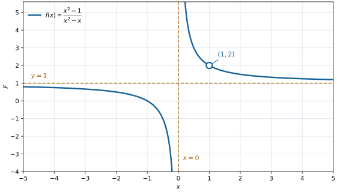

🏠 [← Sumário do Curso](../index.qmd) · [← Cursos de Matemática](../../index.qmd) · [← Seção de Matemática](/posts/matematica/index.qmd)

::: {.callout-note title="🧭 Aprofundamento opcional"}

Este AP complementa a aula [1.16 Crescimento e Comportamento Assintótico](1.16-crescimento-e-comportamento-assintotico.qmd). Ele amplia o estudo sem interromper a sequência principal.

↩️ [Voltar à aula de origem](1.16-crescimento-e-comportamento-assintotico.qmd) · ▶️ [Continuar com 1.17 Revisão Geral do Módulo 1](1.17-revisao-geral-do-modulo-1.qmd)

:::

🔬 **AP anterior:** [1.22-AP — Funções por Partes](1.22-AP-funcoes-por-partes.qmd)

***

::: {.callout-tip title="❓ Pergunta Disparadora"}

Quando uma função racional deixa de estar definida em determinado ponto, podemos concluir imediatamente que existe uma assíntota vertical?

Como determinar se uma função se aproxima de uma reta inclinada, em vez de uma reta horizontal?

E se o gráfico se aproximar de uma curva polinomial de grau maior que um?

Essas perguntas nos levam a investigar com mais profundidade os limites e o comportamento das funções no infinito.

:::

::: {.callout-note title="📌 Objetivos de Aprendizagem"}

Ao final deste aprofundamento, você deverá ser capaz de:

- Interpretar assíntotas por meio de limites.
- Identificar assíntotas verticais utilizando limites laterais.
- Diferenciar assíntotas verticais de descontinuidades removíveis.
- Analisar os pontos problemáticos de funções racionais.
- Determinar assíntotas horizontais pela comparação dos graus dos polinômios.
- Utilizar os termos dominantes para investigar o comportamento no infinito.
- Determinar assíntotas oblíquas por meio da divisão de polinômios.
- Reconhecer situações em que uma função possui assíntota polinomial.
- Distinguir o comportamento de uma função quando $x\to+\infty$ e quando $x\to-\infty$.

:::

# 🔬 Assíntotas e Comportamento no Infinito

As assíntotas descrevem o comportamento de um gráfico perto de um ponto ou em uma direção do infinito.

Elas ajudam a compreender o comportamento de uma função:

- nas proximidades de pontos em que seus valores podem crescer ou decrescer sem limite;
- quando a variável independente tende a $+\infty$;
- quando a variável independente tende a $-\infty$.

Na aula 1.16, apresentamos os conceitos fundamentais de assíntotas e comportamento assintótico. Neste aprofundamento, vamos desenvolver os procedimentos matemáticos que permitem identificá-las e justificá-las.

O instrumento central será o **limite**.

## 🧱 O que é uma assíntota?

Perto de um ponto excluído, perguntamos se os valores da função se aproximam de um número finito ou se crescem ou decrescem sem limite. No infinito, investigamos separadamente o que acontece quando $x\to+\infty$ e quando $x\to-\infty$.

A reta vertical $x=a$ é uma assíntota se pelo menos um limite lateral de $f$ em $a$ for $+\infty$ ou $-\infty$. Para uma reta horizontal ou oblíqua, verificamos se a diferença entre as ordenadas do gráfico e da reta, na mesma abscissa, tende a zero na direção do infinito considerada.

Os três tipos fundamentais são:

- **Assíntota vertical:** relacionada ao comportamento da função nas proximidades de uma abscissa.
- **Assíntota horizontal:** relacionada à aproximação da função a uma constante quando $x$ tende ao infinito.
- **Assíntota oblíqua:** relacionada à aproximação da função a uma reta inclinada quando $x$ tende ao infinito.

Existe ainda uma generalização importante: uma função pode se aproximar de uma curva polinomial de grau superior a um. Nesse caso, podemos falar em **assíntota polinomial**.

Cada tipo de assíntota corresponde a uma condição matemática específica, que será desenvolvida a seguir.

## 📍 Assíntota vertical

Uma reta vertical $x=a$ é uma **assíntota vertical** de uma função $f$ quando pelo menos um dos limites laterais é infinito positivo ou negativo:

$$
\lim_{x\to a^-}f(x)=+\infty,
$$

$$
\lim_{x\to a^-}f(x)=-\infty,
$$

$$
\lim_{x\to a^+}f(x)=+\infty
$$

ou

$$
\lim_{x\to a^+}f(x)=-\infty.
$$

Não é necessário que os dois limites laterais sejam iguais. Basta que pelo menos um deles seja infinito.

### Exemplo 1 — A função recíproca deslocada

Considere:

$$
f(x)=\frac{1}{x-2}.
$$

O domínio da função é:

$$
D(f)=\mathbb{R}\setminus\{2\}.
$$

Quando $x$ se aproxima de $2$ pela direita, temos $x-2>0$ e o denominador se aproxima de zero por valores positivos:

$$
\lim_{x\to 2^+}\frac{1}{x-2}=+\infty.
$$

Quando $x$ se aproxima de $2$ pela esquerda, temos $x-2<0$ e o denominador se aproxima de zero por valores negativos:

$$
\lim_{x\to 2^-}\frac{1}{x-2}=-\infty.
$$

Portanto:

$$
\boxed{x=2}
$$

é uma assíntota vertical.

**Interpretação:** o gráfico apresenta dois ramos que se afastam indefinidamente do eixo horizontal nas proximidades de $x=2$, um em direção a $+\infty$ e outro em direção a $-\infty$.

### Exemplo 2 — Os dois lados podem apresentar o mesmo sinal

Considere:

$$
g(x)=\frac{1}{(x-1)^2}.
$$

Quando $x$ se aproxima de $1$, o denominador permanece positivo e se aproxima de zero:

$$
\lim_{x\to 1^-}\frac{1}{(x-1)^2}=+\infty
$$

e

$$
\lim_{x\to 1^+}\frac{1}{(x-1)^2}=+\infty.
$$

Logo:

$$
\boxed{x=1}
$$

é uma assíntota vertical.

Observe que, diferentemente do exemplo anterior, os dois ramos crescem em direção a $+\infty$.

### Atenção aos limites laterais

O comportamento de uma função nas proximidades de uma assíntota vertical depende do lado pelo qual nos aproximamos do ponto.

Por isso, não devemos analisar apenas a expressão algébrica. É importante verificar os sinais dos fatores que aparecem no numerador e no denominador.

## ⚠️ Nem todo ponto excluído é uma assíntota vertical

Um erro comum é considerar que todo ponto em que o denominador de uma função racional se anula produz uma assíntota vertical.

Isso não é verdade.

Considere:

$$
g(x)=\frac{x^2-4}{x-2}.
$$

O denominador se anula em:

$$
x=2.
$$

Entretanto, o numerador também se anula nesse ponto.

Fatorando o numerador:

$$
x^2-4=(x-2)(x+2).
$$

Para $x\neq 2$, podemos simplificar:

$$
g(x)=x+2.
$$

Portanto, embora a função original não esteja definida em $x=2$, seus valores se aproximam de:

$$
\lim_{x\to 2}\frac{x^2-4}{x-2}
=
\lim_{x\to 2}(x+2)
=4.
$$

O limite existe e é finito.

Assim, não há assíntota vertical em $x=2$.

O gráfico corresponde à reta $y=x+2$, mas com um ponto removido:

$$
(2,4).
$$

Esse tipo de descontinuidade é chamado de **descontinuidade removível**.

::: {.callout-note title="📌 Descontinuidade removível"}

Uma descontinuidade é removível quando a função apresenta um limite finito no ponto, mas não está definida ali ou possui um valor diferente desse limite.

No exemplo:

$$
\lim_{x\to 2}g(x)=4,
$$

mas $g(2)$ não existe.

Se definíssemos uma nova função atribuindo $g(2)=4$, eliminaríamos essa descontinuidade.

Portanto, um ponto excluído do domínio não implica necessariamente uma assíntota vertical.

:::

### Comparação entre os dois casos

| Situação | Comportamento do limite | Interpretação |
|---|---|---|
| $\dfrac{1}{x-2}$ em $x=2$ | Limites laterais infinitos | Assíntota vertical |
| $\dfrac{x^2-4}{x-2}$ em $x=2$ | Limite finito igual a $4$ | Descontinuidade removível |

A análise dos limites permite distinguir situações que, observando apenas o denominador, poderiam parecer iguais.

## ➗ Assíntotas verticais em funções racionais

Uma função racional é expressa pelo quociente de dois polinômios:

$$
f(x)=\frac{P(x)}{Q(x)},
$$

em que $Q(x)$ não é o polinômio nulo.

Os pontos em que o denominador se anula são candidatos a assíntotas verticais.

Entretanto, antes de concluir, devemos investigar se existe algum fator comum entre numerador e denominador.

### Procedimento de análise

Para investigar as assíntotas verticais de uma função racional:

1. Determine os valores que anulam o denominador.
2. Fatore o numerador e o denominador, quando possível.
3. Simplifique os fatores comuns, respeitando as restrições do domínio original.
4. Analise os limites laterais nos pontos excluídos.
5. Identifique quais pontos produzem limites infinitos.

### Exemplo 3 — Dois candidatos, duas assíntotas

Considere:

$$
f(x)=\frac{x+1}{x^2-9}.
$$

Fatorando o denominador:

$$
x^2-9=(x-3)(x+3).
$$

O domínio é:

$$
D(f)=\mathbb{R}\setminus\{-3,3\}.
$$

Os candidatos a assíntotas verticais são:

$$
x=3
$$

e

$$
x=-3.
$$

O numerador não se anula em nenhum desses pontos:

$$
3+1=4\neq 0
$$

e

$$
-3+1=-2\neq 0.
$$

Logo, não existe cancelamento de fatores.

Nas proximidades de $x=3$, o denominador tende a zero, enquanto o numerador tende a $4$. Os limites laterais são infinitos.

Nas proximidades de $x=-3$, o numerador tende a $-2$ e o denominador também tende a zero, produzindo novamente limites laterais infinitos.

Portanto, as duas retas são assíntotas verticais:

$$
\boxed{x=3\qquad\text{e}\qquad x=-3.}
$$

### Exemplo 4 — Cancelamento de um fator

Considere:

$$
g(x)=\frac{(x-2)(x+1)}{(x-2)(x+3)}.
$$

O domínio original exclui:

$$
x=2
$$

e

$$
x=-3.
$$

Para os demais valores de $x$, podemos simplificar:

$$
g(x)=\frac{x+1}{x+3}.
$$

Em $x=2$, o limite é finito:

$$
\lim_{x\to 2}g(x)
=
\frac{2+1}{2+3}
=
\frac{3}{5}.
$$

Logo, $x=2$ corresponde a uma descontinuidade removível.

Em $x=-3$, entretanto, o denominador da expressão simplificada se aproxima de zero, enquanto o numerador tende a $-2$.

Assim, existem limites laterais infinitos e:

$$
\boxed{x=-3}
$$

é uma assíntota vertical.

**Conclusão:** a simplificação algébrica ajuda a identificar os pontos removíveis, mas os limites são o critério definitivo para reconhecer uma assíntota vertical.

## 🌅 Assíntota horizontal

Uma reta horizontal $y=L$ é uma **assíntota horizontal** de uma função quando:

$$
\lim_{x\to+\infty}f(x)=L
$$

ou

$$
\lim_{x\to-\infty}f(x)=L,
$$

com $L$ finito.

A função não precisa se aproximar da mesma reta nas duas direções.

### Exemplo 5 — Assíntota horizontal

Considere:

$$
f(x)=\frac{x}{x+1}.
$$

Para $x\neq0$, dividimos o numerador e o denominador por $x$ e obtemos

$$
f(x)=\frac{1}{1+\frac{1}{x}}.
$$

Quando $x\to+\infty$ ou $x\to-\infty$:

$$
\frac{1}{x}\to 0.
$$

Consequentemente:

$$
\lim_{x\to+\infty}\frac{x}{x+1}=1
$$

e

$$
\lim_{x\to-\infty}\frac{x}{x+1}=1.
$$

Portanto:

$$
\boxed{y=1}
$$

é uma assíntota horizontal nas duas direções.

### Exemplo 6 — Assíntotas horizontais diferentes

Considere:

$$
g(x)=\frac{x}{\sqrt{x^2+1}}.
$$

Para $x\neq0$, podemos escrever

$$
g(x)=
\frac{x}{|x|\sqrt{1+\frac{1}{x^2}}}.
$$

Para $x\to+\infty$, temos $|x|=x$. Assim:

$$
\lim_{x\to+\infty}g(x)=1.
$$

Para $x\to-\infty$, temos $|x|=-x$. Portanto:

$$
\lim_{x\to-\infty}g(x)=-1.
$$

Logo, essa função apresenta duas assíntotas horizontais:

$$
\boxed{y=1\quad\text{quando }x\to+\infty}
$$

e

$$
\boxed{y=-1\quad\text{quando }x\to-\infty.}
$$

Esse exemplo mostra por que é importante investigar separadamente os dois sentidos do infinito.

## 🧮 Regra prática para assíntotas horizontais em funções racionais

Considere:

$$
f(x)=\frac{P(x)}{Q(x)},
$$

em que $P$ e $Q$ são polinômios não nulos.

Para determinar o comportamento no infinito, comparamos os graus dos polinômios.

Sejam:

$$
m=\deg(P)
$$

e

$$
n=\deg(Q).
$$

### Caso 1 — Grau do numerador menor que o grau do denominador

Se:

$$
m<n,
$$

o denominador cresce mais rapidamente em módulo que o numerador.

Assim:

$$
\lim_{x\to\pm\infty}\frac{P(x)}{Q(x)}=0.
$$

A assíntota horizontal é:

$$
\boxed{y=0.}
$$

**Exemplo:**

$$
f(x)=\frac{x+1}{x^2+3}.
$$

O grau do numerador é $1$ e o do denominador é $2$.

Portanto:

$$
\boxed{y=0.}
$$

### Caso 2 — Graus iguais

Se:

$$
m=n,
$$

a assíntota horizontal é dada pela razão entre os coeficientes líderes.

**Exemplo:**

$$
f(x)=\frac{3x^2+1}{2x^2-5}.
$$

Os coeficientes líderes são $3$ e $2$.

Logo:

$$
\boxed{y=\frac{3}{2}.}
$$

### Caso 3 — Grau do numerador maior que o grau do denominador

Se:

$$
m>n,
$$

não existe assíntota horizontal finita.

O quociente da divisão é de grau um quando a diferença dos graus é um e de grau maior nos demais casos.

Para investigá-las, utilizamos a divisão de polinômios.

### Quadro-resumo

| Comparação dos graus | Comportamento no infinito |
|---|---|
| $\deg(P)<\deg(Q)$ | Assíntota horizontal $y=0$ |
| $\deg(P)=\deg(Q)$ | Assíntota horizontal dada pela razão dos coeficientes líderes |
| $\deg(P)>\deg(Q)$ | O quociente da divisão fornece a assíntota oblíqua ou polinomial |

**Observação.** A comparação de graus e coeficientes líderes pode ser feita com a expressão original. Um fator comum reduz os dois graus na mesma quantidade e deixa inalterada a razão dos coeficientes líderes. Para investigar assíntotas verticais, simplifique os fatores comuns e preserve as exclusões do domínio original.

## 🔍 Termo dominante e funções racionais

O comportamento de uma função racional no infinito é frequentemente governado pelos termos de maior grau do numerador e do denominador.

Considere:

$$
f(x)=\frac{4x^3-1}{2x^3+7x}.
$$

Os termos dominantes são:

$$
4x^3
$$

e

$$
2x^3.
$$

Dividindo o numerador e o denominador por $x^3$:

$$
f(x)=
\frac{4-\frac{1}{x^3}}
{2+\frac{7}{x^2}}.
$$

Quando $x\to+\infty$ ou $x\to-\infty$, os termos com potências negativas de $x$ tendem a zero.

Portanto:

$$
\lim_{x\to\pm\infty}f(x)
=
\frac{4}{2}=2.
$$

A assíntota horizontal é:

$$
\boxed{y=2.}
$$

### Por que o procedimento funciona?

Dividimos o numerador e o denominador pela potência $x^n$, em que $n$ é o grau do denominador. Assim, cada termo de grau menor que $n$ tende a zero depois da divisão. Se o numerador também tem grau $n$, o limite é a razão dos coeficientes líderes. Se tem grau menor, o limite é zero. Quando tem grau maior, o grau e o sinal do termo dominante determinam o comportamento em cada direção.

Essa é a justificativa algébrica para a regra prática baseada na comparação dos graus.

## 📐 Assíntota oblíqua

Uma reta inclinada pode ser assíntota de uma função quando a diferença entre a função e a reta tende a zero.

Uma reta:

$$
y=mx+b,
$$

com $m\neq 0$, é uma assíntota oblíqua em uma direção do infinito quando:

$$
\lim_{x\to\pm\infty}
\left[f(x)-(mx+b)\right]=0.
$$

A expressão $\pm\infty$ deve ser interpretada separadamente: a condição pode valer para $+\infty$, para $-\infty$ ou para ambos.

### Exemplo 7 — Divisão de polinômios

Considere:

$$
f(x)=\frac{x^2+1}{x}.
$$

Dividindo cada termo do numerador por $x$:

$$
f(x)=x+\frac{1}{x}.
$$

A reta candidata a assíntota oblíqua é:

$$
y=x.
$$

Para verificar:

$$
f(x)-x=\frac{1}{x}.
$$

Como:

$$
\lim_{x\to+\infty}\frac{1}{x}=0
$$

e

$$
\lim_{x\to-\infty}\frac{1}{x}=0,
$$

a reta:

$$
\boxed{y=x}
$$

é uma assíntota oblíqua nas duas direções.

### Exemplo 8 — Assíntota oblíqua com intercepto diferente de zero

Considere:

$$
g(x)=\frac{x^2+2x+1}{x}.
$$

Dividindo:

$$
g(x)=x+2+\frac{1}{x}.
$$

A reta candidata é:

$$
y=x+2.
$$

A diferença entre a função e a reta é:

$$
g(x)-(x+2)=\frac{1}{x}.
$$

Como:

$$
\lim_{x\to\pm\infty}\frac{1}{x}=0,
$$

concluímos que:

$$
\boxed{y=x+2}
$$

é uma assíntota oblíqua nas duas direções do infinito.

## ➗ Método geral pela divisão de polinômios

Para $f(x)=P(x)/Q(x)$, com $Q$ um polinômio não nulo, a divisão de polinômios fornece um quociente $S$ e um resto $R$ tais que

$$
P(x)=Q(x)S(x)+R(x),
$$

com $R=0$ ou $\deg R<\deg Q$. Para $Q(x)\ne0$, obtemos

$$
f(x)=S(x)+\frac{R(x)}{Q(x)}.
$$

Se $R=0$, a diferença $f(x)-S(x)$ é zero no domínio. Se $R\ne0$, dividimos $R(x)$ e $Q(x)$ por $x^{\deg Q}$. O numerador tende a zero e o denominador tende ao seu coeficiente líder, que é diferente de zero. Portanto,

$$
\lim_{x\to+\infty}\frac{R(x)}{Q(x)}=\lim_{x\to-\infty}\frac{R(x)}{Q(x)}=0.
$$

Assim, $S$ descreve a aproximação nas duas direções. Se $S$ é constante, inclusive $S=0$, temos uma assíntota horizontal. Se $S$ tem grau um, temos uma assíntota oblíqua. Se tem grau dois ou mais, temos uma assíntota polinomial.

### Exemplo 9 — Divisão completa

Considere:

$$
f(x)=\frac{2x^2+3x-1}{x+1}.
$$

Efetuando a divisão de polinômios:

$$
\frac{2x^2+3x-1}{x+1}
=
2x+1-\frac{2}{x+1}.
$$

A reta candidata é:

$$
y=2x+1.
$$

A diferença entre a função e a reta é:

$$
f(x)-(2x+1)=-\frac{2}{x+1}.
$$

Como:

$$
\lim_{x\to+\infty}-\frac{2}{x+1}=0
$$

e

$$
\lim_{x\to-\infty}-\frac{2}{x+1}=0,
$$

a assíntota oblíqua é:

$$
\boxed{y=2x+1.}
$$

### Regra prática

Para funções racionais:

- Se o grau do numerador é menor que o do denominador, a assíntota horizontal é $y=0$.
- Se os graus são iguais, a assíntota horizontal é dada pela razão dos coeficientes líderes.
- Se o grau do numerador supera o do denominador em uma unidade, o quociente fornece a assíntota oblíqua.
- Se a diferença entre os graus é maior que uma unidade, o quociente fornece a assíntota polinomial de grau superior.

## 📈 Assíntotas polinomiais

A ideia de assíntota não precisa ficar restrita às retas.

Uma função pode se aproximar de um polinômio de grau superior a um.

Seja $P(x)$ um polinômio de grau pelo menos dois. Fixamos uma direção, $+\infty$ ou $-\infty$. A curva $y=P(x)$ é uma assíntota polinomial de $f$ se, na direção escolhida, vale

$$
\lim_{x\to\pm\infty}[f(x)-P(x)]=0.
$$

### Exemplo 10 — Aproximação por uma parábola

Considere:

$$
f(x)=\frac{x^3+2x^2+1}{x}.
$$

Dividindo os termos:

$$
f(x)=x^2+2x+\frac{1}{x}.
$$

A função se aproxima do polinômio:

$$
P(x)=x^2+2x.
$$

De fato:

$$
f(x)-P(x)=\frac{1}{x}.
$$

Como:

$$
\lim_{x\to\pm\infty}\frac{1}{x}=0,
$$

temos:

$$
\boxed{P(x)=x^2+2x.}
$$

Esse polinômio é uma assíntota polinomial de grau dois.

Observe que não se trata de uma assíntota oblíqua, pois a expressão de aproximação é uma parábola, e não uma reta.

### Quando isso pode acontecer?

Em funções racionais, a divisão de polinômios pode produzir quocientes de diferentes graus.

- Quociente constante: comportamento associado a uma assíntota horizontal.
- Quociente de primeiro grau: comportamento associado a uma assíntota oblíqua.
- Quociente de grau superior a um: assíntota polinomial.

A análise do resto da divisão permite verificar se essa aproximação realmente ocorre.

## ♾️ Comportamento no infinito

O comportamento no infinito descreve o que acontece com uma função quando a variável independente cresce ou decresce sem limite.

É importante distinguir:

$$
x\to+\infty
$$

de

$$
x\to-\infty.
$$

O comportamento pode ser diferente em cada direção.

### Exemplos fundamentais

**Função recíproca**

$$
f(x)=\frac{1}{x}.
$$

Temos:

$$
\lim_{x\to+\infty}\frac{1}{x}=0
$$

e

$$
\lim_{x\to-\infty}\frac{1}{x}=0.
$$

**Função quadrática**

$$
g(x)=x^2.
$$

Temos:

$$
\lim_{x\to+\infty}x^2=+\infty
$$

e

$$
\lim_{x\to-\infty}x^2=+\infty.
$$

**Função cúbica**

$$
h(x)=x^3.
$$

Temos:

$$
\lim_{x\to+\infty}x^3=+\infty
$$

e

$$
\lim_{x\to-\infty}x^3=-\infty.
$$

**Função exponencial**

$$
p(x)=e^x.
$$

Temos:

$$
\lim_{x\to+\infty}e^x=+\infty
$$

e

$$
\lim_{x\to-\infty}e^x=0.
$$

**Função logarítmica**

$$
q(x)=\ln x.
$$

Seu domínio é $x>0$, e:

$$
\lim_{x\to+\infty}\ln x=+\infty.
$$

Esses exemplos mostram que o comportamento no infinito depende da estrutura da função.

## ⚖️ Comparação de crescimento e limites de quocientes

A comparação entre duas funções pode ser realizada por meio do limite do quociente.

Se $f(x)$ e $g(x)$ são positivas para valores suficientemente grandes de $x$ e:

$$
\lim_{x\to+\infty}\frac{f(x)}{g(x)}=0,
$$

dizemos que $f$ cresce mais lentamente que $g$, no sentido assintótico.

Por exemplo:

$$
\lim_{x\to+\infty}\frac{x}{x^2}
=
\lim_{x\to+\infty}\frac{1}{x}
=0.
$$

Portanto, $x^2$ cresce mais rapidamente que $x$.

Outro exemplo:

$$
\lim_{x\to+\infty}\frac{\ln x}{x}=0.
$$

Assim, $x$ cresce mais rapidamente que $\ln x$.

Também temos:

$$
\lim_{x\to+\infty}\frac{x^3}{e^x}=0.
$$

Portanto, a função exponencial $e^x$ cresce mais rapidamente que o polinômio $x^3$.

Esses resultados ajudam a compreender a hierarquia de crescimento apresentada na aula 1.16.

## 🌉 Ponte para limites

As assíntotas são uma tradução geométrica de determinados limites.

**Assíntota vertical**

Uma reta $x=a$ é assíntota vertical quando pelo menos um dos limites laterais é infinito:

$$
\lim_{x\to a^-}f(x)=\pm\infty
$$

ou

$$
\lim_{x\to a^+}f(x)=\pm\infty.
$$

**Assíntota horizontal**

Uma reta $y=L$ é assíntota horizontal quando:

$$
\lim_{x\to+\infty}f(x)=L
$$

ou

$$
\lim_{x\to-\infty}f(x)=L.
$$

**Assíntota oblíqua**

Uma reta $y=mx+b$, com $m\neq 0$, é assíntota oblíqua em uma direção do infinito quando:

$$
\lim_{x\to\pm\infty}
[f(x)-(mx+b)]=0.
$$

**Assíntota polinomial**

Um polinômio $P(x)$ é assíntota polinomial quando:

$$
\lim_{x\to\pm\infty}[f(x)-P(x)]=0.
$$

Essas definições mostram que o cálculo de limites não é apenas uma ferramenta algébrica: ele permite compreender geometricamente o comportamento de uma função.

::: {.callout-note title="📋 Quadro-resumo"}

| Tipo de comportamento | Condição matemática |
|---|---|
| Assíntota vertical $x=a$ | Pelo menos um limite lateral em $a$ é infinito |
| Assíntota horizontal $y=L$ | O limite da função no infinito é $L$ |
| Assíntota oblíqua $y=mx+b$ | A diferença entre a função e a reta tende a zero |
| Assíntota polinomial $P(x)$ | A diferença entre a função e o polinômio tende a zero |

**Funções racionais**

Para:

$$
f(x)=\frac{P(x)}{Q(x)},
$$

a comparação dos graus permite investigar o comportamento no infinito.

- Grau do numerador menor: assíntota horizontal $y=0$.
- Graus iguais: assíntota horizontal dada pela razão dos coeficientes líderes.
- Grau do numerador maior: não existe assíntota horizontal finita; pode haver assíntota oblíqua ou polinomial.

**Assíntotas verticais**

Os zeros do denominador são candidatos a assíntotas verticais. É necessário verificar se ocorre cancelamento de fatores e analisar os limites laterais.

**Divisão de polinômios**

A divisão permite escrever uma função racional como:

$$
f(x)=S(x)+\frac{R(x)}{Q(x)}.
$$

Se:

$$
\lim_{x\to\pm\infty}\frac{R(x)}{Q(x)}=0,
$$

então o quociente $S(x)$ descreve o comportamento assintótico da função na direção considerada.

:::

::: {.callout-note title="🌉 Conexão com o Módulo 2 — Limites"}

Neste aprofundamento, utilizamos limites para compreender o comportamento de funções nas proximidades de pontos e no infinito.

No módulo de limites, desenvolveremos formalmente os procedimentos que permitem calcular essas expressões.

Entre os assuntos que serão aprofundados estão:

- Limites laterais.
- Limites infinitos.
- Limites no infinito.
- Propriedades algébricas dos limites.
- Indeterminações.
- Técnicas de fatoração e simplificação.
- Divisão de polinômios.
- Comparação de crescimento.

As assíntotas representam uma aplicação geométrica importante desses conceitos.

:::

# 🧪 Exercícios propostos

::: {.callout-note title="📝 Exercícios"}

## 🧪 Exercício 1 — Assíntotas verticais

Determine as assíntotas verticais de cada função. Justifique sua resposta.

a)

$$
f(x)=\frac{1}{x-5}
$$

b)

$$
g(x)=\frac{x+2}{x^2-1}
$$

c)

$$
h(x)=\frac{x}{x^2-4}
$$

d)

$$
p(x)=\frac{x^2-4}{x-2}
$$

## 🧪 Exercício 2 — Descontinuidades removíveis

Considere:

$$
f(x)=\frac{x^2-9}{x-3}.
$$

a) Determine o domínio da função.

b) Simplifique a expressão para os valores permitidos.

c) Calcule:

$$
\lim_{x\to 3}f(x).
$$

d) Explique por que $x=3$ não é uma assíntota vertical.

## 🧪 Exercício 3 — Assíntotas horizontais

Determine as assíntotas horizontais de cada função:

a)

$$
f(x)=\frac{2x+1}{x-3}
$$

b)

$$
g(x)=\frac{x+4}{x^2+1}
$$

c)

$$
h(x)=\frac{5x^3-1}{2x^3+x}
$$

d)

$$
p(x)=\frac{3x^2+1}{x^2-5}
$$

## 🧪 Exercício 4 — Comportamento nas duas direções

Considere:

$$
f(x)=\frac{x}{\sqrt{x^2+4}}.
$$

a) Calcule:

$$
\lim_{x\to+\infty}f(x).
$$

b) Calcule:

$$
\lim_{x\to-\infty}f(x).
$$

c) Determine as assíntotas horizontais da função.

## 🧪 Exercício 5 — Assíntota oblíqua

Determine a assíntota oblíqua da função:

$$
f(x)=\frac{x^2+2x+1}{x}.
$$

Utilize a divisão dos termos e verifique sua resposta por meio de um limite.

## 🧪 Exercício 6 — Divisão de polinômios

Considere:

$$
f(x)=\frac{2x^2+3x-1}{x+1}.
$$

a) Efetue a divisão de polinômios.

b) Escreva a função como soma do quociente e de uma fração.

c) Determine a assíntota oblíqua.

## 🧪 Exercício 7 — Assíntota polinomial

Considere:

$$
f(x)=\frac{x^3+2x^2+1}{x}.
$$

a) Reescreva a função como soma de termos.

b) Determine o polinômio que descreve seu comportamento assintótico.

c) Justifique sua resposta utilizando limites.

## 🧪 Exercício 8 — Análise completa

Considere:

$$
f(x)=\frac{x^2-1}{x^2-x}.
$$

a) Determine o domínio.

b) Fatore o numerador e o denominador.

c) Simplifique a expressão, respeitando as restrições do domínio original.

d) Identifique eventuais descontinuidades removíveis.

e) Determine as assíntotas verticais.

f) Determine a assíntota horizontal.

:::

# ✅ Gabarito comentado

:::: {.callout-important title="✅ Clique para consultar o gabarito"}

## 🧪 Exercício 1 — Assíntotas verticais

**a)**

$$
f(x)=\frac{1}{x-5}.
$$

O denominador se anula em:

$$
x=5.
$$

Como o numerador não se anula nesse ponto, os limites laterais são infinitos.

Logo:

$$
\boxed{x=5.}
$$

**b)**

$$
g(x)=\frac{x+2}{x^2-1}.
$$

Fatorando o denominador:

$$
x^2-1=(x-1)(x+1).
$$

Os candidatos são:

$$
x=1
$$

e

$$
x=-1.
$$

O numerador não se anula nesses pontos:

$$
1+2=3
$$

e

$$
-1+2=1.
$$

Portanto, as assíntotas verticais são:

$$
\boxed{x=1\quad\text{e}\quad x=-1.}
$$

**c)**

$$
h(x)=\frac{x}{x^2-4}.
$$

Fatorando:

$$
x^2-4=(x-2)(x+2).
$$

Os candidatos são $x=2$ e $x=-2$.

O numerador não se anula nesses pontos:

$$
2\neq 0,\qquad -2\neq 0.
$$

Logo:

$$
\boxed{x=2\quad\text{e}\quad x=-2.}
$$

**d)**

$$
p(x)=\frac{x^2-4}{x-2}.
$$

Fatorando:

$$
p(x)=\frac{(x-2)(x+2)}{x-2}.
$$

Para $x\neq 2$:

$$
p(x)=x+2.
$$

Assim:

$$
\lim_{x\to 2}p(x)=4.
$$

O limite é finito. Portanto, $x=2$ representa uma descontinuidade removível, não uma assíntota vertical.

**Resposta:** não há assíntota vertical.

## 🧪 Exercício 2 — Descontinuidades removíveis

Temos:

$$
f(x)=\frac{x^2-9}{x-3}.
$$

**a)** O denominador não pode ser zero:

$$
x-3\neq 0.
$$

Logo:

$$
D(f)=\mathbb{R}\setminus\{3\}.
$$

**b)** Fatorando:

$$
x^2-9=(x-3)(x+3).
$$

Para $x\neq 3$:

$$
f(x)=x+3.
$$

**c)**

$$
\lim_{x\to 3}f(x)
=
\lim_{x\to 3}(x+3)
=6.
$$

**d)** O limite é finito. Portanto, o gráfico apresenta um buraco no ponto:

$$
(3,6).
$$

Não existe assíntota vertical em $x=3$.

## 🧪 Exercício 3 — Assíntotas horizontais

**a)**

$$
f(x)=\frac{2x+1}{x-3}.
$$

Os graus são iguais. A razão dos coeficientes líderes é:

$$
\frac{2}{1}=2.
$$

Logo:

$$
\boxed{y=2.}
$$

**b)**

$$
g(x)=\frac{x+4}{x^2+1}.
$$

O grau do numerador é menor que o grau do denominador.

Logo:

$$
\boxed{y=0.}
$$

**c)**

$$
h(x)=\frac{5x^3-1}{2x^3+x}.
$$

Os graus são iguais. A razão dos coeficientes líderes é:

$$
\frac{5}{2}.
$$

Logo:

$$
\boxed{y=\frac{5}{2}.}
$$

**d)**

$$
p(x)=\frac{3x^2+1}{x^2-5}.
$$

Os graus são iguais. A razão dos coeficientes líderes é:

$$
\frac{3}{1}=3.
$$

Logo:

$$
\boxed{y=3.}
$$

## 🧪 Exercício 4 — Comportamento nas duas direções

Temos:

$$
f(x)=\frac{x}{\sqrt{x^2+4}}.
$$

Para $x\ne0$, podemos escrever:

$$
f(x)=
\frac{x}{|x|\sqrt{1+\frac{4}{x^2}}}.
$$

**a)** Quando $x\to+\infty$, temos $|x|=x$:

$$
\lim_{x\to+\infty}f(x)
=
\frac{1}{\sqrt{1+0}}
=1.
$$

**b)** Quando $x\to-\infty$, temos $|x|=-x$:

$$
\lim_{x\to-\infty}f(x)
=
-\frac{1}{\sqrt{1+0}}
=-1.
$$

**c)** As assíntotas horizontais são:

$$
\boxed{y=1\quad\text{em }+\infty}
$$

e

$$
\boxed{y=-1\quad\text{em }-\infty.}
$$

## 🧪 Exercício 5 — Assíntota oblíqua

Temos:

$$
f(x)=\frac{x^2+2x+1}{x}.
$$

Dividindo os termos por $x$:

$$
f(x)=x+2+\frac{1}{x}.
$$

A reta candidata é:

$$
y=x+2.
$$

Calculando a diferença:

$$
f(x)-(x+2)=\frac{1}{x}.
$$

Como:

$$
\lim_{x\to+\infty}\frac{1}{x}=0
$$

e

$$
\lim_{x\to-\infty}\frac{1}{x}=0,
$$

a assíntota oblíqua é:

$$
\boxed{y=x+2.}
$$

## 🧪 Exercício 6 — Divisão de polinômios

Temos:

$$
f(x)=\frac{2x^2+3x-1}{x+1}.
$$

**a)** Efetuando a divisão:

$$
2x^2+3x-1=(x+1)(2x+1)-2.
$$

**b)** Portanto:

$$
f(x)=2x+1-\frac{2}{x+1}.
$$

**c)** A reta candidata é:

$$
y=2x+1.
$$

A diferença é:

$$
f(x)-(2x+1)=-\frac{2}{x+1}.
$$

Como:

$$
\lim_{x\to\pm\infty}-\frac{2}{x+1}=0,
$$

a assíntota oblíqua é:

$$
\boxed{y=2x+1.}
$$

## 🧪 Exercício 7 — Assíntota polinomial

Temos:

$$
f(x)=\frac{x^3+2x^2+1}{x}.
$$

**a)** Dividindo os termos:

$$
f(x)=x^2+2x+\frac{1}{x}.
$$

**b)** O polinômio candidato é:

$$
P(x)=x^2+2x.
$$

**c)** A diferença entre a função e o polinômio é:

$$
f(x)-P(x)=\frac{1}{x}.
$$

Como:

$$
\lim_{x\to+\infty}\frac{1}{x}=0
$$

e

$$
\lim_{x\to-\infty}\frac{1}{x}=0,
$$

concluímos que:

$$
\boxed{P(x)=x^2+2x}
$$

é uma assíntota polinomial nas duas direções do infinito.

## 🧪 Exercício 8 — Análise completa

Temos:

$$
f(x)=\frac{x^2-1}{x^2-x}.
$$

**a)** O denominador não pode ser zero:

$$
x^2-x=x(x-1).
$$

Portanto:

$$
D(f)=\mathbb{R}\setminus\{0,1\}.
$$

**b)** Fatorando numerador e denominador:

$$
x^2-1=(x-1)(x+1)
$$

e

$$
x^2-x=x(x-1).
$$

**c)** Para os valores permitidos:

$$
f(x)=
\frac{(x-1)(x+1)}{x(x-1)}
=
\frac{x+1}{x}.
$$

A expressão simplificada é:

$$
f(x)=1+\frac{1}{x},
$$

mas as restrições originais $x\neq 0$ e $x\neq 1$ devem ser mantidas.

**d)** Em $x=1$, o limite é:

$$
\lim_{x\to 1}f(x)
=
\frac{1+1}{1}
=2.
$$

Portanto, existe uma descontinuidade removível em:

$$
(1,2).
$$

**e)** Na expressão simplificada $f(x)=1+1/x$, o termo $1/x$ determina os limites laterais em $x=0$:

$$
\lim_{x\to 0^-} f(x)=-\infty,\qquad \lim_{x\to 0^+} f(x)=+\infty.
$$

Assim, existe uma assíntota vertical:

$$
\boxed{x=0.}
$$

**f)** Para $x\to\pm\infty$:

$$
\lim_{x\to\pm\infty}
\left(1+\frac{1}{x}\right)=1.
$$

Logo, a assíntota horizontal é:

$$
\boxed{y=1.}
$$

**Conclusão:** a função apresenta uma descontinuidade removível em $x=1$, uma assíntota vertical em $x=0$ e uma assíntota horizontal $y=1$.

{#fig-ap06-assintotas width="92%" fig-alt="Dois ramos do gráfico com assíntota vertical em x igual a 0 e horizontal em y igual a 1. Um círculo aberto marca o ponto (1,2)."}

::: {.callout-note collapse=true title="Código-fonte da figura em Python"}

```python
from pathlib import Path

import matplotlib.pyplot as plt
import numpy as np

azul, dourado = "#196399", "#A96916"
fig, ax = plt.subplots(figsize=(7.8, 4.45), layout="constrained")
intervalos = (
    np.linspace(-5, -0.025, 450),
    np.linspace(0.025, 1, 350, endpoint=False),
    np.linspace(1, 5, 351)[1:],
)
for i, x in enumerate(intervalos):
    ax.plot(x, 1 + 1/x, color=azul, linewidth=2.4,
            label=r"$f(x)=\dfrac{x^2-1}{x^2-x}$" if i == 0 else None)

ax.axvline(0, color=dourado, linewidth=1.5, linestyle="--")
ax.axhline(1, color=dourado, linewidth=1.5, linestyle="--")
ax.text(0.15, -3.35, r"$x=0$", color=dourado, fontsize=11)
ax.text(-4.75, 1.3, r"$y=1$", color=dourado, fontsize=11)
ax.scatter(1, 2, s=104, facecolors="white",
           edgecolors=azul, linewidths=2.2, zorder=5)
ax.annotate(r"$(1,2)$", (1, 2), xytext=(14, 15), textcoords="offset points",
            arrowprops={"arrowstyle": "-", "color": azul}, color=azul, fontsize=11)
ax.set(xlim=(-5, 5), ylim=(-4, 5.6), xticks=np.arange(-5, 6),
       yticks=np.arange(-4, 6), xlabel=r"$x$", ylabel=r"$y$")
ax.set_axisbelow(True)
ax.grid(color="#DCE5EF")
ax.legend(loc="upper left", frameon=False)

plt.rcParams["svg.fonttype"] = "path"
Path("images").mkdir(exist_ok=True)
fig.savefig("images/1.23-ap-analise-assintotica.svg")
plt.close(fig)
```

:::

::::

# 🧩 Quiz — Assíntotas e Comportamento no Infinito

:::::{.question}

**Q1.** Uma assíntota vertical está associada a:

::::{.choices}

:::{.choice .correct-choice}
Pelo menos um limite lateral infinito nas proximidades de determinado valor de $x$.
:::

:::{.choice}
Uma função constante.
:::

:::{.choice}
Apenas gráficos de retas.
:::

::::

:::::

:::::{.question}

**Q2.** Se uma função racional possui graus iguais no numerador e no denominador, sua assíntota horizontal é:

::::{.choices}

:::{.choice}
Sempre $y=0$.
:::

:::{.choice .correct-choice}
A reta $y=L$, em que $L$ é a razão dos coeficientes líderes.
:::

:::{.choice}
Sempre inexistente.
:::

::::

:::::

:::::{.question}

**Q3.** A função

$$
f(x)=\frac{x^2-4}{x-2}
$$

apresenta em $x=2$:

::::{.choices}

:::{.choice}
Assíntota vertical obrigatoriamente.
:::

:::{.choice .correct-choice}
Uma descontinuidade removível, pois o fator $x-2$ pode ser cancelado.
:::

:::{.choice}
Uma assíntota horizontal.
:::

::::

:::::

:::::{.question}

**Q4.** A função

$$
f(x)=\frac{x^2+1}{x}
$$

possui qual assíntota oblíqua?

::::{.choices}

:::{.choice}
$y=0$.
:::

:::{.choice}
$y=x+1$.
:::

:::{.choice .correct-choice}
$y=x$.
:::

::::

:::::

:::::{.question}

**Q5.** Quando a diferença entre uma função e um polinômio $P(x)$ de grau maior que um tende a zero numa direção do infinito, podemos dizer que:

::::{.choices}

:::{.choice}
A função é necessariamente constante.
:::

:::{.choice .correct-choice}
O polinômio descreve uma assíntota polinomial da função.
:::

:::{.choice}
A função não possui domínio.
:::

::::

:::::

::: {.callout-tip title="🔬 Quer aprofundar ainda mais?"}

O estudo das assíntotas utiliza conceitos que serão formalizados no módulo de limites.

Você pode continuar a sequência principal do curso ou revisitar este aprofundamento depois de estudar limites, quando os procedimentos apresentados aqui poderão ser compreendidos com ainda mais profundidade.

- [1.16 — Crescimento e Comportamento Assintótico](1.16-crescimento-e-comportamento-assintotico.qmd) — Aula de origem deste aprofundamento.
- [1.17 — Revisão Geral do Módulo 1](1.17-revisao-geral-do-modulo-1.qmd) — Continuação da sequência principal.

:::

# 🔗 Navegação

↩️ **Voltar à aula de origem:** [1.16 Crescimento e Comportamento Assintótico](1.16-crescimento-e-comportamento-assintotico.qmd)

▶️ **Continuar a sequência principal:** [1.17 Revisão Geral do Módulo 1](1.17-revisao-geral-do-modulo-1.qmd)

🔬 **AP anterior:** [1.22-AP — Funções por Partes](1.22-AP-funcoes-por-partes.qmd)

✅ **Trilha AP concluída:** [**Exercícios da Revisão Geral**](1.17-revisao-geral-do-modulo-1.qmd#exercícios-propostos).

🚧 **Módulo 2 — Limites: em preparação.** [Consultar os temas previstos](../index.qmd#módulo-2-limites).

🏠 [Sumário do Curso](../index.qmd) · [← Cursos de Matemática](../../index.qmd) · 🔝 [Topo](#)

***

*Blog do Marcellini — Explorando a Matemática com Rigor e Beleza.*

:::{.callout-note}
Criado por Blog do Marcellini com ❤️ e código.
:::
