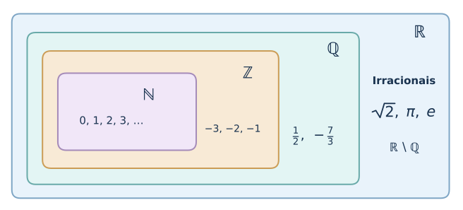
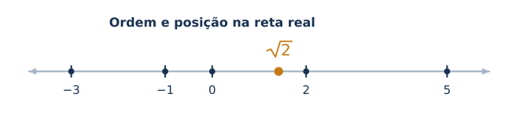
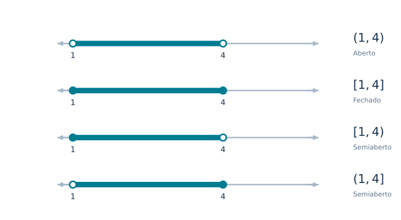
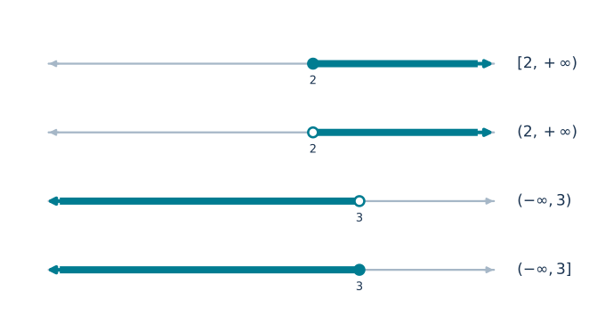
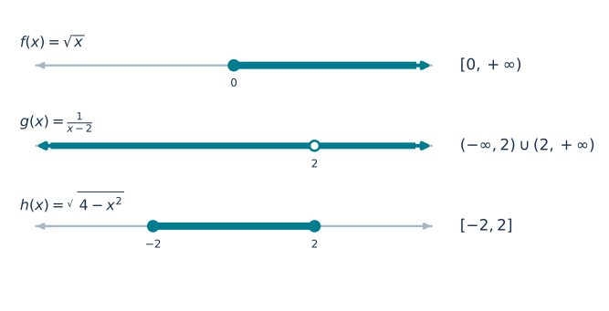
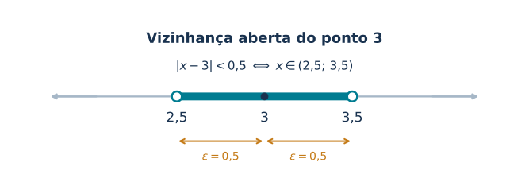
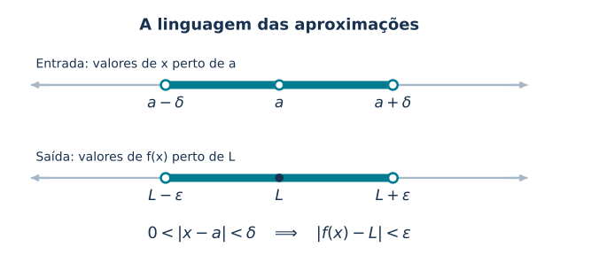

🏠 [← Sumário do Curso](../index.qmd) · [← Cursos de Matemática](../../index.qmd) · [← Seção de Matemática](/posts/matematica/index.qmd)

🎯 **Aula anterior:** 👉 [1.3 Intervalos e Inequações](1.3-intervalos-inequacoes.qmd)

🎯 **Próxima aula:** 👉 [1.5 Equações e Inequações](1.5-equacoes-e-inequacoes.qmd)

***

# 📘 Módulo 1.4: Números Reais e Intervalos

::: {.callout-tip title="💡 Pergunta disparadora"}

Por que o conjunto dos números reais é a base natural para estudar limites, derivadas e integrais?

:::

::: {.callout-note title="📌 Objetivos da aula"}

Ao final desta aula, você deverá ser capaz de:

- reconhecer o conjunto dos números reais como o ambiente natural do Cálculo de uma variável;
- compreender a cadeia de inclusões entre $\mathbb{N}$, $\mathbb{Z}$, $\mathbb{Q}$ e $\mathbb{R}$;
- distinguir números racionais e irracionais;
- compreender, em nível introdutório, a propriedade de completude dos números reais;
- representar subconjuntos da reta real por meio de intervalos;
- interpretar intervalos abertos, fechados, semiabertos e infinitos;
- determinar domínios reais de funções simples;
- relacionar intervalos, valor absoluto e vizinhanças;
- perceber por que essa linguagem será essencial para funções, limites, continuidade, derivadas e integrais.

:::

***

# 🔢 Por que voltar aos números reais?

À primeira vista, pode parecer estranho dedicar uma aula aos números reais depois de já termos estudado conjuntos numéricos, intervalos, inequações e valor absoluto. Mas há uma razão importante para essa retomada: precisamos compreender como essas ideias se articulam no Cálculo.

O Cálculo Diferencial e Integral de uma variável real estuda, em sua forma clássica, **funções reais de variável real**. Podemos representar uma dessas funções por:

$$
A \subseteq \mathbb{R},
\qquad
f:A\longrightarrow\mathbb{R}.
$$

Isso significa que o domínio $A$ é um subconjunto dos números reais e que os valores assumidos pela função pertencem a $\mathbb{R}$.

Quando estudamos limites, perguntamos o que acontece com $f(x)$ quando $x$ se aproxima de um número real. Quando estudamos derivadas, analisamos a variação de uma função nas proximidades de um ponto. Quando estudamos integrais definidas, acumulamos valores ao longo de um intervalo real.

Portanto, antes de avançar para funções e limites, precisamos consolidar algumas ideias:

1. a estrutura dos números reais;
2. sua representação geométrica pela reta real;
3. a linguagem dos intervalos;
4. a interpretação de distância e proximidade;
5. a propriedade de completude que distingue $\mathbb{R}$ de conjuntos numéricos como $\mathbb{Q}$.

Esta aula organiza essas ideias e prepara o terreno para os próximos tópicos.

***

# 📘 A cadeia dos conjuntos numéricos

O conjunto dos números reais é denotado por $\mathbb{R}$. Ele contém os números naturais, inteiros e racionais, além dos números irracionais.

A cadeia de inclusões mais utilizada no Cálculo é:

$$
\mathbb{N}
\subset
\mathbb{Z}
\subset
\mathbb{Q}
\subset
\mathbb{R}.
$$

Cada conjunto amplia o anterior.

::: {.callout-note title="📖 Números naturais"}

Os números naturais são utilizados principalmente para contar:

$$
\mathbb{N}=\{0,1,2,3,\ldots\}.
$$

Alguns autores começam os naturais em $1$. Neste curso, adotaremos a convenção:

$$
\mathbb{N}=\{0,1,2,3,\ldots\}.
$$

:::

::: {.callout-note title="📖 Números inteiros"}

Os números inteiros incluem os naturais, seus opostos e o zero:

$$
\mathbb{Z}
=
\{\ldots,-3,-2,-1,0,1,2,3,\ldots\}.
$$

:::

::: {.callout-note title="📖 Números racionais"}

Os números racionais são aqueles que podem ser escritos como uma razão entre dois números inteiros, com denominador diferente de zero:

$$
\mathbb{Q}
=
\left\{
\frac{p}{q}
\;\middle|\;
p,q\in\mathbb{Z},\ q\neq 0
\right\}.
$$

:::

Exemplos de números racionais são:

$$
\frac{1}{2},
\qquad
-\frac{7}{3},
\qquad
5,
\qquad
0{,}25,
\qquad
1{,}333\ldots
$$

Os números racionais podem ser representados por frações. Em sua representação decimal, apresentam desenvolvimento finito ou periódico.

Todo número inteiro é racional, pois qualquer inteiro $n$ pode ser escrito como:

$$
n=\frac{n}{1}.
$$

Mas nem todo número real é racional. Existem números reais que não podem ser escritos como razão entre dois inteiros. Esses números são chamados **irracionais**.

Exemplos importantes são:

$$
\sqrt{2},
\qquad
\sqrt{3},
\qquad
\pi,
\qquad
e.
$$

Em sua representação decimal, os números irracionais apresentam infinitas casas decimais, sem formar um período repetitivo.

Assim, os números reais são constituídos pelos racionais e pelos irracionais:

$$
\mathbb{R}
=
\mathbb{Q}
\cup
(\mathbb{R}\setminus\mathbb{Q}).
$$

Além disso, esses dois conjuntos não possuem elementos em comum:

$$
\mathbb{Q}
\cap
(\mathbb{R}\setminus\mathbb{Q})
=
\varnothing.
$$

{#fig-conjuntos-numericos width="88%" fig-align="center"}

***

# 🧩 A completude dos números reais

A diferença entre os números racionais e os reais não está apenas na existência de números irracionais. Há uma propriedade estrutural muito importante que caracteriza os números reais: a **completude**.

Em termos intuitivos, dizemos que a reta real não apresenta lacunas. Os números racionais são densos na reta, mas não são suficientes para representar todos os seus pontos. Os irracionais completam essa estrutura.

Uma maneira matemática de expressar essa propriedade é por meio do **supremo**.

Um número $M$ é uma cota superior de um conjunto $S$ quando todos os elementos de $S$ são menores ou iguais a $M$.

O supremo de $S$ é sua menor cota superior. Ele não precisa pertencer ao próprio conjunto.

A propriedade de completude dos reais afirma que:

::: {.callout-note title="📖 Propriedade do supremo"}

Todo subconjunto não vazio de $\mathbb{R}$ que seja limitado superiormente possui supremo em $\mathbb{R}$.

:::

Considere, por exemplo, o conjunto:

$$
S=(0,1).
$$

O número $1$ é o supremo desse conjunto, embora não pertença a ele.

Outro exemplo ajuda a perceber a importância dos irracionais. Considere o conjunto dos números racionais não negativos cujo quadrado é menor que $2$:

$$
A=
\{q\in\mathbb{Q}\mid q\geq 0,\ q^2<2\}.
$$

Esse conjunto é limitado superiormente. Seu supremo em $\mathbb{R}$ é:

$$
\sup A=\sqrt{2}.
$$

Como $\sqrt{2}$ é irracional, esse supremo não pertence a $\mathbb{Q}$. É justamente essa espécie de situação que mostra por que os racionais, isoladamente, não possuem a propriedade de completude dos reais.

Não vamos desenvolver a demonstração formal dessa propriedade agora. O objetivo é reconhecer que a completude será essencial para a fundamentação do Cálculo, especialmente no estudo de limites, continuidade e convergência.

::: {.callout-tip title="💡 Ideia fundamental"}

Os números racionais permitem representar frações e aproximações decimais periódicas. Os irracionais completam a reta numérica. Juntos, eles formam o conjunto dos números reais, que possui a propriedade de completude.

:::

***

# 🔢 A reta real

A interpretação geométrica dos números reais é feita por meio da **reta real**. Cada número real corresponde a um ponto da reta, e cada ponto da reta corresponde a um número real.

Essa correspondência transforma números em geometria e geometria em números.

Na reta real, podemos comparar números. Se $a<b$, então $a$ está à esquerda de $b$. Se $a>b$, então $a$ está à direita de $b$.

Por exemplo:

$$
-3<-1<0<2<5.
$$

Essa relação de ordem será fundamental em todo o curso. Ela aparece em desigualdades, intervalos, domínios de funções, limites laterais, crescimento de funções e regiões de integração.

{#fig-reta-real width="88%" fig-align="center"}

::: {.callout-tip title="💡 Ideia geométrica"}

Pensar em $\mathbb{R}$ como uma reta ajuda a interpretar expressões algébricas como regiões geométricas.

Por exemplo, a desigualdade:

$$
x>2
$$

descreve todos os pontos da reta real que estão à direita de $2$.

:::

***

# 📏 Intervalos como subconjuntos da reta real

Um **intervalo** é um subconjunto $I$ de $\mathbb{R}$ que contém todos os números reais situados entre quaisquer dois de seus elementos.

Em outras palavras, se $x,y\in I$ e $x<y$, então todo número real $z$ que satisfaça:

$$
x<z<y
$$

também pertence a $I$.

Os intervalos podem ser classificados de acordo com a inclusão ou exclusão de suas extremidades.

| Tipo | Notação | Condição |
|---|---|---|
| Aberto | $(a,b)$ | $a<x<b$ |
| Fechado | $[a,b]$ | $a\leq x\leq b$ |
| Semifechado à direita | $[a,b)$ | $a\leq x<b$ |
| Semifechado à esquerda | $(a,b]$ | $a<x\leq b$ |

No intervalo aberto, os extremos não pertencem ao conjunto. No intervalo fechado, ambos pertencem. Nos intervalos semiabertos, apenas um dos extremos está incluído.

Por exemplo:

$$
(1,4)
=
\{x\in\mathbb{R}\mid 1<x<4\}.
$$

Esse intervalo contém números como $2$, $3$, $1{,}5$ e $\sqrt{2}$, mas não contém $1$ nem $4$.

Já o intervalo:

$$
[1,4]
=
\{x\in\mathbb{R}\mid 1\leq x\leq 4\}
$$

contém todos os números reais entre $1$ e $4$, incluindo as duas extremidades.

{#fig-intervalos-finitos width="92%" fig-align="center"}

***

# 📏 Intervalos infinitos

Também utilizamos intervalos que se estendem indefinidamente para a direita ou para a esquerda.

Algumas notações importantes são:

$$
(a,+\infty)
=
\{x\in\mathbb{R}\mid x>a\},
$$

$$
[a,+\infty)
=
\{x\in\mathbb{R}\mid x\geq a\},
$$

$$
(-\infty,b)
=
\{x\in\mathbb{R}\mid x<b\},
$$

e

$$
(-\infty,b]
=
\{x\in\mathbb{R}\mid x\leq b\}.
$$

A própria reta real também pode ser representada por um intervalo:

$$
\mathbb{R}=(-\infty,+\infty).
$$

::: {.callout-warning title="⚠️ Atenção"}

Os símbolos $-\infty$ e $+\infty$ **não são números reais**. Eles indicam apenas que o intervalo se estende indefinidamente para a esquerda ou para a direita.

Por isso, nunca utilizamos colchetes junto de $-\infty$ ou $+\infty$.

Escrevemos:

$$
(-\infty,3]
$$

e não:

$$
[-\infty,3].
$$

:::

{#fig-intervalos-infinitos width="92%" fig-align="center"}

***

# 📏 Intervalos e domínios de funções

Em Cálculo, os intervalos aparecem continuamente.

O domínio de uma função pode ser um intervalo ou uma união de intervalos. A continuidade pode ser estudada em intervalos, e a integral definida é frequentemente calculada sobre um intervalo fechado.

Vamos analisar alguns exemplos.

## ✅ Exemplo 1: raiz quadrada

Considere:

$$
f(x)=\sqrt{x}.
$$

No conjunto dos números reais, essa função está definida para todos os valores de $x$ que satisfaçam:

$$
x\geq 0.
$$

Portanto, seu domínio real é:

$$
D(f)=[0,+\infty).
$$

## ✅ Exemplo 2: função racional

Considere:

$$
g(x)=\frac{1}{x-2}.
$$

Essa função não está definida em $x=2$, pois o denominador seria igual a zero.

Assim, seu domínio é:

$$
D(g)=(-\infty,2)\cup(2,+\infty).
$$

Observe que, nesse caso, o domínio não é um único intervalo, mas a união de dois intervalos.

## ✅ Exemplo 3: raiz com expressão quadrática

Considere:

$$
h(x)=\sqrt{4-x^2}.
$$

Para que essa função esteja definida nos reais, precisamos ter:

$$
4-x^2\geq 0.
$$

Isso equivale a:

$$
x^2\leq 4.
$$

Logo:

$$
-2\leq x\leq 2.
$$

Portanto, o domínio da função é:

$$
D(h)=[-2,2].
$$

Esse exemplo mostra como desigualdades e intervalos aparecem naturalmente quando determinamos o domínio de funções reais.

{#fig-dominios-funcoes width="92%" fig-align="center"}

***

# 📏 Intervalos e valor absoluto

Na aula anterior, estudamos o valor absoluto como uma maneira de representar a distância entre números na reta real.

A distância entre $x$ e $a$ é dada por:

$$
|x-a|.
$$

Assim, para $\varepsilon>0$, a desigualdade:

$$
|x-a|<\varepsilon
$$

significa que a distância entre $x$ e $a$ é menor que $\varepsilon$.

Essa condição é equivalente a:

$$
a-\varepsilon<x<a+\varepsilon.
$$

Em notação de intervalo:

$$
x\in(a-\varepsilon,a+\varepsilon).
$$

::: {.callout-note title="📖 Vizinhança aberta"}

Uma vizinhança aberta de centro $a$ e raio $\varepsilon>0$ é o intervalo:

$$
(a-\varepsilon,a+\varepsilon).
$$

De maneira equivalente, podemos representá-la por:

$$
|x-a|<\varepsilon.
$$

O número $a$ é o centro da vizinhança, e $\varepsilon$ determina seu raio.

:::

Por exemplo, se $a=3$ e $\varepsilon=0{,}5$, a vizinhança aberta de centro $3$ e raio $0{,}5$ é:

$$
(3-0{,}5,3+0{,}5)
=
(2{,}5,3{,}5).
$$

Esse intervalo contém todos os números reais que estão a uma distância menor que $0{,}5$ de $3$.

{#fig-vizinhanca width="88%" fig-align="center"}

***

# 🎯 Por que vizinhanças importam para limites?

A ideia de intervalo não é apenas uma notação conveniente. Ela é uma linguagem fundamental para descrever aproximações.

Quando escrevemos:

$$
x\to a,
$$

queremos estudar o comportamento de uma função quando $x$ se aproxima de um número real $a$.

Isso significa observar valores de $x$ cada vez mais próximos de $a$, isto é, valores pertencentes a vizinhanças cada vez menores desse ponto.

Uma ideia importante é que, no estudo de limites, não precisamos necessariamente que $x$ seja igual a $a$. O que importa é o comportamento da função quando $x$ se aproxima de $a$, sem assumir esse valor.

Por isso, aparece a condição:

$$
0<|x-a|<\delta.
$$

Ela indica que $x$ está a uma distância positiva de $a$, mas menor que $\delta$. Em outras palavras, $x$ pertence a uma vizinhança perfurada de centro $a$ e raio $\delta$.

No estudo de limites, procuramos garantir que, quando $x$ estiver suficientemente próximo de $a$, o valor de $f(x)$ também estará próximo de um número $L$.

A estrutura central dessa ideia é:

$$
0<|x-a|<\delta
\quad\Longrightarrow\quad
|f(x)-L|<\varepsilon.
$$

Nessa expressão:

- $\delta>0$ controla a proximidade de $x$ em relação a $a$;
- $\varepsilon>0$ controla a proximidade de $f(x)$ em relação a $L$;
- a primeira desigualdade descreve uma vizinhança perfurada de $a$;
- a segunda descreve uma vizinhança de $L$.

A definição formal de limite utiliza essa ideia de maneira precisa. Para uma função $f:A\to\mathbb{R}$, com $a$ sendo um ponto de acumulação do domínio $A$, a afirmação:

$$
\lim_{x\to a}f(x)=L
$$

significa que:

$$
\forall\varepsilon>0,\ \exists\delta>0
$$

tal que, para todo $x\in A$,

$$
0<|x-a|<\delta
\quad\Longrightarrow\quad
|f(x)-L|<\varepsilon.
$$

Não é necessário dominar agora todos os detalhes dessa definição. O importante é perceber como ela utiliza as ideias de distância, valor absoluto, intervalos e vizinhanças que estamos estudando.

{#fig-aproximacoes-limites width="92%" fig-align="center"}

***

# 📦 Síntese da aula

Nesta aula, revisamos o conjunto dos números reais $\mathbb{R}$ e sua relação com os conjuntos $\mathbb{N}$, $\mathbb{Z}$ e $\mathbb{Q}$.

Distinguimos números racionais e irracionais e introduzimos a propriedade de completude dos reais, expressa pela existência do supremo para todo subconjunto não vazio e limitado superiormente.

Retomamos a representação geométrica dos números reais por meio da reta real e sua relação de ordem.

Também organizamos a notação de intervalos abertos, fechados, semiabertos e infinitos. Observamos que intervalos são fundamentais para representar domínios de funções e subconjuntos da reta real.

Por fim, conectamos intervalos com valor absoluto e introduzimos a ideia de vizinhança de um ponto, preparando a linguagem necessária para o estudo de limites.

***

# 🧾 Quadro-resumo — Números Reais e Intervalos

| Ideia | Significado | Papel no Cálculo |
|---|---|---|
| $\mathbb{R}$ | Conjunto dos números reais | Ambiente natural das funções reais de uma variável |
| Racionais | Números que podem ser escritos como fração de inteiros | Representam frações e decimais finitos ou periódicos |
| Irracionais | Reais que não são racionais | Completam a reta real junto com os racionais |
| Completude | Propriedade expressa pela existência do supremo | Fundamenta resultados importantes do Cálculo |
| Reta real | Representação geométrica dos números reais | Permite visualizar ordem, distância e aproximação |
| Intervalo aberto | Intervalo que não inclui as extremidades | Descreve proximidades sem incluir os pontos finais |
| Intervalo fechado | Intervalo que inclui as extremidades | Aparece em domínios e problemas com extremos incluídos |
| Intervalo semiaberto | Intervalo que inclui apenas uma extremidade | Representa condições inclusivas e exclusivas |
| Intervalo infinito | Intervalo que se estende indefinidamente | Descreve regiões como $x>a$ ou $x\leq b$ |
| Domínio de função | Conjunto dos valores permitidos para $x$ | Muitas vezes é descrito por intervalos |
| Valor absoluto | Mede distância na reta real | Permite representar proximidades |
| Vizinhança | Intervalo aberto ao redor de um ponto | Prepara a linguagem formal dos limites |

***

::: {.callout-tip title="🌉 Ponte para o Cálculo"}

Na definição de limite, controlamos a proximidade de \(x\) a \(a\) por meio de \(\delta\), e a proximidade de \(f(x)\) a \(L\) por meio de \(\varepsilon\). **Intervalos, valor absoluto e vizinhanças** fornecem a linguagem matemática para formular essa ideia com precisão.

:::

# 🧪 Exercícios propostos

::: {.callout-note title="📝 Exercícios"}

## 🧪 Exercício 1

Indique todos os conjuntos numéricos aos quais cada número pertence, considerando a convenção adotada neste curso para os números naturais:

a) $7$

b) $-4$

c) $\dfrac{3}{5}$

d) $\sqrt{2}$

e) $\pi$

f) $0$

## 🧪 Exercício 2

Escreva em notação de intervalo:

a) $\{x\in\mathbb{R}\mid -2<x<5\}$

b) $\{x\in\mathbb{R}\mid x\geq 3\}$

c) $\{x\in\mathbb{R}\mid x\leq 1\}$

d) $\{x\in\mathbb{R}\mid -1\leq x<4\}$

## 🧪 Exercício 3

Escreva em forma de desigualdade:

a) $(0,7)$

b) $[-3,2]$

c) $(-\infty,5]$

d) $(4,+\infty)$

## 🧪 Exercício 4

Determine o domínio real das funções:

a) $f(x)=\sqrt{x-1}$

b) $g(x)=\dfrac{1}{x+3}$

c) $h(x)=\sqrt{9-x^2}$

## 🧪 Exercício 5

Escreva a desigualdade:

$$
|x-2|<0{,}1
$$

na forma de intervalo.

:::

***

# ✅ Gabarito comentado

::: {.callout-important collapse="true" title="✅ Gabarito comentado"}

## 🧪 Exercício 1

a) $7$ é natural, inteiro, racional e real:

$$
7\in\mathbb{N},\mathbb{Z},\mathbb{Q},\mathbb{R}.
$$

b) $-4$ é inteiro, racional e real:

$$
-4\in\mathbb{Z},\mathbb{Q},\mathbb{R}.
$$

c) $\dfrac{3}{5}$ é racional e real:

$$
\frac{3}{5}\in\mathbb{Q},\mathbb{R}.
$$

d) $\sqrt{2}$ é irracional e real:

$$
\sqrt{2}\in\mathbb{R}\setminus\mathbb{Q}.
$$

e) $\pi$ é irracional e real:

$$
\pi\in\mathbb{R}\setminus\mathbb{Q}.
$$

f) $0$ é natural, inteiro, racional e real, segundo a convenção adotada neste curso:

$$
0\in\mathbb{N},\mathbb{Z},\mathbb{Q},\mathbb{R}.
$$

## 🧪 Exercício 2

a)

$$
(-2,5)
$$

b)

$$
[3,+\infty)
$$

c)

$$
(-\infty,1]
$$

d)

$$
[-1,4)
$$

## 🧪 Exercício 3

a)

$$
0<x<7
$$

b)

$$
-3\leq x\leq 2
$$

c)

$$
x\leq 5
$$

d)

$$
x>4
$$

## 🧪 Exercício 4

**a)** Para:

$$
f(x)=\sqrt{x-1},
$$

precisamos que o radicando seja não negativo:

$$
x-1\geq 0.
$$

Logo:

$$
x\geq 1.
$$

O domínio é:

$$
D(f)=[1,+\infty).
$$

**b)** Para:

$$
g(x)=\frac{1}{x+3},
$$

o denominador não pode ser igual a zero:

$$
x+3\neq 0.
$$

Portanto:

$$
x\neq -3.
$$

O domínio é:

$$
D(g)=(-\infty,-3)\cup(-3,+\infty).
$$

**c)** Para:

$$
h(x)=\sqrt{9-x^2},
$$

precisamos que:

$$
9-x^2\geq 0.
$$

Assim:

$$
x^2\leq 9.
$$

Logo:

$$
-3\leq x\leq 3.
$$

O domínio é:

$$
D(h)=[-3,3].
$$

## 🧪 Exercício 5

Temos:

$$
|x-2|<0{,}1.
$$

Pela interpretação do valor absoluto como distância:

$$
2-0{,}1<x<2+0{,}1.
$$

Portanto:

$$
1{,}9<x<2{,}1.
$$

Em notação de intervalo:

$$
(1{,}9,2{,}1).
$$

:::

***

# 🧩 Quiz — Números Reais e Intervalos

:::::{.question}

**Q1.** Qual afirmação descreve corretamente a relação entre os números racionais, irracionais e reais?

::::{.choices}

:::{.choice}
Todo número real é racional.
:::

:::{.choice .correct-choice}
Todo número racional é real, e existem números reais que são irracionais.
:::

:::{.choice}
Os números irracionais não pertencem ao conjunto dos números reais.
:::

::::

:::::

:::::{.question}

**Q2.** O número $\sqrt{3}$ pertence a quais conjuntos numéricos?

::::{.choices}

:::{.choice}
Aos conjuntos dos naturais, inteiros e racionais.
:::

:::{.choice .correct-choice}
Ao conjunto dos irracionais e ao conjunto dos reais.
:::

:::{.choice}
Apenas ao conjunto dos racionais.
:::

::::

:::::

:::::{.question}

**Q3.** O intervalo $[2,5)$ representa:

::::{.choices}

:::{.choice .correct-choice}
Todos os reais $x$ tais que $2\leq x<5$.
:::

:::{.choice}
Todos os reais $x$ tais que $2<x\leq 5$.
:::

:::{.choice}
Apenas os números inteiros entre $2$ e $5$.
:::

::::

:::::

:::::{.question}

**Q4.** Qual intervalo representa o conjunto dos números reais $x$ que satisfazem $x\geq -1$?

::::{.choices}

:::{.choice}
$(-1,+\infty)$
:::

:::{.choice .correct-choice}
$[-1,+\infty)$
:::

:::{.choice}
$(-\infty,-1]$
:::

::::

:::::

:::::{.question}

**Q5.** Qual é o domínio real da função $h(x)=\sqrt{9-x^2}$?

::::{.choices}

:::{.choice}
$[-9,9]$
:::

:::{.choice}
$(-3,3)$
:::

:::{.choice .correct-choice}
$[-3,3]$
:::

::::

:::::

:::::{.question}

**Q6.** A desigualdade $|x-2|<0{,}1$ representa qual intervalo?

::::{.choices}

:::{.choice}
$[1{,}9,2{,}1]$
:::

:::{.choice .correct-choice}
$(1{,}9,2{,}1)$
:::

:::{.choice}
$(1{,}8,2{,}2)$
:::

::::

:::::

:::::{.question}

**Q7.** Qual afirmação expressa a propriedade do supremo dos números reais?

::::{.choices}

:::{.choice}
Todo subconjunto não vazio dos reais possui um elemento máximo.
:::

:::{.choice}
Todo conjunto limitado de números reais possui simultaneamente máximo e mínimo.
:::

:::{.choice .correct-choice}
Todo subconjunto não vazio dos reais que é limitado superiormente possui supremo em $\mathbb{R}$.
:::

::::

:::::

***

::: {.callout-tip title="🔬 Quer aprofundar?"}

Este aprofundamento é opcional. Você pode explorá-lo agora ou seguir as aulas principais e voltar quando quiser.

- [1.20-AP — Valor Absoluto, Distância e Vizinhanças](1.20-AP-valor-absoluto-distancia-vizinhancas.qmd) — Distâncias, vizinhanças e a linguagem que prepara o estudo de limites.

:::

***

# 🔗 Navegação

🎯 **Aula anterior:** 👉 [1.3 Intervalos e Inequações](1.3-intervalos-inequacoes.qmd)

🎯 **Próxima aula:** 👉 [1.5 Equações e Inequações](1.5-equacoes-e-inequacoes.qmd)

🏠 [← Sumário do Curso](../index.qmd) · [← Cursos de Matemática](../../index.qmd) · [← Seção de Matemática](/posts/matematica/index.qmd) · 🔝 [Voltar ao topo](#)

***

*Blog do Marcellini — Explorando a Matemática com Rigor e Beleza.*

:::{.callout-note}
Criado por Blog do Marcellini com ❤️ e código.
:::