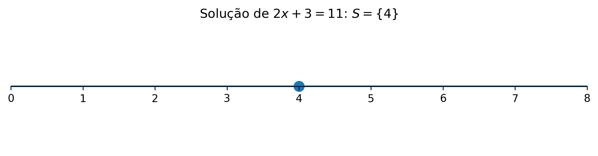
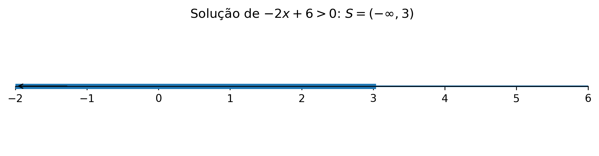
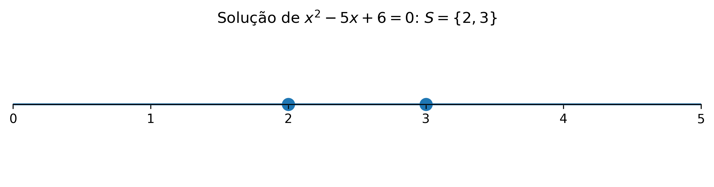
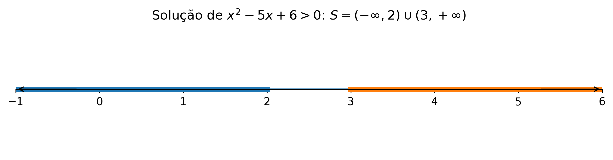
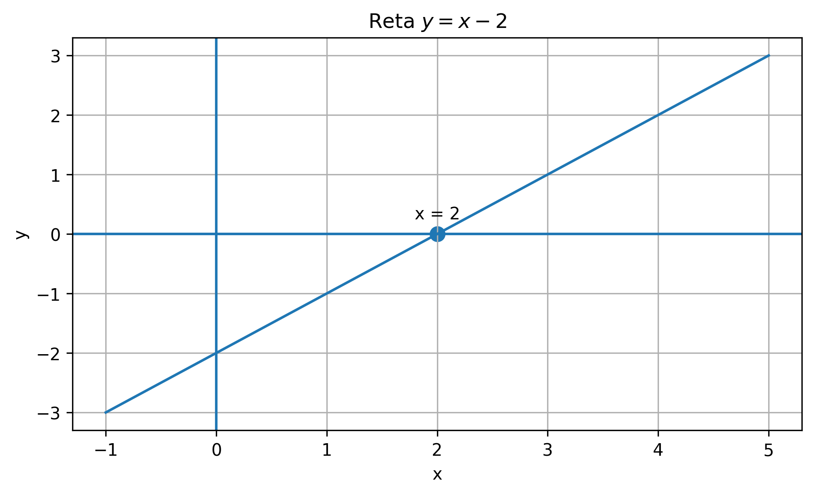
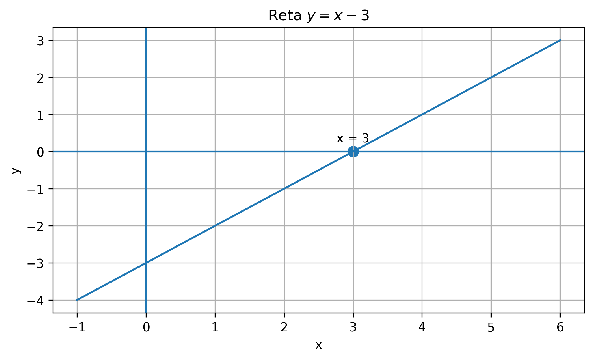
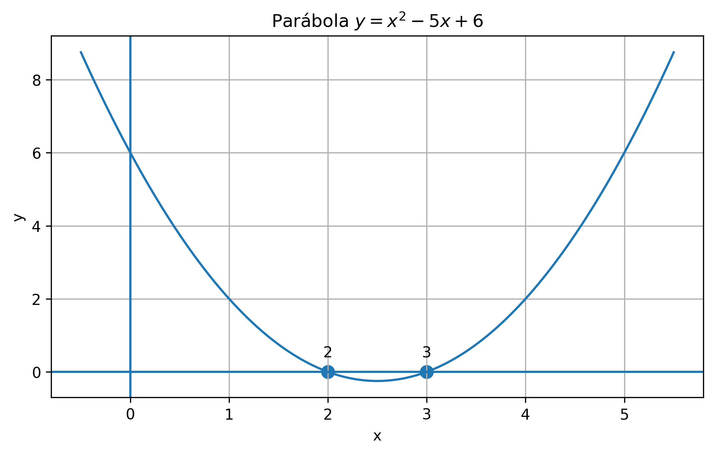
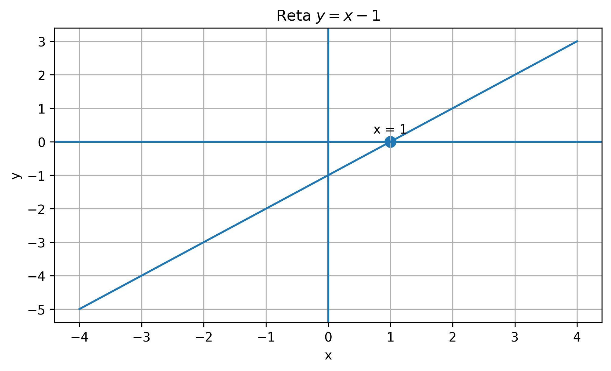
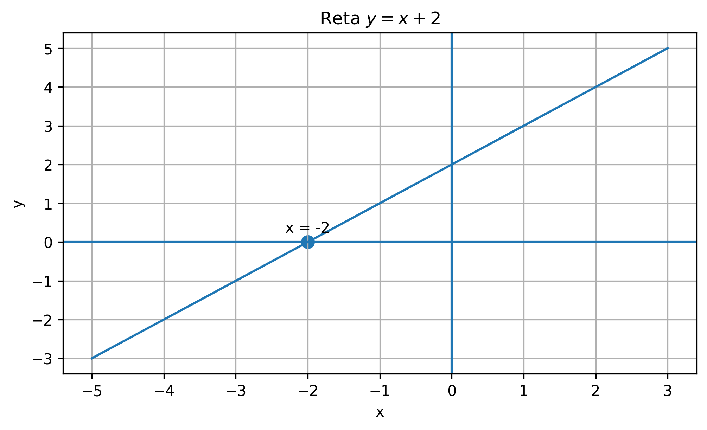
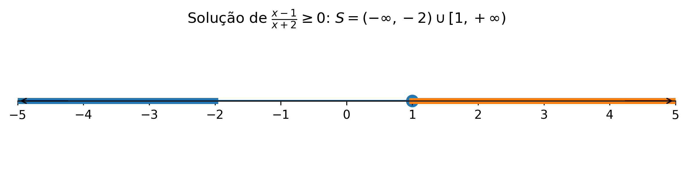

🏠 [← Sumário do Curso](../index.qmd) · [← Cursos de Matemática](../../index.qmd) · [← Seção de Matemática](/posts/matematica/index.qmd)

🎯 **Post Anterior:** 👉 [1.4 Números Reais e Intervalos](1.4-numeros-reais-e-intervalos.qmd)

***

::: {.callout-tip title="❓ Pergunta Disparadora"}
Como resolver condições algébricas e interpretar suas soluções na reta real?
:::

::: {.callout-note title="📌 Objetivos do Post"}
- Revisar equações e inequações como ferramentas para descrever condições matemáticas;
- Interpretar soluções em linguagem algébrica, intervalar e gráfica;
- Preparar o uso de equações, inequações e estudo de sinais no Cálculo.
:::

# 📘 Equações e Inequações

No estudo dos números reais, dos intervalos e do valor absoluto, aprendemos a descrever subconjuntos da reta real. Agora vamos usar essa linguagem para resolver **equações** e **inequações**.

Uma equação pergunta:

> Para quais valores de $x$ duas expressões são iguais?

Uma inequação pergunta:

> Para quais valores de $x$ uma expressão é maior, menor, maior ou igual, ou menor ou igual a outra?

Em ambos os casos, a resposta não é apenas um número isolado. Muitas vezes a resposta é um **conjunto de números reais**, que pode ser descrito por intervalos, uniões de intervalos ou pontos isolados.

***

## 💡 A ideia de solução

Considere a equação

$$
2x+3=11.
$$

Resolver essa equação significa encontrar todos os valores reais de $x$ que tornam a igualdade verdadeira. Subtraindo $3$ dos dois lados, obtemos

$$
2x=8.
$$

Dividindo por $2$,

$$
x=4.
$$

Portanto, o conjunto solução é

$$
S=\{4\}.
$$

Nesse caso, a solução é formada por um único número.

A reta real abaixo representa esse conjunto-solução com um único ponto:

{fig-align="center" width="85%"}

Já na inequação

$$
2x+3<11,
$$

subtraímos $3$ dos dois lados:

$$
2x<8.
$$

Dividindo por $2$,

$$
x<4.
$$

Agora a solução não é um número isolado, mas todo o intervalo

$$
S=(-\infty,4).
$$

***

## 🧮 Equações lineares

Uma equação linear em uma variável pode ser escrita, depois de simplificações, na forma

$$
ax+b=0,
$$

com $a\neq 0$.

Nesse caso,

$$
ax=-b
$$

e, portanto,

$$
x=-\frac{b}{a}.
$$

Por exemplo:

$$
3x-12=0.
$$

Então

$$
3x=12
$$

e

$$
x=4.
$$

Logo,

$$
S=\{4\}.
$$

***

## ⚖️ Inequações lineares

Uma inequação linear pode ter formas como

$$
ax+b>0,\qquad ax+b<0,\qquad ax+b\geq 0,\qquad ax+b\leq 0.
$$

A resolução é parecida com a de uma equação, mas há um cuidado essencial:

::: {.callout-warning title="Cuidado com o sinal da desigualdade"}
Ao multiplicar ou dividir uma inequação por um número negativo, o sentido da desigualdade se inverte.
:::

Por exemplo:

$$
-2x+6>0.
$$

Subtraindo $6$ dos dois lados:

$$
-2x>-6.
$$

Agora dividimos por $-2$. Como estamos dividindo por um número negativo, invertemos o sinal:

$$
x<3.
$$

Assim,

$$
S=(-\infty,3).
$$

Na reta real, a solução aparece como uma semirreta para a esquerda, com bolinha aberta em $3$:

{fig-align="center" width="85%"}

***

## 🧮 Equações quadráticas

Uma equação quadrática tem a forma

$$
ax^2+bx+c=0,
$$

com $a\neq 0$.

O método mais conhecido para resolvê-la é a fórmula de Bhaskara:

$$
x=\frac{-b\pm\sqrt{\Delta}}{2a},
$$

onde

$$
\Delta=b^2-4ac.
$$

A quantidade $\Delta$ é chamada de **discriminante**.

- Se $\Delta>0$, há duas raízes reais distintas.
- Se $\Delta=0$, há uma raiz real dupla.
- Se $\Delta<0$, não há raízes reais.

Por exemplo:

$$
x^2-5x+6=0.
$$

Temos

$$
a=1,\qquad b=-5,\qquad c=6.
$$

Logo,

$$
\Delta=(-5)^2-4\cdot 1\cdot 6=25-24=1.
$$

Assim,

$$
x=\frac{5\pm 1}{2}.
$$

Portanto,

$$
x=2
$$

ou

$$
x=3.
$$

Logo,

$$
S=\{2,3\}.
$$

Na reta real, isso corresponde a dois pontos isolados:

{fig-align="center" width="85%"}

***

## ⚖️ Inequações quadráticas

Para resolver uma inequação quadrática, é útil pensar no sinal de um produto.

Considere

$$
x^2-5x+6>0.
$$

Fatorando,

$$
x^2-5x+6=(x-2)(x-3).
$$

Então precisamos resolver

$$
(x-2)(x-3)>0.
$$

Os pontos críticos são

$$
x=2
$$

e

$$
x=3.
$$

Eles dividem a reta em três intervalos:

$$
(-\infty,2),\qquad (2,3),\qquad (3,+\infty).
$$

Testando o sinal em cada intervalo:

- em $(-\infty,2)$, os dois fatores são negativos, então o produto é positivo;
- em $(2,3)$, um fator é positivo e o outro negativo, então o produto é negativo;
- em $(3,+\infty)$, os dois fatores são positivos, então o produto é positivo.

Como queremos o produto positivo, obtemos

$$
S=(-\infty,2)\cup(3,+\infty).
$$

Na reta real, a solução é a união de dois intervalos abertos:

{fig-align="center" width="85%"}

***

## 📊 Estudo gráfico do sinal e tabela de sinais

A tabela de sinais não precisa ser vista como um truque mecânico. Ela pode ser entendida a partir do estudo gráfico das funções associadas aos fatores do produto ou do quociente.

A ideia central é simples:

- quando o gráfico de uma função está **acima** do eixo $x$, a função é **positiva**;
- quando o gráfico está **abaixo** do eixo $x$, a função é **negativa**;
- quando o gráfico toca ou cruza o eixo $x$, temos um **zero** da função.

Assim, a tabela de sinais organiza, em forma resumida, aquilo que já observamos graficamente.

***

## 📐 Estudo gráfico dos fatores em uma inequação produto

Retomemos a inequação

$$
(x-2)(x-3)>0.
$$

Antes de montar a tabela de sinais, podemos estudar os gráficos dos fatores separadamente.

### 📈 Fator 1: a reta $y=x-2$

A reta $y=x-2$ zera em $x=2$.

- Para $x<2$, temos $x-2<0$, então o gráfico fica abaixo do eixo $x$.
- Para $x>2$, temos $x-2>0$, então o gráfico fica acima do eixo $x$.

{fig-align="center" width="75%"}

### 📈 Fator 2: a reta $y=x-3$

A reta $y=x-3$ zera em $x=3$.

- Para $x<3$, temos $x-3<0$, então o gráfico fica abaixo do eixo $x$.
- Para $x>3$, temos $x-3>0$, então o gráfico fica acima do eixo $x$.

{fig-align="center" width="75%"}

### 📊 Tabela de sinais do produto

Agora que já sabemos o sinal de cada fator, podemos resumir tudo na tabela a seguir.

| Intervalo | $x-2$ | $x-3$ | $(x-2)(x-3)$ |
|---|---:|---:|---:|
| $(-\infty,2)$ | $-$ | $-$ | $+$ |
| $(2,3)$ | $+$ | $-$ | $-$ |
| $(3,+\infty)$ | $+$ | $+$ | $+$ |

Como queremos

$$
(x-2)(x-3)>0,
$$

escolhemos os intervalos em que o produto é positivo. Portanto,

$$
S=(-\infty,2)\cup(3,+\infty).
$$

### 🧮 Confirmação pela parábola associada

Também podemos juntar os fatores e olhar diretamente para a função

$$
y=(x-2)(x-3)=x^2-5x+6.
$$

Seu gráfico é uma parábola com raízes em $x=2$ e $x=3$.

- Fora do intervalo entre as raízes, a parábola fica acima do eixo $x$, então a função é positiva;
- Entre as raízes, a parábola fica abaixo do eixo $x$, então a função é negativa.

{fig-align="center" width="78%"}

Esse estudo gráfico confirma exatamente a tabela de sinais.

***

## ➗ Estudo gráfico dos fatores em uma inequação quociente

Agora consideremos a inequação racional

$$
\frac{x-1}{x+2}\geq 0.
$$

Novamente, começamos estudando separadamente o numerador e o denominador.

### 📈 Numerador: a reta $y=x-1$

A reta $y=x-1$ zera em $x=1$.

- Para $x<1$, o numerador é negativo;
- Para $x>1$, o numerador é positivo.

{fig-align="center" width="75%"}

### 📈 Denominador: a reta $y=x+2$

A reta $y=x+2$ zera em $x=-2$.

- Para $x<-2$, o denominador é negativo;
- Para $x>-2$, o denominador é positivo.

{fig-align="center" width="75%"}

### 📊 Tabela de sinais do quociente

Os pontos críticos são $x=-2$ e $x=1$. Eles dividem a reta nos intervalos:

$$
(-\infty,-2),\qquad (-2,1),\qquad (1,+\infty).
$$

A tabela de sinais fica:

| Intervalo | $x-1$ | $x+2$ | $\dfrac{x-1}{x+2}$ |
|---|---:|---:|---:|
| $(-\infty,-2)$ | $-$ | $-$ | $+$ |
| $(-2,1)$ | $-$ | $+$ | $-$ |
| $(1,+\infty)$ | $+$ | $+$ | $+$ |

Como queremos

$$
\frac{x-1}{x+2}\geq 0,
$$

escolhemos os intervalos em que o quociente é positivo e também o ponto em que o numerador zera.

Assim:

- $x=-2$ fica excluído, porque zera o denominador;
- $x=1$ fica incluído, porque zera o numerador e a desigualdade aceita igualdade.

Logo,

$$
S=(-\infty,-2)\cup[1,+\infty).
$$

Esse procedimento mostra que a tabela de sinais é um resumo do estudo gráfico do sinal de cada fator.

***

## ⚖️ Inequações racionais

Uma inequação racional envolve quocientes de expressões algébricas. Por exemplo:

$$
\frac{x-1}{x+2}\geq 0.
$$

Aqui há dois pontos importantes:

1. o numerador zera em $x=1$;
2. o denominador zera em $x=-2$, mas esse valor não pertence ao domínio.

Os pontos $-2$ e $1$ dividem a reta em três intervalos:

$$
(-\infty,-2),\qquad (-2,1),\qquad (1,+\infty).
$$

Analisando sinais:

- em $(-\infty,-2)$, numerador e denominador são negativos, então o quociente é positivo;
- em $(-2,1)$, numerador negativo e denominador positivo, então o quociente é negativo;
- em $(1,+\infty)$, numerador e denominador positivos, então o quociente é positivo.

Como a inequação é

$$
\frac{x-1}{x+2}\geq 0,
$$

incluímos $x=1$, pois o numerador pode ser zero, mas excluímos $x=-2$, pois o denominador não pode ser zero.

Logo,

$$
S=(-\infty,-2)\cup[1,+\infty).
$$

A representação na reta real ajuda a distinguir o ponto excluído do domínio e o ponto incluído na solução:

{fig-align="center" width="85%"}

***

## 🧮 Equações, inequações e domínio

No Cálculo, equações e inequações aparecem o tempo todo na determinação de domínios.

Por exemplo, para a função

$$
f(x)=\sqrt{x-4},
$$

precisamos que

$$
x-4\geq 0.
$$

Logo,

$$
x\geq 4,
$$

e o domínio é

$$
[4,+\infty).
$$

Para a função

$$
g(x)=\frac{1}{x^2-9},
$$

precisamos que

$$
x^2-9\neq 0.
$$

Como

$$
x^2-9=(x-3)(x+3),
$$

temos

$$
x\neq 3
$$

e

$$
x\neq -3.
$$

Portanto,

$$
D_g=(-\infty,-3)\cup(-3,3)\cup(3,+\infty).
$$

***

## 🌉 Por que isso importa para o Cálculo?

Antes de estudar limites, derivadas e integrais, precisamos saber **onde** uma função está definida, **em quais intervalos** uma expressão é positiva ou negativa e **quais valores** tornam uma condição verdadeira.

Por isso, equações e inequações não são apenas técnicas algébricas. Elas são ferramentas para investigar o comportamento das funções.

No próximo passo, começaremos a organizar as principais famílias de funções que aparecem no Cálculo.

***

## 🧾 Quadro-resumo

| Ideia | Significado | Papel no Cálculo |
|---|---|---|
| Equação | Igualdade com incógnita | Usada para encontrar valores específicos que satisfazem uma condição |
| Conjunto-solução | Conjunto de todos os valores que resolvem uma equação ou inequação | Pode ser ponto, intervalo ou união de intervalos |
| Equação linear | Equação do tipo \(ax+b=0\), com \(a\neq 0\) | Produz, em geral, uma única solução real |
| Inequação linear | Desigualdade envolvendo uma expressão de primeiro grau | Produz intervalos ou semirretas na reta real |
| Multiplicação por número negativo | Operação que inverte o sentido da desigualdade | É um cuidado essencial na resolução de inequações |
| Equação quadrática | Equação do tipo \(ax^2+bx+c=0\), com \(a\neq 0\) | Suas soluções são os zeros de uma parábola |
| Inequação quadrática | Desigualdade envolvendo uma expressão de segundo grau | Pode ser resolvida por fatoração, gráfico ou tabela de sinais |
| Tabela de sinais | Organização dos sinais dos fatores em cada intervalo | Ajuda a resolver inequações produto e quociente |
| Inequação racional | Inequação envolvendo quociente de expressões algébricas | Exige atenção ao domínio e aos pontos excluídos |
| Domínio | Conjunto dos valores permitidos para \(x\) | Muitas vezes é determinado por equações e inequações |

***

# 🧪 Exercícios propostos

::: {.callout-note title="📝 Exercícios"}

## 🧪 Exercício 1

Resolva as equações lineares:

a) $3x-9=0$  
b) $2x+5=17$  
c) $-4x+8=0$

## 🧪 Exercício 2

Resolva as inequações lineares e escreva a resposta em notação de intervalo:

a) $2x-6>0$  
b) $5-x\leq 2$  
c) $-3x+12>0$

## 🧪 Exercício 3

Resolva as equações quadráticas:

a) $x^2-9=0$  
b) $x^2-5x+6=0$  
c) $x^2+2x+1=0$

## 🧪 Exercício 4

Resolva as inequações quadráticas:

a) $x^2-4>0$  
b) $x^2-4\leq 0$  
c) $x^2-3x+2>0$

## 🧪 Exercício 5

Determine o domínio real das funções:

a) $f(x)=\sqrt{x+2}$  
b) $g(x)=\dfrac{1}{x-5}$  
c) $h(x)=\dfrac{1}{x^2-4}$  
d) $p(x)=\sqrt{4-x}$

:::

***

::: {.callout-important collapse=true title="✅ Gabarito"}

# ✅ Gabarito comentado

## 🧪 Exercício 1

a) $3x-9=0$ implica $3x=9$, logo $x=3$. Portanto, $S=\{3\}$.  

b) $2x+5=17$ implica $2x=12$, logo $x=6$. Portanto, $S=\{6\}$.  

c) $-4x+8=0$ implica $-4x=-8$, logo $x=2$. Portanto, $S=\{2\}$.

## 🧪 Exercício 2

a) $2x-6>0$ implica $2x>6$, logo $x>3$. Portanto, $S=(3,+\infty)$.  

b) $5-x\leq 2$ implica $-x\leq -3$. Dividindo por $-1$, invertemos o sinal: $x\geq 3$. Portanto, $S=[3,+\infty)$.  

c) $-3x+12>0$ implica $-3x>-12$. Dividindo por $-3$, invertemos o sinal: $x<4$. Portanto, $S=(-\infty,4)$.

## 🧪 Exercício 3

a) $x^2-9=0$ implica $x^2=9$, logo $x=-3$ ou $x=3$. Portanto, $S=\{-3,3\}$.  

b) $x^2-5x+6=0$ fatorando dá $(x-2)(x-3)=0$. Logo, $S=\{2,3\}$.  

c) $x^2+2x+1=0$ fatorando dá $(x+1)^2=0$. Logo, $S=\{-1\}$.

## 🧪 Exercício 4

a) $x^2-4>0$ equivale a $(x-2)(x+2)>0$. O produto é positivo fora das raízes. Logo, $S=(-\infty,-2)\cup(2,+\infty)$.  

b) $x^2-4\leq 0$ equivale a $(x-2)(x+2)\leq 0$. O produto é não positivo entre as raízes, incluindo-as. Logo, $S=[-2,2]$.  

c) $x^2-3x+2>0$ equivale a $(x-1)(x-2)>0$. O produto é positivo fora das raízes. Logo, $S=(-\infty,1)\cup(2,+\infty)$.

## 🧪 Exercício 5

a) Para $f(x)=\sqrt{x+2}$, precisamos de $x+2\geq 0$, isto é, $x\geq -2$. Logo, $D_f=[-2,+\infty)$.  

b) Para $g(x)=\dfrac{1}{x-5}$, precisamos de $x-5\neq 0$, isto é, $x\neq 5$. Logo, $D_g=(-\infty,5)\cup(5,+\infty)$.  

c) Para $h(x)=\dfrac{1}{x^2-4}$, precisamos de $x^2-4\neq 0$. Como $x^2-4=(x-2)(x+2)$, temos $x\neq -2$ e $x\neq 2$. Logo, $D_h=(-\infty,-2)\cup(-2,2)\cup(2,+\infty)$.  

d) Para $p(x)=\sqrt{4-x}$, precisamos de $4-x\geq 0$, isto é, $x\leq 4$. Logo, $D_p=(-\infty,4]$.

:::

***

# 🧩 Quiz — Equações e Inequações

:::::{.question}
**Q1.** Resolver uma equação significa encontrar:

::::{.choices}
:::{.choice .correct-choice}
Todos os valores da variável que tornam a igualdade verdadeira.
:::

:::{.choice}
Apenas valores positivos da variável.
:::

:::{.choice}
Somente os pontos onde a expressão não está definida.
:::
::::
:::::

:::::{.question}
**Q2.** Ao dividir uma inequação por um número negativo, devemos:

::::{.choices}
:::{.choice}
Manter o sentido da desigualdade.
:::

:::{.choice .correct-choice}
Inverter o sentido da desigualdade.
:::

:::{.choice}
Trocar a inequação por uma equação.
:::
::::
:::::

:::::{.question}
**Q3.** Na inequação racional $\dfrac{x-1}{x+2}\geq 0$, o valor $x=-2$ deve ser excluído porque:

::::{.choices}
:::{.choice}
Ele torna o numerador igual a zero.
:::

:::{.choice .correct-choice}
Ele torna o denominador igual a zero.
:::

:::{.choice}
Ele é sempre negativo.
:::
::::
:::::

***

# 🔗 Navegação

🎯 **Post Anterior:** 👉 [1.4 Números Reais e Intervalos](1.4-numeros-reais-e-intervalos.qmd)
  
🎯 **Próximo Post:** 👉 [1.6 Funções Elementares](1.6-funcoes-elementares.qmd)
 
🏠 [Sumário do Curso](../index.qmd) · [← Cursos de Matemática](../../index.qmd) · 🔝 [Topo](1.5-equacoes-e-inequacoes.qmd)

***

*Blog do Marcellini — Explorando a Matemática com Rigor e Beleza.*

:::{.callout-note}
Criado por Blog do Marcellini com ❤️ e código.
:::

