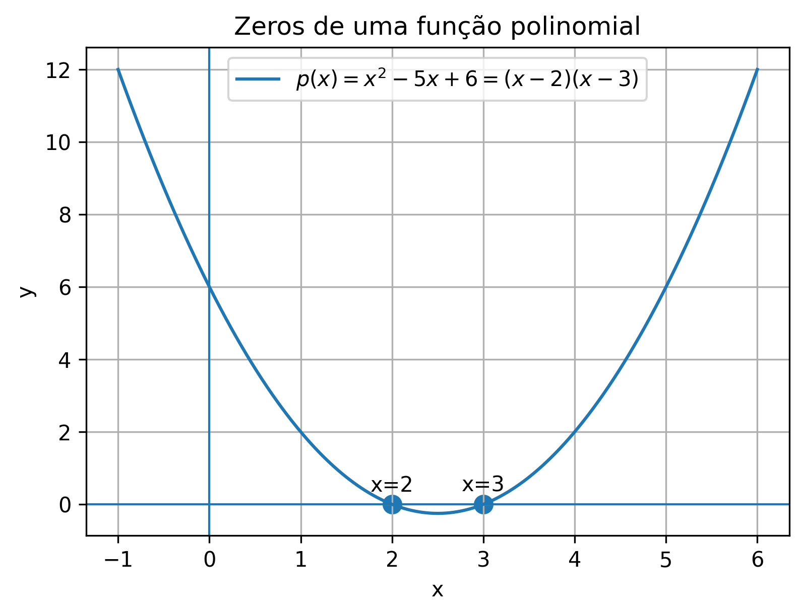

🏠 [← Sumário do Curso](../index.qmd) · [← Cursos de Matemática](../../index.qmd) · [← Seção de Matemática](/posts/matematica/index.qmd)

🎯 **Aula anterior:** 👉 [1.6 Funções Elementares](1.6-funcoes-elementares.qmd)

🎯 **Próxima aula:** 👉 [1.8 Exponenciais e Logaritmos](1.8-exponenciais-e-logaritmos.qmd)

***

::: {.callout-tip title="❓ Pergunta Disparadora"}
Como os polinômios e quocientes de polinômios ajudam a compreender zeros, sinais, descontinuidades e assíntotas?
:::

::: {.callout-note title="📌 Objetivos do Post"}
- Reconhecer funções polinomiais e racionais e identificar seus domínios;
- Interpretar zeros, fatoração e sinais de uma função polinomial;
- Compreender o efeito do cancelamento de fatores no domínio de uma função racional;
- Identificar os zeros de funções racionais, respeitando as restrições do domínio;
- Identificar descontinuidades removíveis e assíntotas verticais;
- Analisar o comportamento de funções racionais no infinito.
:::

# 📘 Funções Polinomiais e Racionais

Entre as funções elementares, duas famílias aparecem continuamente no Cálculo: as **funções polinomiais** e as **funções racionais**.

As funções polinomiais são construídas a partir de somas de potências inteiras não negativas de \(x\). As funções racionais são quocientes de polinômios.

Essas duas famílias são importantes porque combinam simplicidade algébrica com grande riqueza gráfica. Elas permitem discutir zeros, sinais, crescimento, domínio, continuidade, assíntotas e comportamento no infinito.

***

## 🧮 Funções polinomiais

Uma **função polinomial real** tem a forma

$$
\boxed{
p(x)=a_nx^n+a_{n-1}x^{n-1}+\cdots+a_1x+a_0
}
$$

em que

$$
a_0,a_1,\ldots,a_n\in\mathbb{R},
\qquad
n\in\mathbb{N}_0,
\qquad
a_n\neq 0.
$$

O número \(n\) é chamado de **grau** do polinômio.

O coeficiente \(a_n\) é chamado de **coeficiente dominante**, pois acompanha o termo de maior grau.

**Exemplos:**

$$
p(x)=3x-2
$$

é um polinômio de grau \(1\).

$$
q(x)=x^2-5x+6
$$

é um polinômio de grau \(2\).

$$
r(x)=2x^3-x+1
$$

é um polinômio de grau \(3\).

O polinômio constante não nulo \(s(x)=9\) tem grau \(0\).

::: {.callout-note title="Observação sobre o polinômio nulo"}
O polinômio nulo, definido por \(p(x)=0\) para todo \(x\), não possui grau definido na convenção usual adotada neste curso.
:::

Os gráficos abaixo ajudam a visualizar três exemplos de funções polinomiais de graus diferentes.

```{python}
#| label: fig-exemplos-polinomiais
#| echo: false
#| warning: false
#| message: false
#| fig-align: center
#| out-width: "80%"

import os
import numpy as np
import matplotlib.pyplot as plt

os.makedirs("images", exist_ok=True)

# Exemplo 1
x = np.linspace(-3, 3, 400)
plt.figure(figsize=(6, 4.2))
plt.axhline(0, linewidth=1)
plt.axvline(0, linewidth=1)
plt.plot(x, 3*x - 2, label=r"$p(x)=3x-2$")
plt.title("Exemplo de polinômio de grau 1")
plt.xlabel("x")
plt.ylabel("y")
plt.grid(True)
plt.legend()
plt.savefig("images/1-7-polinomio-grau-1.png", dpi=300, bbox_inches="tight")
plt.show()

# Exemplo 2
x = np.linspace(-1, 6, 500)
plt.figure(figsize=(6, 4.2))
plt.axhline(0, linewidth=1)
plt.axvline(0, linewidth=1)
plt.plot(x, x**2 - 5*x + 6, label=r"$q(x)=x^2-5x+6$")
plt.title("Exemplo de polinômio de grau 2")
plt.xlabel("x")
plt.ylabel("y")
plt.grid(True)
plt.legend()
plt.savefig("images/1-7-polinomio-grau-2.png", dpi=300, bbox_inches="tight")
plt.show()

# Exemplo 3
x = np.linspace(-2, 2, 500)
plt.figure(figsize=(6, 4.2))
plt.axhline(0, linewidth=1)
plt.axvline(0, linewidth=1)
plt.plot(x, 2*x**3 - x + 1, label=r"$r(x)=2x^3-x+1$")
plt.title("Exemplo de polinômio de grau 3")
plt.xlabel("x")
plt.ylabel("y")
plt.grid(True)
plt.legend()
plt.savefig("images/1-7-polinomio-grau-3.png", dpi=300, bbox_inches="tight")
plt.show()
```

::: {.callout-note collapse=true title="Clique para ver o código"}
```{python}
#| eval: false
#| warning: false
#| message: false

import os
import numpy as np
import matplotlib.pyplot as plt

os.makedirs("images", exist_ok=True)

# Exemplo 1
x = np.linspace(-3, 3, 400)
plt.figure(figsize=(6, 4.2))
plt.axhline(0, linewidth=1)
plt.axvline(0, linewidth=1)
plt.plot(x, 3*x - 2, label=r"$p(x)=3x-2$")
plt.title("Exemplo de polinômio de grau 1")
plt.xlabel("x")
plt.ylabel("y")
plt.grid(True)
plt.legend()
plt.savefig("images/1-7-polinomio-grau-1.png", dpi=300, bbox_inches="tight")
plt.show()

# Exemplo 2
x = np.linspace(-1, 6, 500)
plt.figure(figsize=(6, 4.2))
plt.axhline(0, linewidth=1)
plt.axvline(0, linewidth=1)
plt.plot(x, x**2 - 5*x + 6, label=r"$q(x)=x^2-5x+6$")
plt.title("Exemplo de polinômio de grau 2")
plt.xlabel("x")
plt.ylabel("y")
plt.grid(True)
plt.legend()
plt.savefig("images/1-7-polinomio-grau-2.png", dpi=300, bbox_inches="tight")
plt.show()

# Exemplo 3
x = np.linspace(-2, 2, 500)
plt.figure(figsize=(6, 4.2))
plt.axhline(0, linewidth=1)
plt.axvline(0, linewidth=1)
plt.plot(x, 2*x**3 - x + 1, label=r"$r(x)=2x^3-x+1$")
plt.title("Exemplo de polinômio de grau 3")
plt.xlabel("x")
plt.ylabel("y")
plt.grid(True)
plt.legend()
plt.savefig("images/1-7-polinomio-grau-3.png", dpi=300, bbox_inches="tight")
plt.show()
```
:::

***

## 🌍 Domínio de funções polinomiais

**Toda função polinomial real está definida para todo número real.**

Assim, se

$$
p(x)=x^4-3x^2+1,
$$

então

$$
D_p=\mathbb{R}.
$$

Isso acontece porque as operações que formam um polinômio — soma, subtração, multiplicação e potências inteiras não negativas — fazem sentido para qualquer \(x\in\mathbb{R}\).

::: {.callout-note title="Ideia importante"}
Funções polinomiais não têm restrições de domínio nos reais.
:::

***

## 🎯 Zeros de uma função polinomial

Os **zeros** (ou **raízes**) de uma função polinomial são os valores de \(x\) para os quais

$$
\boxed{p(x)=0}.
$$

Por exemplo, considere

$$
p(x)=x^2-5x+6.
$$

Fatorando,

$$
p(x)=(x-2)(x-3).
$$

Logo, os zeros são

$$
x=2
$$

e

$$
x=3.
$$

Graficamente, os zeros correspondem aos pontos em que o gráfico intercepta o eixo horizontal.

### Multiplicidade das raízes

Uma raiz pode aparecer repetida na fatoração de um polinômio. Essa repetição é chamada de **multiplicidade da raiz**.

Se \(r\) é uma raiz de multiplicidade \(m\), podemos escrever

$$
p(x)=(x-r)^m q(x),
\qquad q(r)\neq 0.
$$

A paridade de \(m\) determina o comportamento do gráfico nas proximidades da raiz:

- **Multiplicidade par:** o gráfico toca o eixo \(x\), mas não o atravessa.
- **Multiplicidade ímpar:** o gráfico atravessa o eixo \(x\).

Por exemplo, em \(p(x)=(x-2)^2\), a raiz \(x=2\) tem multiplicidade \(2\). Já em \(g(x)=(x-2)^3\), a raiz \(x=2\) tem multiplicidade \(3\).

::: {.callout-note title="💡 Dica de fatoração"}
Quando um polinômio de grau \(2\) possui duas raízes reais \(x_1\) e \(x_2\), consideradas com suas multiplicidades, podemos escrevê-lo na forma

$$
p(x)=a(x-x_1)(x-x_2),
$$

em que \(a\) é o **coeficiente dominante**, isto é, o coeficiente do termo de maior grau.

No exemplo

$$
p(x)=x^2-5x+6,
$$

as raízes são \(2\) e \(3\), e como o coeficiente de \(x^2\) é \(1\), temos

$$
p(x)=(x-2)(x-3).
$$

Se o polinômio fosse, por exemplo,

$$
2x^2-10x+12,
$$

então a fatoração seria

$$
2(x-2)(x-3).
$$

Observe que nem todo polinômio quadrático possui raízes reais. A existência de raízes reais depende de seus coeficientes.
:::

A imagem abaixo mostra graficamente como os zeros aparecem como interseções com o eixo \(x\).

{fig-align="center" width="80%"}

::: {.callout-note collapse=true title="Clique para ver o código que gera a imagem"}
```{python}
#| eval: false
#| warning: false
#| message: false
#| fig-align: center

import os
import numpy as np
import matplotlib.pyplot as plt

os.makedirs("images", exist_ok=True)

x = np.linspace(-1, 6, 500)
y = x**2 - 5*x + 6

plt.figure(figsize=(6.6, 4.4))
plt.axhline(0, linewidth=1)
plt.axvline(0, linewidth=1)

plt.plot(x, y, label=r"$p(x)=x^2-5x+6$")
plt.scatter([2, 3], [0, 0], s=70, zorder=5)

plt.axvline(2, linestyle="--", linewidth=1)
plt.axvline(3, linestyle="--", linewidth=1)

plt.text(2, 0.6, "2", ha="center")
plt.text(3, 0.6, "3", ha="center")

plt.title(r"Zeros de $p(x)=x^2-5x+6$")
plt.xlabel("x")
plt.ylabel("y")
plt.grid(True)
plt.legend()

plt.savefig(
    "images/1-7-zeros-polinomio.png",
    dpi=300,
    bbox_inches="tight"
)
plt.show()
```
:::

***

## 📊 Sinal de uma função polinomial

Depois de encontrar os zeros, podemos estudar em quais intervalos a função é positiva ou negativa.

Para

$$
p(x)=(x-2)(x-3),
$$

os zeros \(2\) e \(3\) dividem a reta em três intervalos:

$$
(-\infty,2),\qquad (2,3),\qquad (3,+\infty).
$$

Analisando o sinal:

- Em \((-\infty,2)\), os dois fatores são negativos, então \(p(x)>0\);
- Em \((2,3)\), os fatores têm sinais opostos, então \(p(x)<0\);
- Em \((3,+\infty)\), os dois fatores são positivos, então \(p(x)>0\).

Esse tipo de análise será essencial quando estudarmos crescimento, concavidade e esboço de gráficos.

O gráfico a seguir destaca as raízes \(x=2\) e \(x=3\) e indica o sinal da função em cada subintervalo.

```{python}
#| label: fig-sinal-polinomio
#| echo: false
#| warning: false
#| message: false
#| fig-align: center
#| out-width: "80%"

import os
import numpy as np
import matplotlib.pyplot as plt

os.makedirs("images", exist_ok=True)

x = np.linspace(-1, 6, 500)
y = x**2 - 5*x + 6

plt.figure(figsize=(6.6, 4.4))
plt.axhline(0, linewidth=1)
plt.axvline(0, linewidth=1)
plt.plot(x, y, label=r"$p(x)=x^2-5x+6$")
plt.scatter([2, 3], [0, 0], s=70, zorder=5)
plt.axvline(2, linestyle="--", linewidth=1)
plt.axvline(3, linestyle="--", linewidth=1)
plt.text(0.2, 2.8, r"$p(x)>0$")
plt.text(2.45, -0.9, r"$p(x)<0$")
plt.text(4.0, 2.8, r"$p(x)>0$")
plt.text(2, 0.35, "2", ha="center")
plt.text(3, 0.35, "3", ha="center")
plt.title(r"Sinal de $p(x)=x^2-5x+6$")
plt.xlabel("x")
plt.ylabel("y")
plt.grid(True)
plt.legend()
plt.savefig("images/1-7-sinal-polinomio.png", dpi=300, bbox_inches="tight")
plt.show()
```

::: {.callout-note collapse=true title="Clique para ver o código"}
```{python}
#| eval: false
#| warning: false
#| message: false

import os
import numpy as np
import matplotlib.pyplot as plt

os.makedirs("images", exist_ok=True)

x = np.linspace(-1, 6, 500)
y = x**2 - 5*x + 6

plt.figure(figsize=(6.6, 4.4))
plt.axhline(0, linewidth=1)
plt.axvline(0, linewidth=1)
plt.plot(x, y, label=r"$p(x)=x^2-5x+6$")
plt.scatter([2, 3], [0, 0], s=70, zorder=5)
plt.axvline(2, linestyle="--", linewidth=1)
plt.axvline(3, linestyle="--", linewidth=1)
plt.text(0.2, 2.8, r"$p(x)>0$")
plt.text(2.45, -0.9, r"$p(x)<0$")
plt.text(4.0, 2.8, r"$p(x)>0$")
plt.text(2, 0.35, "2", ha="center")
plt.text(3, 0.35, "3", ha="center")
plt.title(r"Sinal de $p(x)=x^2-5x+6$")
plt.xlabel("x")
plt.ylabel("y")
plt.grid(True)
plt.legend()
plt.savefig("images/1-7-sinal-polinomio.png", dpi=300, bbox_inches="tight")
plt.show()
```
:::

***

Até aqui, estudamos funções formadas por somas e produtos de potências de \(x\).

Agora vamos dar um passo adiante: estudar **quocientes de polinômios**.

Essa mudança parece pequena, mas traz uma novidade importante: o denominador pode ser zero. É daí que surgem restrições de domínio, buracos e assíntotas.

## ➗ Funções racionais

Uma **função racional** é uma função da forma

$$
\boxed{
f(x)=\frac{p(x)}{q(x)},
\qquad q(x)\neq 0
}
$$

em que \(p(x)\) e \(q(x)\) são polinômios.

Seu domínio real é formado pelos valores de \(x\) para os quais o denominador não se anula:

$$
D_f=\{x\in\mathbb{R}:q(x)\neq 0\}.
$$

::: {.callout-note title="🧭 Pergunta obrigatória"}
Antes de estudar qualquer função racional, a primeira pergunta deve ser:

$$
\boxed{q(x)\neq 0?}
$$

Ou seja: **quais valores tornam o denominador zero e precisam ser excluídos do domínio?**
:::

### Zeros de uma função racional

Os zeros de uma função racional são os valores que anulam o numerador, desde que não anulem também o denominador.

Assim, para

$$
f(x)=\frac{p(x)}{q(x)},
$$

temos

$$
\boxed{
f(x)=0
\iff
p(x)=0
\quad\text{e}\quad
q(x)\neq 0.
}
$$

Portanto, não basta encontrar os zeros do numerador: é necessário verificar se esses valores pertencem ao domínio da função.

**Exemplos:**

$$
f(x)=\frac{1}{x},
$$

$$
g(x)=\frac{x+1}{x-2},
$$

$$
h(x)=\frac{x^2-1}{x^2-4}.
$$

As funções racionais aparecem naturalmente quando dividimos grandezas, modelamos taxas médias ou estudamos expressões algébricas com denominadores variáveis.

Os exemplos a seguir mostram alguns gráficos típicos de funções racionais básicas.

```{python}
#| label: fig-funcoes-racionais
#| echo: false
#| warning: false
#| message: false
#| fig-align: center
#| out-width: "80%"

import os
import numpy as np
import matplotlib.pyplot as plt

os.makedirs("images", exist_ok=True)

# Exemplo 1: f(x)=1/x
x1 = np.linspace(-5, -0.15, 400)
x2 = np.linspace(0.15, 5, 400)

plt.figure(figsize=(6, 4.2))
plt.axhline(0, linewidth=1)
plt.axvline(0, linewidth=1)
plt.plot(x1, 1/x1, label=r"$f(x)=\frac{1}{x}$")
plt.plot(x2, 1/x2)
plt.title(r"Função racional: $f(x)=\frac{1}{x}$")
plt.xlabel("x")
plt.ylabel("y")
plt.ylim(-6, 6)
plt.grid(True)
plt.legend()
plt.savefig("images/1-7-racional-1-sobre-x.png", dpi=300, bbox_inches="tight")
plt.show()

# Exemplo 2: g(x)=(x+1)/(x-2)
x1 = np.linspace(-5, 1.85, 500)
x2 = np.linspace(2.15, 7, 500)

plt.figure(figsize=(6, 4.2))
plt.axhline(0, linewidth=1)
plt.axvline(0, linewidth=1)
plt.plot(x1, (x1+1)/(x1-2), label=r"$g(x)=\frac{x+1}{x-2}$")
plt.plot(x2, (x2+1)/(x2-2))
plt.title(r"Função racional: $g(x)=\frac{x+1}{x-2}$")
plt.xlabel("x")
plt.ylabel("y")
plt.ylim(-8, 8)
plt.grid(True)
plt.legend()
plt.savefig("images/1-7-racional-x-mais-1-sobre-x-menos-2.png", dpi=300, bbox_inches="tight")
plt.show()

# Exemplo 3: h(x)=(x^2-1)/(x^2-4)
x1 = np.linspace(-5, -2.15, 400)
x2 = np.linspace(-1.85, 1.85, 400)
x3 = np.linspace(2.15, 5, 400)

plt.figure(figsize=(6, 4.2))
plt.axhline(0, linewidth=1)
plt.axvline(0, linewidth=1)
plt.plot(
    x1,
    (x1**2 - 1)/(x1**2 - 4),
    label=r"$h(x)=\frac{x^2-1}{x^2-4}$"
)
plt.plot(x2, (x2**2 - 1)/(x2**2 - 4))
plt.plot(x3, (x3**2 - 1)/(x3**2 - 4))
plt.title(r"Função racional: $h(x)=\frac{x^2-1}{x^2-4}$")
plt.xlabel("x")
plt.ylabel("y")
plt.ylim(-8, 8)
plt.grid(True)
plt.legend()
plt.savefig("images/1-7-racional-x2-menos-1-sobre-x2-menos-4.png", dpi=300, bbox_inches="tight")
plt.show()
```

::: {.callout-note collapse=true title="Clique para ver o código"}
```{python}
#| eval: false
#| warning: false
#| message: false

import os
import numpy as np
import matplotlib.pyplot as plt

os.makedirs("images", exist_ok=True)

# Exemplo 1: f(x)=1/x
x1 = np.linspace(-5, -0.15, 400)
x2 = np.linspace(0.15, 5, 400)

plt.figure(figsize=(6, 4.2))
plt.axhline(0, linewidth=1)
plt.axvline(0, linewidth=1)
plt.plot(x1, 1/x1, label=r"$f(x)=\frac{1}{x}$")
plt.plot(x2, 1/x2)
plt.title(r"Função racional: $f(x)=\frac{1}{x}$")
plt.xlabel("x")
plt.ylabel("y")
plt.ylim(-6, 6)
plt.grid(True)
plt.legend()
plt.savefig("images/1-7-racional-1-sobre-x.png", dpi=300, bbox_inches="tight")
plt.show()

# Exemplo 2: g(x)=(x+1)/(x-2)
x1 = np.linspace(-5, 1.85, 500)
x2 = np.linspace(2.15, 7, 500)

plt.figure(figsize=(6, 4.2))
plt.axhline(0, linewidth=1)
plt.axvline(0, linewidth=1)
plt.plot(x1, (x1+1)/(x1-2), label=r"$g(x)=\frac{x+1}{x-2}$")
plt.plot(x2, (x2+1)/(x2-2))
plt.title(r"Função racional: $g(x)=\frac{x+1}{x-2}$")
plt.xlabel("x")
plt.ylabel("y")
plt.ylim(-8, 8)
plt.grid(True)
plt.legend()
plt.savefig("images/1-7-racional-x-mais-1-sobre-x-menos-2.png", dpi=300, bbox_inches="tight")
plt.show()

# Exemplo 3: h(x)=(x^2-1)/(x^2-4)
x1 = np.linspace(-5, -2.15, 400)
x2 = np.linspace(-1.85, 1.85, 400)
x3 = np.linspace(2.15, 5, 400)

plt.figure(figsize=(6, 4.2))
plt.axhline(0, linewidth=1)
plt.axvline(0, linewidth=1)
plt.plot(
    x1,
    (x1**2 - 1)/(x1**2 - 4),
    label=r"$h(x)=\frac{x^2-1}{x^2-4}$"
)
plt.plot(x2, (x2**2 - 1)/(x2**2 - 4))
plt.plot(x3, (x3**2 - 1)/(x3**2 - 4))
plt.title(r"Função racional: $h(x)=\frac{x^2-1}{x^2-4}$")
plt.xlabel("x")
plt.ylabel("y")
plt.ylim(-8, 8)
plt.grid(True)
plt.legend()
plt.savefig("images/1-7-racional-x2-menos-1-sobre-x2-menos-4.png", dpi=300, bbox_inches="tight")
plt.show()
```
:::

***

## 🚫 Domínio de funções racionais

**O domínio de uma função racional exclui os valores que anulam o denominador.**

Por exemplo, para

$$
f(x)=\frac{x+1}{x-2},
$$

precisamos de

$$
x-2\neq 0.
$$

Logo,

$$
x\neq 2.
$$

Assim,

$$
D_f=(-\infty,2)\cup(2,+\infty).
$$

Para

$$
g(x)=\frac{x^2-1}{x^2-4},
$$

temos

$$
x^2-4=(x-2)(x+2).
$$

Portanto, o denominador zera em

$$
x=-2
$$

e

$$
x=2.
$$

Logo,

$$
D_g=(-\infty,-2)\cup(-2,2)\cup(2,+\infty).
$$

Observe que os zeros do numerador não precisam ser excluídos do domínio. A restrição decorre dos zeros do denominador.

***

## 🕳️ Cancelamento e domínio

Considere

$$
f(x)=\frac{x^2-1}{x-1}.
$$

Como

$$
x^2-1=(x-1)(x+1),
$$

podemos escrever

$$
f(x)=\frac{(x-1)(x+1)}{x-1}.
$$

Para \(x\neq 1\), podemos cancelar o fator \(x-1\) e obter

$$
f(x)=x+1.
$$

Mas é muito importante observar:

::: {.callout-warning title="Cuidado"}
O cancelamento simplifica a expressão, mas não recupera o ponto excluído do domínio original, isto é, o ponto em que a função não está definida.
:::

A função original não está definida em \(x=1\). Portanto,

$$
D_f=(-\infty,1)\cup(1,+\infty).
$$

O gráfico coincide com a reta \(y=x+1\), exceto por um buraco no ponto correspondente a \(x=1\).

Nesse caso, o ponto ausente é

$$
(1,2),
$$

pois a expressão simplificada \(x+1\), avaliada em \(x=1\), teria valor \(2\).

Portanto, a função original e a função \(g(x)=x+1\), definida em todo \(\mathbb R\), não são iguais como funções: seus domínios são diferentes. Elas coincidem para todo \(x\neq 1\).

O gráfico abaixo mostra exatamente essa situação: a expressão simplificada parece uma reta, mas a função original mantém uma descontinuidade removível em \(x=1\).

```{python}
#| label: fig-cancelamento-buraco
#| echo: false
#| warning: false
#| message: false
#| fig-align: center
#| out-width: "80%"

import os
import numpy as np
import matplotlib.pyplot as plt

os.makedirs("images", exist_ok=True)

x1 = np.linspace(-3, 0.95, 300)
x2 = np.linspace(1.05, 4, 300)

plt.figure(figsize=(6, 4.2))
plt.axhline(0, linewidth=1)
plt.axvline(0, linewidth=1)
plt.plot(
    x1,
    x1 + 1,
    label=r"$f(x)=\frac{x^2-1}{x-1}=x+1,\; x\neq 1$"
)
plt.plot(x2, x2 + 1)
plt.scatter(
    [1],
    [2],
    s=110,
    facecolors="white",
    edgecolors="black",
    linewidths=2.0,
    zorder=5
)
plt.text(1.18, 2.28, "buraco em (1,2)")
plt.title("Cancelamento e domínio")
plt.xlabel("x")
plt.ylabel("y")
plt.grid(True)
plt.legend()
plt.savefig("images/1-7-cancelamento-buraco.png", dpi=300, bbox_inches="tight")
plt.show()
```

::: {.callout-note collapse=true title="Clique para ver o código"}
```{python}
#| eval: false
#| warning: false
#| message: false

import os
import numpy as np
import matplotlib.pyplot as plt

os.makedirs("images", exist_ok=True)

x1 = np.linspace(-3, 0.95, 300)
x2 = np.linspace(1.05, 4, 300)

plt.figure(figsize=(6, 4.2))
plt.axhline(0, linewidth=1)
plt.axvline(0, linewidth=1)
plt.plot(
    x1,
    x1 + 1,
    label=r"$f(x)=\frac{x^2-1}{x-1}=x+1,\; x\neq 1$"
)
plt.plot(x2, x2 + 1)
plt.scatter(
    [1],
    [2],
    s=110,
    facecolors="white",
    edgecolors="black",
    linewidths=2.0,
    zorder=5
)
plt.text(1.18, 2.28, "buraco em (1,2)")
plt.title("Cancelamento e domínio")
plt.xlabel("x")
plt.ylabel("y")
plt.grid(True)
plt.legend()
plt.savefig("images/1-7-cancelamento-buraco.png", dpi=300, bbox_inches="tight")
plt.show()
```
:::

***

::: {.callout-note title="🔍 Buraco ou assíntota?"}
Um fator comum que é cancelado pode produzir um **buraco** no gráfico.

Um fator que permanece no denominador pode produzir uma **assíntota vertical**, desde que a função cresça sem limite em valor absoluto nas proximidades do ponto excluído.

Portanto, nem todo zero do denominador é automaticamente uma assíntota vertical.
:::

## 📏 Assíntotas verticais

Uma **assíntota vertical** é uma reta da forma

$$
x=a
$$

à qual o gráfico de uma função se aproxima quando \(x\) tende a \(a\), enquanto os valores da função crescem ou decrescem sem limite.

Em termos de limites, isso ocorre quando pelo menos um dos limites laterais é infinito:

$$
\lim_{x\to a^-}f(x)=+\infty,
\qquad
\lim_{x\to a^+}f(x)=-\infty,
$$

ou em outra combinação de sinais infinitos.

Por exemplo, considere

$$
f(x)=\frac{1}{x-2}.
$$

O domínio exclui \(x=2\).

Quando \(x\) se aproxima de \(2\) pela esquerda, o denominador é negativo e se aproxima de zero. Assim,

$$
\lim_{x\to 2^-}\frac{1}{x-2}=-\infty.
$$

Quando \(x\) se aproxima de \(2\) pela direita, o denominador é positivo e se aproxima de zero. Assim,

$$
\lim_{x\to 2^+}\frac{1}{x-2}=+\infty.
$$

Por isso, a reta

$$
\boxed{x=2}
$$

é uma assíntota vertical.

No estudo de limites, voltaremos a esse fenômeno com mais precisão.

O gráfico abaixo mostra a função e sua assíntota vertical.

```{python}
#| label: fig-assintota-vertical
#| echo: false
#| warning: false
#| message: false
#| fig-align: center
#| out-width: "80%"

import os
import numpy as np
import matplotlib.pyplot as plt

os.makedirs("images", exist_ok=True)

x1 = np.linspace(-4, 1.85, 400)
x2 = np.linspace(2.15, 8, 400)

plt.figure(figsize=(6, 4.2))
plt.axhline(0, linewidth=1)
plt.axvline(0, linewidth=1)
plt.plot(x1, 1/(x1 - 2), label=r"$f(x)=\frac{1}{x-2}$")
plt.plot(x2, 1/(x2 - 2))
plt.axvline(
    2,
    linestyle="--",
    linewidth=1.2,
    label=r"assíntota vertical $x=2$"
)
plt.title(r"Assíntota vertical de $f(x)=\frac{1}{x-2}$")
plt.xlabel("x")
plt.ylabel("y")
plt.ylim(-8, 8)
plt.grid(True)
plt.legend()
plt.savefig("images/1-7-assintota-vertical.png", dpi=300, bbox_inches="tight")
plt.show()
```

::: {.callout-note collapse=true title="Clique para ver o código"}
```{python}
#| eval: false
#| warning: false
#| message: false

import os
import numpy as np
import matplotlib.pyplot as plt

os.makedirs("images", exist_ok=True)

x1 = np.linspace(-4, 1.85, 400)
x2 = np.linspace(2.15, 8, 400)

plt.figure(figsize=(6, 4.2))
plt.axhline(0, linewidth=1)
plt.axvline(0, linewidth=1)
plt.plot(x1, 1/(x1 - 2), label=r"$f(x)=\frac{1}{x-2}$")
plt.plot(x2, 1/(x2 - 2))
plt.axvline(
    2,
    linestyle="--",
    linewidth=1.2,
    label=r"assíntota vertical $x=2$"
)
plt.title(r"Assíntota vertical de $f(x)=\frac{1}{x-2}$")
plt.xlabel("x")
plt.ylabel("y")
plt.ylim(-8, 8)
plt.grid(True)
plt.legend()
plt.savefig("images/1-7-assintota-vertical.png", dpi=300, bbox_inches="tight")
plt.show()
```
:::

***

## ♾️ Comportamento no infinito

Funções racionais também têm comportamento interessante quando \(x\) cresce indefinidamente em valor absoluto.

Considere

$$
f(x)=\frac{2x+1}{x-3}.
$$

Podemos dividir o numerador pelo denominador e escrever

$$
\frac{2x+1}{x-3}
=
2+\frac{7}{x-3}.
$$

Quando \(x\) cresce em valor absoluto, o termo

$$
\frac{7}{x-3}
$$

se aproxima de zero.

Consequentemente, a função se aproxima de \(2\), isto é, o gráfico se aproxima da reta horizontal

$$
\boxed{y=2}.
$$

Essa reta é chamada de **assíntota horizontal**.

O gráfico abaixo mostra tanto a assíntota vertical quanto a horizontal.

```{python}
#| label: fig-comportamento-infinito
#| echo: false
#| warning: false
#| message: false
#| fig-align: center
#| out-width: "80%"

import os
import numpy as np
import matplotlib.pyplot as plt

os.makedirs("images", exist_ok=True)

x1 = np.linspace(-10, 2.85, 500)
x2 = np.linspace(3.15, 10, 500)

plt.figure(figsize=(6.4, 4.4))
plt.axhline(0, linewidth=1)
plt.axvline(0, linewidth=1)
plt.plot(
    x1,
    (2*x1 + 1)/(x1 - 3),
    label=r"$f(x)=\frac{2x+1}{x-3}$"
)
plt.plot(x2, (2*x2 + 1)/(x2 - 3))
plt.axvline(
    3,
    linestyle="--",
    linewidth=1.2,
    label=r"assíntota vertical $x=3$"
)
plt.axhline(
    2,
    linestyle="--",
    linewidth=1.2,
    label=r"assíntota horizontal $y=2$"
)
plt.title("Comportamento no infinito e assíntotas")
plt.xlabel("x")
plt.ylabel("y")
plt.ylim(-10, 10)
plt.grid(True)
plt.legend()
plt.savefig("images/1-7-comportamento-infinito.png", dpi=300, bbox_inches="tight")
plt.show()
```

::: {.callout-note collapse=true title="Clique para ver o código"}
```{python}
#| eval: false
#| warning: false
#| message: false

import os
import numpy as np
import matplotlib.pyplot as plt

os.makedirs("images", exist_ok=True)

x1 = np.linspace(-10, 2.85, 500)
x2 = np.linspace(3.15, 10, 500)

plt.figure(figsize=(6.4, 4.4))
plt.axhline(0, linewidth=1)
plt.axvline(0, linewidth=1)
plt.plot(
    x1,
    (2*x1 + 1)/(x1 - 3),
    label=r"$f(x)=\frac{2x+1}{x-3}$"
)
plt.plot(x2, (2*x2 + 1)/(x2 - 3))
plt.axvline(
    3,
    linestyle="--",
    linewidth=1.2,
    label=r"assíntota vertical $x=3$"
)
plt.axhline(
    2,
    linestyle="--",
    linewidth=1.2,
    label=r"assíntota horizontal $y=2$"
)
plt.title("Comportamento no infinito e assíntotas")
plt.xlabel("x")
plt.ylabel("y")
plt.ylim(-10, 10)
plt.grid(True)
plt.legend()
plt.savefig("images/1-7-comportamento-infinito.png", dpi=300, bbox_inches="tight")
plt.show()
```
:::

### Regra prática para assíntotas horizontais

Considere uma função racional

$$
f(x)=\frac{p(x)}{q(x)},
$$

em que \(p\) e \(q\) são polinômios não nulos.

Podemos identificar o comportamento horizontal comparando os graus do numerador e do denominador:

- **Grau do numerador menor que o grau do denominador:** a assíntota horizontal é \(y=0\).
- **Graus iguais:** a assíntota horizontal é a razão entre os coeficientes dominantes.
- **Grau do numerador maior que o grau do denominador:** não existe assíntota horizontal. A divisão dos polinômios pode revelar uma assíntota polinomial. Quando a diferença entre os graus é igual a \(1\), temos uma **assíntota oblíqua**, isto é, uma assíntota que é uma reta não horizontal.

::: {.callout-note title="Exemplo rápido"}
Considere

$$
g(x)=\frac{4x^2+3x-1}{2x^2-5}.
$$

Os graus do numerador e do denominador são iguais. A razão entre os coeficientes dominantes é

$$
\frac{4}{2}=2.
$$

Portanto, a assíntota horizontal é

$$
y=2.
$$
:::

***

## 🧾 Quadro-resumo

| Situação | O que observar | Efeito no gráfico |
|---|---|---|
| Polinômio | Grau, zeros e coeficiente dominante | Domínio \(\mathbb{R}\); gráfico contínuo em \(\mathbb{R}\) |
| Zero de polinômio | \(p(x)=0\) | Interseção com o eixo \(x\) |
| Função racional | Denominador \(q(x)\neq 0\) | Pode ter restrições de domínio |
| Zero de função racional | Numerador igual a zero e denominador diferente de zero | Interseção com o eixo \(x\) |
| Fator cancelado | Fator comum no numerador e denominador | Pode gerar buraco |
| Fator não cancelado no denominador | Verificar o comportamento nas proximidades do zero | Pode gerar assíntota vertical |
| Graus do numerador e denominador | Comparação dos graus e coeficientes dominantes | Indicam o comportamento no infinito |
| Assíntota horizontal | Comportamento quando \(x\to\pm\infty\) | O gráfico se aproxima de uma reta horizontal |

***

::: {.callout-tip title="🌉 Ponte para o Cálculo"}

Polinômios e funções racionais formam um laboratório central para o Cálculo. Seus zeros e sinais ajudam a analisar gráficos, enquanto cancelamentos, descontinuidades e assíntotas antecipam o estudo de limites e continuidade. O comportamento no infinito também prepara a análise de limites quando \(x\to\pm\infty\).

:::

# 🧪 Exercícios propostos

::: {.callout-note title="📝 Exercícios"}

## 🧪 Exercício 1

Determine o grau dos polinômios:

a) \(p(x)=4x^3-2x+1\)

b) \(q(x)=7x-5\)

c) \(r(x)=x^5+x^2-1\)

d) \(s(x)=9\)

## 🧪 Exercício 2

Encontre os zeros das funções polinomiais:

a) \(p(x)=x^2-4\)

b) \(q(x)=x^2-3x+2\)

c) \(r(x)=x(x-5)\)

## 🧪 Exercício 3

Determine o domínio real das funções racionais:

a) \(f(x)=\dfrac{1}{x-4}\)

b) \(g(x)=\dfrac{x+1}{x^2-9}\)

c) \(h(x)=\dfrac{x^2-1}{x-1}\)

## 🧪 Exercício 4

Simplifique a expressão, indicando a restrição de domínio:

$$
f(x)=\frac{x^2-4}{x-2}.
$$

## 🧪 Exercício 5

Determine os intervalos em que

$$
p(x)=x^2-3x+2
$$

é positiva e negativa.

## 🧪 Exercício 6

Considere a função racional

$$
f(x)=\frac{3x+1}{x-2}.
$$

Determine:

a) O domínio da função;

b) A equação da assíntota vertical;

c) A equação da assíntota horizontal.

## 🧪 Exercício 7

Considere a função

$$
f(x)=\frac{x^2-4}{x^2-5x+6}.
$$

Determine:

a) O domínio da função;

b) A expressão simplificada, indicando as restrições;

c) As coordenadas do buraco no gráfico;

d) A equação da assíntota vertical;

e) A equação da assíntota horizontal.

:::

***

# ✅ Gabarito comentado

::: {.callout-important collapse=true title="✅ Gabarito"}

## 🧪 Exercício 1

a) \(p(x)=4x^3-2x+1\) tem grau \(3\).

b) \(q(x)=7x-5\) tem grau \(1\).

c) \(r(x)=x^5+x^2-1\) tem grau \(5\).

d) \(s(x)=9\) é um polinômio constante não nulo, de grau \(0\).

## 🧪 Exercício 2

a) Temos

$$
p(x)=x^2-4=(x-2)(x+2).
$$

Logo, os zeros são

$$
x=-2
\qquad\text{e}\qquad
x=2.
$$

b) Temos

$$
q(x)=x^2-3x+2=(x-1)(x-2).
$$

Logo, os zeros são

$$
x=1
\qquad\text{e}\qquad
x=2.
$$

c) Temos

$$
r(x)=x(x-5).
$$

Logo, os zeros são

$$
x=0
\qquad\text{e}\qquad
x=5.
$$

## 🧪 Exercício 3

a) Para

$$
f(x)=\frac{1}{x-4},
$$

precisamos de

$$
x-4\neq 0,
$$

isto é, \(x\neq 4\).

Logo,

$$
D_f=(-\infty,4)\cup(4,+\infty).
$$

b) Para

$$
g(x)=\frac{x+1}{x^2-9},
$$

precisamos de

$$
x^2-9\neq 0.
$$

Como

$$
x^2-9=(x-3)(x+3),
$$

temos

$$
x\neq -3
\qquad\text{e}\qquad
x\neq 3.
$$

Logo,

$$
D_g=(-\infty,-3)\cup(-3,3)\cup(3,+\infty).
$$

c) Para

$$
h(x)=\frac{x^2-1}{x-1},
$$

precisamos de

$$
x-1\neq 0,
$$

isto é, \(x\neq 1\).

Mesmo que haja cancelamento algébrico, o domínio da expressão original exclui \(1\).

Logo,

$$
D_h=(-\infty,1)\cup(1,+\infty).
$$

## 🧪 Exercício 4

Temos

$$
f(x)=\frac{x^2-4}{x-2}.
$$

Como

$$
x^2-4=(x-2)(x+2),
$$

obtemos

$$
f(x)=\frac{(x-2)(x+2)}{x-2}.
$$

Para \(x\neq 2\), podemos cancelar \(x-2\):

$$
f(x)=x+2.
$$

A restrição é

$$
x\neq 2.
$$

Portanto, a expressão simplificada é \(x+2\), mas o domínio original é

$$
D_f=(-\infty,2)\cup(2,+\infty).
$$

O gráfico apresenta um buraco no ponto

$$
(2,4).
$$

## 🧪 Exercício 5

Temos

$$
p(x)=x^2-3x+2=(x-1)(x-2).
$$

Os zeros são \(1\) e \(2\). Eles dividem a reta em três intervalos:

$$
(-\infty,1),\qquad (1,2),\qquad (2,+\infty).
$$

Analisando os sinais:

- Em \((-\infty,1)\), os dois fatores são negativos, então \(p(x)>0\);
- Em \((1,2)\), os fatores têm sinais opostos, então \(p(x)<0\);
- Em \((2,+\infty)\), os dois fatores são positivos, então \(p(x)>0\).

Logo, \(p(x)>0\) em

$$
(-\infty,1)\cup(2,+\infty)
$$

e \(p(x)<0\) em

$$
(1,2).
$$

Nos pontos \(x=1\) e \(x=2\), a função é igual a zero.

## 🧪 Exercício 6

Considere

$$
f(x)=\frac{3x+1}{x-2}.
$$

**a) Domínio**

O denominador não pode ser zero:

$$
x-2\neq 0
\quad\Longrightarrow\quad
x\neq 2.
$$

Portanto,

$$
D_f=\mathbb{R}\setminus\{2\}.
$$

**b) Assíntota vertical**

O denominador se anula em \(x=2\), enquanto o numerador vale

$$
3(2)+1=7\neq 0.
$$

Não há cancelamento do fator do denominador. A função cresce sem limite em valor absoluto nas proximidades de \(x=2\).

Assim, a assíntota vertical é

$$
\boxed{x=2}.
$$

**c) Assíntota horizontal**

Os graus do numerador e do denominador são iguais. Portanto, a assíntota horizontal é dada pela razão entre os coeficientes dominantes:

$$
y=\frac{3}{1}.
$$

Logo,

$$
\boxed{y=3}.
$$

## 🧪 Exercício 7

Considere

$$
f(x)=\frac{x^2-4}{x^2-5x+6}.
$$

**a) Domínio**

Fatorando o denominador:

$$
x^2-5x+6=(x-2)(x-3).
$$

O denominador não pode ser zero. Portanto,

$$
x\neq 2
\qquad\text{e}\qquad
x\neq 3.
$$

Logo,

$$
D_f=\mathbb{R}\setminus\{2,3\}.
$$

**b) Expressão simplificada**

Fatorando o numerador:

$$
x^2-4=(x-2)(x+2).
$$

Assim,

$$
f(x)=\frac{(x-2)(x+2)}{(x-2)(x-3)}.
$$

Para \(x\neq 2\) e \(x\neq 3\), podemos cancelar o fator comum:

$$
f(x)=\frac{x+2}{x-3}.
$$

As duas restrições do domínio original devem ser mantidas:

$$
x\neq 2,\qquad x\neq 3.
$$

**c) Coordenadas do buraco**

O fator \(x-2\) foi cancelado. Portanto, há uma descontinuidade removível em \(x=2\).

Para encontrar a coordenada vertical do buraco, usamos a expressão simplificada:

$$
y=\frac{2+2}{2-3}=-4.
$$

Logo, o buraco está no ponto

$$
\boxed{(2,-4)}.
$$

**d) Assíntota vertical**

O fator \(x-3\) permanece no denominador da expressão simplificada.

Como o numerador não se anula em \(x=3\), temos uma assíntota vertical:

$$
\boxed{x=3}.
$$

**e) Assíntota horizontal**

Os graus do numerador e do denominador da expressão simplificada são iguais. A razão entre os coeficientes dominantes é

$$
\frac{1}{1}=1.
$$

Logo, a assíntota horizontal é

$$
\boxed{y=1}.
$$

Esse exercício reúne três ideias importantes: domínio, descontinuidade removível e assíntota vertical.

:::

***

# 🧩 Quiz — Funções Polinomiais e Racionais

:::::{.question}

**Q1.** Toda função polinomial real tem domínio:

::::{.choices}
:::{.choice .correct-choice}
\(\mathbb{R}\).
:::

:::{.choice}
\([0,+\infty)\).
:::

:::{.choice}
\(\mathbb{R}\setminus\{0\}\).
:::

:::{.choice}
\((0,+\infty)\).
:::
::::

:::::

:::::{.question}

**Q2.** Quais são os zeros da função \(p(x)=x^2-5x+6\)?

::::{.choices}
:::{.choice .correct-choice}
\(2\) e \(3\).
:::

:::{.choice}
\(-2\) e \(-3\).
:::

:::{.choice}
\(0\) e \(5\).
:::

:::{.choice}
\(1\) e \(6\).
:::
::::

:::::

:::::{.question}

**Q3.** Qual é o domínio real da função

$$
f(x)=\frac{x+1}{x^2-9}?
$$

::::{.choices}
:::{.choice .correct-choice}
\(\mathbb{R}\setminus\{-3,3\}\).
:::

:::{.choice}
\(\mathbb{R}\setminus\{-3\}\).
:::

:::{.choice}
\(\mathbb{R}\setminus\{3\}\).
:::

:::{.choice}
\(\mathbb{R}\).
:::
::::

:::::

:::::{.question}

**Q4.** Ao simplificar

$$
\frac{x^2-1}{x-1}
$$

para \(x+1\), qual ponto permanece ausente do gráfico da função original?

::::{.choices}
:::{.choice .correct-choice}
\((1,2)\).
:::

:::{.choice}
\((1,0)\).
:::

:::{.choice}
\((-1,0)\).
:::

:::{.choice}
\((2,1)\).
:::
::::
:::::

:::::{.question}

**Q5.** Qual é a assíntota horizontal da função

$$
f(x)=\frac{4x-1}{2x+5}?
$$

::::{.choices}
:::{.choice .correct-choice}
\(y=2\).
:::

:::{.choice}
\(y=4\).
:::

:::{.choice}
\(y=\frac{1}{2}\).
:::

:::{.choice}
\(x=-\frac{5}{2}\).
:::
::::
:::::

***

# 🔗 Navegação

🎯 **Aula anterior:** 👉 [1.6 Funções Elementares](1.6-funcoes-elementares.qmd)

🎯 **Próxima aula:** 👉 [1.8 Exponenciais e Logaritmos](1.8-exponenciais-e-logaritmos.qmd)

🏠 [← Sumário do Curso](../index.qmd) · [← Cursos de Matemática](../../index.qmd) · [← Seção de Matemática](/posts/matematica/index.qmd) · 🔝 [Voltar ao topo](#)

***

*Blog do Marcellini — Explorando a Matemática com Rigor e Beleza.*

:::{.callout-note}
Criado por Blog do Marcellini com ❤️ e código.
:::