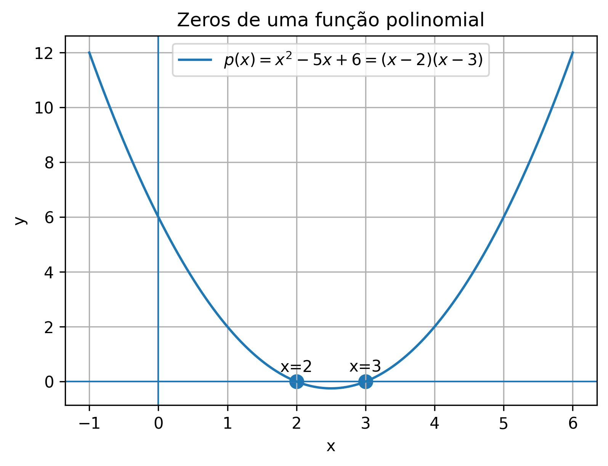

🏠 [← Sumário do Curso](../index.qmd) · [← Cursos de Matemática](../../index.qmd) · [← Seção de Matemática](/posts/matematica/index.qmd)

🎯 **Post Anterior:** 👉 [1.6 Funções Elementares](1.6-funcoes-elementares.qmd)

***

::: {.callout-tip title="❓ Pergunta Disparadora"}
Como os polinômios e quocientes de polinômios ajudam a compreender zeros, sinais, descontinuidades e assíntotas?
:::

::: {.callout-note title="📌 Objetivos do Post"}
- Reconhecer funções polinomiais e racionais e identificar seus domínios;
- Interpretar zeros, fatoração e sinais de uma função polinomial;
- Visualizar graficamente buracos, assíntotas verticais e comportamento no infinito em funções racionais.
:::

# 📘 Funções Polinomiais e Racionais

Entre as funções elementares, duas famílias aparecem continuamente no Cálculo: as **funções polinomiais** e as **funções racionais**.

As funções polinomiais são construídas a partir de somas de potências inteiras não negativas de $x$. As funções racionais são quocientes de polinômios.

Essas duas famílias são importantes porque combinam simplicidade algébrica com grande riqueza gráfica. Elas permitem discutir zeros, sinais, crescimento, domínio, continuidade, assíntotas e comportamento no infinito.

***

## 🧮 Funções polinomiais

Uma **função polinomial** tem a forma

$$
\boxed{
p(x)=a_nx^n+a_{n-1}x^{n-1}+\cdots+a_1x+a_0
}
$$

em que os coeficientes

$$
a_0,a_1,\ldots,a_n\in\mathbb{R}
$$

e

$$
a_n\neq 0.
$$

O número $n$ é chamado de **grau** do polinômio.

**Exemplos:**

$$
p(x)=3x-2
$$

é um polinômio de grau $1$.

$$
q(x)=x^2-5x+6
$$

é um polinômio de grau $2$.

$$
r(x)=2x^3-x+1
$$

é um polinômio de grau $3$.

Os gráficos abaixo ajudam a visualizar esses três exemplos de funções polinomiais de graus diferentes.

```{python}
#| label: fig-exemplos-polinomiais
#| echo: false
#| warning: false
#| message: false
#| fig-align: center
#| out-width: "80%"

import os
import numpy as np
import matplotlib.pyplot as plt

os.makedirs("images", exist_ok=True)

# Exemplo 1
x = np.linspace(-3, 3, 400)
plt.figure(figsize=(6, 4.2))
plt.axhline(0, linewidth=1)
plt.axvline(0, linewidth=1)
plt.plot(x, 3*x - 2, label=r"$p(x)=3x-2$")
plt.title("Exemplo de polinômio de grau 1")
plt.xlabel("x")
plt.ylabel("y")
plt.grid(True)
plt.legend()
plt.savefig("images/1-7-polinomio-grau-1.png", dpi=300, bbox_inches="tight")
plt.show()

# Exemplo 2
x = np.linspace(-1, 6, 500)
plt.figure(figsize=(6, 4.2))
plt.axhline(0, linewidth=1)
plt.axvline(0, linewidth=1)
plt.plot(x, x**2 - 5*x + 6, label=r"$q(x)=x^2-5x+6$")
plt.title("Exemplo de polinômio de grau 2")
plt.xlabel("x")
plt.ylabel("y")
plt.grid(True)
plt.legend()
plt.savefig("images/1-7-polinomio-grau-2.png", dpi=300, bbox_inches="tight")
plt.show()

# Exemplo 3
x = np.linspace(-2, 2, 500)
plt.figure(figsize=(6, 4.2))
plt.axhline(0, linewidth=1)
plt.axvline(0, linewidth=1)
plt.plot(x, 2*x**3 - x + 1, label=r"$r(x)=2x^3-x+1$")
plt.title("Exemplo de polinômio de grau 3")
plt.xlabel("x")
plt.ylabel("y")
plt.grid(True)
plt.legend()
plt.savefig("images/1-7-polinomio-grau-3.png", dpi=300, bbox_inches="tight")
plt.show()
```

::: {.callout-note collapse=true title="Clique para ver o código"}

```{python}
#| eval: false
#| warning: false
#| message: false

import os
import numpy as np
import matplotlib.pyplot as plt

os.makedirs("images", exist_ok=True)

# Exemplo 1
x = np.linspace(-3, 3, 400)
plt.figure(figsize=(6, 4.2))
plt.axhline(0, linewidth=1)
plt.axvline(0, linewidth=1)
plt.plot(x, 3*x - 2, label=r"$p(x)=3x-2$")
plt.title("Exemplo de polinômio de grau 1")
plt.xlabel("x")
plt.ylabel("y")
plt.grid(True)
plt.legend()
plt.savefig("images/1-7-polinomio-grau-1.png", dpi=300, bbox_inches="tight")
plt.show()

# Exemplo 2
x = np.linspace(-1, 6, 500)
plt.figure(figsize=(6, 4.2))
plt.axhline(0, linewidth=1)
plt.axvline(0, linewidth=1)
plt.plot(x, x**2 - 5*x + 6, label=r"$q(x)=x^2-5x+6$")
plt.title("Exemplo de polinômio de grau 2")
plt.xlabel("x")
plt.ylabel("y")
plt.grid(True)
plt.legend()
plt.savefig("images/1-7-polinomio-grau-2.png", dpi=300, bbox_inches="tight")
plt.show()

# Exemplo 3
x = np.linspace(-2, 2, 500)
plt.figure(figsize=(6, 4.2))
plt.axhline(0, linewidth=1)
plt.axvline(0, linewidth=1)
plt.plot(x, 2*x**3 - x + 1, label=r"$r(x)=2x^3-x+1$")
plt.title("Exemplo de polinômio de grau 3")
plt.xlabel("x")
plt.ylabel("y")
plt.grid(True)
plt.legend()
plt.savefig("images/1-7-polinomio-grau-3.png", dpi=300, bbox_inches="tight")
plt.show()
```

:::

***

## 🌍 Domínio de funções polinomiais

**Toda função polinomial real está definida para todo número real.**

Assim, se

$$
p(x)=x^4-3x^2+1,
$$

então

$$
D_p=\mathbb{R}.
$$

Isso acontece porque as operações que formam um polinômio — soma, subtração, multiplicação e potências inteiras não negativas — fazem sentido para qualquer $x\in\mathbb{R}$.

::: {.callout-note title="Ideia importante"}
Funções polinomiais não têm restrições de domínio nos reais.
:::

***

## 🎯 Zeros de uma função polinomial

Os **zeros** (ou **raízes**) de uma função polinomial são os valores de $x$ para os quais

$$
\boxed{p(x)=0}.
$$

Por exemplo, considere

$$
p(x)=x^2-5x+6.
$$

Fatorando,

$$
p(x)=(x-2)(x-3).
$$

Logo, os zeros são

$$
x=2
$$

e

$$
x=3.
$$

Graficamente, os zeros são os pontos onde o gráfico corta ou toca o eixo horizontal.

::: {.callout-note title="💡 Dica de fatoração"}
Quando um polinômio de grau $2$ tem raízes $x_1$ e $x_2$, podemos escrevê-lo na forma

$$
p(x)=a(x-x_1)(x-x_2),
$$

em que \(a\) é o **coeficiente dominante**, isto é, o coeficiente do termo de maior grau.

No exemplo

$$
p(x)=x^2-5x+6,
$$

as raízes são $2$ e $3$, e como o coeficiente de $x^2$ é $1$, temos

$$
p(x)=(x-2)(x-3).
$$

Se o polinômio fosse, por exemplo,

$$
2x^2-10x+12,
$$

então a fatoração seria

$$
2(x-2)(x-3).
$$
:::

A imagem abaixo mostra graficamente como os zeros aparecem como interseções com o eixo $x$.

{fig-align="center" width="80%"}

***

## 📊 Sinal de uma função polinomial

Depois de encontrar os zeros, podemos estudar em quais intervalos a função é positiva ou negativa.

Para

$$
p(x)=(x-2)(x-3),
$$

os zeros $2$ e $3$ dividem a reta em três intervalos:

$$
(-\infty,2),\qquad (2,3),\qquad (3,+\infty).
$$

Analisando o sinal:

- em $(-\infty,2)$, os dois fatores são negativos, então $p(x)>0$;
- em $(2,3)$, os fatores têm sinais opostos, então $p(x)<0$;
- em $(3,+\infty)$, os dois fatores são positivos, então $p(x)>0$.

Esse tipo de análise será essencial quando estudarmos crescimento, concavidade e esboço de gráficos.

O gráfico a seguir destaca as raízes $x=2$ e $x=3$ e indica o sinal da função em cada subintervalo.

```{python}
#| label: fig-sinal-polinomio
#| echo: false
#| warning: false
#| message: false
#| fig-align: center
#| out-width: "80%"

import os
import numpy as np
import matplotlib.pyplot as plt

os.makedirs("images", exist_ok=True)

x = np.linspace(-1, 6, 500)
y = x**2 - 5*x + 6

plt.figure(figsize=(6.6, 4.4))
plt.axhline(0, linewidth=1)
plt.axvline(0, linewidth=1)
plt.plot(x, y, label=r"$p(x)=x^2-5x+6$")
plt.scatter([2, 3], [0, 0], s=70)
plt.axvline(2, linestyle="--", linewidth=1)
plt.axvline(3, linestyle="--", linewidth=1)
plt.text(0.2, 2.8, r"$p(x)>0$")
plt.text(2.45, -0.9, r"$p(x)<0$")
plt.text(4.0, 2.8, r"$p(x)>0$")
plt.text(2, 0.35, "2", ha="center")
plt.text(3, 0.35, "3", ha="center")
plt.title("Sinal de $p(x)=x^2-5x+6$")
plt.xlabel("x")
plt.ylabel("y")
plt.grid(True)
plt.legend()
plt.savefig("images/1-7-sinal-polinomio.png", dpi=300, bbox_inches="tight")
plt.show()
```

::: {.callout-note collapse=true title="Clique para ver o código"}

```{python}
#| eval: false
#| warning: false
#| message: false

import os
import numpy as np
import matplotlib.pyplot as plt

os.makedirs("images", exist_ok=True)

x = np.linspace(-1, 6, 500)
y = x**2 - 5*x + 6

plt.figure(figsize=(6.6, 4.4))
plt.axhline(0, linewidth=1)
plt.axvline(0, linewidth=1)
plt.plot(x, y, label=r"$p(x)=x^2-5x+6$")
plt.scatter([2, 3], [0, 0], s=70)
plt.axvline(2, linestyle="--", linewidth=1)
plt.axvline(3, linestyle="--", linewidth=1)
plt.text(0.2, 2.8, r"$p(x)>0$")
plt.text(2.45, -0.9, r"$p(x)<0$")
plt.text(4.0, 2.8, r"$p(x)>0$")
plt.text(2, 0.35, "2", ha="center")
plt.text(3, 0.35, "3", ha="center")
plt.title("Sinal de $p(x)=x^2-5x+6$")
plt.xlabel("x")
plt.ylabel("y")
plt.grid(True)
plt.legend()
plt.savefig("images/1-7-sinal-polinomio.png", dpi=300, bbox_inches="tight")
plt.show()
```

:::

***

Até aqui, estudamos funções formadas por somas e produtos de potências de $x$.
Agora vamos dar um passo adiante: estudar **quocientes de polinômios**.

Essa mudança parece pequena, mas traz uma novidade importante: o denominador pode ser zero.
É daí que surgem restrições de domínio, buracos e assíntotas.

## ➗ Funções racionais

Uma **função racional** é uma função da forma

$$
\boxed{
f(x)=\frac{p(x)}{q(x)},\qquad q(x)\neq 0
}
$$

em que $p(x)$ e $q(x)$ são polinômios.

::: {.callout-note title="🧭 Pergunta obrigatória"}
Antes de estudar qualquer função racional, a primeira pergunta deve ser:

$$
\boxed{q(x)\neq 0?}
$$

Ou seja: **quais valores tornam o denominador zero e precisam ser excluídos do domínio?**
:::

**Exemplos:**

$$
f(x)=\frac{1}{x},
$$

$$
g(x)=\frac{x+1}{x-2},
$$

$$
h(x)=\frac{x^2-1}{x^2-4}.
$$

As funções racionais aparecem naturalmente quando dividimos grandezas, modelamos taxas médias ou estudamos expressões algébricas com denominadores variáveis.

Os **exemplos** a seguir mostram alguns gráficos típicos de funções racionais básicas.

```{python}
#| label: fig-funcoes-racionais
#| echo: false
#| warning: false
#| message: false
#| fig-align: center
#| out-width: "80%"

import os
import numpy as np
import matplotlib.pyplot as plt

os.makedirs("images", exist_ok=True)

# Exemplo 1: f(x)=1/x
x1 = np.linspace(-5, -0.15, 400)
x2 = np.linspace(0.15, 5, 400)
plt.figure(figsize=(6, 4.2))
plt.axhline(0, linewidth=1)
plt.axvline(0, linewidth=1)
plt.plot(x1, 1/x1, label=r"$f(x)=\frac{1}{x}$")
plt.plot(x2, 1/x2)
plt.title("Função racional: $f(x)=1/x$")
plt.xlabel("x")
plt.ylabel("y")
plt.ylim(-6, 6)
plt.grid(True)
plt.legend()
plt.savefig("images/1-7-racional-1-sobre-x.png", dpi=300, bbox_inches="tight")
plt.show()

# Exemplo 2: g(x)=(x+1)/(x-2)
x1 = np.linspace(-5, 1.85, 500)
x2 = np.linspace(2.15, 7, 500)
plt.figure(figsize=(6, 4.2))
plt.axhline(0, linewidth=1)
plt.axvline(0, linewidth=1)
plt.plot(x1, (x1+1)/(x1-2), label=r"$g(x)=\frac{x+1}{x-2}$")
plt.plot(x2, (x2+1)/(x2-2))
plt.title("Função racional: $g(x)=\\frac{x+1}{x-2}$")
plt.xlabel("x")
plt.ylabel("y")
plt.ylim(-8, 8)
plt.grid(True)
plt.legend()
plt.savefig("images/1-7-racional-x-mais-1-sobre-x-menos-2.png", dpi=300, bbox_inches="tight")
plt.show()

# Exemplo 3: h(x)=(x^2-1)/(x^2-4)
x1 = np.linspace(-5, -2.15, 400)
x2 = np.linspace(-1.85, 1.85, 400)
x3 = np.linspace(2.15, 5, 400)
plt.figure(figsize=(6, 4.2))
plt.axhline(0, linewidth=1)
plt.axvline(0, linewidth=1)
plt.plot(x1, (x1**2 - 1)/(x1**2 - 4), label=r"$h(x)=\frac{x^2-1}{x^2-4}$")
plt.plot(x2, (x2**2 - 1)/(x2**2 - 4))
plt.plot(x3, (x3**2 - 1)/(x3**2 - 4))
plt.title("Função racional: $h(x)=\\frac{x^2-1}{x^2-4}$")
plt.xlabel("x")
plt.ylabel("y")
plt.ylim(-8, 8)
plt.grid(True)
plt.legend()
plt.savefig("images/1-7-racional-x2-menos-1-sobre-x2-menos-4.png", dpi=300, bbox_inches="tight")
plt.show()
```

::: {.callout-note collapse=true title="Clique para ver o código"}

```{python}
#| eval: false
#| warning: false
#| message: false

import os
import numpy as np
import matplotlib.pyplot as plt

os.makedirs("images", exist_ok=True)

# Exemplo 1: f(x)=1/x
x1 = np.linspace(-5, -0.15, 400)
x2 = np.linspace(0.15, 5, 400)
plt.figure(figsize=(6, 4.2))
plt.axhline(0, linewidth=1)
plt.axvline(0, linewidth=1)
plt.plot(x1, 1/x1, label=r"$f(x)=\frac{1}{x}$")
plt.plot(x2, 1/x2)
plt.title("Função racional: $f(x)=1/x$")
plt.xlabel("x")
plt.ylabel("y")
plt.ylim(-6, 6)
plt.grid(True)
plt.legend()
plt.savefig("images/1-7-racional-1-sobre-x.png", dpi=300, bbox_inches="tight")
plt.show()

# Exemplo 2: g(x)=(x+1)/(x-2)
x1 = np.linspace(-5, 1.85, 500)
x2 = np.linspace(2.15, 7, 500)
plt.figure(figsize=(6, 4.2))
plt.axhline(0, linewidth=1)
plt.axvline(0, linewidth=1)
plt.plot(x1, (x1+1)/(x1-2), label=r"$g(x)=\frac{x+1}{x-2}$")
plt.plot(x2, (x2+1)/(x2-2))
plt.title("Função racional: $g(x)=\\frac{x+1}{x-2}$")
plt.xlabel("x")
plt.ylabel("y")
plt.ylim(-8, 8)
plt.grid(True)
plt.legend()
plt.savefig("images/1-7-racional-x-mais-1-sobre-x-menos-2.png", dpi=300, bbox_inches="tight")
plt.show()

# Exemplo 3: h(x)=(x^2-1)/(x^2-4)
x1 = np.linspace(-5, -2.15, 400)
x2 = np.linspace(-1.85, 1.85, 400)
x3 = np.linspace(2.15, 5, 400)
plt.figure(figsize=(6, 4.2))
plt.axhline(0, linewidth=1)
plt.axvline(0, linewidth=1)
plt.plot(x1, (x1**2 - 1)/(x1**2 - 4), label=r"$h(x)=\frac{x^2-1}{x^2-4}$")
plt.plot(x2, (x2**2 - 1)/(x2**2 - 4))
plt.plot(x3, (x3**2 - 1)/(x3**2 - 4))
plt.title("Função racional: $h(x)=\\frac{x^2-1}{x^2-4}$")
plt.xlabel("x")
plt.ylabel("y")
plt.ylim(-8, 8)
plt.grid(True)
plt.legend()
plt.savefig("images/1-7-racional-x2-menos-1-sobre-x2-menos-4.png", dpi=300, bbox_inches="tight")
plt.show()
```

:::

***

## 🚫 Domínio de funções racionais

**O domínio de uma função racional exclui os valores que anulam o denominador.**

Por **exemplo**, para

$$
f(x)=\frac{x+1}{x-2},
$$

precisamos de

$$
x-2\neq 0.
$$

Logo,

$$
x\neq 2.
$$

Assim,

$$
D_f=(-\infty,2)\cup(2,+\infty).
$$

Para

$$
g(x)=\frac{x^2-1}{x^2-4},
$$

temos

$$
x^2-4=(x-2)(x+2).
$$

Portanto, o denominador zera em

$$
x=-2
$$

e

$$
x=2.
$$

Logo,

$$
D_g=(-\infty,-2)\cup(-2,2)\cup(2,+\infty).
$$

***

## 🕳️ Cancelamento e domínio

Considere

$$
f(x)=\frac{x^2-1}{x-1}.
$$

Como

$$
x^2-1=(x-1)(x+1),
$$

podemos escrever

$$
f(x)=\frac{(x-1)(x+1)}{x-1}.
$$

Para $x\neq 1$, podemos cancelar o fator $x-1$ e obter

$$
f(x)=x+1.
$$

Mas é muito importante observar:

::: {.callout-warning title="Cuidado"}
O cancelamento simplifica a expressão, mas não recupera o ponto excluído do domínio original, isto é, o ponto em que a função não está definida.
:::

A função original não está definida em $x=1$. Portanto,

$$
D_f=(-\infty,1)\cup(1,+\infty).
$$

O gráfico coincide com a reta $y=x+1$, exceto por um buraco no ponto correspondente a $x=1$.

O gráfico abaixo mostra exatamente essa situação: a expressão simplificada parece uma reta, mas a função original mantém uma descontinuidade removível em $x=1$.

Portanto, o cancelamento muda a aparência algébrica da expressão, mas **não muda o domínio da função original**.

```{python}
#| label: fig-cancelamento-buraco
#| echo: false
#| warning: false
#| message: false
#| fig-align: center
#| out-width: "80%"

import os
import numpy as np
import matplotlib.pyplot as plt

os.makedirs("images", exist_ok=True)

x1 = np.linspace(-3, 0.95, 300)
x2 = np.linspace(1.05, 4, 300)

plt.figure(figsize=(6, 4.2))
plt.axhline(0, linewidth=1)
plt.axvline(0, linewidth=1)
plt.plot(x1, x1 + 1, label=r"$f(x)=\frac{x^2-1}{x-1}=x+1,\; x\neq 1$")
plt.plot(x2, x2 + 1)
plt.scatter([1], [2], s=110, facecolors='white', edgecolors='black', linewidths=2.0, zorder=5)
plt.text(1.18, 2.28, "buraco em (1,2)")
plt.title("Cancelamento e domínio")
plt.xlabel("x")
plt.ylabel("y")
plt.grid(True)
plt.legend()
plt.savefig("images/1-7-cancelamento-buraco.png", dpi=300, bbox_inches="tight")
plt.show()
```

::: {.callout-note collapse=true title="Clique para ver o código"}

```{python}
#| eval: false
#| warning: false
#| message: false

import os
import numpy as np
import matplotlib.pyplot as plt

os.makedirs("images", exist_ok=True)

x1 = np.linspace(-3, 0.95, 300)
x2 = np.linspace(1.05, 4, 300)

plt.figure(figsize=(6, 4.2))
plt.axhline(0, linewidth=1)
plt.axvline(0, linewidth=1)
plt.plot(x1, x1 + 1, label=r"$f(x)=\frac{x^2-1}{x-1}=x+1,\; x\neq 1$")
plt.plot(x2, x2 + 1)
plt.scatter([1], [2], s=110, facecolors='white', edgecolors='black', linewidths=2.0, zorder=5)
plt.text(1.18, 2.28, "buraco em (1,2)")
plt.title("Cancelamento e domínio")
plt.xlabel("x")
plt.ylabel("y")
plt.grid(True)
plt.legend()
plt.savefig("images/1-7-cancelamento-buraco.png", dpi=300, bbox_inches="tight")
plt.show()
```

:::

***

::: {.callout-note title="🔍 Buraco ou assíntota?"}
Um fator **cancelado** pode gerar um **buraco** no gráfico.

Um fator que **permanece no denominador** pode gerar uma **assíntota vertical**.
:::

## 📏 Assíntotas verticais

Uma **assíntota vertical** pode aparecer quando o denominador de uma função racional se aproxima de zero e a função cresce sem limite em valor absoluto.

Por **exemplo**:

$$
f(x)=\frac{1}{x-2}.
$$

O domínio exclui $x=2$.

Quando $x$ se aproxima de $2$, o denominador se aproxima de zero. A função pode assumir valores muito grandes positivos ou negativos.

Por isso, a reta

$$
x=2
$$

é uma assíntota vertical.

No estudo de limites, voltaremos a esse fenômeno com mais precisão.

O gráfico abaixo mostra a função e a assíntota vertical $x=2$.

```{python}
#| label: fig-assintota-vertical
#| echo: false
#| warning: false
#| message: false
#| fig-align: center
#| out-width: "80%"

import os
import numpy as np
import matplotlib.pyplot as plt

os.makedirs("images", exist_ok=True)

x1 = np.linspace(-4, 1.85, 400)
x2 = np.linspace(2.15, 8, 400)

plt.figure(figsize=(6, 4.2))
plt.axhline(0, linewidth=1)
plt.axvline(0, linewidth=1)
plt.plot(x1, 1/(x1 - 2), label=r"$f(x)=\frac{1}{x-2}$")
plt.plot(x2, 1/(x2 - 2))
plt.axvline(2, linestyle="--", linewidth=1.2, label=r"assíntota vertical $x=2$")
plt.title("Assíntota vertical de $f(x)=\\frac{1}{x-2}$")
plt.xlabel("x")
plt.ylabel("y")
plt.ylim(-8, 8)
plt.grid(True)
plt.legend()
plt.savefig("images/1-7-assintota-vertical.png", dpi=300, bbox_inches="tight")
plt.show()
```

::: {.callout-note collapse=true title="Clique para ver o código"}

```{python}
#| eval: false
#| warning: false
#| message: false

import os
import numpy as np
import matplotlib.pyplot as plt

os.makedirs("images", exist_ok=True)

x1 = np.linspace(-4, 1.85, 400)
x2 = np.linspace(2.15, 8, 400)

plt.figure(figsize=(6, 4.2))
plt.axhline(0, linewidth=1)
plt.axvline(0, linewidth=1)
plt.plot(x1, 1/(x1 - 2), label=r"$f(x)=\frac{1}{x-2}$")
plt.plot(x2, 1/(x2 - 2))
plt.axvline(2, linestyle="--", linewidth=1.2, label=r"assíntota vertical $x=2$")
plt.title("Assíntota vertical de $f(x)=\\frac{1}{x-2}$")
plt.xlabel("x")
plt.ylabel("y")
plt.ylim(-8, 8)
plt.grid(True)
plt.legend()
plt.savefig("images/1-7-assintota-vertical.png", dpi=300, bbox_inches="tight")
plt.show()
```

:::

***

## ♾️ Comportamento no infinito

Funções racionais também têm comportamento interessante quando $x$ cresce indefinidamente.

Considere

$$
f(x)=\frac{2x+1}{x-3}.
$$

Para valores muito grandes de $x$, os termos dominantes são $2x$ no numerador e $x$ no denominador. Assim, a função se comporta aproximadamente como

$$
\frac{2x}{x}=2.
$$

Isso sugere que, quando $x$ vai para $+\infty$ ou $-\infty$, o gráfico se aproxima da reta horizontal

$$
y=2.
$$

Essa reta é chamada de **assíntota horizontal**.

No gráfico abaixo, incluímos tanto a assíntota vertical quanto a assíntota horizontal para visualizar melhor o comportamento da função.

```{python}
#| label: fig-comportamento-infinito
#| echo: false
#| warning: false
#| message: false
#| fig-align: center
#| out-width: "80%"

import os
import numpy as np
import matplotlib.pyplot as plt

os.makedirs("images", exist_ok=True)

x1 = np.linspace(-10, 2.85, 500)
x2 = np.linspace(3.15, 10, 500)

plt.figure(figsize=(6.4, 4.4))
plt.axhline(0, linewidth=1)
plt.axvline(0, linewidth=1)
plt.plot(x1, (2*x1 + 1)/(x1 - 3), label=r"$f(x)=\frac{2x+1}{x-3}$")
plt.plot(x2, (2*x2 + 1)/(x2 - 3))
plt.axvline(3, linestyle="--", linewidth=1.2, label=r"assíntota vertical $x=3$")
plt.axhline(2, linestyle="--", linewidth=1.2, label=r"assíntota horizontal $y=2$")
plt.title("Comportamento no infinito e assíntotas")
plt.xlabel("x")
plt.ylabel("y")
plt.ylim(-10, 10)
plt.grid(True)
plt.legend()
plt.savefig("images/1-7-comportamento-infinito.png", dpi=300, bbox_inches="tight")
plt.show()
```

::: {.callout-note collapse=true title="Clique para ver o código"}

```{python}
#| eval: false
#| warning: false
#| message: false

import os
import numpy as np
import matplotlib.pyplot as plt

os.makedirs("images", exist_ok=True)

x1 = np.linspace(-10, 2.85, 500)
x2 = np.linspace(3.15, 10, 500)

plt.figure(figsize=(6.4, 4.4))
plt.axhline(0, linewidth=1)
plt.axvline(0, linewidth=1)
plt.plot(x1, (2*x1 + 1)/(x1 - 3), label=r"$f(x)=\frac{2x+1}{x-3}$")
plt.plot(x2, (2*x2 + 1)/(x2 - 3))
plt.axvline(3, linestyle="--", linewidth=1.2, label=r"assíntota vertical $x=3$")
plt.axhline(2, linestyle="--", linewidth=1.2, label=r"assíntota horizontal $y=2$")
plt.title("Comportamento no infinito e assíntotas")
plt.xlabel("x")
plt.ylabel("y")
plt.ylim(-10, 10)
plt.grid(True)
plt.legend()
plt.savefig("images/1-7-comportamento-infinito.png", dpi=300, bbox_inches="tight")
plt.show()
```

:::

***

## 🌟 Por que essas funções são tão importantes?

Funções polinomiais e racionais são importantes porque:

- são algébricas e manipuláveis;
- ajudam a treinar fatoração, domínio e análise de sinais;
- aparecem em limites;
- fornecem exemplos claros de continuidade e descontinuidade;
- permitem visualizar assíntotas;
- servem de base para modelos mais sofisticados.

Antes de estudar limites formalmente, é essencial estar confortável com essas funções.

***

## 🧾 Quadro-resumo

| Situação | O que observar | Efeito no gráfico |
|---|---|---|
| Polinômio | Grau, zeros e coeficiente dominante | Curva contínua, sem restrições de domínio |
| Zero de polinômio | $p(x)=0$ | Interseção com o eixo $x$ |
| Função racional | Denominador $q(x)\neq 0$ | Pode ter restrições de domínio |
| Fator cancelado | Fator comum no numerador e denominador | Pode gerar buraco |
| Fator não cancelado no denominador | Denominador zera | Pode gerar assíntota vertical |
| Graus do numerador e denominador | Termos dominantes | Indicam comportamento no infinito |

***

# 🧪 Exercícios propostos

::: {.callout-note title="📝 Exercícios"}

## 🧪 Exercício 1

Determine o grau dos polinômios:

a) $p(x)=4x^3-2x+1$  
b) $q(x)=7x-5$  
c) $r(x)=x^5+x^2-1$  
d) $s(x)=9$

## 🧪 Exercício 2

Encontre os zeros das funções polinomiais:

a) $p(x)=x^2-4$  
b) $q(x)=x^2-3x+2$  
c) $r(x)=x(x-5)$

## 🧪 Exercício 3

Determine o domínio real das funções racionais:

a) $f(x)=\dfrac{1}{x-4}$  
b) $g(x)=\dfrac{x+1}{x^2-9}$  
c) $h(x)=\dfrac{x^2-1}{x-1}$

## 🧪 Exercício 4

Simplifique a expressão, indicando a restrição de domínio:

$$
f(x)=\frac{x^2-4}{x-2}.
$$

## 🧪 Exercício 5

Determine os intervalos em que

$$
p(x)=x^2-3x+2
$$

é positiva e negativa.

:::

***

::: {.callout-important collapse=true title="✅ Gabarito"}

# ✅ Gabarito comentado

## 🧪 Exercício 1

a) $p(x)=4x^3-2x+1$ tem grau $3$.  

b) $q(x)=7x-5$ tem grau $1$.  

c) $r(x)=x^5+x^2-1$ tem grau $5$.  

d) $s(x)=9$ é um polinômio constante, de grau $0$, desde que a constante seja não nula.

## 🧪 Exercício 2

a) $p(x)=x^2-4=(x-2)(x+2)$. Logo, os zeros são $x=-2$ e $x=2$.  

b) $q(x)=x^2-3x+2=(x-1)(x-2)$. Logo, os zeros são $x=1$ e $x=2$.  

c) $r(x)=x(x-5)$. Logo, os zeros são $x=0$ e $x=5$.

## 🧪 Exercício 3

a) Para $f(x)=\dfrac{1}{x-4}$, precisamos de $x-4\neq 0$, isto é, $x\neq 4$. Logo, $D_f=(-\infty,4)\cup(4,+\infty)$.  

b) Para $g(x)=\dfrac{x+1}{x^2-9}$, precisamos de $x^2-9\neq 0$. Como $x^2-9=(x-3)(x+3)$, temos $x\neq -3$ e $x\neq 3$. Logo, $D_g=(-\infty,-3)\cup(-3,3)\cup(3,+\infty)$.  

c) Para $h(x)=\dfrac{x^2-1}{x-1}$, precisamos de $x-1\neq 0$, isto é, $x\neq 1$. Mesmo que haja cancelamento algébrico, o domínio da expressão original exclui $1$. Logo, $D_h=(-\infty,1)\cup(1,+\infty)$.

## 🧪 Exercício 4

Temos:

$$
f(x)=\frac{x^2-4}{x-2}.
$$

Como

$$
x^2-4=(x-2)(x+2),
$$

obtemos

$$
f(x)=\frac{(x-2)(x+2)}{x-2}.
$$

Para $x\neq 2$, podemos cancelar $x-2$:

$$
f(x)=x+2.
$$

A restrição é

$$
x\neq 2.
$$

Portanto, a expressão simplificada é $x+2$, mas o domínio original é

$$
(-\infty,2)\cup(2,+\infty).
$$

## 🧪 Exercício 5

Temos

$$
p(x)=x^2-3x+2=(x-1)(x-2).
$$

Os zeros são $1$ e $2$. Eles dividem a reta em:

$$
(-\infty,1),\qquad (1,2),\qquad (2,+\infty).
$$

Analisando sinais:

- em $(-\infty,1)$, os dois fatores são negativos, então $p(x)>0$;
- em $(1,2)$, os fatores têm sinais opostos, então $p(x)<0$;
- em $(2,+\infty)$, os dois fatores são positivos, então $p(x)>0$.

Logo, $p(x)>0$ em

$$
(-\infty,1)\cup(2,+\infty)
$$

e $p(x)<0$ em

$$
(1,2).
$$

:::

***

# 🧩 Quiz — Funções Polinomiais e Racionais

:::::{.question}
**Q1.** Toda função polinomial real tem domínio:

::::{.choices}
:::{.choice .correct-choice}
$\mathbb{R}$.
:::

:::{.choice}
Apenas os números positivos.
:::

:::{.choice}
Apenas os números diferentes de zero.
:::
::::
:::::

:::::{.question}
**Q2.** Em uma função racional, devemos excluir do domínio os valores que:

::::{.choices}
:::{.choice}
Anulam o numerador.
:::

:::{.choice .correct-choice}
Anulam o denominador.
:::

:::{.choice}
Tornam a função positiva.
:::
::::
:::::

:::::{.question}
**Q3.** Ao simplificar $\dfrac{x^2-1}{x-1}$ para $x+1$, devemos lembrar que:

::::{.choices}
:::{.choice .correct-choice}
O valor $x=1$ continua excluído do domínio original.
:::

:::{.choice}
A função passa a valer zero em $x=1$.
:::

:::{.choice}
O domínio passa automaticamente a ser todo $\mathbb{R}$.
:::
::::
:::::

***

# 🔗 Navegação

🎯 **Post Anterior:** 👉 [1.6 Funções Elementares](1.6-funcoes-elementares.qmd)

🎯 **Próximo Post:** 👉 [1.8 Exponenciais e Logaritmos](1.8-exponenciais-e-logaritmos.qmd)

🏠 [Sumário do Curso](../index.qmd) · [← Cursos de Matemática](../../index.qmd) · 🔝 [Topo](1.7-funcoes-polinomiais-e-racionais.qmd)
