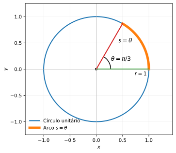
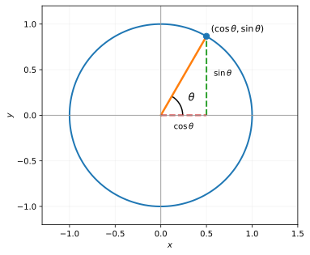
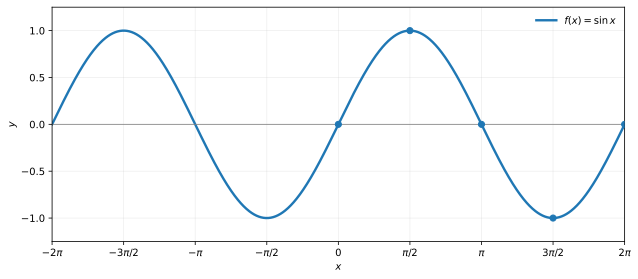
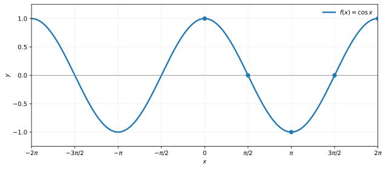
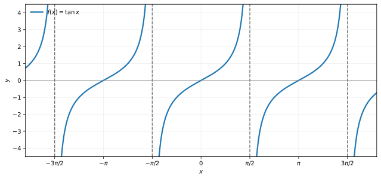
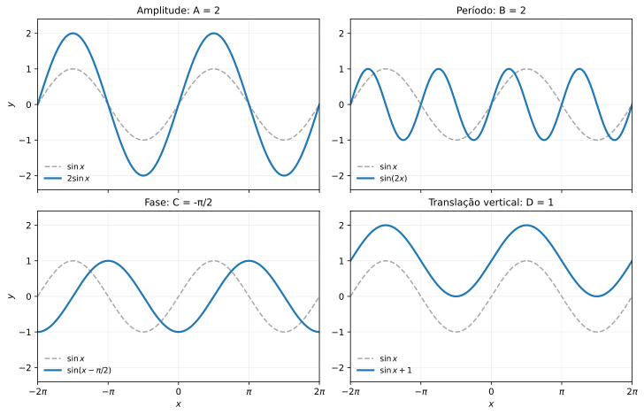
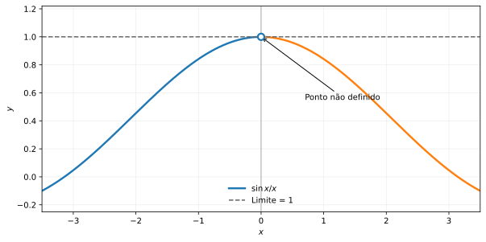

🏠 [← Sumário do Curso](../index.qmd) · [← Cursos de Matemática](../../index.qmd) · [← Seção de Matemática](/posts/matematica/index.qmd)

🎯 **Aula anterior:** 👉 [1.8 Exponenciais e Logaritmos](1.8-exponenciais-e-logaritmos.qmd)

🎯 **Próxima aula:** 👉 [1.10 Conceito Formal de Função](1.10-conceito-formal-de-funcao.qmd)

***

::: {.callout-tip title="❓ Pergunta Disparadora"}

Como a medida dos ângulos em radianos e o círculo unitário ajudam a compreender os valores, os gráficos e a periodicidade das funções trigonométricas?

:::

::: {.callout-note title="📌 Objetivos de Aprendizagem"}

Ao concluir esta aula, você deverá ser capaz de:

- Interpretar a medida em radianos e converter ângulos entre graus e radianos;
- Relacionar seno e cosseno às coordenadas de pontos do círculo unitário;
- Determinar valores notáveis, domínios, imagens, períodos e simetrias de seno, cosseno e tangente;
- Utilizar identidades trigonométricas básicas para simplificar expressões;
- Interpretar os efeitos de amplitude, período, fase e translação vertical em gráficos trigonométricos;
- Reconhecer a importância dos radianos no estudo posterior de limites e derivadas.

:::

# 📘 Trigonometria Essencial

A trigonometria é uma das linguagens fundamentais do Cálculo.

Ela aparece no estudo de ondas, oscilações, movimento circular, fenômenos periódicos, séries de Fourier, equações diferenciais, geometria, física e engenharia.

Neste módulo, vamos revisar as ideias essenciais:

- medida de ângulos;
- radianos;
- círculo trigonométrico;
- seno, cosseno e tangente;
- identidades básicas;
- gráficos das funções trigonométricas;
- domínio, imagem e periodicidade.

O objetivo não é esgotar a trigonometria, mas consolidar aquilo que será usado no Cálculo.

***

## 📐 Por que radianos?

No ensino básico, é comum medir ângulos em graus. Por exemplo:

$$
90^\circ,\qquad 180^\circ,\qquad 360^\circ.
$$

No Cálculo, entretanto, usamos principalmente **radianos**.

A razão é profunda: em radianos, a medida do ângulo está ligada diretamente ao comprimento de arco no círculo.

Em um círculo de raio $r$, um ângulo central $\theta$, medido em radianos, determina um arco de comprimento

$$
s=r\theta,
$$

considerando $\theta\geq 0$.

No círculo unitário, em que $r=1$, temos simplesmente

$$
s=\theta.
$$

Ou seja, a medida do ângulo em radianos coincide com o comprimento do arco correspondente no círculo de raio $1$.

{#fig-1-9-radianos fig-alt="Círculo unitário com um arco de 60 graus, raio unitário e ângulo de pi sobre três; o arco tem comprimento pi sobre três." width="90%"}

::: {.callout-note collapse="true" title="Clique para ver o código"}

Execute o código a partir do diretório `modulo-1`, com `numpy` e `matplotlib` instalados. A figura SVG será salva na pasta `images/`.

```python
import numpy as np
import matplotlib.pyplot as plt
from matplotlib.patches import Arc
from pathlib import Path

angulo = np.pi / 3
volta = np.linspace(0, 2 * np.pi, 600)
arco = np.linspace(0, angulo, 200)

fig, ax = plt.subplots(figsize=(7.2, 4.5))

ax.plot(np.cos(volta), np.sin(volta), lw=2, label='Círculo unitário')
ax.plot(np.cos(arco), np.sin(arco), lw=5, label=r'Arco $s=\theta$')
ax.plot([0, 1], [0, 0], lw=2)
ax.plot([0, np.cos(angulo)], [0, np.sin(angulo)], lw=2)

ax.add_patch(Arc((0, 0), 0.55, 0.55, theta1=0, theta2=60, lw=1.5))

ax.scatter([0], [0], color='black', s=18)
ax.text(0.28, 0.16, r'$\theta=\pi/3$', fontsize=12)
ax.text(0.42, 0.51, r'$s=\theta$', fontsize=12)
ax.text(0.73, -0.12, r'$r=1$', fontsize=11)

ax.set(xlim=(-1.35, 1.45), ylim=(-1.25, 1.25), xlabel='$x$', ylabel='$y$')
ax.set_aspect('equal')
ax.axhline(0, color='0.7', lw=0.8)
ax.axvline(0, color='0.7', lw=0.8)
ax.legend(loc='lower left', frameon=False)
ax.grid(alpha=0.15)

fig.tight_layout()

Path('images').mkdir(exist_ok=True)
fig.savefig('images/1.9-radianos.svg', bbox_inches='tight')
plt.close(fig)
```

:::

::: {.callout-note title="Ideia central"}

Radianos são naturais no Cálculo porque conectam ângulos, arcos e movimento circular de forma direta.

:::

***

## 🔄 Conversão entre graus e radianos

Uma volta completa corresponde a

$$
360^\circ
$$

e também a

$$
2\pi
$$

radianos.

Portanto,

$$
180^\circ=\pi
$$

radianos.

A partir dessa relação, obtemos:

$$
1^\circ=\frac{\pi}{180}
$$

radianos, e

$$
1\text{ radiano}=\frac{180^\circ}{\pi}.
$$

Algumas conversões importantes são:

| Graus | Radianos |
|---:|---:|
| $0^\circ$ | $0$ |
| $30^\circ$ | $\dfrac{\pi}{6}$ |
| $45^\circ$ | $\dfrac{\pi}{4}$ |
| $60^\circ$ | $\dfrac{\pi}{3}$ |
| $90^\circ$ | $\dfrac{\pi}{2}$ |
| $180^\circ$ | $\pi$ |
| $270^\circ$ | $\dfrac{3\pi}{2}$ |
| $360^\circ$ | $2\pi$ |

***

## ⭕ O círculo trigonométrico

O círculo trigonométrico é o círculo de raio $1$ centrado na origem do plano cartesiano.

Sua equação é

$$
x^2+y^2=1.
$$

Dado um ângulo $\theta$, medido a partir do eixo positivo $x$, o ponto correspondente no círculo unitário tem coordenadas

$$
(\cos\theta,\sin\theta).
$$

Assim:

- o cosseno é a coordenada horizontal;
- o seno é a coordenada vertical.

Essa definição é poderosa porque permite estudar seno e cosseno para qualquer ângulo real, não apenas para ângulos entre $0^\circ$ e $90^\circ$.

{#fig-1-9-circulo-unitario fig-alt="Círculo unitário com um ponto no primeiro quadrante, projeção horizontal cosseno de teta e projeção vertical seno de teta." width="90%"}

::: {.callout-note collapse="true" title="Clique para ver o código"}

Execute o código a partir do diretório `modulo-1`, com `numpy` e `matplotlib` instalados. A figura SVG será salva na pasta `images/`.

```python
import numpy as np
import matplotlib.pyplot as plt
from matplotlib.patches import Arc
from pathlib import Path

angulo = np.pi / 3
cx, sy = np.cos(angulo), np.sin(angulo)
t = np.linspace(0, 2 * np.pi, 600)

fig, ax = plt.subplots(figsize=(7.2, 4.5))

ax.plot(np.cos(t), np.sin(t), lw=2)
ax.plot([0, cx], [0, sy], lw=2.5)
ax.plot([cx, cx], [0, sy], '--', lw=2, label=r'$\sin\theta$')
ax.plot([0, cx], [0, 0], '--', lw=2, label=r'$\cos\theta$')

ax.scatter([cx], [sy], s=55, zorder=5)
ax.add_patch(Arc((0, 0), 0.48, 0.48, theta1=0, theta2=60, lw=1.5))

ax.text(0.30, 0.16, r'$\theta$', fontsize=13)
ax.text(cx + 0.05, sy + 0.05, r'$(\cos\theta,\sin\theta)$', fontsize=11)
ax.text(cx / 2, -0.15, r'$\cos\theta$', ha='center')
ax.text(cx + 0.08, sy / 2, r'$\sin\theta$')

ax.set(xlim=(-1.3, 1.5), ylim=(-1.2, 1.2), xlabel='$x$', ylabel='$y$')
ax.set_aspect('equal')
ax.axhline(0, color='0.6', lw=0.9)
ax.axvline(0, color='0.6', lw=0.9)
ax.grid(alpha=0.15)

fig.tight_layout()

Path('images').mkdir(exist_ok=True)
fig.savefig('images/1.9-circulo-unitario.svg', bbox_inches='tight')
plt.close(fig)
```

:::

***

## 🌊 Seno e cosseno

No círculo unitário, definimos:

$$
\cos\theta=x,
$$

$$
\sin\theta=y,
$$

onde $(x,y)$ é o ponto do círculo associado ao ângulo $\theta$.

Como todo ponto do círculo unitário satisfaz

$$
x^2+y^2=1,
$$

temos a identidade fundamental:

$$
\cos^2\theta+\sin^2\theta=1.
$$

Essa identidade será usada muitas vezes no Cálculo.

Por exemplo, ela permite reescrever expressões, simplificar derivadas e resolver equações trigonométricas.

***

## 🔢 Valores notáveis

Alguns valores de seno e cosseno aparecem com frequência:

| $\theta$ | $\sin\theta$ | $\cos\theta$ |
|---:|---:|---:|
| $0$ | $0$ | $1$ |
| $\dfrac{\pi}{6}$ | $\dfrac{1}{2}$ | $\dfrac{\sqrt{3}}{2}$ |
| $\dfrac{\pi}{4}$ | $\dfrac{\sqrt{2}}{2}$ | $\dfrac{\sqrt{2}}{2}$ |
| $\dfrac{\pi}{3}$ | $\dfrac{\sqrt{3}}{2}$ | $\dfrac{1}{2}$ |
| $\dfrac{\pi}{2}$ | $1$ | $0$ |
| $\pi$ | $0$ | $-1$ |
| $\dfrac{3\pi}{2}$ | $-1$ | $0$ |
| $2\pi$ | $0$ | $1$ |

Esses valores ajudam a construir gráficos, resolver limites e reconhecer padrões trigonométricos.

***

## 📐 Tangente

A tangente é definida por

$$
\tan\theta=\frac{\sin\theta}{\cos\theta},
$$

sempre que

$$
\cos\theta\neq 0.
$$

Portanto, a tangente não está definida nos pontos em que o cosseno é zero.

Isso ocorre quando

$$
\theta=\frac{\pi}{2}+k\pi,
$$

com

$$
k\in\mathbb{Z}.
$$

Assim, o domínio da tangente é

$$
D_{\tan}=
\mathbb{R}\setminus
\left\{
\frac{\pi}{2}+k\pi\mid k\in\mathbb{Z}
\right\}.
$$

***

## 🔁 Periodicidade

As funções trigonométricas são periódicas.

Isso significa que seus valores se repetem em intervalos regulares.

Para seno e cosseno, temos:

$$
\sin(\theta+2\pi)=\sin\theta,
$$

$$
\cos(\theta+2\pi)=\cos\theta.
$$

O período fundamental de $\sin x$ e $\cos x$ é

$$
2\pi.
$$

Para a tangente,

$$
\tan(\theta+\pi)=\tan\theta.
$$

O período fundamental de $\tan x$ é

$$
\pi.
$$

A periodicidade é uma das razões pelas quais funções trigonométricas são tão importantes na modelagem de oscilações.

***

## 🪞 Paridade: funções pares e ímpares

O cosseno é uma função par:

$$
\cos(-x)=\cos x.
$$

Isso significa que seu gráfico é simétrico em relação ao eixo vertical.

O seno é uma função ímpar:

$$
\sin(-x)=-\sin x.
$$

Isso significa que seu gráfico é simétrico em relação à origem.

A tangente também é ímpar:

$$
\tan(-x)=-\tan x.
$$

Essas simetrias ajudam a simplificar cálculos e a entender os gráficos.

***

## 📊 Gráfico do seno

A função

$$
f(x)=\sin x
$$

tem domínio

$$
\mathbb{R}
$$

e imagem

$$
[-1,1].
$$

Seu período fundamental é

$$
2\pi.
$$

Alguns pontos importantes são:

$$
\sin 0=0,
$$

$$
\sin\frac{\pi}{2}=1,
$$

$$
\sin\pi=0,
$$

$$
\sin\frac{3\pi}{2}=-1,
$$

$$
\sin 2\pi=0.
$$

O gráfico do seno oscila entre $-1$ e $1$ indefinidamente.

{#fig-1-9-seno fig-alt="Curva seno entre menos dois pi e dois pi, indicando máximos, mínimos e interseções com o eixo horizontal." width="90%"}

::: {.callout-note collapse="true" title="Clique para ver o código"}

Execute o código a partir do diretório `modulo-1`, com `numpy` e `matplotlib` instalados. A figura SVG será salva na pasta `images/`.

```python
import numpy as np
import matplotlib.pyplot as plt
from pathlib import Path

x = np.linspace(-2 * np.pi, 2 * np.pi, 1200)

fig, ax = plt.subplots(figsize=(9, 4))

ax.plot(x, np.sin(x), lw=2.4, label=r'$f(x)=\sin x$')
ax.scatter(
    [0, np.pi/2, np.pi, 3*np.pi/2, 2*np.pi],
    [0, 1, 0, -1, 0],
    s=38,
    zorder=3
)

ax.set_xticks(np.pi * np.array([-2, -1.5, -1, -.5, 0, .5, 1, 1.5, 2]))
ax.set_xticklabels([
    r'$-2\pi$', r'$-3\pi/2$', r'$-\pi$', r'$-\pi/2$',
    '$0$', r'$\pi/2$', r'$\pi$', r'$3\pi/2$', r'$2\pi$'
])

ax.set(xlim=(-2*np.pi, 2*np.pi), ylim=(-1.25, 1.25), xlabel='$x$', ylabel='$y$')
ax.axhline(0, color='0.5', lw=0.8)
ax.grid(alpha=0.2)
ax.legend(frameon=False)

fig.tight_layout()

Path('images').mkdir(exist_ok=True)
fig.savefig('images/1.9-seno.svg', bbox_inches='tight')
plt.close(fig)
```

:::

***

## 📊 Gráfico do cosseno

A função

$$
f(x)=\cos x
$$

também tem domínio

$$
\mathbb{R}
$$

e imagem

$$
[-1,1].
$$

Seu período fundamental é

$$
2\pi.
$$

Alguns pontos importantes são:

$$
\cos 0=1,
$$

$$
\cos\frac{\pi}{2}=0,
$$

$$
\cos\pi=-1,
$$

$$
\cos\frac{3\pi}{2}=0,
$$

$$
\cos 2\pi=1.
$$

O gráfico do cosseno tem a mesma forma geral do seno, mas começa no valor máximo quando $x=0$.

{#fig-1-9-cosseno fig-alt="Curva cosseno entre menos dois pi e dois pi, indicando máximos, mínimos e interseções com o eixo horizontal." width="90%"}

::: {.callout-note collapse="true" title="Clique para ver o código"}

Execute o código a partir do diretório `modulo-1`, com `numpy` e `matplotlib` instalados. A figura SVG será salva na pasta `images/`.

```python
import numpy as np
import matplotlib.pyplot as plt
from pathlib import Path

x = np.linspace(-2 * np.pi, 2 * np.pi, 1200)

fig, ax = plt.subplots(figsize=(9, 4))

ax.plot(x, np.cos(x), lw=2.4, label=r'$f(x)=\cos x$')
ax.scatter(
    [0, np.pi/2, np.pi, 3*np.pi/2, 2*np.pi],
    [1, 0, -1, 0, 1],
    s=38,
    zorder=3
)

ax.set_xticks(np.pi * np.array([-2, -1.5, -1, -.5, 0, .5, 1, 1.5, 2]))
ax.set_xticklabels([
    r'$-2\pi$', r'$-3\pi/2$', r'$-\pi$', r'$-\pi/2$',
    '$0$', r'$\pi/2$', r'$\pi$', r'$3\pi/2$', r'$2\pi$'
])

ax.set(xlim=(-2*np.pi, 2*np.pi), ylim=(-1.25, 1.25), xlabel='$x$', ylabel='$y$')
ax.axhline(0, color='0.5', lw=0.8)
ax.grid(alpha=0.2)
ax.legend(frameon=False)

fig.tight_layout()

Path('images').mkdir(exist_ok=True)
fig.savefig('images/1.9-cosseno.svg', bbox_inches='tight')
plt.close(fig)
```

:::

***

## 📊 Gráfico da tangente

A função

$$
f(x)=\tan x
$$

tem domínio

$$
D_{\tan}=
\mathbb{R}\setminus
\left\{
\frac{\pi}{2}+k\pi\mid k\in\mathbb{Z}
\right\}
$$

e imagem

$$
\mathbb{R}.
$$

Seu período fundamental é

$$
\pi.
$$

A tangente possui assíntotas verticais nos pontos

$$
x=\frac{\pi}{2}+k\pi.
$$

Essas assíntotas aparecem porque, nesses pontos, o cosseno é zero e a expressão

$$
\tan x=\frac{\sin x}{\cos x}
$$

não está definida.

{#fig-1-9-tangente fig-alt="Curva tangente com ramos separados por assíntotas verticais em pi sobre dois mais múltiplos inteiros de pi." width="90%"}

::: {.callout-note collapse="true" title="Clique para ver o código"}

Execute o código a partir do diretório `modulo-1`, com `numpy` e `matplotlib` instalados. A figura SVG será salva na pasta `images/`.

```python
import numpy as np
import matplotlib.pyplot as plt
from pathlib import Path

x = np.linspace(-1.8 * np.pi, 1.8 * np.pi, 4000)
y = np.tan(x)

y[(np.abs(np.cos(x)) < 0.035) | (np.abs(y) > 4.5)] = np.nan

fig, ax = plt.subplots(figsize=(9, 4.3))
ax.plot(x, y, lw=2.2, label=r'$f(x)=\tan x$')

for k in [-2, -1, 0, 1]:
    assintota = np.pi / 2 + k * np.pi

    if -1.8*np.pi < assintota < 1.8*np.pi:
        ax.axvline(assintota, color='0.45', ls='--', lw=1.4)

ax.set_xticks(np.pi * np.array([-1.5, -1, -.5, 0, .5, 1, 1.5]))
ax.set_xticklabels([
    r'$-3\pi/2$', r'$-\pi$', r'$-\pi/2$', '$0$',
    r'$\pi/2$', r'$\pi$', r'$3\pi/2$'
])

ax.set(xlim=(-1.8*np.pi, 1.8*np.pi), ylim=(-4.5, 4.5), xlabel='$x$', ylabel='$y$')
ax.axhline(0, color='0.5', lw=0.8)
ax.grid(alpha=0.2)
ax.legend(loc='upper left', frameon=False)

fig.tight_layout()

Path('images').mkdir(exist_ok=True)
fig.savefig('images/1.9-tangente.svg', bbox_inches='tight')
plt.close(fig)
```

:::

***

## 🧮 Identidades trigonométricas básicas

A identidade fundamental é

$$
\sin^2 x+\cos^2 x=1.
$$

Dividindo essa identidade por $\cos^2 x$, quando $\cos x\neq 0$, obtemos:

$$
\tan^2 x+1=\sec^2 x.
$$

Dividindo por $\sin^2 x$, quando $\sin x\neq 0$, obtemos:

$$
1+\cot^2 x=\csc^2 x.
$$

Também temos:

$$
\tan x=\frac{\sin x}{\cos x},
$$

sempre que $\cos x\neq 0$.

Para o início do Cálculo, as identidades mais importantes são:

$$
\sin^2 x+\cos^2 x=1
$$

e

$$
\tan x=\frac{\sin x}{\cos x}.
$$

***

## 🔄 Transformações simples

As funções trigonométricas podem ser modificadas por constantes.

Por exemplo:

$$
f(x)=A\sin(Bx+C)+D.
$$

Nesse caso:

- $A$ determina a amplitude, que é $|A|$; se $A<0$, também ocorre uma reflexão em relação à linha média;
- $B$ altera o período;
- $C$ determina o deslocamento horizontal, que é $-C/B$ quando $B\neq 0$;
- $D$ desloca o gráfico verticalmente e determina a linha média $y=D$.

A amplitude de

$$
A\sin x
$$

é

$$
|A|.
$$

O período de

$$
\sin(Bx)
$$

é

$$
\frac{2\pi}{|B|},
$$

quando $B\neq 0$.

Essa expressão representa o **período fundamental** de $A\sin(Bx+C)+D$ quando $A\neq 0$ e $B\neq 0$. Se $A=0$ ou $B=0$, a função é constante e não possui período fundamental positivo.

Essas transformações são muito usadas na modelagem de ondas.

{#fig-1-9-transformacoes fig-alt="Quatro gráficos comparando seno com dois seno, seno de dois x, seno de x menos meio pi e seno mais um." width="90%"}

::: {.callout-note collapse="true" title="Clique para ver o código"}

Execute o código a partir do diretório `modulo-1`, com `numpy` e `matplotlib` instalados. A figura SVG será salva na pasta `images/`.

```python
import numpy as np
import matplotlib.pyplot as plt
from pathlib import Path

x = np.linspace(-2*np.pi, 2*np.pi, 1200)

fig, axs = plt.subplots(
    2, 2,
    figsize=(10, 6.4),
    sharex=True,
    constrained_layout=True
)

casos = [
    (2*np.sin(x), r'$2\sin x$', 'Amplitude: A = 2'),
    (np.sin(2*x), r'$\sin(2x)$', 'Período: B = 2'),
    (np.sin(x-np.pi/2), r'$\sin(x-\pi/2)$', 'Fase: C = -π/2'),
    (np.sin(x)+1, r'$\sin x+1$', 'Translação vertical: D = 1'),
]

for ax, (y, rotulo, titulo) in zip(axs.flat, casos):
    ax.plot(x, np.sin(x), color='0.65', ls='--', lw=1.5, label=r'$\sin x$')
    ax.plot(x, y, lw=2.2, label=rotulo)
    ax.set_title(titulo, fontsize=11)
    ax.set(xlim=(-2*np.pi, 2*np.pi), ylim=(-2.4, 2.4))
    ax.grid(alpha=0.2)
    ax.legend(loc='lower left', fontsize=9, frameon=False)
    ax.set_xticks(np.pi * np.array([-2, -1, 0, 1, 2]))
    ax.set_xticklabels([r'$-2\pi$', r'$-\pi$', '$0$', r'$\pi$', r'$2\pi$'])

for ax in axs[1]:
    ax.set_xlabel('$x$')

for ax in axs[:, 0]:
    ax.set_ylabel('$y$')

Path('images').mkdir(exist_ok=True)
fig.savefig('images/1.9-transformacoes.svg', bbox_inches='tight')
plt.close(fig)
```

:::

***

## 🧾 Quadro-resumo — Trigonometria Essencial

| Conceito | Resultado essencial |
|---|---|
| Radianos | $s=r\theta$ ($\theta\geq 0$); uma volta: $2\pi$ rad. |
| Conversão | $180^\circ=\pi$; graus $\to$ radianos: $\times\pi/180$. |
| Círculo unitário | $(\cos\theta,\sin\theta)$. |
| Seno | $D=\mathbb{R}$; imagem $[-1,1]$; período $2\pi$; ímpar. |
| Cosseno | $D=\mathbb{R}$; imagem $[-1,1]$; período $2\pi$; par. |
| Tangente | $\tan x=\dfrac{\sin x}{\cos x}$; $D=\mathbb{R}\setminus\{\frac{\pi}{2}+k\pi\}$; imagem $\mathbb{R}$; período $\pi$. |
| Identidade fundamental | $\sin^2x+\cos^2x=1$. |
| Seno transformado | $A\sin(Bx+C)+D$: amplitude $|A|$; período $\dfrac{2\pi}{|B|}$; fase $-\dfrac{C}{B}$; deslocamento vertical $D$. |
| Limite fundamental | $\displaystyle\lim_{x\to0}\frac{\sin x}{x}=1$ (radianos). |

**Para conferir a compreensão:** identifique o domínio, a imagem, as simetrias e o período de cada função. Nas funções transformadas, diferencie amplitude, deslocamento horizontal e linha média.

***

:::: {.callout-tip title="🌉 Ponte para o Cálculo"}

A trigonometria é essencial para o Cálculo por várias razões. As funções seno e cosseno têm derivadas muito especiais:

$$
\frac{d}{dx}\sin x=\cos x,
$$

e

$$
\frac{d}{dx}\cos x=-\sin x.
$$

Esses resultados serão estudados mais adiante.

Além disso, funções trigonométricas aparecem em limites fundamentais, como

$$
\lim_{x\to 0}\frac{\sin x}{x}=1.
$$

Esse limite é uma das portas de entrada para as derivadas trigonométricas.

{#fig-1-9-limite-fundamental fig-alt="Gráfico de seno de x sobre x, com um círculo aberto em x igual a zero e reta horizontal pontilhada em y igual a um." width="90%"}

::: {.callout-note collapse="true" title="Clique para ver o código"}

Execute o código a partir do diretório `modulo-1`, com `numpy` e `matplotlib` instalados. A figura SVG será salva na pasta `images/`.

```python
import numpy as np
import matplotlib.pyplot as plt
from pathlib import Path

neg = np.linspace(-3.5, -0.001, 1400)
pos = np.linspace(0.001, 3.5, 1400)

fig, ax = plt.subplots(figsize=(8.5, 4.3))

ax.plot(neg, np.sin(neg)/neg, lw=2.4, label=r'$\sin x/x$')
ax.plot(pos, np.sin(pos)/pos, lw=2.4)
ax.axhline(1, color='0.4', ls='--', label='Limite = 1')

ax.scatter(
    [0], [1],
    s=65,
    facecolors='white',
    edgecolors='C0',
    linewidths=2.2,
    zorder=5
)

ax.annotate(
    'Ponto não definido',
    xy=(0, 1),
    xytext=(0.7, 0.55),
    arrowprops=dict(arrowstyle='->', lw=1),
    fontsize=10
)

ax.set(xlim=(-3.5, 3.5), ylim=(-0.25, 1.22), xlabel='$x$', ylabel='$y$')
ax.axvline(0, color='0.6', lw=0.8)
ax.grid(alpha=0.2)
ax.legend(loc='lower center', frameon=False)

fig.tight_layout()

Path('images').mkdir(exist_ok=True)
fig.savefig('images/1.9-limite-fundamental.svg', bbox_inches='tight')
plt.close(fig)
```

:::

**Atenção:** as fórmulas usuais de derivadas e limites trigonométricos apresentadas nesta aula pressupõem que os ângulos estejam medidos em radianos. Quando a variável angular é expressa em graus, aparecem fatores de conversão.

::::

# 🧪 Exercícios propostos

::: {.callout-note title="📝 Exercícios"}

## 🧪 Exercício 1

Converta para radianos:

a) $30^\circ$  
b) $45^\circ$  
c) $60^\circ$  
d) $90^\circ$  
e) $180^\circ$

## 🧪 Exercício 2

Converta para graus:

a) $\dfrac{\pi}{6}$  
b) $\dfrac{\pi}{4}$  
c) $\dfrac{\pi}{3}$  
d) $\dfrac{\pi}{2}$  
e) $2\pi$

## 🧪 Exercício 3

Calcule:

a) $\sin\left(\dfrac{\pi}{6}\right)$  
b) $\cos\left(\dfrac{\pi}{3}\right)$  
c) $\sin\left(\dfrac{\pi}{2}\right)$  
d) $\cos(\pi)$  
e) $\tan\left(\dfrac{\pi}{4}\right)$

## 🧪 Exercício 4

Determine o domínio real das funções:

a) $f(x)=\sin x$  
b) $g(x)=\cos x$  
c) $h(x)=\tan x$

## 🧪 Exercício 5

Use a identidade

$$
\sin^2 x+\cos^2 x=1
$$

para determinar $\cos^2 x$ quando $\sin x=\dfrac{3}{5}$.

:::

***

# ✅ Gabarito comentado

::: {.callout-important collapse="true" title="✅ Gabarito"}

## 🧪 Exercício 1

Para converter graus em radianos, multiplicamos por

$$
\frac{\pi}{180}.
$$

a) $30^\circ=\dfrac{30\pi}{180}=\dfrac{\pi}{6}$.

b) $45^\circ=\dfrac{45\pi}{180}=\dfrac{\pi}{4}$.

c) $60^\circ=\dfrac{60\pi}{180}=\dfrac{\pi}{3}$.

d) $90^\circ=\dfrac{90\pi}{180}=\dfrac{\pi}{2}$.

e) $180^\circ=\pi$.

## 🧪 Exercício 2

Para converter radianos em graus, multiplicamos por

$$
\frac{180}{\pi}.
$$

a) $\dfrac{\pi}{6}=30^\circ$.

b) $\dfrac{\pi}{4}=45^\circ$.

c) $\dfrac{\pi}{3}=60^\circ$.

d) $\dfrac{\pi}{2}=90^\circ$.

e) $2\pi=360^\circ$.

## 🧪 Exercício 3

a) $\sin\left(\dfrac{\pi}{6}\right)=\dfrac{1}{2}$.

b) $\cos\left(\dfrac{\pi}{3}\right)=\dfrac{1}{2}$.

c) $\sin\left(\dfrac{\pi}{2}\right)=1$.

d) $\cos(\pi)=-1$.

e) $\tan\left(\dfrac{\pi}{4}\right)=1$.

## 🧪 Exercício 4

a) A função $f(x)=\sin x$ está definida para todo real. Logo,

$$
D_f=\mathbb{R}.
$$

b) A função $g(x)=\cos x$ está definida para todo real. Logo,

$$
D_g=\mathbb{R}.
$$

c) A função $h(x)=\tan x$ não está definida quando $\cos x=0$. Isso ocorre em

$$
x=\frac{\pi}{2}+k\pi,
$$

com $k\in\mathbb{Z}$. Portanto,

$$
D_h=
\mathbb{R}\setminus
\left\{
\frac{\pi}{2}+k\pi\mid k\in\mathbb{Z}
\right\}.
$$

## 🧪 Exercício 5

Sabemos que

$$
\sin^2 x+\cos^2 x=1.
$$

Se

$$
\sin x=\frac{3}{5},
$$

então

$$
\sin^2 x=\left(\frac{3}{5}\right)^2=\frac{9}{25}.
$$

Logo,

$$
\frac{9}{25}+\cos^2 x=1.
$$

Assim,

$$
\cos^2 x=1-\frac{9}{25}=\frac{16}{25}.
$$

Portanto,

$$
\boxed{\cos^2 x=\frac{16}{25}}.
$$

:::

***

# 🧩 Quiz — Trigonometria Essencial

:::::{.question}

**Q1.** No Cálculo, preferimos medir ângulos em radianos porque:

::::{.choices}

:::{.choice .correct-choice}
Radianos conectam naturalmente ângulos e comprimentos de arco.
:::

:::{.choice}
Radianos eliminam a necessidade de funções trigonométricas.
:::

:::{.choice}
Radianos só servem para ângulos retos.
:::

::::

:::::

:::::{.question}

**Q2.** No círculo unitário, o ponto associado ao ângulo $\theta$ tem coordenadas:

::::{.choices}

:::{.choice}
$(\sin\theta,\cos\theta)$.
:::

:::{.choice .correct-choice}
$(\cos\theta,\sin\theta)$.
:::

:::{.choice}
$(\tan\theta,\sin\theta)$.
:::

::::

:::::

:::::{.question}

**Q3.** A identidade trigonométrica fundamental é:

::::{.choices}

:::{.choice}
$\sin x+\cos x=1$.
:::

:::{.choice}
$\tan x=\sin x+\cos x$.
:::

:::{.choice .correct-choice}
$\sin^2 x+\cos^2 x=1$.
:::

::::

:::::

***

# 🔗 Navegação

🎯 **Aula anterior:** 👉 [1.8 Exponenciais e Logaritmos](1.8-exponenciais-e-logaritmos.qmd)

🎯 **Próxima aula:** 👉 [1.10 Conceito Formal de Função](1.10-conceito-formal-de-funcao.qmd)

🏠 [← Sumário do Curso](../index.qmd) · [← Cursos de Matemática](../../index.qmd) · [← Seção de Matemática](/posts/matematica/index.qmd) · 🔝 [Voltar ao topo](#)

***

*Blog do Marcellini — Explorando a Matemática com Rigor e Beleza.*

:::{.callout-note}
Criado por Blog do Marcellini com ❤️ e código.
:::