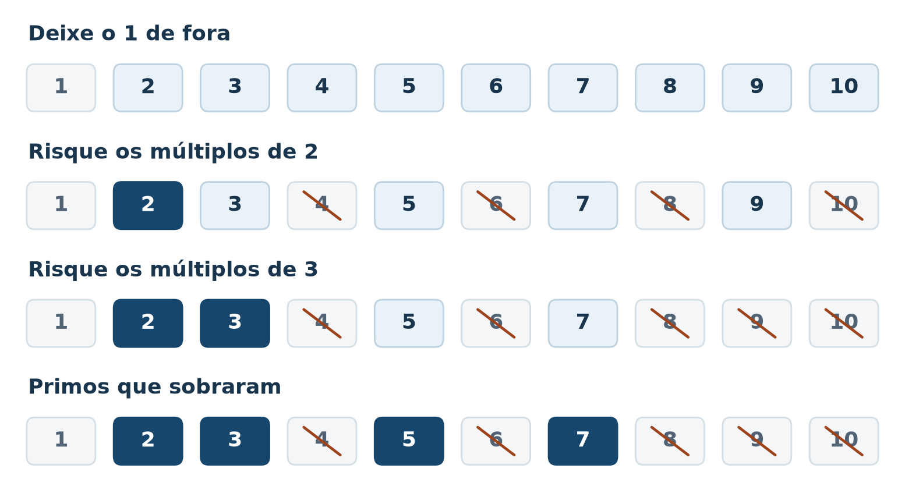
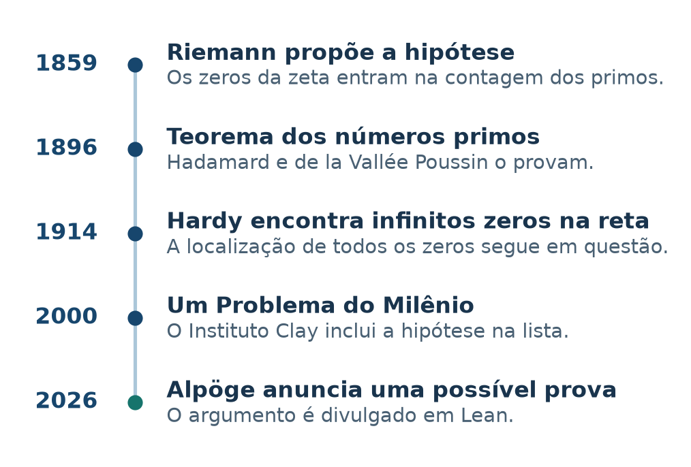
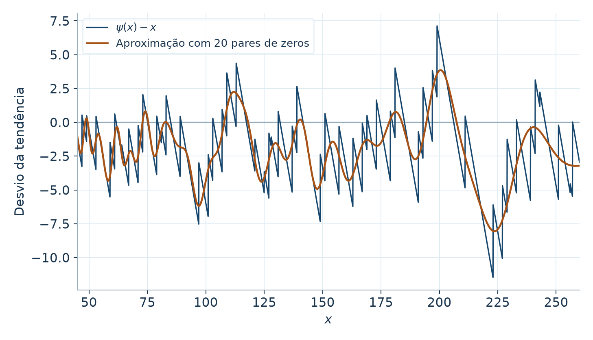

· [← Guia de Leitura de Matemática](guia-matematica.qmd) · [← Seção de Matemática](index.qmd)

---

::: {.callout-note appearance="simple"}
**Atualização de 22 de novembro de 2026.** Em 21 de novembro, as comunidades Lean e Mathlib confirmaram a validade da demonstração formal de Levent Alpöge. Verificadores independentes também checaram a prova, e a comparação com a Mathlib confirmou que o enunciado demonstrado é o da hipótese de Riemann clássica. [Leia a declaração conjunta](https://leanprover-community.github.io/blog/posts/riemann-hypothesis/).
:::

Até 10 há quatro números primos. Até 100, há 25. Até 1.000, já são 168. À medida que avançamos, os primos ficam mais raros em média, e a distância entre eles varia. Podemos ver isso começando pela contagem exata.

O **Crivo de Eratóstenes** mostra como fazer essa contagem. Até 10, deixamos o 1 de fora, conservamos o 2 e riscamos seus múltiplos maiores que ele (4, 6, 8 e 10). O próximo número ainda de pé é o 3. Conservamos o 3 e riscamos o 9, pois o 6 já foi riscado. Sobram **2, 3, 5 e 7**. Basta usar os primos até a raiz quadrada do limite, pois todo número composto tem pelo menos um fator primo nessa faixa.

{fig-alt="Quatro etapas do crivo até 10. O 1 fica de fora. O 2 elimina 4, 6, 8 e 10. O 3 elimina 9. Sobram 2, 3, 5 e 7."}

| Faixa | Primos usados para riscar múltiplos até o limite | Primos na faixa | Total acumulado |
|:---|:---|---:|---:|
| 1–10 | 2 e 3 | 4 de 10 | 4 |
| 11–100 | 2, 3, 5 e 7 | 21 de 90 | 25 |
| 101–1.000 | 2, 3, 5, 7, 11, 13, 17, 19, 23, 29 e 31 | 143 de 900 | 168 |

Em cada linha, o crivo é feito desde o 2 até o fim da faixa. A coluna **Primos na faixa** conta só os números daquele trecho. A última faixa contém mais primos em números absolutos, mas a proporção cai de 4 em 10 para cerca de 16 em 100.

**Com que precisão podemos estimar quantos primos existem até um número dado?** O crivo dá a contagem exata. Uma estimativa clássica para o total até 1.000 dá cerca de **177**, enquanto a tabela mostra **168**. A diferença é de aproximadamente **9 primos**. Quando o limite cresce, quão grande pode ficar esse erro?

Riemann descobriu que, para estudar esse erro, podemos olhar os **zeros da função zeta**, os pontos em que ela vale zero. A posição desses pontos ajuda a determinar quanto a estimativa pode se afastar da contagem real. A **hipótese de Riemann** afirma que um grupo específico desses zeros, os **não triviais**, está todo numa mesma reta. Se isso for verdade, teremos um limite mais preciso para o erro das estimativas. Essa ligação explica por que um anúncio sobre os zeros de uma função chamou a atenção de quem estuda os primos. [Instituto Clay, hipótese de Riemann](https://www.claymath.org/millennium/riemann-hypothesis/)

Em 20 de novembro de 2026, o matemático **Levent Alpöge** anunciou que acredita ter demonstrado a **hipótese de Riemann** e sua **versão generalizada**, em um trabalho desenvolvido com a ajuda do assistente de IA **Claude**. [Nota de Alpöge](https://alpo.ge/remark.pdf) · [Cobertura da Quanta Magazine](https://www.quantamagazine.org/updates/transformation/)

::: {.callout-note title="Estado da verificação segundo a Quanta — 20 de novembro de 2026"}
A *Quanta* informou que equipes independentes conseguiram compilar o código com que Alpöge apresentou o argumento em [Lean, um assistente de provas](#o-que-é-lean). A checagem prosseguia para confirmar se o código demonstrava exatamente o enunciado original e quais premissas usava. O Instituto Clay ainda listava a hipótese como problema em aberto. [Cobertura da Quanta](https://www.quantamagazine.org/updates/transformation/) · [Verificação da comunidade Lean](https://github.com/leanprover-community/riemann-hypothesis) · [Instituto Clay](https://www.claymath.org/millennium/riemann-hypothesis/)
:::

# 👤 Quem é Levent Alpöge? {#quem-é-levent-alpöge}

Alpöge é um matemático da Anthropic. Fez o doutorado em Princeton e estudou problemas sobre soluções inteiras de equações. No anúncio, ele conta que orientou a pesquisa a partir de um problema mais simples e que Claude sugeriu passos importantes do argumento. [Perfil acadêmico](https://alpo.ge/) · [Relato de Alpöge](https://alpo.ge/remark.pdf)

# 🤖 O que é Claude? {#o-que-é-claude}

Claude é o assistente de IA da Anthropic. Na pesquisa matemática, ele pode ajudar a explorar ideias e escrever código. Neste caso, o relato de Alpöge dá um exemplo de como um matemático pode trabalhar com um assistente de IA na busca de uma prova. [Apresentação de Claude](https://www.anthropic.com/news/introducing-claude)

# 🕰️ Uma pergunta que atravessou gerações {#um-breve-histórico}

Em 1859, Bernhard Riemann encontrou uma maneira de ligar a contagem de primos a uma função chamada **zeta**. Em 1896, Hadamard e de la Vallée Poussin provaram o **teorema dos números primos**, que descreve o crescimento da contagem. Em 1914, G. H. Hardy provou que infinitos zeros da zeta estão na reta que Riemann indicou. Ainda restava saber se algum dos zeros não triviais poderia estar fora dela. [Manuscrito de Riemann](https://www.claymath.org/collections/riemanns-1859-manuscript/) · [Histórico do Clay](https://www.claymath.org/library/annual_report/ar2004/04report_riemann.pdf) · [Hardy no Blog](beleza-matematica.qmd)

{fig-alt="Linha do tempo com marcos em 1859, 1896, 1914, 2000 e 2026."}

# 📐 O que a hipótese de Riemann diz? {#a-hipótese-de-riemann-e-as-funções-l-de-dirichlet}

## Por que aparece a função zeta? {#a-função-zeta}

Uma maneira de calcular a zeta começa com uma soma de parcelas cada vez menores. Para calcular $\zeta(2)$, tomamos o inverso do quadrado de cada inteiro positivo.

$$
\begin{aligned}
\zeta(2)&=1+\frac{1}{2^2}+\frac{1}{3^2}+\frac{1}{4^2}+\cdots\\
        &=1+\frac14+\frac19+\frac1{16}+\cdots
\end{aligned}
$$

A mesma soma pode ser montada a partir dos primos, porque cada inteiro maior que $1$ tem uma única fatoração em primos. Como $6=2\cdot3$, a parcela correspondente a $6$ aparece ao multiplicarmos a contribuição do $2$ pela do $3$:

$$
\frac{1}{2^2}\cdot\frac{1}{3^2}=\frac{1}{(2\cdot3)^2}=\frac{1}{6^2}=\frac{1}{36}.
$$

Cada parcela da soma pode ser obtida pelo mesmo princípio. Essa ponte permite estudar os primos por meio da zeta. [NIST, função zeta](https://dlmf.nist.gov/25.2)

## Como ler a faixa crítica {#como-ler-a-faixa-crítica}

Até aqui calculamos a zeta para a entrada $s=2$. Riemann estudou a função para **números complexos**, que podemos representar como pontos num mapa. A coordenada horizontal é a **parte real** e a vertical é a **parte imaginária**. Um **zero** é um ponto em que a função vale zero. Os zeros que interessam à hipótese, chamados *não triviais*, ficam na faixa azul. A hipótese afirma que **todos eles estão sobre a linha tracejada**, cuja coordenada horizontal é $1/2$.

{fig-alt="Faixa azul entre 0 e 1 no eixo horizontal. Oito zeros estão sobre a reta tracejada que passa por 1/2. Dois zeros triviais aparecem à esquerda e o polo é marcado com uma cruz."}

Os oito pontos azuis são exemplos já conhecidos. Para demonstrar a hipótese, é preciso explicar por que nenhum dos zeros não triviais pode ficar fora daquela linha. [NIST, zeros da zeta](https://dlmf.nist.gov/25.10)

::: {.callout-note collapse="true" title="Para aprofundar — as fórmulas da zeta"}
Se a parte real de $s$ for maior que $1$, a zeta admite uma soma sobre os inteiros e um produto sobre os primos:

$$
\zeta(s)=\sum_{n\ge1}\frac{1}{n^s}
=\prod_{p\ \mathrm{primo}}\frac{1}{1-p^{-s}}.
$$

O **prolongamento analítico** estende a função ao plano complexo, com um polo simples em $s=1$. Seus zeros não triviais estão na faixa $0<\operatorname{Re}(s)<1$. A hipótese afirma que todos têm parte real $1/2$. [NIST, definição e propriedades](https://dlmf.nist.gov/25.2)
:::

## A versão generalizada {#da-zeta-às-funções-l}

Há primos que deixam resto 1 quando divididos por 4, como 5 e 13. Outros deixam resto 3, como 3 e 7. Para estudar esses grupos separadamente, os matemáticos usam funções aparentadas com a zeta, chamadas **funções L de Dirichlet**. Elas atribuem pesos diferentes aos grupos. A versão generalizada da hipótese prevê que os zeros dessas funções na faixa crítica também estejam na reta de coordenada horizontal $1/2$. [NIST, funções L de Dirichlet](https://dlmf.nist.gov/25.15)

::: {.callout-note collapse="true" title="Para aprofundar — um exemplo de função L"}
Podemos dar peso $+1$ aos números que deixam resto $1$ na divisão por $4$, peso $-1$ aos que deixam resto $3$ e peso zero aos pares. Essa regra é um **caráter de Dirichlet**, denotado por $\chi$. Para $\operatorname{Re}(s)>1$, ela produz a série $L(s,\chi)=1-3^{-s}+5^{-s}-7^{-s}+\cdots$. No caso geral, a série é $L(s,\chi)=\sum_{n\ge1}\chi(n)n^{-s}$.
:::

# 🔢 O que os zeros têm a ver com os primos? {#como-os-zeros-aparecem-na-contagem-dos-primos}

## Contar e estimar são coisas diferentes {#a-contagem-em-degraus}

O gráfico azul sobe um degrau cada vez que encontramos um primo. Entre 10 e 11, por exemplo, a contagem sobe de quatro para cinco. De 11 a 12, ela fica parada. As curvas laranja e verde estimam o mesmo total. A laranja, $x/\log x$, usa a densidade aproximada de primos perto do limite $x$ e dá cerca de 145 quando $x=1.000$. A verde, chamada **integral logarítmica**, leva em conta como essa densidade varia de 2 até $x$. É a estimativa de cerca de 177 que usamos na abertura. [NIST, distribuição dos primos](https://dlmf.nist.gov/25.16#i)

{fig-alt="A contagem exata dos primos sobe em degraus azuis. Em 1.000, a curva laranja termina abaixo da contagem e a verde, um pouco acima."}

## De onde vêm as oscilações? {#as-oscilações-na-fórmula-explícita}

O desvio entre o total exato e as estimativas é mais fácil de estudar com uma contagem que também inclui potências de primos como 4 e 8. Nela, 2, 4 e 8 contribuem com o mesmo peso, por serem potências de 2. Essa contagem revela oscilações em torno de uma tendência. Cada par de zeros da zeta que aparecem à mesma distância acima e abaixo do eixo horizontal contribui com uma onda. A posição dos zeros controla quanto essas ondas podem crescer e ajuda a limitar o desvio na contagem dos primos. [NIST, relação entre zeros e contagem](https://dlmf.nist.gov/25.16.E2)

::: {.callout-note collapse="true" title="Para aprofundar — veja as ondas no gráfico"}
Chamamos de $\psi(x)$ a contagem que soma $\log p$ para cada potência $p^k\le x$, com $k\ge1$. A linha azul mostra o desvio $\psi(x)-x$. A laranja aproxima esse desvio usando os primeiros 20 pares de zeros e os termos de correção da fórmula abaixo. Ela já acompanha parte das oscilações.

{fig-alt="A curva laranja acompanha parte das subidas e descidas da linha azul, sem reproduzir todos os saltos."}

A fórmula de Riemann–von Mangoldt, para $x>1$ fora dos saltos, é

$$
\psi(x)=x-\sum_{\rho}\frac{x^\rho}{\rho}
-\log(2\pi)-\tfrac12\log(1-x^{-2}).
$$

A soma inclui os zeros não triviais em ordem simétrica de altura. Se $\rho=\beta+i\gamma$, então $x^\rho=x^\beta e^{i\gamma\log x}$. A altura $\gamma$ determina a frequência em $\log x$. Se a hipótese vale, o fator de crescimento $x^\beta$ é $\sqrt{x}$ para todos esses zeros. [A fórmula explícita e suas estimativas](https://arxiv.org/abs/1611.07251)
:::

# 🛠️ Como o Lean ajuda a conferir uma prova? {#o-que-é-lean}

**Lean** é uma ferramenta para escrever provas em uma linguagem que o computador consegue verificar. Primeiro escrevemos a afirmação com todas as suas condições. Depois mostramos, passo a passo, como ela se segue de resultados anteriores. No caso de Riemann, os revisores comparam o enunciado escrito no código com o enunciado da hipótese para conferir se dizem a mesma coisa. Eles também verificam de quais premissas o argumento depende. [Projeto Lean](https://lean-lang.org/) · [Verificação da comunidade Lean](https://github.com/leanprover-community/riemann-hypothesis)

# 🎯 O que mudaria com uma prova? {#o-que-mudaria-se-a-prova-fosse-confirmada}

Teríamos margens de erro mais precisas para a contagem de primos e garantias de encontrar primos em intervalos mais curtos. A versão generalizada daria garantias semelhantes para grupos como os que deixam restos 1 e 3 na divisão por 4. Resultados que hoje dependem dessas hipóteses poderiam ser usados sem essa condição. [Estimativas da contagem de primos](https://arxiv.org/abs/1410.7015) · [Primos em intervalos curtos](https://arxiv.org/abs/1611.07251)

## Testes de primalidade e criptografia RSA {#riemann-e-rsa}

Uma aplicação da hipótese de Riemann **generalizada** aparece quando queremos saber se um inteiro muito grande é primo. Em 1976, Gary Miller propôs um teste que decide se o número é primo ou composto por meio de verificações aritméticas. Miller mostrou que, se a hipótese generalizada vale, seu teste sempre dá a resposta certa com um número de passos que cresce, no máximo, como uma potência do número de algarismos. [Artigo de Gary Miller](https://www.cs.cmu.edu/~glmiller/Publications/Papers/Mi76.pdf)

Saber testar primalidade é útil na geração de chaves do **RSA**, que começa pela escolha de dois primos grandes. Imagine que Beatriz quer receber uma mensagem confidencial de André. Ela divulga a chave pública, que inclui o produto desses dois primos, e guarda a chave privada. André usa a chave pública para cifrar a mensagem, e Beatriz usa a privada para lê-la. [Artigo original do RSA](https://people.csail.mit.edu/rivest/Rsapaper.pdf)

A diferença aparece num exemplo pequeno. Um teste de primalidade informa que **91 é composto**. Fatorar 91 revela **quais são os fatores**, 7 e 13. Para gerar uma chave RSA, precisamos da primeira operação para escolher candidatos primos. Para recuperar uma chave privada por fatoração, precisaríamos da segunda, aplicada a um produto muito maior. Até onde se sabe, provar a hipótese generalizada confirmaria a garantia do teste de Miller sem fornecer um método rápido para fatorar esse produto.

# 🏆 O Instituto Clay e o prêmio de US$ 1 milhão {#premio-do-instituto-clay}

Uma demonstração aceita também teria importância para o prêmio do **Instituto Clay**. Fundado em 1998 por Landon e Lavinia Clay para apoiar a pesquisa em matemática, o Instituto anunciou em Paris, em 2000, **sete Problemas do Milênio**, com **US$ 1 milhão por problema**. O encontro homenageou a palestra de David Hilbert em 1900. A hipótese de Riemann já fazia parte do oitavo problema da lista de Hilbert. [História do Instituto Clay](https://www.claymath.org/about/the-clay-mathematics-institute-overview-and-history/) · [Palestra de Hilbert](https://mathcs.clarku.edu/~djoyce/hilbert/problems.html) · [Problemas do Milênio](https://www.claymath.org/millennium-problems/)

O prêmio exige uma solução completa, publicada em um veículo que cumpra as regras do Instituto. Precisam passar pelo menos dois anos desde essa publicação, e a solução precisa ter aceitação geral entre os matemáticos. [Regulamento oficial](https://www.claymath.org/millennium-problems/rules/)

## Quantos problemas foram resolvidos? {#problemas-resolvidos-e-perelman}

Na lista consultada em 21 de novembro de 2026, **apenas um dos sete** constava como resolvido, a **Conjectura de Poincaré**. O Clay classificava cinco como não resolvidos, incluindo Riemann. Navier–Stokes aparecia como ativo após o anúncio de uma aparente solução. [Lista oficial](https://www.claymath.org/millennium-problems/) · [Comunicado sobre Navier–Stokes](https://www.claymath.org/news/navier-stokes-announcement/)

O matemático russo **Grigori Perelman**, nascido em 1966, divulgou a prova da Conjectura de Poincaré em 2002 e 2003. Ele desenvolveu o trabalho de Richard Hamilton sobre o *fluxo de Ricci*, método que permite estudar a forma de um espaço ao deformar sua geometria. Perelman recusou a **Medalha Fields em 2006** e o **prêmio de US$ 1 milhão do Clay em 2010**. [Perfil de Perelman](https://www.mathunion.org/fileadmin/IMU/Prizes/Fields/2006/PerelmanENG.pdf) · [Registro da Medalha Fields](https://www.mathunion.org/imu-awards/fields-medal/fields-medals-2006) · [Registro do prêmio Clay](https://www.claymath.org/news/poincare-chair-2/)

::: {.rodape}

# 📚 Bibliografia e leitura adicional

- [Bernhard Riemann — manuscrito de 1859](https://www.claymath.org/collections/riemanns-1859-manuscript/).
- [NIST — Zeta and Related Functions](https://dlmf.nist.gov/25).
- [Levent Alpöge — nota do anúncio](https://alpo.ge/remark.pdf).
- [Konstantin Kakaes — Transformation](https://www.quantamagazine.org/updates/transformation/).

:::

---

· [← Guia de Leitura de Matemática](guia-matematica.qmd) · [← Seção de Matemática](index.qmd) · 🔝 [Topo](#top)
