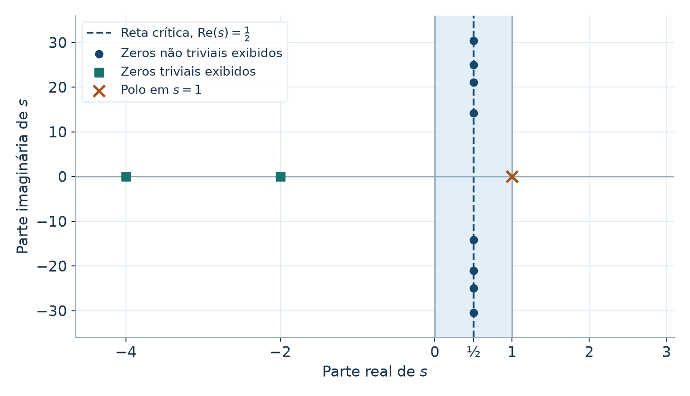
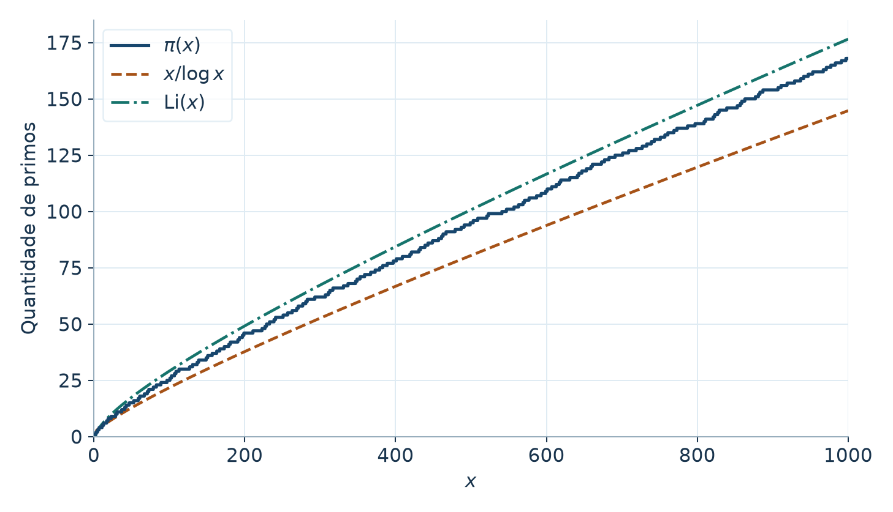

· [← Guia de Leitura de Matemática](guia-matematica.qmd) · [← Seção de Matemática](index.qmd)

---

Em 20 de novembro de 2026, Levent Alpöge anunciou que acredita ter encontrado, trabalhando com Claude, uma prova da hipótese de Riemann e de sua generalização para as funções $L$ de Dirichlet. Divulgou uma nota sobre a pesquisa e disponibilizou o argumento em Lean, um assistente de provas. A *Quanta Magazine* estimou que o material reúne cerca de 17 milhões de linhas de código. [Nota de Alpöge](https://alpo.ge/remark.pdf) · [Reportagem de Konstantin Kakaes](https://www.quantamagazine.org/updates/transformation/)

::: {.callout-note title="Estado da verificação em 20 de novembro de 2026"}
O projeto independente consultado confirmou que sua cópia correspondia ao material publicado e compilou os enunciados de referência com a biblioteca Mathlib. No registro consultado, a etapa de conferir as demonstrações submetidas, comparar os enunciados e auditar seus axiomas ainda estava em andamento. O Instituto Clay ainda listava a hipótese clássica como problema em aberto. [Registro técnico](https://github.com/SINF-KEN/rh-lean-check) · [Instituto Clay](https://www.claymath.org/millennium/riemann-hypothesis/)
:::

# 👤 Quem é Levent Alpöge?

Levent Alpöge é um matemático da Anthropic. Fez o doutorado em Princeton, com uma tese sobre pontos em curvas, e pesquisou a distribuição de pontos inteiros em curvas elípticas. São problemas de teoria dos números que perguntam, por exemplo, quais soluções inteiras podem ocorrer em equações polinomiais. No anúncio, Alpöge conta que orientou a pesquisa a partir de um problema análogo mais simples e atribui a Claude a sugestão de etapas importantes do argumento. [Página acadêmica de Alpöge](https://alpo.ge/) · [Tese de doutorado](https://alpo.ge/papers/my%20thesis.pdf) · [Relato da colaboração](https://alpo.ge/remark.pdf)

# 🤖 O que é Claude?

Claude é o nome do assistente de IA e da família de modelos de linguagem da Anthropic. Lançado publicamente em 2023, o assistente pode analisar textos e escrever código. Em pesquisa matemática, um modelo desse tipo pode sugerir resultados intermediários, propor abordagens e ajudar a traduzir um argumento em código formal. Cada proposta exige checagem. Neste caso, Claude participou do desenvolvimento do argumento, e o Lean é a ferramenta usada para conferir a prova formal. [Apresentação de Claude pela Anthropic](https://www.anthropic.com/news/introducing-claude)

# 🕰️ Um breve histórico

Em **1859**, Bernhard Riemann publicou um trabalho sobre quantos primos existem abaixo de um dado número. Ele estudou a função zeta para argumentos complexos e mostrou como seus zeros entram nas fórmulas de contagem. Em **1896**, Jacques Hadamard e Charles de la Vallée Poussin provaram, de maneira independente, o teorema dos números primos. Em **1914**, G. H. Hardy provou que há infinitos zeros na linha crítica. A hipótese exige que **todos** os zeros não triviais estejam nessa linha. Em **2000**, o Instituto Clay a incluiu entre os Problemas do Milênio. [Manuscrito de 1859](https://www.claymath.org/collections/riemanns-1859-manuscript/) · [Histórico do Instituto Clay](https://www.claymath.org/library/annual_report/ar2004/04report_riemann.pdf) · [Hardy e Littlewood, histórico do resultado de 1914](https://personal.math.ubc.ca/~gerg/teaching/592-Fall2018/papers/1916.Hardy.pdf) · [Hardy no Blog](beleza-matematica.qmd)

{fig-alt="Linha do tempo com cinco marcos em ordem: artigo de Riemann em 1859, teorema dos números primos em 1896, resultado de Hardy em 1914, seleção pelo Instituto Clay em 2000 e anúncio de Alpöge em 2026."}

# 📐 A hipótese de Riemann e as funções $L$ de Dirichlet

## A função zeta

Imagine que queremos reunir todos os inteiros positivos em uma soma. Para que a soma possa ter um valor finito, atribuímos um peso cada vez menor aos inteiros maiores. Se usamos o inverso do quadrado, as primeiras parcelas são $1$, $1/4$, $1/9$ e $1/16$. Essa soma é o valor da **função zeta** no ponto $s=2$. O expoente $s$ pode variar e pode até ser um número complexo.

Há outro jeito de montar a mesma soma. Separe as potências de cada primo. O fator do primo $2$ fornece os pesos de $1,2,4,8,\ldots$, e o fator de $3$ fornece os pesos de $1,3,9,27,\ldots$. Ao multiplicar os fatores, podemos escolher $1/2^2$ do primeiro e $1/3^2$ do segundo. O produto é $1/6^2$, exatamente o peso de $6$ na soma. Como cada inteiro tem uma única fatoração em primos, cada peso aparece uma única vez.

Para $\operatorname{Re}(s)>1$, a série converge absolutamente e essa correspondência fica escrita assim:

$$
\zeta(s)=\sum_{n=1}^{\infty}\frac{1}{n^s}
       =\prod_{p\text{ primo}}\frac{1}{1-p^{-s}}.
$$

Essa igualdade explica por que uma função definida por uma soma de inteiros pode revelar informações sobre os primos. Para estudar seus zeros, é preciso ampliar o domínio. O **prolongamento analítico** preserva os valores da zeta onde a série converge e estende a função ao restante do plano complexo, com um polo simples em $s=1$. [NIST, definição e produto de Euler](https://dlmf.nist.gov/25.2)

### Como ler a faixa crítica

Pense em cada entrada $s$ como um ponto no mapa da figura. A coordenada horizontal é a parte real, e a vertical é a parte imaginária. Um **zero** é uma entrada em que a função devolve zero. Alguns zeros são os inteiros negativos pares, marcados por quadrados verdes. Os demais são os **zeros não triviais**. Sabe-se que eles ficam dentro da faixa azul, entre as verticais de coordenadas $0$ e $1$.

{fig-alt="Plano complexo com faixa sombreada entre as partes reais zero e um. Quatro pares de zeros aparecem na reta real igual a um meio. Os zeros triviais visíveis são menos dois e menos quatro. O polo, em um, é marcado com uma cruz."}

O primeiro ponto azul acima do eixo real fica aproximadamente na altura $14{,}13$. O ponto conjugado fica na altura oposta, na mesma posição horizontal. A linha tracejada passa pelo meio da faixa e contém os oito pontos azuis mostrados. A hipótese é que essa linha também contém todos os demais zeros não triviais. [NIST, zeros da zeta](https://dlmf.nist.gov/25.10)

::: {.callout-important title="Enunciado da hipótese de Riemann"}
Se $\rho$ é um zero não trivial da zeta, então

$$
\operatorname{Re}(\rho)=\frac12.
$$
:::

## Da zeta às funções $L$

Suponha que queremos comparar dois grupos de primos ímpares. Ao dividir por $4$, os primos $5$ e $13$ deixam resto $1$, enquanto $3$, $7$ e $11$ deixam resto $3$. Como fazer uma versão da zeta que guarde essa diferença? Podemos trocar os pesos da soma. Damos sinal positivo aos números com resto $1$, sinal negativo aos que deixam resto $3$ e peso zero aos pares.

| Resto de $n$ na divisão por $4$ | Exemplos | Peso $\chi(n)$ |
|:--:|:--|:--:|
| $1$ | $1,5,9,13$ | $+1$ |
| $3$ | $3,7,11,15$ | $-1$ |
| $0$ ou $2$ | $2,4,6,8$ | $0$ |

O padrão se repete a cada quatro números e respeita a multiplicação. Por exemplo, $3$ e $7$ têm peso $-1$, e seu produto $21$ tem peso $+1$. Chamamos esse sistema de pesos de **caráter de Dirichlet** de módulo $4$. De modo geral, um caráter de módulo $q$ é periódico de período $q$, satisfaz $\chi(ab)=\chi(a)\chi(b)$ e vale zero quando $n$ e $q$ têm um divisor comum maior que $1$.

Aplicando os pesos da tabela à série da zeta, obtemos $1-3^{-s}+5^{-s}-7^{-s}+\cdots$. Cada inteiro continua contribuindo com seu peso, mas agora com o sinal da classe a que pertence. Para $\operatorname{Re}(s)>1$, a fórmula geral da **função $L$ de Dirichlet** é

$$
L(s,\chi)=\sum_{n=1}^{\infty}\frac{\chi(n)}{n^s}
        =\prod_{p\text{ primo}}\frac{1}{1-\chi(p)p^{-s}}.
$$

O produto também registra o peso de cada primo. Comparar o caráter da tabela com o que dá $+1$ a todos os ímpares permite distinguir as duas classes. A zeta é o caso em que todos os pesos são $1$, correspondente ao módulo $1$. [NIST, funções $L$ de Dirichlet](https://dlmf.nist.gov/25.15)

::: {.callout-important title="Enunciado da hipótese de Riemann generalizada"}
Para todo caráter de Dirichlet $\chi$, cada zero de $L(s,\chi)$ na faixa $0<\operatorname{Re}(s)<1$ tem parte real $\tfrac12$. A reta é a mesma da figura, agora para uma família de funções. [Enunciados formais em análise](https://github.com/SINF-KEN/rh-lean-check#the-statements)
:::

# 🔢 Como os zeros aparecem na contagem dos primos?

## A contagem em degraus

Até $10$ há quatro primos, $2,3,5,7$. Ao passar de $10$ para $11$, encontramos mais um primo e a contagem sobe para cinco. De $11$ para $12$ ela permanece em cinco. É por isso que o gráfico de $\pi(x)$, a quantidade de primos menores ou iguais a $x$, tem degraus.

{fig-alt="Gráfico com três curvas crescentes até x igual a mil. A contagem exata dos primos forma degraus azuis. A integral logarítmica acompanha a contagem de perto. A curva x dividido pelo logaritmo de x termina abaixo das outras."}

A curva laranja representa uma estimativa global. Perto de um número grande $t$, a densidade média de primos é aproximadamente $1/\log t$. Se usamos a densidade do extremo $x$ para estimar a contagem até ele, obtemos $x/\log x$. O **teorema dos números primos** diz que o erro relativo dessa aproximação tende a zero:

$$
\frac{\pi(x)}{x/\log x}\longrightarrow 1
\qquad (x\to\infty).
$$

A curva verde acrescenta uma ideia. A densidade estimada varia ao longo do caminho, então somamos as estimativas locais desde $2$ até $x$. Ao transformar essa soma em uma integral, obtemos a **integral logarítmica** usada na figura:

$$
\operatorname{Li}(x)=\int_2^x\frac{dt}{\log t}.
$$

Em $x=1000$, há $168$ primos. A estimativa laranja dá cerca de $145$, e a verde fica em torno de $177$. A pergunta que nos leva aos zeros da zeta é como explicar e limitar o desvio entre uma contagem exata e sua tendência. [NIST, distribuição dos primos](https://dlmf.nist.gov/25.16#i)

## As oscilações na fórmula explícita

Para enxergar a ligação, usamos uma contagem que combina com o produto de Euler. Em vez de somar $1$ só quando passamos por um primo, somamos $\log p$ quando passamos por qualquer potência de um primo $p$. Até $10$, por exemplo, o primo $2$ contribui três vezes, em $2,4,8$, e o primo $3$ contribui duas vezes, em $3,9$. Os primos $5$ e $7$ contribuem uma vez cada. Essa é a **função de Chebyshev**:

$$
\psi(x)=\sum_{\substack{p^k\le x\\k\ge1}}\log p.
$$

A tendência de $\psi(x)$ é a reta $x$. Entre duas potências de primos, a contagem fica parada enquanto $x$ cresce. Por isso o desvio $\psi(x)-x$ desce entre os saltos. Na figura, a linha azul registra esse desvio e a laranja tenta reconstruí-lo com os primeiros 20 pares de zeros da zeta.

{fig-alt="A linha azul irregular mostra psi de x menos x. A linha laranja mostra a aproximação obtida com os primeiros vinte pares de zeros e os termos restantes da fórmula. Ela acompanha parte das oscilações, sem reproduzir todos os saltos."}

Por que aparecem ondas? Cada zero $\rho=\beta+i\gamma$ fornece uma contribuição. A parte imaginária $\gamma$ determina a frequência da oscilação na escala $\log x$. A parte real $\beta$ determina quanto a contribuição pode crescer. Na fórmula, isso aparece porque $x^\rho=x^\beta e^{i\gamma\log x}$. Ao somar a contribuição de um zero e a do seu conjugado, obtemos uma oscilação real.

A **fórmula explícita de Riemann–von Mangoldt** junta a tendência, as contribuições de todos os zeros e dois termos de correção. Para $x>1$ fora dos pontos de salto, ela dá

$$
\psi(x)=x-\sum_{\rho}\frac{x^\rho}{\rho}
        -\log(2\pi)-\tfrac12\log(1-x^{-2}).
$$

A soma inclui os zeros não triviais em ordem simétrica de altura. Se todos estiverem sobre a reta crítica, o fator $x^\beta$ de cada contribuição será $\sqrt{x}$. A posição dos zeros ajuda, assim, a controlar os desvios na contagem dos primos. [NIST, relação entre zeros e contagem](https://dlmf.nist.gov/25.16.E2) · [Dudek, estimativas explícitas para primos](https://arxiv.org/abs/1611.07251)

# 🛠️ O que é Lean?

**Lean** é uma linguagem de programação e um assistente de provas. Nele, escrevemos o enunciado e fornecemos uma demonstração. Comandos podem procurar passos automaticamente, e o núcleo confere se o objeto de prova obedece às regras lógicas do sistema. A comunidade mantém a **Mathlib**, uma biblioteca para reutilizar definições e resultados já formalizados. [Projeto Lean](https://lean-lang.org/) · [Mathlib](https://github.com/leanprover-community/mathlib4)

A linha abaixo afirma que somar zero a um número natural preserva esse número e invoca um resultado da biblioteca para demonstrá-lo.

~~~lean
example (n : Nat) : n + 0 = n := Nat.add_zero n
~~~

Na alegação sobre Riemann, a checagem envolve determinar se o enunciado formal corresponde às conjecturas anunciadas, quais axiomas o argumento usa e se ele é aceito pelo verificador. Uma exposição matemática pode explicar por que as construções usadas funcionam e onde poderão ser aplicadas de novo. [Registro da verificação independente](https://github.com/SINF-KEN/rh-lean-check)

# 🎯 O que mudaria se a prova fosse confirmada?

- **Contagem de primos com margem de erro demonstrada.** A hipótese clássica implica $\pi(x)=\operatorname{Li}(x)+O(\sqrt{x}\log x)$. Para $x$ suficientemente grande, o erro fica limitado por uma constante vezes $\sqrt{x}\log x$. [Büthe, estimativas para $\pi(x)$](https://arxiv.org/abs/1410.7015)
- **Garantias em intervalos mais curtos.** Sob a hipótese clássica, pode-se garantir um primo entre $x$ e $x+C\sqrt{x}\log x$ para uma constante adequada e $x$ suficientemente grande. [Dudek, estimativas explícitas](https://arxiv.org/abs/1611.07251)
- **Estimativas por classe de resíduos.** A versão generalizada controla melhor a quantidade de primos em progressões aritméticas. A longo prazo, cada uma das classes $4k+1$ e $4k+3$ fica com cerca de metade dos primos ímpares. A generalização quantifica os desvios nessa divisão. [NIST, primos em progressões aritméticas](https://dlmf.nist.gov/25.15#ii)

- **Testes computacionais de primalidade.** Em 1976, Gary Miller mostrou que, sob uma hipótese sobre funções $L$ de Dirichlet, seu teste determinístico decide se um inteiro é primo em tempo polinomial no número de dígitos. A confirmação da versão generalizada daria a garantia incondicional desse teste. [Artigo de Gary Miller](https://www.cs.cmu.edu/~glmiller/Publications/Papers/Mi76.pdf)

As consequências hoje demonstradas sob essas hipóteses passariam a valer incondicionalmente. O alcance do método dependeria também de quais ideias da prova pudessem ser reaproveitadas para outras funções $L$ e outros problemas de teoria dos números.

## Introdução ao RSA {#riemann-e-rsa}

Imagine que Beatriz quer receber uma mensagem confidencial de André. Com o RSA, ela pode divulgar uma **chave pública** e guardar uma **chave privada**. André usa a chave pública de Beatriz para cifrar a mensagem. Beatriz usa a chave privada correspondente para lê-la. O RSA também serve para assinaturas digitais. Nesse caso, Beatriz assina com a chave privada e qualquer pessoa com a chave pública pode verificar a assinatura.

O nome **RSA** vem dos sobrenomes de seus autores, Ronald Rivest, Adi Shamir e Leonard Adleman. Para gerar o par de chaves, escolhem-se normalmente dois primos grandes, $p$ e $q$. O produto $N=pq$, chamado **módulo**, faz parte da chave pública. Quando já conhecemos os primos, calcular o produto é rápido mesmo com números muito grandes. Recuperar os primos a partir do produto pode ser difícil. Quem consegue fatorar $N$ pode calcular a chave privada correspondente. [Artigo original do RSA](https://people.csail.mit.edu/rivest/Rsapaper.pdf)

Um exemplo pequeno ajuda a distinguir as operações. Um teste de primalidade responde se $91$ é primo ou composto. A fatoração dá uma informação a mais, $91=7\cdot13$. Na geração de chaves, usamos testes de primalidade para escolher os fatores. Quando o módulo já é público, descobrir aqueles fatores é um problema diferente.

A relação com Riemann é indireta. A versão generalizada daria uma garantia matemática ao teste de primalidade de Miller, mencionado acima. A quebra de uma chave RSA por fatoração exigiria um método eficiente para encontrar os fatores de um módulo específico. Até onde se sabe, demonstrar a hipótese clássica ou a generalizada, por si só, não fornece esse método. [Artigo de Gary Miller](https://www.cs.cmu.edu/~glmiller/Publications/Papers/Mi76.pdf)

# 🏆 O Instituto Clay e o prêmio de US$ 1 milhão {#premio-do-instituto-clay}

O **Clay Mathematics Institute** (CMI) foi fundado em 1998 por Landon e Lavinia Clay para apoiar a pesquisa matemática. Em maio de 2000, o instituto anunciou no Collège de France, em Paris, os **sete Problemas do Milênio**. Reservou **US$ 7 milhões** para o programa, com **US$ 1 milhão por problema**. [História do Instituto Clay](https://www.claymath.org/about/the-clay-mathematics-institute-overview-and-history/) · [Problemas do Milênio](https://www.claymath.org/millennium-problems/)

A escolha de Paris foi uma homenagem a **David Hilbert**. No Congresso Internacional de Matemáticos de 1900, Hilbert fez uma palestra cujo texto publicado reuniu **23 problemas** para orientar pesquisas nas décadas seguintes. Um século depois, o Instituto Clay retomou a ideia de apresentar à comunidade uma seleção de grandes questões em aberto. A **hipótese de Riemann** liga as duas iniciativas. Ela fazia parte do **oitavo problema de Hilbert**, dedicado à distribuição dos números primos, e entrou na lista do Clay como um problema próprio. [Texto da palestra de Hilbert](https://mathcs.clarku.edu/~djoyce/hilbert/problems.html) · [Registro do evento de 2000](https://www.claymath.org/lectures/the-millennium-prize-problems-i/)

Para que o Instituto Clay considere uma proposta, a solução precisa responder integralmente ao enunciado oficial e cumprir três condições:

1. Ser publicada em um veículo que satisfaça os critérios do instituto.
2. Ter pelo menos dois anos decorridos desde essa publicação.
3. Alcançar aceitação geral na comunidade matemática internacional.

Essas condições permitem ao instituto avaliar a solução para o prêmio. No caso de Alpöge, o anúncio e a checagem do código Lean fazem parte de uma etapa anterior. O prazo de dois anos é contado a partir de uma publicação que cumpra as regras. [Regulamento oficial do prêmio](https://www.claymath.org/millennium-problems/rules/)

## Quantos problemas foram resolvidos? {#problemas-resolvidos-e-perelman}

Em **20 de novembro de 2026**, apenas **um dos sete** constava como resolvido na lista oficial do Instituto Clay, a **Conjectura de Poincaré**. O Clay classificava cinco como não resolvidos, entre eles a hipótese de Riemann. O sétimo, sobre as equações de **Navier–Stokes**, aparecia como ativo. Em setembro de 2026, o Instituto se pronunciou sobre o anúncio de uma aparente solução e indicou que a avaliação seguiria o processo previsto nas regras do prêmio. [Lista oficial dos Problemas do Milênio](https://www.claymath.org/millennium-problems/) · [Comunicado sobre Navier–Stokes](https://www.claymath.org/news/navier-stokes-announcement/)

**Grigori Perelman** é um matemático russo nascido em 1966, na então União Soviética. Doutorou-se na Universidade Estatal de São Petersburgo, pesquisou no Instituto de Matemática Steklov e passou parte dos anos 1990 na Universidade da Califórnia em Berkeley. Em três preprints de **2002 e 2003**, desenvolveu o programa do *fluxo de Ricci* iniciado por Richard Hamilton. O fluxo de Ricci deforma a geometria de um espaço de acordo com sua curvatura. Perelman mostrou como lidar com as singularidades que surgem nesse processo. Com isso, provou a conjectura de geometrização de Thurston, que inclui a Conjectura de Poincaré. [Perfil biográfico da União Matemática Internacional](https://www.mathunion.org/fileadmin/IMU/Prizes/Fields/2006/PerelmanENG.pdf) · [A solução de Poincaré no Instituto Clay](https://www.claymath.org/millennium/poincare-conjecture/)

Perelman recusou a **Medalha Fields**, concedida pela União Matemática Internacional em **2006** por suas contribuições à geometria e ao estudo do fluxo de Ricci. Em **2010**, recusou também o **prêmio de US$ 1 milhão** que o Instituto Clay lhe atribuiu pela solução da Conjectura de Poincaré. [Registro da Medalha Fields de 2006](https://www.mathunion.org/imu-awards/fields-medal/fields-medals-2006) · [Registro da recusa do prêmio do Clay](https://www.claymath.org/news/poincare-chair-2/)

::: {.rodape}

# 📚 Bibliografia e leitura adicional

- [Bernhard Riemann — manuscrito de 1859](https://www.claymath.org/collections/riemanns-1859-manuscript/). Fac-símile e materiais de leitura do Instituto Clay.
- [NIST — Zeta and Related Functions](https://dlmf.nist.gov/25). Referência para definições, zeros e aplicações.
- [Levent Alpöge — nota do anúncio](https://alpo.ge/remark.pdf). Relato original da colaboração com Claude.
- [Konstantin Kakaes — Transformation](https://www.quantamagazine.org/updates/transformation/). Cobertura da *Quanta Magazine*.

:::

---

· [← Guia de Leitura de Matemática](guia-matematica.qmd) · [← Seção de Matemática](index.qmd) · 🔝 [Topo](#top)
